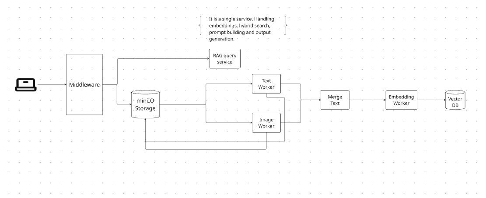
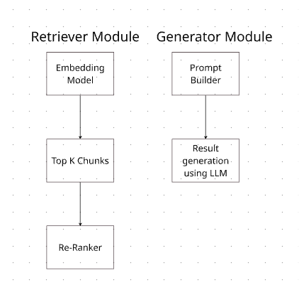

## Functional Requirements

* **Multi-Format Support:** Handle various document formats (e.g., `.docx`, `.pdf`, `.txt`, `.md`).
* **Large File Scalability:** Support file sizes up to 1 GB, with an architecture designed to scale further.
* **Rich Content Extraction:** Extract and process plain text, embedded images, diagrams, and scanned documents.
* **Citation & Referencing:** Provide accurate document citations and source references in model outputs.
* **Batch Processing:** Allow users to upload multiple documents simultaneously.
* **Document Versioning:** Maintain document versions, automatically prioritizing the latest version over older ones during retrieval.
* **User Feedback:** Provide users with real-time status updates and clear progress logs during document processing.
* **Service Observability:** Ensure each service and container generates structured, human-readable logs.
* **Atomic Upload Cancellation:** Allow users to safely cancel ongoing uploads without breaking the system or persisting partial/orphaned vectors.
* **Data Erasure (Right to be Forgotten):** Enable users to permanently delete documents and their associated vector embeddings from system memory.

---

## Non-Functional Requirements

* **Availability:** Maintain a minimum of 99% system availability target.
* **Upload Latency:** File upload latency under 30 seconds.
* **Processing Latency:** Embedding generation and vector storage latency under 30 seconds.
* **Query Latency:** End-to-end query response time under 10 seconds.
* **Concurrency:** Architected to handle high-throughput and concurrent requests efficiently.

---

## Tech Stack

* **Frontend:** Next.js
* **Backend & Microservices:** Python FastAPI
* **Object Storage:** MinIO
* **Vector Database:** ChromaDB
* **Middleware:** Node.js

---

## System Architecture

## Retreiver and Generation Architecture

## Code of Conduct & Development Guidelines

1. **Design Principles:** Adhere strictly to **SOLID** software design principles.
2. **Comprehensive Documentation:** Include top-level file overviews and docstrings for every function.
3. **Selective Inline Comments:** Avoid unnecessary inline comments; reserve them exclusively for complex or non-obvious logic.
4. **Clarity over Verbosity:** Write clear, concise documentation—avoid dense or overly complex paragraphs.
5. **Dependency Tracking:** When adding external libraries, link to their official documentation within the relevant function docstrings.
6. **Structured Event Logging:** Log critical lifecycle events across all services using standardized formats (e.g., `Upload successful | START_TIMESTAMP : END_TIMESTAMP`).
7. **Version Management:** Explicitly pin and document library versions in project configuration files (e.g., `requirements.txt`, `package.json`).

## Phases 

### File Uploading. 
1. POST /upload — single file, streamed to MinIO, basic validation (file present, non-empty).
2. Structured log line on success/failure (Upload successful | START:END).
3. DoD: Valid doc uploads and returns filename; storage errors return clean 4xx/5xx with logged context.

### Multiple File Uploading 
1. POST /upload — Allow user to upload mutiple files with different versions at once. 
2. DoD: Valid doc uplaods and returns all filenames; storage errors return clean logs context. 

### Text Worker 
1. Fetch metadata — Query Postgres for the object key, page count, MIME type.
2. Stream from MinIO, page by page — avoids loading the full file into memory near the 1GB limit.
3. Extract text per page, tagging each block with page_number / section for citations.
4. Chunk the text (e.g. chunk_size=512 tokens, overlap=50, tokenizer-aware).
5. Persist intermediate output back to MinIO — e.g. processed/{document_id}/{version_id}/text_chunks.json — so the merge step (and any manual reprocessing later) doesn't need to re-parse the source file.
6. Return chunk references (not the full payload) — the chord callback fetches from MinIO/Postgres rather than passing large blobs through Redis, which keeps the result backend lightweight.

### Image worker 
1. Fetch metadata, same as text worker.
2. Stream and extract images/diagrams page by page (or full-page rasterizations for scanned pages).
3. Vision model call per image — wrap each call in its own retry/backoff so one flaky API call doesn't fail the whole page batch.
4. Tag output with page_number/section, same citation contract as the text worker.
5. Chunk the vision output using the same shared chunking utility the text worker uses — one function, imported by both, so chunk size/overlap never drifts between pipelines.
6. Persist intermediate output back to MinIO — processed/{document_id}/{version_id}/image_chunks.json.
Return chunk references, same as the text worker.

