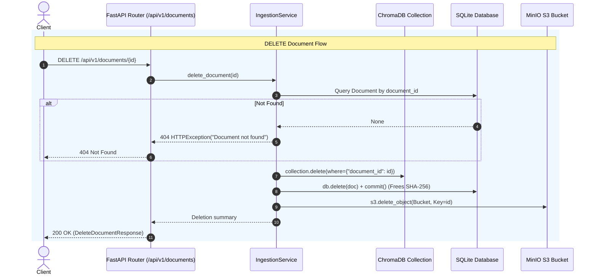

# Document Lifecycle CRUD Architecture & Implementation Plan
*(Aligned with Contextual AI Datastores & Documents API Design)*

## 1. Executive Summary & Design Philosophy

In the Honeywell Virtual Assistant, documents are ingested into a tri-store topology:
* **MinIO**: Persists original document binaries (keyed by `document_id`).
* **SQLite**: Persists relational metadata, timestamps, and `sha256` deduplication hashes.
* **ChromaDB**: Persists text chunks and vector embeddings tagged with `document_id` and metadata.

Following industry standards established by enterprise RAG platforms like **Contextual AI** (specifically their Datastores & Documents API), document management provides rich listing, search filters, chunk transparency, and metadata updates while enforcing strict multi-store consistency.

This document details the single, complete architecture and implementation roadmap for **Document Lifecycle CRUD** under `/api/v1/documents`.

---

## 2. Contextual AI Comparison & Adaptation

| Design Dimension | Contextual AI Pattern | Honeywell Adaptation | Rationale |
| :--- | :--- | :--- | :--- |
| **Resource Hierarchy** | `/datastores/{id}/documents` | `/api/v1/documents` | Honeywell operates on a shared vector store collection where documents are segmented by `product_id`. Rather than requiring a datastore UUID path segment, `product_id` is used as a first-class filter. |
| **Listing Response** | `GetDocumentsResponse` (`total_count`, `documents: [...]`) | `GetDocumentsResponse` (`total_count`, `limit`, `skip`, `documents: [...]`) | Adopts Contextual AI's clear envelope structure and naming (`total_count`, `documents`). |
| **Document Schema** | `DocumentDescription` (`id`, `name`, `status`, `created_at`, `custom_metadata`) | `DocumentDescription` (`document_id`, `filename`, `product_id`, `size_bytes`, `total_chunks`, `status`, `created_at`) | Matches Contextual AI's core entity attributes while incorporating Honeywell's `total_chunks` and storage size. |
| **Search & Filtering** | `document_name_search`, `uploaded_after`, `uploaded_before`, `ingestion_job_status` | `name_search`, `product_id`, `uploaded_after`, `uploaded_before`, `status` | Adopts Contextual AI's case-insensitive name search and ISO date-bound query filters. |
| **Chunk / Content Inspection** | `GET /documents/{id}/parse-results` & chunk edits | `GET /documents/{document_id}/chunks` | Allows inspecting parsed chunks, page markers, and vector IDs directly from ChromaDB for full RAG transparency. |
| **Metadata Update** | `POST /documents/{id}/metadata` | `PATCH /documents/{document_id}` | Idiomatic RESTful `PATCH` updating metadata (`product_id`) across SQLite and Chroma chunk metadatas simultaneously. |
| **Deletion** | `DELETE /documents/{id}` | `DELETE /documents/{document_id}` | Full cascading removal (Chroma vectors first, SQLite row second, MinIO binary third). |

---

## 3. REST API Surface (`/api/v1/documents`)

### 1. `POST /api/v1/documents` *(Existing Ingestion)*
* **Action**: Multi-part file upload with `product_id`.
* **Behavior**: Computes SHA-256 fingerprint, checks duplicates, uploads raw file to MinIO, parses text, chunks, embeds into ChromaDB, and records metadata in SQLite.

---

### 2. `GET /api/v1/documents` *(List Documents)*
* **Summary**: Retrieve a paginated list of documents with optional filtering and live chunk counts.
* **Query Parameters** (Contextual AI-aligned):
  * `product_id: Optional[str] = None` — Filter by product identifier.
  * `name_search: Optional[str] = None` — Case-insensitive substring search on filename (e.g. `"manual"` matches `"89470J6_manual.pdf"`).
  * `status: Optional[str] = None` — Filter by status (`"indexed"`).
  * `uploaded_after: Optional[datetime] = None` — Filter documents uploaded at or after timestamp (ISO 8601).
  * `uploaded_before: Optional[datetime] = None` — Filter documents uploaded at or before timestamp (ISO 8601).
  * `limit: int = 50` — Number of documents to return (min 1, max 1000).
  * `skip: int = 0` — Number of documents to skip for pagination.
* **Response Model (`GetDocumentsResponse`)**:
  ```json
  {
    "total_count": 12,
    "limit": 50,
    "skip": 0,
    "documents": [
      {
        "document_id": "9b1deb4d-3b7d-4bad-9bdd-2b0d7b3dcb6d",
        "filename": "89470J6.GB0.pdf",
        "product_id": "89470J6",
        "size_bytes": 245921,
        "sha256": "e3b0c44298fc1c149afbf4c8996fb92427ae41e4649b934ca495991b7852b855",
        "total_chunks": 42,
        "status": "indexed",
        "created_at": "2026-10-18T10:00:00Z"
      }
    ]
  }
  ```

---

### 3. `GET /api/v1/documents/{document_id}` *(Get Document Details)*
* **Summary**: Get detailed metadata for a single document.
* **Path Parameter**: `document_id: str`
* **Response Model (`DocumentDescription`)**: Returns the single document object. Returns `404 Not Found` if missing.

---

### 4. `GET /api/v1/documents/{document_id}/chunks` *(Get Document Chunks)*
* **Summary**: Inspect text chunks and chunk metadata directly from ChromaDB for a given document.
* **Path Parameter**: `document_id: str`
* **Query Parameters**:
  * `limit: int = 50` (min 1, max 500)
  * `offset: int = 0`
* **Response Model (`GetDocumentChunksResponse`)**:
  ```json
  {
    "document_id": "9b1deb4d-3b7d-4bad-9bdd-2b0d7b3dcb6d",
    "filename": "89470J6.GB0.pdf",
    "total_chunks": 42,
    "chunks": [
      {
        "chunk_id": "9b1deb4d-3b7d-4bad-9bdd-2b0d7b3dcb6d_c0",
        "chunk_index": 0,
        "page": 1,
        "text": "Honeywell Virtual Assistant Overview...",
        "metadata": {
          "document_id": "9b1deb4d-3b7d-4bad-9bdd-2b0d7b3dcb6d",
          "filename": "89470J6.GB0.pdf",
          "page": 1,
          "chunk_index": 0,
          "product_id": "89470J6"
        }
      }
    ]
  }
  ```

---

### 5. `PATCH /api/v1/documents/{document_id}` *(Update Document Metadata)*
* **Summary**: Update document metadata attributes.
* **Path Parameter**: `document_id: str`
* **Request Body (`UpdateDocumentRequest`)**:
  ```json
  {
    "product_id": "new-product-group"
  }
  ```
* **Behavior**: Atomically updates the record in SQLite and propagates the metadata changes to all associated chunks in ChromaDB.
* **Response Model (`DocumentDescription`)**: Returns the updated document.

---

### 6. `DELETE /api/v1/documents/{document_id}` *(Delete Document)*
* **Summary**: Irreversibly delete a document and cascade deletion across all three stores.
* **Path Parameter**: `document_id: str`
* **Response Model (`DeleteDocumentResponse`)**:
  ```json
  {
    "document_id": "9b1deb4d-3b7d-4bad-9bdd-2b0d7b3dcb6d",
    "status": "deleted",
    "deleted_chunks": 42,
    "database_removed": true,
    "storage_removed": true
  }
  ```

---

## 4. Multi-Store Synchronization & Cascade Execution



---

## 5. Architectural Implementation Plan

### Layer 1: Core Primitives (`core/`)
* Kept **100% untouched** as pure infrastructure drivers (RAG search, vector storage, and MinIO S3 object transport).

### Layer 2: Pydantic Schemas (`schemas/ingestion.py` & `schemas/document.py`)
* Fully decoupled schemas without cross-domain dependencies:
  * `schemas/ingestion.py`:
    * `DocumentIngestItem`: Ingestion status (`document_id`, `filename`, `status`, `message`, `chunks_indexed`, `size_bytes`).
    * `DocumentIngestResponse`: Ingestion batch response summary.
  * `schemas/document.py`:
    * `DocumentDescription`: Core document model (`document_id`, `filename`, `product_id`, `size_bytes`, `sha256`, `total_chunks`, `status`, `created_at`).
    * `GetDocumentsResponse`: List container (`total_count`, `limit`, `skip`, `documents`).
    * `ChunkDescription`: Chunk model (`chunk_id`, `chunk_index`, `page`, `text`, `metadata`).
    * `GetDocumentChunksResponse`: Chunks container (`document_id`, `filename`, `total_chunks`, `chunks`).
    * `UpdateDocumentRequest`: Update payload (`product_id`).
    * `DeleteDocumentResponse`: Deletion report (`document_id`, `status`, `deleted_chunks`, `database_removed`, `storage_removed`).
  *(Note: All temporary backward-compatibility re-exports in `schemas/document.py` will be completely eliminated in CRUD v2.0 once endpoint and service callers are migrated to direct imports).*

### Layer 3: Service Layer (`services/document_service.py`)
* Dedicated domain orchestrator `DocumentService` managing SQLite, ChromaDB, and MinIO:
  * `list_documents(product_id, name_search, status, uploaded_after, uploaded_before, limit, skip) -> GetDocumentsResponse`: Queries SQLite with filters and retrieves live Chroma chunk counts.
  * `get_document(document_id: str) -> DocumentDescription`: Validates existence and returns document metadata.
  * `get_document_chunks(document_id: str, limit: int, offset: int) -> GetDocumentChunksResponse`: Inspects chunks from Chroma.
  * `update_document_metadata(document_id: str, product_id: str) -> DocumentDescription`: Synchronizes SQLite and Chroma chunk metadata.
  * `delete_document(document_id: str) -> DeleteDocumentResponse`: Executes cascade deletion (Chroma -> SQLite -> MinIO).

### Layer 4: API Router (`api/v1/endpoints/documents.py`)
* Wire `GET /`, `GET /{document_id}`, `GET /{document_id}/chunks`, `PATCH /{document_id}`, `DELETE /{document_id}`.

---

## 6. Phased Implementation Roadmap

```text
Phase 1: Core Primitives (core/retriever.py & core/uploader.py)
  ├── Add get_by_document, count_by_document, delete_by_document to Retriever
  ├── Add delete_file to Uploader
  └── Unit tests for retriever & uploader primitives

Phase 2: Schemas & IngestionService Business Logic
  ├── Define Contextual AI-aligned schemas in schemas/document.py
  ├── Implement list_documents (filters: product_id, name_search, dates, pagination)
  ├── Implement get_document and get_document_chunks
  ├── Implement update_document (cross-store metadata sync)
  ├── Implement delete_document (strict cascade order)
  └── Service tests verifying SQLite + MinIO + Chroma sync & SHA-256 release

Phase 3: Router Endpoints Wiring
  ├── Add GET, DELETE, PATCH routes to api/v1/endpoints/documents.py
  └── Verify OpenAPI documentation at /docs

Phase 4: End-to-End Verification
  ├── Test full lifecycle: Ingest -> List with filters -> Inspect Chunks -> Update Metadata -> Delete
  ├── Test duplicate re-upload after deletion (ensure hash was properly freed)
  └── Test query isolation (ensure deleted documents are never cited)
```

