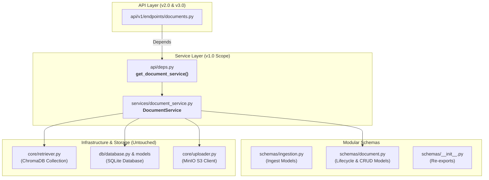
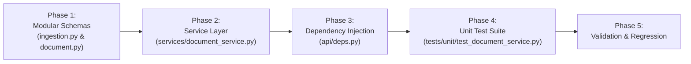

# Formal Implementation Plan: CRUD Version 1.0 - Document Service Layer & Modular Schemas

## 1. Executive Summary & Objective

The objective of **CRUD Version 1.0** is to establish the complete business logic and data contracts for Document Lifecycle Management inside a dedicated **Service Layer**, adhering strictly to **Separation of Concerns**:

1. **Zero Impact on `core/`**: [`core/retriever.py`](file:///c:/Users/ADMIN/OneDrive/Desktop/Honeywell%20Project/honeywell-project/core/retriever.py) and [`core/uploader.py`](file:///c:/Users/ADMIN/OneDrive/Desktop/Honeywell%20Project/honeywell-project/core/uploader.py) remain completely untouched as pure low-level RAG and storage drivers.
2. **Modular Schema Architecture**: Rather than mixing ingestion and lifecycle models in one file, schemas are cleanly decoupled into dedicated modules:
   * [`schemas/ingestion.py`](file:///c:/Users/ADMIN/OneDrive/Desktop/Honeywell%20Project/honeywell-project/schemas/ingestion.py): Ingestion & multipart upload contracts (`DocumentIngestItem`, `DocumentIngestResponse`).
   * [`schemas/document.py`](file:///c:/Users/ADMIN/OneDrive/Desktop/Honeywell%20Project/honeywell-project/schemas/document.py): Document lifecycle & CRUD contracts (`DocumentDescription`, `GetDocumentsResponse`, `ChunkDescription`, `GetDocumentChunksResponse`, `UpdateDocumentRequest`, `DeleteDocumentResponse`).
   * [`schemas/__init__.py`](file:///c:/Users/ADMIN/OneDrive/Desktop/Honeywell%20Project/honeywell-project/schemas/__init__.py): Centralized re-export for clean namespace resolution.
3. **Dedicated Domain Service**: Create [`services/document_service.py`](file:///c:/Users/ADMIN/OneDrive/Desktop/Honeywell%20Project/honeywell-project/services/document_service.py) containing all business logic for querying SQLite, ChromaDB, and MinIO.
4. **Dependency Injection**: Expose `get_document_service` in [`api/deps.py`](file:///c:/Users/ADMIN/OneDrive/Desktop/Honeywell%20Project/honeywell-project/api/deps.py) using FastAPI's `Depends()`.
5. **Isolated Unit Test Suite**: Build a comprehensive test suite in [`tests/unit/test_document_service.py`](file:///c:/Users/ADMIN/OneDrive/Desktop/Honeywell%20Project/honeywell-project/tests/unit/test_document_service.py) with in-memory SQLite and mock/ephemeral storage backends.

---

## 2. Architectural Principles & Layer Boundaries



### Key Invariants Enforced by `DocumentService`:
- **Domain Independence**: "Document" is a higher-order concept that links raw file bytes (MinIO), metadata tracking (SQLite), and semantic vectors (ChromaDB). Low-level engines in `core/` know nothing about this orchestration.
- **Strict Cascade Deletion Sequence**:
  1. **Step 1: ChromaDB Vectors Purged**: Eliminates the document from RAG search results immediately.
  2. **Step 2: SQLite Row Deleted**: Removes the database record and liberates the `sha256` hash for future re-uploads.
  3. **Step 3: MinIO Object Purged**: Cleans up physical file storage in S3 bucket.
- **Bi-Directional Metadata Consistency**: When `update_document_metadata` is called, both the SQLite row and all matching Chroma chunk metadatas (`product_id`) are updated in unison.

---

## 3. Phased Implementation Roadmap



---

### Phase 1: Modular Schemas Layer (`schemas/`)

#### Objective:
Separate ingestion contracts from document lifecycle CRUD contracts into distinct, dedicated files without dividing comments or bloated models.

#### 1. `schemas/ingestion.py` [NEW]
Contains purely the ingestion and multi-part upload models:
```python
from pydantic import BaseModel, Field


class DocumentIngestItem(BaseModel):
    document_id: str = Field(..., description="Unique document identifier in object storage")
    product_id: str = Field(default="", description="Product identifier selected for this upload")
    filename: str = Field(..., description="Original filename")
    size_bytes: int = Field(..., description="File size in bytes")
    collection: str = Field(..., description="ChromaDB collection name")
    total_chunks: int = Field(..., description="Number of chunks generated and indexed")
    status: str = Field(default="indexed", description="Ingestion status: indexed or duplicate")


class DocumentIngestResponse(BaseModel):
    message: str
    count: int
    documents: list[DocumentIngestItem]
```

#### 2. `schemas/document.py` [UPDATE]
Contains the core Document Entity and Lifecycle CRUD models (Contextual AI-aligned):
```python
from datetime import datetime
from typing import Any
from pydantic import BaseModel, Field

# Re-export ingestion models for seamless backward compatibility
from .ingestion import DocumentIngestItem, DocumentIngestResponse


class DocumentDescription(BaseModel):
    document_id: str = Field(..., description="Unique document UUID")
    filename: str = Field(..., description="Original filename")
    product_id: str = Field(..., description="Product identifier tag")
    size_bytes: int = Field(..., description="File size in bytes")
    sha256: str = Field(..., description="SHA-256 fingerprint for deduplication")
    total_chunks: int = Field(..., description="Number of text chunks indexed in ChromaDB")
    status: str = Field(default="indexed", description="Indexing status")
    created_at: datetime = Field(..., description="Timestamp when document was ingested")


class GetDocumentsResponse(BaseModel):
    total_count: int = Field(..., description="Total documents matching query filters")
    limit: int = Field(..., description="Maximum items returned")
    skip: int = Field(..., description="Items skipped")
    documents: list[DocumentDescription] = Field(..., description="List of matching documents")


class ChunkDescription(BaseModel):
    chunk_id: str = Field(..., description="Unique chunk vector ID in ChromaDB")
    chunk_index: int = Field(..., description="Index of the chunk in document")
    page: int | str = Field(..., description="Page number of origin")
    text: str = Field(..., description="Extracted text chunk content")
    metadata: dict[str, Any] = Field(default_factory=dict, description="Full chunk metadata attributes")


class GetDocumentChunksResponse(BaseModel):
    document_id: str = Field(..., description="Unique document UUID")
    filename: str = Field(..., description="Original filename")
    total_chunks: int = Field(..., description="Total chunks in ChromaDB for this document")
    chunks: list[ChunkDescription] = Field(..., description="Retrieved chunks")


class UpdateDocumentRequest(BaseModel):
    product_id: str = Field(..., min_length=1, description="New product identifier tag")


class DeleteDocumentResponse(BaseModel):
    document_id: str = Field(..., description="Document ID that was deleted")
    status: str = Field(default="deleted", description="Deletion status")
    deleted_chunks: int = Field(..., description="Number of vectors removed from ChromaDB")
    database_removed: bool = Field(default=True, description="Whether SQL record was deleted")
    storage_removed: bool = Field(default=True, description="Whether raw MinIO binary was deleted")
```

#### 3. `schemas/__init__.py` [UPDATE]
Centralized re-exports ensuring all imports (`from schemas import ...` or `from schemas.document import ...` or `from schemas.ingestion import ...`) resolve cleanly:
```python
from .document import (
    ChunkDescription,
    DeleteDocumentResponse,
    DocumentDescription,
    GetDocumentChunksResponse,
    GetDocumentsResponse,
    UpdateDocumentRequest,
)
from .health import HealthResponse
from .ingestion import (
    DocumentIngestItem,
    DocumentIngestResponse,
)
from .query import QueryRequest, QueryResponse, SourceItem

__all__ = [
    "ChunkDescription",
    "DeleteDocumentResponse",
    "DocumentDescription",
    "DocumentIngestItem",
    "DocumentIngestResponse",
    "GetDocumentChunksResponse",
    "GetDocumentsResponse",
    "HealthResponse",
    "QueryRequest",
    "QueryResponse",
    "SourceItem",
    "UpdateDocumentRequest",
]
```

---

### Phase 2: Service Layer (`services/document_service.py`)

#### Objective:
Create `DocumentService` to encapsulate all document queries, chunk extraction, metadata updates, and cascading deletions.

#### File: `services/document_service.py` [NEW]
```python
import logging
from datetime import datetime
from typing import Any
from fastapi import HTTPException, status
from sqlalchemy import func, select
from sqlalchemy.orm import Session

from core.retriever import Retriever
from core.uploader import Uploader
from db.models.document import Document
from schemas.document import (
    ChunkDescription,
    DeleteDocumentResponse,
    DocumentDescription,
    GetDocumentChunksResponse,
    GetDocumentsResponse,
)

logger = logging.getLogger(__name__)


class DocumentService:
    """
    Coordinates document lifecycle operations across SQLite, ChromaDB, and MinIO.
    
    Attributes:
        db: SQLAlchemy session for metadata & deduplication tracking
        retriever: Retriever providing access to ChromaDB collection
        uploader: Uploader providing access to MinIO S3 client
    """

    def __init__(
        self,
        db: Session,
        retriever: Retriever,
        uploader: Uploader,
    ) -> None:
        self.db = db
        self.retriever = retriever
        self.uploader = uploader

    def list_documents(
        self,
        product_id: str | None = None,
        name_search: str | None = None,
        uploaded_after: datetime | None = None,
        uploaded_before: datetime | None = None,
        limit: int = 50,
        skip: int = 0,
    ) -> GetDocumentsResponse:
        """Query SQLite with filters, paginate, and enrich with live Chroma chunk counts."""
        query = select(Document)

        if product_id:
            query = query.where(Document.product_id == product_id)
        if name_search:
            query = query.where(Document.filename.ilike(f"%{name_search}%"))
        if uploaded_after:
            query = query.where(Document.created_at >= uploaded_after)
        if uploaded_before:
            query = query.where(Document.created_at <= uploaded_before)

        # Count total matching records before pagination
        total_count = self.db.scalar(
            select(func.count()).select_from(query.subquery())
        ) or 0

        # Fetch paginated records ordered by newest first
        records = self.db.scalars(
            query.order_by(Document.created_at.desc()).offset(skip).limit(limit)
        ).all()

        documents = []
        for doc in records:
            # Query Chroma for live chunk count
            chroma_res = self.retriever.collection.get(
                where={"document_id": doc.document_id}
            )
            total_chunks = len(chroma_res.get("ids", []))

            documents.append(
                DocumentDescription(
                    document_id=doc.document_id,
                    filename=doc.filename,
                    product_id=doc.product_id,
                    size_bytes=doc.size_bytes,
                    sha256=doc.sha256,
                    total_chunks=total_chunks,
                    status="indexed",
                    created_at=doc.created_at,
                )
            )

        return GetDocumentsResponse(
            total_count=total_count,
            limit=limit,
            skip=skip,
            documents=documents,
        )

    def get_document(self, document_id: str) -> DocumentDescription:
        """Fetch single document metadata from SQLite and ChromaDB."""
        doc = self.db.scalar(select(Document).where(Document.document_id == document_id))
        if not doc:
            raise HTTPException(
                status_code=status.HTTP_404_NOT_FOUND,
                detail=f"Document with ID '{document_id}' not found",
            )

        chroma_res = self.retriever.collection.get(
            where={"document_id": document_id}
        )
        total_chunks = len(chroma_res.get("ids", []))

        return DocumentDescription(
            document_id=doc.document_id,
            filename=doc.filename,
            product_id=doc.product_id,
            size_bytes=doc.size_bytes,
            sha256=doc.sha256,
            total_chunks=total_chunks,
            status="indexed",
            created_at=doc.created_at,
        )

    def get_document_chunks(
        self,
        document_id: str,
        limit: int = 50,
        offset: int = 0,
    ) -> GetDocumentChunksResponse:
        """Inspect text chunks and metadatas directly from ChromaDB."""
        doc = self.db.scalar(select(Document).where(Document.document_id == document_id))
        if not doc:
            raise HTTPException(
                status_code=status.HTTP_404_NOT_FOUND,
                detail=f"Document with ID '{document_id}' not found",
            )

        chroma_res = self.retriever.collection.get(
            where={"document_id": document_id},
            include=["documents", "metadatas"],
            limit=limit,
            offset=offset,
        )

        ids = chroma_res.get("ids", [])
        docs = chroma_res.get("documents", [])
        metas = chroma_res.get("metadatas", [])

        # Total chunks across entire document
        all_ids = self.retriever.collection.get(
            where={"document_id": document_id}
        ).get("ids", [])

        chunk_items = []
        for chunk_id, text, meta in zip(ids, docs, metas):
            meta_dict = meta or {}
            chunk_items.append(
                ChunkDescription(
                    chunk_id=chunk_id,
                    chunk_index=meta_dict.get("chunk_index", 0),
                    page=meta_dict.get("page", 1),
                    text=text or "",
                    metadata=meta_dict,
                )
            )

        return GetDocumentChunksResponse(
            document_id=document_id,
            filename=doc.filename,
            total_chunks=len(all_ids),
            chunks=chunk_items,
        )

    def update_document_metadata(
        self,
        document_id: str,
        product_id: str,
    ) -> DocumentDescription:
        """Atomically update document metadata across SQLite and ChromaDB."""
        doc = self.db.scalar(select(Document).where(Document.document_id == document_id))
        if not doc:
            raise HTTPException(
                status_code=status.HTTP_404_NOT_FOUND,
                detail=f"Document with ID '{document_id}' not found",
            )

        # 1. Update SQLite
        doc.product_id = product_id
        self.db.commit()
        self.db.refresh(doc)

        # 2. Update ChromaDB chunk metadatas
        chroma_res = self.retriever.collection.get(
            where={"document_id": document_id},
            include=["metadatas"],
        )
        ids = chroma_res.get("ids", [])
        metadatas = chroma_res.get("metadatas", [])

        if ids and metadatas:
            updated_metas = []
            for m in metadatas:
                merged = dict(m or {})
                merged["product_id"] = product_id
                updated_metas.append(merged)

            self.retriever.collection.update(
                ids=ids,
                metadatas=updated_metas,
            )

        return DocumentDescription(
            document_id=doc.document_id,
            filename=doc.filename,
            product_id=doc.product_id,
            size_bytes=doc.size_bytes,
            sha256=doc.sha256,
            total_chunks=len(ids),
            status="indexed",
            created_at=doc.created_at,
        )

    def delete_document(self, document_id: str) -> DeleteDocumentResponse:
        """Cascade deletion across ChromaDB, SQLite, and MinIO in strict order."""
        doc = self.db.scalar(select(Document).where(Document.document_id == document_id))
        if not doc:
            raise HTTPException(
                status_code=status.HTTP_404_NOT_FOUND,
                detail=f"Document with ID '{document_id}' not found",
            )

        # Step 1: Remove vectors from ChromaDB (halts RAG citations immediately)
        chroma_res = self.retriever.collection.get(where={"document_id": document_id})
        deleted_chunks_count = len(chroma_res.get("ids", []))
        if deleted_chunks_count > 0:
            self.retriever.collection.delete(where={"document_id": document_id})
            logger.info("Purged %d vectors from ChromaDB for doc_id=%s", deleted_chunks_count, document_id)

        # Step 2: Delete relational record from SQLite (frees SHA-256 fingerprint)
        self.db.delete(doc)
        self.db.commit()
        logger.info("Deleted SQLite metadata record for doc_id=%s", document_id)

        # Step 3: Remove raw binary from MinIO
        try:
            self.uploader.client.delete_object(
                Bucket=self.uploader.bucket_name,
                Key=document_id,
            )
            logger.info("Deleted MinIO binary object for doc_id=%s", document_id)
        except Exception as err:
            logger.warning("Failed to delete MinIO object for doc_id=%s: %s", document_id, err)

        return DeleteDocumentResponse(
            document_id=document_id,
            status="deleted",
            deleted_chunks=deleted_chunks_count,
            database_removed=True,
            storage_removed=True,
        )
```

---

### Phase 3: Dependency Injection Wiring (`api/deps.py`)

#### Objective:
Wire `get_document_service` into FastAPI's dependency injection container so route controllers can inject it via `Depends()`.

#### Modifications to `api/deps.py`:
```python
from db.session import get_db
from services.document_service import DocumentService


def get_document_service(
    db: Session = Depends(get_db),
    retriever: Retriever = Depends(get_retriever),
    uploader: Uploader = Depends(get_uploader),
) -> DocumentService:
    """Provide a scoped DocumentService instance with injected session and infrastructure gateways."""
    return DocumentService(db=db, retriever=retriever, uploader=uploader)
```

---

### Phase 4: Unit Test Suite (`tests/unit/test_document_service.py`)

#### Objective:
Verify all methods of `DocumentService` in complete isolation using an SQLite in-memory database and mock Chroma collection / S3 client.

#### File: `tests/unit/test_document_service.py` [NEW]
The test suite covers 9 distinct scenarios:
1. `test_list_documents_filtering_by_product_id`: Verify filtering by `product_id`.
2. `test_list_documents_name_search_substring`: Verify case-insensitive substring search on `filename`.
3. `test_list_documents_pagination_skip_and_limit`: Verify pagination offsets and limits.
4. `test_get_document_success`: Verify single document retrieval enriched with Chroma chunk count.
5. `test_get_document_not_found_raises_404`: Verify `HTTPException(404)` on missing ID.
6. `test_get_document_chunks_transparency`: Verify chunk text, page indices, and chunk counts from Chroma.
7. `test_update_document_metadata_syncs_sqlite_and_chroma`: Verify product ID update synchronizes both SQLite and Chroma vector metadatas.
8. `test_delete_document_strict_cascade_sequence`: Verify Chroma vectors deleted, SQLite row deleted, and MinIO object deleted.
9. `test_delete_document_liberates_sha256_hash`: Verify that after deletion, the SHA-256 fingerprint is removed from the database, allowing re-uploads.

---

### Phase 5: Verification & Validation Steps

1. **Run CRUD v1.0 Unit Test Suite**:
   ```powershell
   .\venv\Scripts\python.exe -m unittest tests/unit/test_document_service.py -v
   ```
2. **Run Full Regression Suite**:
   ```powershell
   .\venv\Scripts\python.exe -m unittest discover -s tests/unit
   ```
   Ensures all existing tests (chunker, embeddings) continue to pass 100%.

---

## 4. Definition of Done for CRUD v1.0

- [ ] `schemas/ingestion.py` created for ingestion/upload payloads.
- [ ] `schemas/document.py` contains lifecycle & CRUD models and re-exports ingestion models.
- [ ] `schemas/__init__.py` re-exports all models cleanly.
- [ ] `services/document_service.py` implemented with multi-store cascade and search filtering.
- [ ] `api/deps.py` exports `get_document_service`.
- [ ] `core/retriever.py` and `core/uploader.py` remain 100% untouched.
- [ ] `tests/unit/test_document_service.py` passes with 0 failures and 0 errors.
