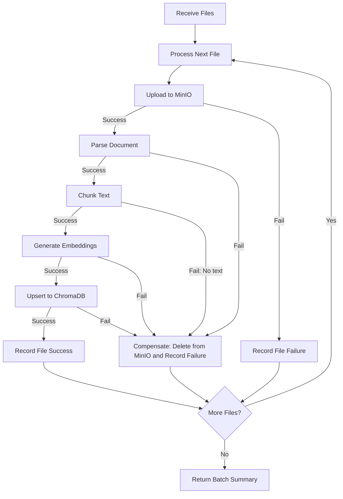

# Design Plan: Robust Error Handling & Fault Tolerance Architecture

> **Target Version**: v0.6 (Resilience & Error Handling)  
> **Status**: Proposed Design Plan  
> **Goal**: Transform the Honeywell RAG pipeline from a fragile happy-path prototype into an enterprise-ready, fault-tolerant system with domain-specific exceptions, standardized error contracts, transactional cleanup, and partial batch resilience.

---

## 1. Executive Summary & Problem Statement

Currently, the application relies on an overly simplistic error-handling setup:
1. **Generic Catch-Alls**: In `main.py`, only `ValueError` (mapped to `400`), `StorageError` (`502`), and `GenerationError` (`503`) are captured.
2. **Unhandled 500 Disasters**: Corrupted PDFs, unreadable Word documents, invalid zip archives, ChromaDB HTTP connection drops, or ONNX runtime crashes raise raw external exceptions (`PdfReadError`, `PackageNotFoundError`, `httpx.ConnectError`, etc.) that leak as unhandled `500 Internal Server Errors`.
3. **Orphaned Storage Artifacts**: In `IngestionService.ingest_files()`, all files are committed to MinIO upfront. If document #3 of 5 fails parsing or embedding, the entire request crashes with no cleanup—leaving orphaned objects in MinIO and an inconsistent state between object storage and ChromaDB.
4. **Semantics Violation**: When `RAGService` cannot find document chunks for a query, it raises `ValueError("No indexed document chunks...")`, which triggers an HTTP `400 Bad Request`. A query with zero matches is not a malformed client syntax error.
5. **Event-Loop Starvation**: Synchronous I/O operations (PDF parsing, embeddings generation, synchronous `urlopen` to Ollama) are executed inside `async def` route handlers. If an upstream service hangs or times out, FastAPI's main event loop is blocked.

---

## 2. Component Failure Matrix

| Component | Failure Scenario | Current Behavior | Proposed Behavior | Target HTTP Status |
| :--- | :--- | :--- | :--- | :--- |
| **Parser (`pypdf`)** | Encrypted or malformed PDF | Unhandled `PdfReadError` $\rightarrow$ `500` | Caught $\rightarrow$ `CorruptedDocumentError` | `422 Unprocessable Entity` |
| **Parser (`docx`)** | Corrupted DOCX / bad ZIP archive | Unhandled `PackageNotFoundError` $\rightarrow$ `500` | Caught $\rightarrow$ `CorruptedDocumentError` | `422 Unprocessable Entity` |
| **Parser (`doc`)** | `antiword` missing from system | `ValueError` with generic message | Caught $\rightarrow$ `ParserDependencyError` | `503 Service Unavailable` |
| **Uploader (`MinIO`)** | MinIO unreachable / auth fails | `StorageError` caught in `main.py` | Typed `StorageConnectionError` with retry hints | `502 Bad Gateway` |
| **Ingestion Pipeline** | 1 out of $N$ files fails processing | Entire batch fails; uploaded files orphaned | Resilient Batch Manifest: report per-file success/failure | `207 Multi-Status` or `200` with status manifest |
| **Embeddings** | Model memory failure / token limit | Unhandled runtime error $\rightarrow$ `500` | Caught $\rightarrow$ `EmbeddingError` | `500 Internal Server Error` (structured) |
| **Retriever (`Chroma`)**| Chroma container down or SQLite lock | Unhandled connection error $\rightarrow$ `500` | Caught $\rightarrow$ `VectorStoreError` | `503 Service Unavailable` |
| **RAG Service** | No matching chunks found in search | `ValueError` $\rightarrow$ `400 Bad Request` | Clean answer with zero sources ("No relevant info") | `200 OK` (with empty sources) |
| **Generator (`Ollama`)**| Ollama down or times out | `GenerationError` $\rightarrow$ `503` | `GenerationError` with structured retry header | `503 Service Unavailable` |

---

## 3. Proposed Architecture

```
                       +----------------------------------+
                       |        HTTP Request Entry        |
                       +----------------------------------+
                                        |
                       +----------------------------------+
                       |    Global Exception Handler      |
                       |    (Standard RFC 7807 Envelope)  |
                       +----------------------------------+
                                        |
             +--------------------------+--------------------------+
             |                                                     |
+--------------------------+                             +--------------------------+
|       Client Errors      |                             |   Infrastructure Errors  |
|       (HTTP 4xx)         |                             |        (HTTP 5xx)        |
+--------------------------+                             +--------------------------+
| - InvalidInputError (400)|                             | - StorageError (502)     |
| - UnsupportedFormat(415) |                             | - VectorStoreError (503) |
| - CorruptedDocument(422) |                             | - GenerationError (503)  |
| - DocumentNotFound (404) |                             | - DependencyError (500)  |
+--------------------------+                             +--------------------------+
```

---

## 4. Technical Design Details

### 4.1. Domain-Specific Exception Hierarchy

A dedicated `core/exceptions.py` module will define an explicit hierarchy extending a base `RAGException`:

```python
class RAGException(Exception):
    """Base exception for all domain errors within Honeywell RAG."""
    def __init__(self, message: str, code: str, status_code: int = 500, details: dict | None = None):
        super().__init__(message)
        self.message = message
        self.code = code
        self.status_code = status_code
        self.details = details or {}

# 4xx Client Errors
class InvalidInputError(RAGException):
    def __init__(self, message: str, details: dict | None = None):
        super().__init__(message=message, code="INVALID_INPUT", status_code=400, details=details)

class UnsupportedFileTypeError(RAGException):
    def __init__(self, extension: str, supported: list[str]):
        super().__init__(
            message=f"Unsupported file extension '{extension}'. Supported: {', '.join(supported)}",
            code="UNSUPPORTED_FILE_TYPE",
            status_code=415,
            details={"extension": extension, "supported": supported}
        )

class CorruptedDocumentError(RAGException):
    def __init__(self, filename: str, reason: str):
        super().__init__(
            message=f"Document '{filename}' is corrupted or cannot be parsed: {reason}",
            code="CORRUPTED_DOCUMENT",
            status_code=422,
            details={"filename": filename, "reason": reason}
        )

# 5xx Infrastructure Errors
class StorageError(RAGException):
    def __init__(self, message: str, details: dict | None = None):
        super().__init__(message=message, code="STORAGE_ERROR", status_code=502, details=details)

class VectorStoreError(RAGException):
    def __init__(self, message: str, details: dict | None = None):
        super().__init__(message=message, code="VECTOR_STORE_ERROR", status_code=503, details=details)

class EmbeddingError(RAGException):
    def __init__(self, message: str, details: dict | None = None):
        super().__init__(message=message, code="EMBEDDING_ERROR", status_code=500, details=details)

class GenerationError(RAGException):
    def __init__(self, message: str, details: dict | None = None):
        super().__init__(message=message, code="GENERATION_ERROR", status_code=503, details=details)
```

### 4.2. Unified Error Response Schema

All HTTP error responses will conform to a consistent Pydantic contract:

```python
class ErrorDetail(BaseModel):
    code: str
    message: str
    details: dict[str, Any] = Field(default_factory=dict)
    timestamp: str

class ErrorResponse(BaseModel):
    error: ErrorDetail
```

Example JSON response:
```json
{
  "error": {
    "code": "CORRUPTED_DOCUMENT",
    "message": "Document 'annual_report.pdf' is corrupted or cannot be parsed: File is encrypted and requires a password",
    "details": {
      "filename": "annual_report.pdf",
      "reason": "File is encrypted and requires a password"
    },
    "timestamp": "2026-09-27T15:55:00Z"
  }
}
```

### 4.3. Resilient Ingestion & Partial Success Handling

In a multi-file upload, one corrupted file should not abort the entire batch or orphan successfully uploaded objects.

#### Proposed Ingestion Flow:


#### Updated Response Contract for Ingestion:
```python
class DocumentIngestItem(BaseModel):
    document_id: str | None
    filename: str
    status: Literal["indexed", "failed"]
    total_chunks: int = 0
    error: str | None = None

class DocumentIngestResponse(BaseModel):
    message: str
    total_files: int
    successful_count: int
    failed_count: int
    documents: list[DocumentIngestItem]
```

### 4.4. Parser Hardening

Update `Parser.parse()` to catch third-party exceptions and map them to `CorruptedDocumentError`:
* **PDF**:
  ```python
  try:
      reader = PdfReader(io.BytesIO(content))
      if reader.is_encrypted:
          raise CorruptedDocumentError(filename, "File is password protected")
      # Extract pages...
  except Exception as err:
      raise CorruptedDocumentError(filename, f"PDF read failure: {str(err)}") from err
  ```
* **DOCX**:
  ```python
  try:
      document = Document(io.BytesIO(content))
  except Exception as err:
      raise CorruptedDocumentError(filename, f"Invalid DOCX archive: {str(err)}") from err
  ```

### 4.5. ChromaDB & Vector Store Guarding

Wrap all calls in `Retriever` with connection and query guards:
```python
def retrieve(self, query: str, k: int = 5) -> dict[str, Any]:
    try:
        return self.collection.query(...)
    except Exception as err:
        logger.exception("ChromaDB query failed")
        raise VectorStoreError(f"Vector search service unavailable: {str(err)}") from err
```

### 4.6. Async Worker Thread Offloading

Because FastAPI runs `async def` endpoints on the main event loop, all heavy synchronous operations must be offloaded to worker threads via `fastapi.concurrency.run_in_threadpool` or `anyio.to_thread.run_sync`:

```python
@router.post("/query")
async def query_pipeline(request: QueryRequest, service: RAGService = Depends(get_rag_service)):
    return await run_in_threadpool(service.answer_question, request.question)
```
This guarantees that an Ollama timeout or heavy PDF parsing job will never block other incoming requests or the `/health` endpoint.

---

## 5. Phased Implementation Plan

### Phase 1: Exception Framework & Core Contracts
1. Create `core/exceptions.py` containing `RAGException` and subclasses.
2. Update `core/__init__.py` to export the new exceptions.
3. Update `main.py` with:
   - A centralized handler for `RAGException`.
   - A fallback handler for unexpected `Exception` (logs full stack trace with request ID, returns clean 500 without leaking internals).

### Phase 2: Core Driver Hardening
1. **`core/parser.py`**: Wrap `pypdf`, `python-docx`, and `subprocess` calls in try/catch blocks translating to `CorruptedDocumentError` / `ParserDependencyError`.
2. **`core/retriever.py`**: Wrap Chroma client calls and upsert/query methods in `VectorStoreError`.
3. **`core/embeddings.py`**: Wrap embedding function calls in `EmbeddingError`.
4. **`core/uploader.py`**: Add `delete_file(document_id: str)` method for compensating transactions (cleanup).

### Phase 3: Service Layer & Resilient Batch Ingestion
1. Update `IngestionService`:
   - Process each file independently.
   - If parsing/embedding fails, trigger `uploader.delete_file(doc_id)` to prevent orphaned files.
   - Accumulate both successes and failures into `DocumentIngestResponse`.
2. Update `RAGService`:
   - Remove misleading `ValueError` when zero documents are found.
   - Return clean response with `sources=[]` and fallback message.

### Phase 4: Threadpool Offloading & API Protection
1. Wrap blocking service calls in `endpoints/documents.py` and `endpoints/query.py` with `run_in_threadpool`.
2. Add maximum upload size checks (e.g. 50MB per file) to prevent memory exhaustion attacks.

### Phase 5: Verification & Test Suite
1. Write unit tests in `tests/test_errors.py`:
   - Test password-protected / corrupted PDF upload $\rightarrow$ expect 422 or partial failure status.
   - Test corrupted DOCX file upload $\rightarrow$ expect 422.
   - Test MinIO connection down $\rightarrow$ expect 502.
   - Test ChromaDB down $\rightarrow$ expect 503.
   - Test empty query or no documents indexed $\rightarrow$ expect 200 with fallback message or appropriate 404.
   - Test partial batch upload (1 good file, 1 corrupted file) $\rightarrow$ verify good file is indexed and bad file is reported with rollback from MinIO.

---

## 6. Definition of Done (DoD)

- [ ] Zero unhandled 500 errors during malformed file uploads.
- [ ] No orphaned files in MinIO upon downstream parsing or embedding errors.
- [ ] Standardized JSON error response format across the entire API.
- [ ] All synchronous blocking I/O offloaded from the FastAPI event loop.
- [ ] Automated tests covering all error conditions passing at 100%.
