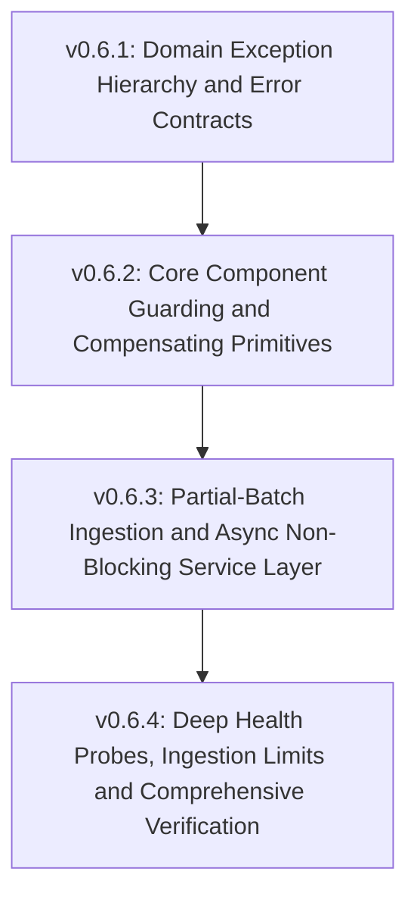
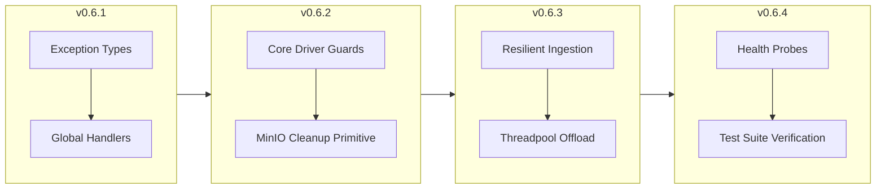

# Design Version Plan: Incremental Rollout for Error Handling & Resilience

> **Target Milestone**: v0.6  
> **Philosophy**: *Make it work, make it right, make it fast.*  
> **Approach**: Incremental, non-breaking rollout across 4 staged minor versions (v0.6.1 $\rightarrow$ v0.6.4) to systematically build bulletproof fault tolerance into the Honeywell RAG pipeline.

---

## 1. High-Level Version Roadmap



| Version | Focus | Scope | Key Deliverables | Risk Level |
| :--- | :--- | :--- | :--- | :--- |
| **v0.6.1** | **Foundation & Contracts** | Global handlers & Schemas | `core/exceptions.py`, `schemas/error.py`, updated `main.py` handlers | Low |
| **v0.6.2** | **Core Driver Guarding** | Core drivers & Storage primitives | Hardened `parser.py`, `retriever.py`, `uploader.delete_file()` | Low-Med |
| **v0.6.3** | **Service Layer Resilience** | Orchestration & Event Loop | Resilient batch ingestion, rollback on error, threadpool offload | Med |
| **v0.6.4** | **Observability & Verification** | Probes, Limits & Test Suite | Dynamic `/health` probe, payload size caps, automated `tests/v0.6/` | Low |

---

## 2. Version Breakdown

---

### Version 0.6.1: Domain Exception Hierarchy & Error Contracts

#### Objective
Establish an enterprise-grade exception foundation so the application never relies on generic built-in Python exceptions (`ValueError`) for HTTP status mapping, and all errors adhere to a strict RFC 7807-style JSON contract.

#### 1. New Module: `core/exceptions.py`
Define a root domain exception and specialized client/infrastructure subclasses:
* `RAGException`: Base exception with `message`, `code`, `status_code`, and `details`.
* **Client Exceptions (HTTP 4xx)**:
  * `InvalidInputError` (HTTP 400)
  * `DocumentNotFoundError` (HTTP 404)
  * `UnsupportedFileTypeError` (HTTP 415)
  * `CorruptedDocumentError` (HTTP 422)
* **Infrastructure Exceptions (HTTP 5xx)**:
  * `StorageError` (HTTP 502)
  * `VectorStoreError` (HTTP 503)
  * `EmbeddingError` (HTTP 500)
  * `GenerationError` (HTTP 503)
  * `ParserDependencyError` (HTTP 500)

#### 2. New Schema: `schemas/error.py`
Standardized error contract for Swagger / OpenAPI documentation:
```python
class ErrorDetail(BaseModel):
    code: str
    message: str
    details: dict[str, Any] = Field(default_factory=dict)
    timestamp: str

class ErrorResponse(BaseModel):
    error: ErrorDetail
```

#### 3. Update `main.py` Exception Handlers
* Replace individual one-off handlers with a unified `RAGException` handler.
* Add an unhandled `Exception` safety net that captures unexpected panics, logs a unique error ID with stack trace, and returns a clean HTTP 500 without leaking server internals.

---

### Version 0.6.2: Core Component Guarding & Compensating Storage Primitives

#### Objective
Harden low-level core adapters so they intercept third-party library crashes and convert them into domain exceptions. Provide a deletion primitive in MinIO to support compensating rollback transactions.

#### 1. Parser Hardening (`core/parser.py`)
* **PDF**: Intercept `PdfReadError`, `FileNotDecryptedError`, and `EmptyFileError` from `pypdf`, translating them to `CorruptedDocumentError`.
* **DOCX**: Intercept `docx.opc.exceptions.PackageNotFoundError` and `zipfile.BadZipFile`, translating to `CorruptedDocumentError`.
* **DOC**: Distinguish missing system binary (`antiword` `FileNotFoundError` $\rightarrow$ `ParserDependencyError`) from a corrupt document (`CalledProcessError` $\rightarrow$ `CorruptedDocumentError`).

#### 2. Vector Store & Embeddings Guarding (`core/retriever.py` & `core/embeddings.py`)
* Wrap ChromaDB `HttpClient` and `PersistentClient` network/lock failures in `VectorStoreError`.
* Wrap embedding tokenization or ONNX memory allocation failures in `EmbeddingError`.

#### 3. Storage Compensating Primitive (`core/uploader.py`)
* Add `delete_file(document_id: str) -> bool` to `Uploader` using boto3 `delete_object`.
* Ensures downstream pipeline steps can trigger automated cleanup if later stages abort.

---

### Version 0.6.3: Partial-Batch Ingestion & Async Non-Blocking Service Layer

#### Objective
Transition `IngestionService` and `RAGService` from all-or-nothing failure workflows to resilient, fault-tolerant orchestration. Prevent event loop starvation in FastAPI routes.

#### 1. Partial-Batch Resilience in `services/ingestion_service.py`
* Change batch ingestion loop to process files independently:
  ```
  File 1: Upload -> Parse -> Chunk -> Embed -> Upsert -> Success
  File 2 (Corrupt PDF): Upload -> Parse (Throws CorruptedDocumentError) -> Compensate: Delete from MinIO -> Record Failure
  File 3: Upload -> Parse -> Chunk -> Embed -> Upsert -> Success
  ```
* If a document fails mid-pipeline, call `self.uploader.delete_file(doc_id)` immediately to guarantee no orphaned objects remain in MinIO.

#### 2. Ingestion Schema Update in `schemas/document.py`
Expand `DocumentIngestResponse` to return a clear execution manifest:
```python
class DocumentIngestItem(BaseModel):
    document_id: str | None = None
    filename: str
    status: Literal["indexed", "failed"]
    total_chunks: int = 0
    error: str | None = None

class DocumentIngestResponse(BaseModel):
    message: str
    total_files: int
    successful_count: int
    failed_count: int
    documents: list[DocumentIngestItem]
```

#### 3. Query Fallback in `services/rag_service.py`
* Stop raising `ValueError` (which returned HTTP 400) when zero documents match a search.
* Return a valid `QueryResponse` with an informative message ("No relevant documents found in knowledge base") and `sources=[]`.

#### 4. Threadpool Offloading in `api/v1/endpoints/`
* In `documents.py` and `query.py`, wrap heavy synchronous operations using `fastapi.concurrency.run_in_threadpool`.
* Ensures Ollama generation timeouts and PDF parsing CPU bursts never block other requests.

---

### Version 0.6.4: Dynamic Health Probing, Ingestion Limits & Verification

#### Objective
Enhance system observability, prevent denial-of-service via oversized files, and establish a dedicated automated verification test suite.

#### 1. Dynamic Dependency Probing in `api/v1/endpoints/health.py`
* Enhance `/health` endpoint to perform live pings against:
  * MinIO (`s3.head_bucket`)
  * ChromaDB (`chroma_client.heartbeat()`)
* Return HTTP 200 with status `degraded` or `unhealthy` with component breakdowns if a dependency is down, rather than crashing silently.

#### 2. Payload Protection & File Size Limits
* Add configurable file size guards (e.g., maximum 50 MB per file, configurable via `config.py`) to prevent server memory exhaustion.

#### 3. Automated Test Suite (`tests/v0.6/`)
Create comprehensive tests validating all error states:
* `test_corrupted_pdf_upload`: Verify 422 or partial failure status.
* `test_batch_partial_success`: 2 valid files + 1 corrupt file $\rightarrow$ verify 2 indexed, 1 failed, corrupt file deleted from MinIO.
* `test_minio_down`: Assert 502 with standard error envelope.
* `test_chroma_down`: Assert 503 with standard error envelope.
* `test_ollama_timeout`: Assert 503 `GenerationError`.
* `test_empty_query_search`: Assert 200 with clean fallback response.

---

## 3. Migration & Verification Strategy



1. **Zero Downtime / Non-Breaking Progression**:
   * Each minor version delivers an isolated, testable improvement.
   * Existing endpoints retain backwards compatibility while gaining standardized error handling.
2. **Deterministic Rollback**:
   * If any step introduces regressions, each sub-version is small enough to be rolled back without impacting surrounding layers.
