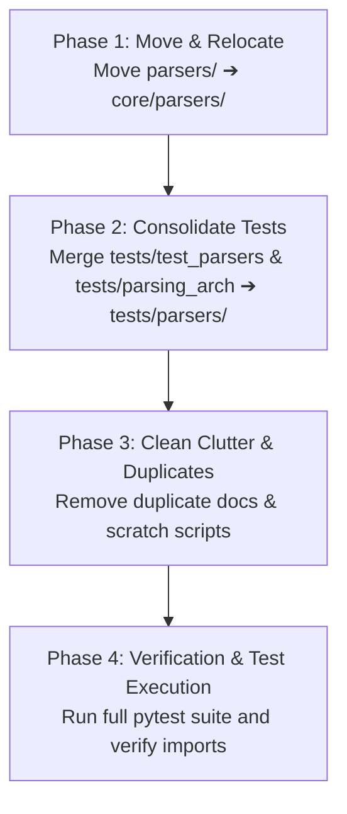

# Organization Plan: Unified Parsing Architecture (`orgv2.md`)

**Branch**: `parser_v1` (to be evolved/renamed or structured as `feat/parsing-architecture`)  
**Scope**: Consolidate v1 + v2 developments into a clean, predictable, standard codebase structure.

---

## Executive Summary

Instead of reverting existing functionality, this plan organizes all completed **v1** (Foundation & Text Parsing) and **v2** (Office Documents & Picture Description) components into a clean, cohesive architecture under `core/parsers/`.

### Key Objectives
1. **Encapsulation**: Relocate the standalone `parsers/` package from the repository root into `core/parsers/`, making document parsing an intrinsic subsystem of `core/`.
2. **Standardized Exports & Clean Imports**: Expose all parsers and routing utilities through `core.parsers` and re-export key classes (`ParserRouter`, `DoclingParser`, `TextParser`, `BaseParser`) directly from `core`.
3. **Unified Test Suite**: Merge fragmented test folders (`tests/test_parsers/`, `tests/parsing_arch/`) into a single, structured `tests/parsers/` directory.
4. **Clutter Cleanup**: Deduplicate documentation files, remove one-off scratch scripts, and finalize the `test_parse.py` CLI utility.

---

## Target Architecture

```
honeywell-project/
├── core/
│   ├── parsers/                           <── Parsers encapsulated in core
│   │   ├── __init__.py                    <── Exports BaseParser, TextParser, DoclingParser, ParserRouter, UnsupportedFileError
│   │   ├── base.py                        <── BaseParser abstract interface
│   │   ├── text.py                        <── TextParser (.txt, .md)
│   │   ├── docling_parser.py              <── DoclingParser (.docx, .pptx + VLM picture description)
│   │   └── router.py                      <── ParserRouter dispatcher
│   ├── chunker.py                         <── Token-aware HybridChunker with contextualized headings
│   ├── embeddings.py
│   ├── generator.py
│   ├── parser.py                          <── Legacy parser (preserved for backward compatibility)
│   ├── retriever.py
│   ├── uploader.py
│   └── __init__.py                        <── Centralized core exports
├── tests/
│   ├── parsers/                           <── Consolidated parser test suite
│   │   ├── __init__.py
│   │   ├── test_base.py                   <── BaseParser abstract tests
│   │   ├── test_text.py                   <── TextParser unit tests
│   │   ├── test_docling.py                <── DoclingParser unit tests
│   │   ├── test_router.py                 <── ParserRouter routing tests
│   │   ├── test_picture_description.py    <── Local VLM picture description tests
│   │   ├── test_serialize_fix.py          <── Heading-context & synthetic chunk regression tests
│   │   └── test_integration.py            <── End-to-end multi-format pipeline integration tests
│   ├── unit/
│   │   └── test_chunker.py                <── Chunker unit tests
│   ├── v0.3/
│   └── v0.4/
├── docs/
│   ├── orgv2.md                           <── This organization plan
│   ├── parsing_architecture_plan.md       <── Master architecture roadmap
│   ├── v1.md                              <── v1 Foundation specifications
│   ├── v2.md                              <── v2 Office & VLM specifications
│   └── RAG_PARSING_ARCHITECTURE_FINAL.md  <── Master reference document
├── config.py                              <── Configuration settings
├── requirements.txt                       <── Dependencies (including docling and python-pptx)
├── pytest.ini                             <── Pytest configuration
├── test_parse.py                          <── Standalone CLI parser test tool
└── main.py
```

---

## Phased Implementation Roadmap



---

### Phase 1: Relocate Parsers Package to `core/parsers/`

#### 1.1 Move Directory
Move `parsers/` to `core/parsers/`:
```powershell
Move-Item -Path "parsers" -Destination "core\parsers"
```

#### 1.2 Update `core/parsers/__init__.py`
Ensure all public interfaces are cleanly exported:
```python
# core/parsers/__init__.py
from .base import BaseParser
from .docling_parser import DoclingParser
from .router import ParserRouter, UnsupportedFileError
from .text import TextParser

__all__ = [
    "BaseParser",
    "DoclingParser",
    "ParserRouter",
    "TextParser",
    "UnsupportedFileError",
]
```

#### 1.3 Update `core/parsers/router.py`
Update internal relative imports:
```python
# core/parsers/router.py
from pathlib import PurePath
from docling_core.types.doc import DoclingDocument

from .base import BaseParser
from .docling_parser import DoclingParser
from .text import TextParser

class UnsupportedFileError(ValueError):
    """Raised when no registered parser can handle the given file extension."""

class ParserRouter:
    """Route incoming files to the correct BaseParser by file extension."""
    def __init__(self) -> None:
        self._parsers: list[BaseParser] = []
        self.register(TextParser())
        self.register(DoclingParser())
    ...
```

#### 1.4 Update `core/__init__.py`
Re-export the parser interfaces through `core`:
```python
# core/__init__.py
from .chunker import Chunker
from .parser import Parser
from .parsers import (
    BaseParser,
    DoclingParser,
    ParserRouter,
    TextParser,
    UnsupportedFileError,
)

try:
    from .embeddings import Embeddings
    from .generator import GenerationError, Generator
    from .retriever import Retriever
    from .uploader import StorageError, Uploader
except ImportError:
    Embeddings = None  # type: ignore[assignment,misc]
    GenerationError = None  # type: ignore[assignment,misc]
    Generator = None  # type: ignore[assignment,misc]
    Retriever = None  # type: ignore[assignment,misc]
    StorageError = None  # type: ignore[assignment,misc]
    Uploader = None  # type: ignore[assignment,misc]

__all__ = [
    "BaseParser",
    "Chunker",
    "DoclingParser",
    "Embeddings",
    "GenerationError",
    "Generator",
    "Parser",
    "ParserRouter",
    "Retriever",
    "StorageError",
    "TextParser",
    "UnsupportedFileError",
    "Uploader",
]
```

#### 1.5 Update CLI Tool `test_parse.py`
Update imports to use `core.parsers`:
```python
# test_parse.py
from core.chunker import Chunker
from core.parsers import ParserRouter
...
```

---

### Phase 2: Consolidate Test Suite into `tests/parsers/`

#### 2.1 Directory Setup & File Consolidation
1. Create `tests/parsers/`.
2. Move and standardize test files:
   - `tests/test_parsers/test_base.py` ➔ `tests/parsers/test_base.py`
   - `tests/test_parsers/test_text.py` ➔ `tests/parsers/test_text.py`
   - `tests/test_parsers/test_docling_parser.py` ➔ `tests/parsers/test_docling.py`
   - `tests/test_parsers/test_router.py` ➔ `tests/parsers/test_router.py`
   - `tests/parsing_arch/v2/test_picture_description.py` ➔ `tests/parsers/test_picture_description.py`
   - `tests/parsing_arch/v2/test_serialize_fix.py` ➔ `tests/parsers/test_serialize_fix.py`
   - Combine `test_integration_v1.py` and `test_integration_v2.py` ➔ `tests/parsers/test_integration.py`
3. Remove old directories:
   - Remove `tests/test_parsers/`
   - Remove `tests/parsing_arch/`

#### 2.2 Update Test Imports
Update all test files to import from `core.parsers`:
```python
# In test files:
from core.parsers import BaseParser, DoclingParser, ParserRouter, TextParser, UnsupportedFileError
```

---

### Phase 3: Cleanup Clutter & Duplicates

#### 3.1 Documentation Deduplication
- Remove duplicate file: `docs/RAG_PARSING_ARCHITECTURE_FINAL (1).md`
- Keep canonical file: `docs/RAG_PARSING_ARCHITECTURE_FINAL.md`

#### 3.2 Scratch Script Cleanup
- Remove one-off diagnostic scripts in `scratch/`:
  - `scratch/diagnose_pptx.py`
  - `scratch/inspect_slide13.py`

#### 3.3 Execution Commands
```powershell
# Remove duplicate document
Remove-Item -Force "docs\RAG_PARSING_ARCHITECTURE_FINAL (1).md"

# Remove scratch files
Remove-Item -Force "scratch\diagnose_pptx.py"
Remove-Item -Force "scratch\inspect_slide13.py"
```

---

## Phase 4: Verification & Test Execution

Execute the verification steps to ensure clean imports and full test coverage.

### 4.1 Import Verification
```powershell
python -c "from core.parsers import ParserRouter, DoclingParser, TextParser, BaseParser; from core import ParserRouter, Chunker; print('All core.parsers imports succeed!')"
```

### 4.2 Test Suite Execution
```powershell
# Run consolidated parser unit & integration tests
pytest tests/parsers/ -v

# Run chunker tests
pytest tests/unit/test_chunker.py -v

# Run full project test suite (including contract and pure API tests)
pytest tests/ -v
```

---

## Summary of File Movements & Actions

| Existing Path | Action | Target Path | Rationale |
|---|---|---|---|
| `parsers/` | **MOVE** | `core/parsers/` | Encapsulates parsing logic within the core system. |
| `tests/test_parsers/` | **CONSOLIDATE** | `tests/parsers/` | Unifies all parser test files in one clear location. |
| `tests/parsing_arch/` | **CONSOLIDATE** | `tests/parsers/` | Merges VLM and serialize regression tests into standard test suite. |
| `docs/RAG_PARSING_ARCHITECTURE_FINAL (1).md` | **DELETE** | — | Removes accidental duplicate document. |
| `scratch/*.py` | **DELETE** | — | Cleans up temporary exploration scripts. |
| `test_parse.py` | **UPDATE** | `test_parse.py` | Updates import to `core.parsers` for local document testing. |
| `core/__init__.py` | **UPDATE** | `core/__init__.py` | Exposes `core.parsers` interfaces at the top level. |

