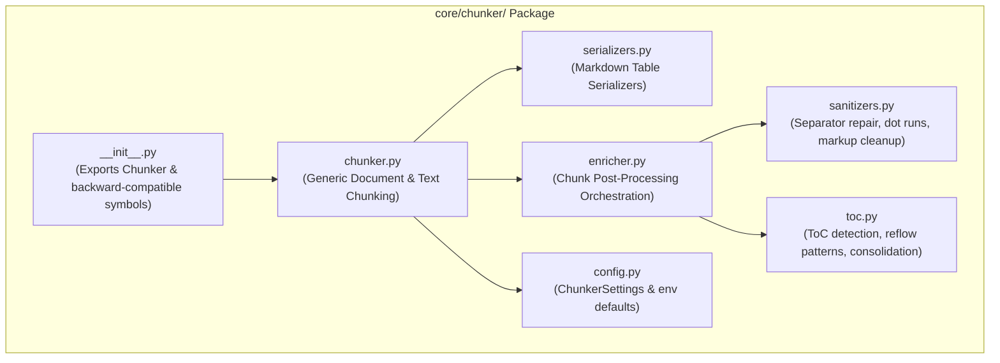

# PDF Pipeline Cleanup & Structural Architecture Overview

## 1. Executive Summary

The latest commit (`b4cf5c7`) restored the full extraction strength and retrieval quality of `parser_v1` (resilient table extraction, cellmark injection, ToC consolidation, figure handling, and 91/91 golden question recall). However, achieving this accuracy rapidly introduced significant architectural debt:

* **Central Configuration Bloat**: Over 25 granular, milestone-tagged variables (`pdf_v57_cleanup`, `pdf_v59_cellmarks`, `chunk_v59_tables`, etc.) were dumped directly into `core/pipeline_config.py` and `config.py`.
* **Format Leakage in Chunker**: `core/chunker.py` was coupled to PDF-specific details with checks like `filename.lower().endswith(".pdf")`, inspection of string sentinels (`[TOC]`, `[Recovered text]`), and inline table serializer classes.
* **Unstructured Post-Processing**: A 309-line heuristic cleanup script (`core/chunk_cleanup.py`) was placed directly at the root of `core/` with obsolete work-package comments.

### Key Decisions in this Updated Architecture:
1. **Decentralized Configuration**: High-level macro settings stay in `core/pipeline_config.py`, while subsystem-specific micro-tuning moves directly into `core/parsers/pdf/config.py` and `core/chunker/config.py`.
2. **Encapsulated Chunker Package**: The entire chunking subsystem moves into a dedicated package directory `core/chunker/` (with a zero-breakage backward compatibility shim at `core/chunker.py`).
3. **100% Strength Preservation**: Zero heuristics or tolerances are dropped; all table header carry, dot-run cleanup, ToC consolidation, and cellmark logic are retained with complete test verification.

---

## 2. Configuration Strategy: Central vs Decentralized

A core design flaw in the latest commit was treating `core/pipeline_config.py` as a dumping ground for every internal heuristic switch. 

### What MUST Remain in Central `core/pipeline_config.py`
The central pipeline configuration should only contain **macro-level pipeline contracts**, infrastructure connections, engine selection, and stage orchestration parameters:

* **Infrastructure & Storage**: MinIO endpoint/keys/bucket, ChromaDB host/port/collection, Ollama base URL.
* **Engine & Model Selection**: `pdf_parser_backend` (`docling`), `ocr_engine` (`tesseract`), `embedder_provider` (`ollama`), `generator_provider` (`ollama`), model names, and dimensions.
* **Pipeline-Level Stage Parameters**: Standard `chunk_size` and `chunk_overlap`, retrieval `retrieval_k` and `retrieval_score_threshold`, generation `temperature`.

### What MOVES to Decentralized Module Configs

#### A. PDF Parser Micro-Config (`core/parsers/pdf/config.py`)
These settings are internal to PDF page triage, OCR triggering, visual mark detection, and Docling table verification. They have no relevance to text files, docx, or chunking:

| Setting in `core/parsers/pdf/config.py` | Former Name (`b4cf5c7`) | Purpose | Default |
| :--- | :--- | :--- | :--- |
| `enable_page_router` | `enable_pdf_page_router` | Toggle hybrid page triage | `True` |
| `min_text_chars_for_text_route` | `pdf_min_text_chars_for_text_route` | Text threshold for fast route | `800` |
| `text_layer_min_chars` | `pdf_text_layer_min_chars` | Threshold to trigger OCR | `40` |
| `allow_ocr_on_text_pages` | `pdf_ocr_on_text_pages` | OCR fallback on dense pages | `False` |
| `enable_text_cleanup` | `pdf_v57_cleanup` | OCR whitespace/hyphen fix | `True` |
| `enable_cellmarks` | `pdf_v59_cellmarks` | Fitz cell visual markers | `True` |
| `cellmark_repeat_min` | `pdf_mark_repeat_min` | Minimum marker repetition | `3` |
| `figure_mode` | `pdf_figure_mode` | `off`, `labels_only`, `vlm` | `"labels_only"` |
| `smolvlm_max_new_tokens` | `pdf_smolvlm_max_new_tokens` | SmolVLM caption token cap | `200` |
| `enable_coverage_check` | `pdf_v59_coverage` | Verify recall against fitz | `True` |
| `coverage_recall_min` | `pdf_coverage_recall_min` | Minimum text recall score | `0.9` |
| `coverage_near_match` | `pdf_coverage_near_match` | Fuzzy match tolerance | `0.75` |
| `enable_table_crosscheck` | `pdf_v59_table_crosscheck` | Cross-validate tables | `True` |
| `boilerplate_min_page_repeats` | `pdf_boilerplate_min_page_repeats` | Header/footer repeat count | `3` |
| `debug_heading_dump` | `pdf_debug_heading_dump` | Diagnostic logging | `False` |

#### B. Chunker Micro-Config (`core/chunker/config.py`)
These settings govern markdown serialization and post-chunking transformations:

| Setting in `core/chunker/config.py` | Former Name (`b4cf5c7`) | Purpose | Default |
| :--- | :--- | :--- | :--- |
| `enable_postprocess` | `chunk_postprocess` | Master toggle for chunk enrichers | `True` |
| `carry_table_headers` | `chunk_v59_tables` | Injects headers into continuation table chunks | `True` |
| `merge_toc_entries` | `pdf_v59_toc` | Detects and consolidates ToC fragments | `True` |
| `repeat_table_header` | `pdf_table_repeat_header` | Docling `HybridChunker` table header repeat | `True` |
| `header_cap_tokens` | `chunk_header_cap_tokens` | Max token budget for carried table headers | `64` |

---

## 3. Chunker Restructuring: Packaging into `core/chunker/`

Instead of keeping `core/chunker.py` as a monolithic file and `core/chunk_cleanup.py` as an orphan in `core/`, the entire chunking subsystem is packaged cleanly into `core/chunker/`.



### Module Breakdown within `core/chunker/`:

1. **`core/chunker/__init__.py`**:
   * Exports `Chunker`, `ChunkerSettings`, and public metadata helpers.
   * Maintains 100% backward compatibility for all existing imports (`from core.chunker import Chunker`).

2. **`core/chunker/chunker.py`**:
   * Contains the `Chunker` class.
   * Completely format-agnostic: delegates table serialization to `serializers.py` and chunk post-processing to `enricher.py`.
   * Removes hardcoded checks like `filename.lower().endswith(".pdf")`.

3. **`core/chunker/serializers.py`**:
   * Contains `_MarkdownTableChunkSerializer` and `_MarkdownTableSerializerProvider`.
   * Ensures markdown table continuity without polluting the main chunker file.

4. **`core/chunker/enricher.py`** (Replaces `core/chunk_cleanup.py`):
   * Orchestrates the chunk post-processing pipeline:
     * Carries table headers across split chunks (`carry_table_headers`).
     * Drops junk / micro separator chunks.
     * Consolidates multi-line ToC entries.
     * Sanitizes scalar metadata for Chroma.

5. **`core/chunker/sanitizers.py`**:
   * Pure text-cleaning primitives:
     * `strip_markup()`: Removes loose ATX heading hashes and rogue italic asterisks.
     * `_collapse_sep_rows()` & `_SEP_FRAG_RE`: Repairs broken markdown table separators.
     * `_strip_dot_runs()`: Strips dot leaders (`....... 42`).
     * `is_micro_label()`: Identifies isolated numeric/single-character junk chunks.

6. **`core/chunker/toc.py`**:
   * Specialized ToC extraction and consolidation:
     * `_TOC_HEAD_RE`, `_TOC_ROW_RE`, and `_TOC_ENTRY_RE` (handles reflowed PyMuPDF4LLM lines).
     * `_merge_toc()`: Merges scattered ToC page chunks into single compact chunks tagged `content_type="toc"`.

7. **`core/chunker/config.py`**:
   * Encapsulates `ChunkerSettings` with environment variable defaults.

8. **Backward Compatibility Shim (`core/chunker.py`)**:
   * A thin shim file at `core/chunker.py`:
     ```python
     # Backward compatibility shim
     from core.chunker import Chunker, _flatten_meta
     __all__ = ["Chunker", "_flatten_meta"]
     ```

---

## 4. PDF Parser Architecture & Internal Pipeline

With configuration decentralized to `core/parsers/pdf/config.py`, the PDF parser modules become clean and self-contained:

```
core/parsers/pdf/
├── __init__.py                        # Exports PdfParser
├── config.py                          # PdfParserSettings & defaults
├── parser.py                          # Page triage, routing & multi-page coordinator
├── backends.py                        # Docling, SmolVLM, PyMuPDF, OCR engines
├── pipeline.py                        # Shared transform runner (cellmarks + figures)
├── postprocess.py                     # Document-level cleanup & coverage cross-checks
└── transforms/
    ├── cellmarks.py                   # Fitz visual mark detection & injection
    ├── figures.py                     # Bounding boxes, deduplication & descriptions
    └── tables.py                      # Multi-page table verification
```

### Key Improvements:
* **`pipeline.py` (Shared Transform Orchestrator)**:
  * Eliminates the duplicate `fitz.open()`, `inject_marks()`, and figure-card handling duplicated between `DoclingTableBackend` and `VlmPictureBackend`.
* **Centralized Error Handling**:
  * Logging is consistent, and fallback paths (e.g. Docling -> PyMuPDF) are clean and explicit.

---

## 5. Comparative Layout: Current vs Target State

```
CURRENT (b4cf5c7)                              TARGET STATE
============================================   ============================================
core/                                          core/
├── chunk_cleanup.py (309 lines at root)       │
├── chunker.py (contains PDF checks & tags)    ├── chunker/
├── pipeline_config.py (27+ loose v59 flags)   │   ├── __init__.py (clean exports)
├── retriever.py                               │   ├── chunker.py (format-agnostic)
├── parsers/                                   │   ├── config.py (ChunkerSettings)
│   └── pdf/                                   │   ├── serializers.py (Markdown tables)
│       ├── backends.py (duplicated logic)     │   ├── enricher.py (post-processing)
│       ├── parser.py                          │   ├── sanitizers.py (markup/dot-runs)
│       ├── postprocess.py                     │   └── toc.py (ToC merge & detection)
│       └── transforms/                        ├── chunker.py (backward-compat shim)
│           ├── cellmarks.py                   ├── pipeline_config.py (clean ~100 lines)
│           └── figures.py                     ├── retriever.py
│                                              └── parsers/
│                                                  └── pdf/
│                                                      ├── __init__.py
│                                                      ├── config.py (PdfParserSettings)
│                                                      ├── parser.py
│                                                      ├── backends.py
│                                                      ├── pipeline.py (shared transforms)
│                                                      ├── postprocess.py
│                                                      └── transforms/
│                                                          ├── cellmarks.py
│                                                          └── figures.py
```

---

## 6. Phased Rollout & Safety Protocol

Any refactor of this strength must be completely validated against regression. The work is organized into 5 incremental versions (detailed in `docs/parser_cleanup_versions.md`):

1. **Cleanup v1.0**: PDF Parser & Config Decentralization (move micro-settings to `core/parsers/pdf/config.py`, create shared `pipeline.py`).
2. **Cleanup v2.0**: Chunker Package Restructuring (package into `core/chunker/`, eliminate root `core/chunk_cleanup.py`, provide compatibility shim).
3. **Cleanup v3.0**: Format Decoupling & Pipeline Config Finalization (remove hardcoded `.pdf` checks, clean `core/pipeline_config.py`).
4. **Cleanup v4.0**: Test Suite Domain Reorganization & Quality Benchmark (organize domain tests, verify 91/91 golden recall).
5. **Cleanup v5.0**: Repository Hardening & Redundancy Purge (delete compatibility shims, purge legacy `PDF_V59_*` and `CHUNK_V59_*` fallbacks, eliminate dead code, archive obsolete documentation).

### Safety Guarantees at Every Step:
* **Unit & Component Testing**: Test each subsystem in isolation after its respective phase.
* **Full Benchmark Verification**: Run `tests/parsers/test_pdf_golden_quality.py` to confirm that 91/91 golden questions achieve top-k recall at every milestone.
