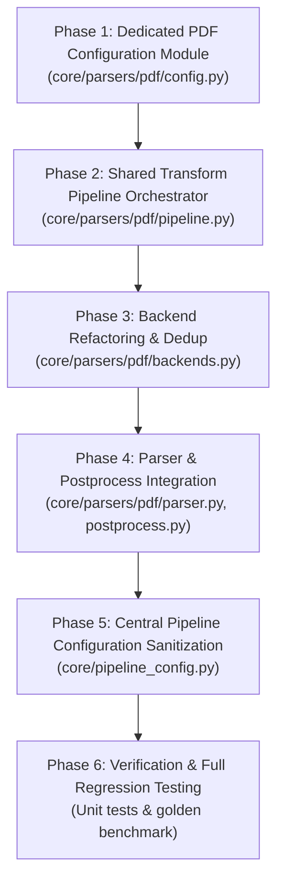

# Formal Implementation Plan: Cleanup v1.0 — PDF Parser & Config Decentralization

## Executive Summary

**Cleanup v1.0** is the first operational phase of the PDF pipeline structural overhaul defined in `docs/parser_cleanup.md` and `docs/parser_cleanup_versions.md`.

In the current latest commit (`b4cf5c7`), the PDF parser regained full extraction parity with `parser_v1`, but at the cost of polluting `core/pipeline_config.py` with 15+ granular PDF triage and transform switches (`pdf_v59_cellmarks`, `pdf_v59_coverage`, etc.), and duplicating `fitz` setup, cellmark injection, and figure card handling across multiple backend paths in `core/parsers/pdf/backends.py`.

**Cleanup v1.0** addresses this by:
1. Decentralizing PDF-specific configuration into a dedicated module (`core/parsers/pdf/config.py`) with semantic naming and backward-compatible environment variable aliases.
2. Creating a shared transform orchestrator (`core/parsers/pdf/pipeline.py`) that unifies `fitz` page lifecycle management, cellmark injection, and figure card processing.
3. Refactoring `core/parsers/pdf/backends.py`, `parser.py`, and `postprocess.py` to use the decentralized config and shared pipeline.
4. Sanitizing `core/pipeline_config.py` to retain only macro infrastructure and pipeline contracts.
5. Providing full unit and regression test coverage to ensure zero degradation of the 91/91 golden benchmark.

---

## 1. Architectural Scope & Invariants

```text
+-------------------------------------------------------------------------+
|                       Cleanup v1.0 Scope Boundary                       |
+-------------------------------------------------------------------------+
| 1. Active Working Branch                                                |
|    * pdf_refactor (starting from b4cf5c7)                               |
|                                                                         |
| 2. New Modules Created                                                  |
|    * core/parsers/pdf/config.py (PdfParserSettings & env aliases)       |
|    * core/parsers/pdf/pipeline.py (Shared apply_page_transforms runner) |
|    * tests/parsers/test_pdf_config.py (Config & alias unit tests)       |
|                                                                         |
| 3. Existing Modules Refactored                                          |
|    * core/parsers/pdf/backends.py (DoclingTableBackend & VLM clean-up)  |
|    * core/parsers/pdf/parser.py (Imports PdfParserSettings)             |
|    * core/parsers/pdf/postprocess.py (Imports PdfParserSettings)        |
|    * core/pipeline_config.py (Removes 15+ granular PDF flags)           |
|                                                                         |
| 4. Modules Strictly Untouched in v1.0                                   |
|    * core/chunker.py and core/chunk_cleanup.py (Deferred to v2.0)       |
|    * core/retriever.py and core/uploader.py                             |
|                                                                         |
| 5. Regression & Parity Guarantees                                       |
|    * 100% extraction parity maintained (91/91 golden test recall)       |
|    * Legacy env vars (e.g. PDF_V59_CELLMARKS) continue to be honored    |
+-------------------------------------------------------------------------+
```

---

## 2. Implementation Deliverables by Distinct Phases



---

## 3. Phase-by-Phase Technical Specifications

### Phase 1: Dedicated PDF Configuration Module (`core/parsers/pdf/config.py`)

**Objective**: Create a cohesive, typed configuration dataclass for all PDF-specific behaviors, removing them from the global namespace while ensuring full backward compatibility for existing environment variables.

#### 1. Implementation Details
Create `core/parsers/pdf/config.py`:
```python
import os
from dataclasses import dataclass


def _get_bool(primary: str, fallback: str, default: str = "true") -> bool:
    """Read a boolean setting, checking the new semantic key first, then falling back to legacy."""
    val = os.getenv(primary)
    if val is None:
        val = os.getenv(fallback, default)
    return val.strip().lower() in ("true", "1", "yes")


def _get_int(primary: str, fallback: str, default: str) -> int:
    val = os.getenv(primary)
    if val is None:
        val = os.getenv(fallback, default)
    return int(val.strip())


def _get_float(primary: str, fallback: str, default: str) -> float:
    val = os.getenv(primary)
    if val is None:
        val = os.getenv(fallback, default)
    return float(val.strip())


@dataclass
class PdfParserSettings:
    """PDF-specific parsing, triage, OCR, and transform settings."""

    # Page Routing & Triage
    enable_page_router: bool = _get_bool("PDF_ENABLE_PAGE_ROUTER", "ENABLE_PDF_PAGE_ROUTER", "true")
    min_text_chars_for_text_route: int = _get_int("PDF_MIN_TEXT_CHARS_FOR_TEXT_ROUTE", "PDF_MIN_TEXT_CHARS_FOR_TEXT_ROUTE", "800")
    text_layer_min_chars: int = _get_int("PDF_TEXT_LAYER_MIN_CHARS", "PDF_TEXT_LAYER_MIN_CHARS", "40")
    allow_ocr_on_text_pages: bool = _get_bool("PDF_ALLOW_OCR_ON_TEXT_PAGES", "PDF_ALLOW_OCR_ON_TEXT_PAGES", "false")
    enable_text_cleanup: bool = _get_bool("PDF_ENABLE_TEXT_CLEANUP", "PDF_V57_CLEANUP", "true")
    boilerplate_min_page_repeats: int = _get_int("PDF_BOILERPLATE_MIN_PAGE_REPEATS", "PDF_BOILERPLATE_MIN_PAGE_REPEATS", "3")
    debug_heading_dump: bool = _get_bool("PDF_DEBUG_HEADING_DUMP", "PDF_DEBUG_HEADING_DUMP", "false")

    # Visual Domain & Cellmarks
    enable_cellmarks: bool = _get_bool("PDF_ENABLE_CELLMARKS", "PDF_V59_CELLMARKS", "true")
    cellmark_repeat_min: int = _get_int("PDF_CELLMARK_REPEAT_MIN", "PDF_MARK_REPEAT_MIN", "3")

    # Figures & VLM
    figure_mode: str = os.getenv("PDF_FIGURE_MODE", "labels_only")  # off / labels_only / vlm_fallback
    smolvlm_max_new_tokens: int = int(os.getenv("PDF_SMOLVLM_MAX_NEW_TOKENS", "200"))

    # Text Coverage & Table Crosscheck
    enable_coverage_check: bool = _get_bool("PDF_ENABLE_COVERAGE_CHECK", "PDF_V59_COVERAGE", "true")
    coverage_recall_min: float = _get_float("PDF_COVERAGE_RECALL_MIN", "PDF_COVERAGE_RECALL_MIN", "0.9")
    coverage_near_match: float = _get_float("PDF_COVERAGE_NEAR_MATCH", "PDF_COVERAGE_NEAR_MATCH", "0.75")
    enable_table_crosscheck: bool = _get_bool("PDF_ENABLE_TABLE_CROSSCHECK", "PDF_V59_TABLE_CROSSCHECK", "true")


pdf_parser_settings = PdfParserSettings()
```

---

### Phase 2: Shared Transform Pipeline Orchestrator (`core/parsers/pdf/pipeline.py`)

**Objective**: Eliminate repeated `fitz` setup, error suppression, and figure card extraction across `DoclingTableBackend` and `VlmPictureBackend`.

#### 1. Implementation Details
Create `core/parsers/pdf/pipeline.py`:
```python
import logging
from typing import Any, Optional
import fitz
from docling_core.types.doc import DoclingDocument

from .config import PdfParserSettings, pdf_parser_settings
from .transforms.cellmarks import inject_marks
from .transforms.figures import process_pictures

logger = logging.getLogger(__name__)


def apply_page_transforms(
    doc: DoclingDocument,
    page_pdf_bytes: bytes,
    page_no: int,
    legend: Optional[dict[str, str]] = None,
    cfg: Optional[PdfParserSettings] = None,
) -> list[dict[str, Any]]:
    """
    Apply fitz-dependent visual transformations to a single-page DoclingDocument.
    
    Orchestrates:
    1. Table cell availability marks injection (cellmarks).
    2. Visual figure diagram card extraction and OCR label association.
    
    Returns:
        List of generated figure cards (if figure_mode != 'off').
    """
    settings = cfg or pdf_parser_settings
    cards: list[dict[str, Any]] = []

    if not (settings.enable_cellmarks or settings.figure_mode != "off"):
        return cards

    try:
        pdf_single = fitz.open(stream=page_pdf_bytes, filetype="pdf")
        page_fitz = pdf_single[0]
    except Exception as exc:
        logger.warning("apply_page_transforms: failed to open page %d in PyMuPDF: %s", page_no, exc)
        return cards

    try:
        # Step 1: Inject cellmarks into tables before export
        if settings.enable_cellmarks:
            try:
                inject_marks(doc, page_fitz, legend=legend, repeat_min=settings.cellmark_repeat_min)
            except Exception as exc:
                logger.warning("cellmarks: page %d failed: %s", page_no, exc)

        # Step 2: Extract picture cards & labels
        if settings.figure_mode != "off":
            try:
                cards = process_pictures(
                    doc, page_fitz, heading_path=[], page_no=page_no, mode=settings.figure_mode
                )
            except Exception as exc:
                logger.warning("pdf_figures: page %d failed: %s", page_no, exc)
    finally:
        pdf_single.close()

    return cards
```

---

### Phase 3: Backend Refactoring & Dedup (`core/parsers/pdf/backends.py`)

**Objective**: Simplify `DoclingTableBackend` and `VlmPictureBackend` by having them delegate to `apply_page_transforms`.

#### 1. Changes in `DoclingTableBackend`:
* Remove redundant `fitz.open(stream=page_pdf_bytes, filetype="pdf")` blocks and repetitive `try/except` handlers.
* Call `apply_page_transforms(doc, page_pdf_bytes, page_no, legend=legend, cfg=self.cfg)`.
* Inject the resulting figure cards into the markdown output cleanly.

#### 2. Changes in `VlmPictureBackend`:
* Update the fallback path and the VLM path to invoke `apply_page_transforms` rather than duplicating `inject_marks` calls with inline `try/except`.

---

### Phase 4: Parser & Postprocess Integration (`core/parsers/pdf/parser.py`, `postprocess.py`)

**Objective**: Update `PdfParser` and `postprocess.py` to reference `PdfParserSettings` directly.

#### 1. In `core/parsers/pdf/parser.py`:
* Replace imports from `core.pipeline_config.pipeline_settings` with `from .config import pdf_parser_settings`.
* Update references:
  * `min_chars = pipeline_config.pipeline_settings.pdf_text_layer_min_chars` -> `pdf_parser_settings.text_layer_min_chars`
  * `pipeline_config.pipeline_settings.pdf_v57_cleanup` -> `pdf_parser_settings.enable_text_cleanup`
  * `pipeline_config.pipeline_settings.pdf_v59_coverage` -> `pdf_parser_settings.enable_coverage_check`
  * `pipeline_config.pipeline_settings.pdf_v59_table_crosscheck` -> `pdf_parser_settings.enable_table_crosscheck`
  * `pipeline_config.pipeline_settings.pdf_debug_heading_dump` -> `pdf_parser_settings.debug_heading_dump`

#### 2. In `core/parsers/pdf/postprocess.py`:
* Update `clean_page_markdown()` and `verify_page_coverage()` to read thresholds from `pdf_parser_settings` (`coverage_recall_min`, `coverage_near_match`).

---

### Phase 5: Central Pipeline Configuration Sanitization (`core/pipeline_config.py`)

**Objective**: Strip out the 15+ granular PDF settings from `PipelineSettings`.

#### 1. Fields Removed from `core/pipeline_config.py`:
* `enable_pdf_page_router`
* `pdf_min_text_chars_for_text_route`
* `pdf_text_layer_min_chars`
* `pdf_ocr_on_text_pages`
* `pdf_v57_cleanup`
* `pdf_smolvlm_max_new_tokens`
* `pdf_boilerplate_min_page_repeats`
* `pdf_debug_heading_dump`
* `pdf_v59_cellmarks`
* `pdf_mark_repeat_min`
* `pdf_v59_coverage`
* `pdf_coverage_recall_min`
* `pdf_coverage_near_match`
* `pdf_figure_mode`
* `pdf_v59_table_crosscheck`

#### 2. Fields Retained in `core/pipeline_config.py`:
* `pdf_parser_backend: str = os.getenv("PDF_PARSER_BACKEND", "docling")`
* `ocr_engine: str = os.getenv("OCR_ENGINE", "tesseract")`
* `ocr_languages: list[str] = ...`
* `tesseract_cmd: str = ...`
* `libreoffice_binary: str = ...`
* `libreoffice_timeout_seconds: int = ...`

---

### Phase 6: Verification & Full Regression Testing

**Objective**: Provide automated unit tests for the new configuration and pipeline modules, followed by running the full PDF regression and golden benchmarks.

#### 1. New Unit Test Suite (`tests/parsers/test_pdf_config.py`):
* Test default values of `PdfParserSettings`.
* Test that semantic environment variables take precedence over legacy aliases (e.g. `PDF_ENABLE_CELLMARKS` overrides `PDF_V59_CELLMARKS`).
* Test that legacy environment variables (e.g. `PDF_V59_CELLMARKS=false`) are correctly honored when new ones are not set.
* Test `apply_page_transforms` behavior under both `enable_cellmarks=True` and `enable_cellmarks=False`.

#### 2. Full Regression Execution:
* `pytest tests/parsers/test_pdf_tables.py`
* `pytest tests/parsers/test_pdf_figures.py`
* `pytest tests/parsers/test_pdf_v59_regression.py`
* `pytest tests/parsers/test_pdf_golden_quality.py` (Must maintain 91/91 golden recall)

---

## 4. Acceptance Criteria & Quality Gates

| Checkpoint | Gate Condition | Verification Method |
| :--- | :--- | :--- |
| **G1: Config Isolation** | `PipelineSettings` in `core/pipeline_config.py` has zero `pdf_v59_*` or `pdf_v57_*` attributes. | Code inspection & grep |
| **G2: Config Backward Compatibility** | Setting `PDF_V59_CELLMARKS=false` disables cellmark injection. | `test_pdf_config.py` |
| **G3: Transform Dedup** | `DoclingTableBackend` and `VlmPictureBackend` use `pipeline.apply_page_transforms`. Zero redundant `fitz` setup. | Code inspection |
| **G4: Unit Tests** | All 40+ parser unit tests pass without errors. | `pytest tests/parsers/` |
| **G5: Zero Recall Loss** | 91/91 golden questions achieve top-k recall in ChromaDB. | `pytest tests/parsers/test_pdf_golden_quality.py` |

---

## 5. Rollback & Risk Mitigation Strategy

* **Git Isolation**: All work is performed on a clean branch or staged commits on `pdf_refactor`.
* **Zero Interface Breakage**: `PdfParser.parse()` signature and output `DoclingDocument` remain 100% identical.
* **Fallback Guarantee**: If any environmental issue occurs with new variable names, legacy variables (`PDF_V59_*`) seamlessly take effect via `_get_bool` / `_get_int` fallbacks.

