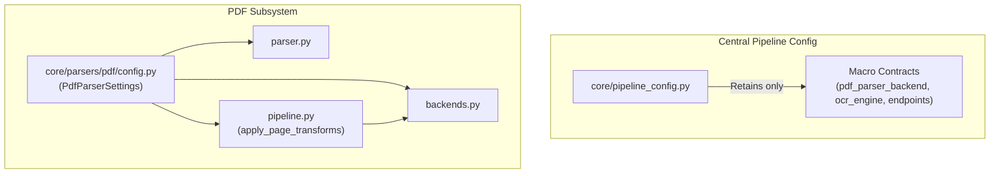
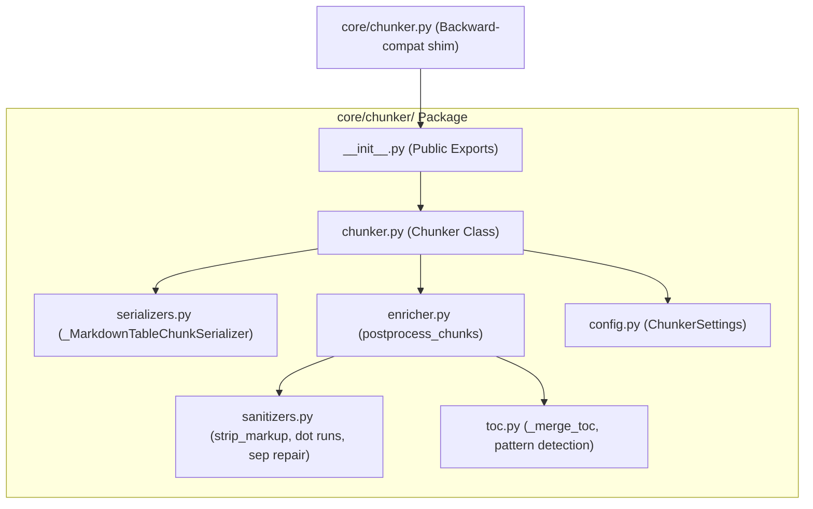
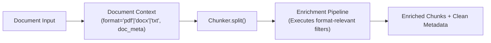
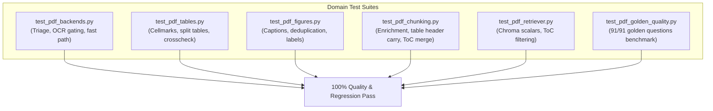
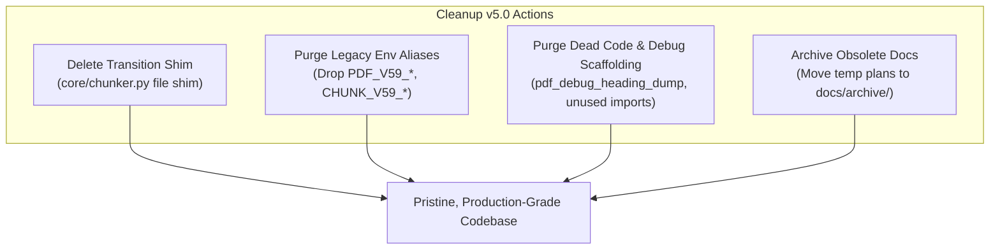

# PDF Pipeline Cleanup: Version Roadmap (`parser_cleanup_versions.md`)

This document outlines the step-by-step, versioned execution roadmap to transform the PDF parser, chunker, and configuration into a modular, clean, and maintainable architecture while strictly preserving **100% of extraction strength and retrieval accuracy** (verified against the 91/91 golden benchmark).

---

## 1. Version Roadmap Summary

| Version | Focus | Primary Deliverables | Key Milestones |
| :--- | :--- | :--- | :--- |
| **Cleanup v1.0** | **PDF Parser & Config Decentralization** | `core/parsers/pdf/config.py` `core/parsers/pdf/pipeline.py` `core/parsers/pdf/backends.py` `core/pipeline_config.py` | • Create `core/parsers/pdf/config.py` with semantic names & backward-compatible env aliases • Eliminate duplicate `fitz` setup & cellmark calls via shared `pipeline.py` • Strip PDF-specific micro-configs from central `core/pipeline_config.py` • Verify all PDF backend and table tests pass |
| **Cleanup v2.0** | **Chunker Package Restructuring (`core/chunker/`)** | `core/chunker/__init__.py` `core/chunker/serializers.py` `core/chunker/sanitizers.py` `core/chunker/toc.py` `core/chunker/enricher.py` `core/chunker/config.py` | • Package chunking into dedicated `core/chunker/` directory • Move `core/chunk_cleanup.py` logic into `enricher.py`, `sanitizers.py`, and `toc.py` • Extract Markdown table serializers into `serializers.py` • Add backward-compatibility shim at `core/chunker.py` • Verify table header carry, dot-run cleanup, and ToC merging pass |
| **Cleanup v3.0** | **Format Decoupling & Pipeline Config Finalization** | `core/chunker/chunker.py` `core/chunker/enricher.py` `core/pipeline_config.py` `config.py` | • Eliminate hardcoded `filename.lower().endswith(".pdf")` in chunker • Decouple string sentinel tags (`[TOC]`, `[Recovered text]`) using structured metadata • Clean up central `pipeline_config.py` and `config.py` to only contain macro pipeline contracts • Verify multi-format chunking (PDF, TXT, DOCX) works seamlessly |
| **Cleanup v4.0** | **Test Suite Domain Reorganization & Quality Benchmark** | `tests/parsers/test_pdf_tables.py` `tests/parsers/test_pdf_chunking.py` `tests/parsers/test_pdf_golden_quality.py` | • Consolidate temporary regression tests (`test_pdf_v59_regression.py`) into clean domain suites • Standardize test fixtures and assertions • Run full end-to-end 91/91 golden question recall verification • Confirm zero regressions across extraction and retrieval |
| **Cleanup v5.0** | **Repository Hardening & Redundancy Purge** | Codebase-wide purge of transition shims, legacy fallbacks, and dead code | • Remove backward-compatibility shims (e.g. `core/chunker.py` file shim) • Remove legacy fallback aliases for obsolete environment variables (`PDF_V59_*`, `CHUNK_V59_*`) • Purge unused dead code, redundant helpers, and obsolete test files • Archive obsolete scratch documentation into `docs/archive/` • Enforce clean, canonical configuration and run full benchmark suite |

---

## 2. Cleanup v1.0: PDF Parser & Config Decentralization

**Objective**: Move all PDF-specific micro-settings out of `core/pipeline_config.py` into a dedicated module config, and eliminate repeated transformation code across PDF backends.

### Components Touched
* `core/parsers/pdf/config.py` (New)
* `core/parsers/pdf/pipeline.py` (New)
* `core/parsers/pdf/backends.py`
* `core/parsers/pdf/parser.py`
* `core/parsers/pdf/postprocess.py`
* `core/pipeline_config.py`

### Key Deliverables
1. **Dedicated PDF Configuration (`core/parsers/pdf/config.py`)**:
   * Define `PdfParserSettings` with clear semantic names:
     * `enable_page_router`, `min_text_chars_for_text_route`, `text_layer_min_chars`
     * `enable_cellmarks`, `cellmark_repeat_min`, `figure_mode`, `smolvlm_max_new_tokens`
     * `enable_coverage_check`, `coverage_recall_min`, `coverage_near_match`, `enable_table_crosscheck`
   * Provide env-var aliases ensuring backward compatibility:
     * `PDF_V59_CELLMARKS` fallback for `PDF_ENABLE_CELLMARKS`
     * `PDF_V59_COVERAGE` fallback for `PDF_ENABLE_COVERAGE`
     * `PDF_V59_TABLE_CROSSCHECK` fallback for `PDF_ENABLE_TABLE_CROSSCHECK`
2. **Shared Transform Orchestrator (`core/parsers/pdf/pipeline.py`)**:
   * Implement `apply_page_transforms(doc, page_fitz, page_no, config)`:
     * Centralize `fitz` page lifecycle, cellmark injection, and figure card processing.
     * Consolidate warning logs and try/except wrappers into a single well-tested helper.
3. **Refactor Backends & Parser**:
   * Update `DoclingTableBackend` and `VlmPictureBackend` to delegate to `pipeline.py`.
   * Update `parser.py` to reference `PdfParserSettings`.
4. **Clean Central `pipeline_config.py`**:
   * Strip all PDF triage, cellmark, coverage, and figure flags from `core/pipeline_config.py`.
   * Keep only `pdf_parser_backend`, `ocr_engine`, `ocr_languages`, `tesseract_cmd`, and `libreoffice_*`.

### Verification Criteria
* `tests/parsers/test_pdf_tables.py` passes.
* `tests/parsers/test_pdf_backends.py` passes.
* `tests/parsers/test_pdf_figures.py` passes.
* Verify `PdfParser` runs without errors using both default and custom env vars.

---

## 3. Cleanup v2.0: Chunker Package Restructuring (`core/chunker/`)

**Objective**: Package the entire chunking subsystem into a dedicated `core/chunker/` directory, moving `core/chunk_cleanup.py` into clean submodules and isolating table serialization.

### Components Touched
* `core/chunker/__init__.py` (New)
* `core/chunker/chunker.py` (New - moved from `core/chunker.py`)
* `core/chunker/serializers.py` (New)
* `core/chunker/enricher.py` (New)
* `core/chunker/sanitizers.py` (New)
* `core/chunker/toc.py` (New)
* `core/chunker/config.py` (New)
* `core/chunker.py` (Converted to backward-compatibility shim)
* `core/chunk_cleanup.py` (Deleted - logic distributed into `enricher`, `sanitizers`, `toc`)

### Key Deliverables
1. **Module Decomposition**:
   * `serializers.py`: Contains `_MarkdownTableChunkSerializer` and `_MarkdownTableSerializerProvider`.
   * `sanitizers.py`: Contains `strip_markup()`, `_collapse_sep_rows()`, `_strip_dot_runs()`, `_SEP_FRAG_RE`, `is_micro_label()`, and `_flatten_meta()`.
   * `toc.py`: Contains `_TOC_HEAD_RE`, `_TOC_ROW_RE`, `_TOC_ENTRY_RE`, and `_merge_toc()`.
   * `enricher.py`: Clean orchestrator of `postprocess_chunks()` combining sanitizers, table continuation, and ToC consolidation.
   * `config.py`: Local `ChunkerSettings` (`enable_postprocess`, `carry_table_headers`, `merge_toc_entries`, `repeat_table_header`, `header_cap_tokens`) with env-var aliases (`CHUNK_V59_TABLES`, `PDF_V59_TOC`, etc.).
2. **Clean `core/chunker/chunker.py`**:
   * Uses components from `serializers.py`, `enricher.py`, and `config.py`.
3. **Public API & Compatibility Shim**:
   * `core/chunker/__init__.py` exports `Chunker`, `ChunkerSettings`, and `_flatten_meta`.
   * `core/chunker.py` acts as a 2-line shim importing and re-exporting from `core.chunker` so that existing scripts require no changes during this phase.
4. **Remove Root Clutter**:
   * Delete `core/chunk_cleanup.py`.

### Verification Criteria
* `tests/parsers/test_pdf_chunk_cleanup.py` passes (updated imports).
* `tests/parsers/test_pdf_chunker_retriever.py` passes.
* In-page synthetic heading insertion and table header continuation are verified.

---

## 4. Cleanup v3.0: Format Decoupling & Pipeline Config Finalization

**Objective**: Remove format-specific hardcoding (`filename.lower().endswith(".pdf")`) and string sentinel tags from `core/chunker/`, and finalize the central configuration files.

### Components Touched
* `core/chunker/chunker.py`
* `core/chunker/enricher.py`
* `core/pipeline_config.py`
* `config.py`

### Key Deliverables
1. **Format Decoupling in Chunker**:
   * Replace `filename.lower().endswith(".pdf")` in `Chunker.split()` with a structured parameter or clean document introspection (e.g. `is_pdf = (doc_type == "pdf")` or context dictionary passed to `enricher.postprocess_chunks()`).
   * Avoid hardcoding file extensions inside the core chunk splitting loop.
2. **Sentinel Tag Abstraction**:
   * Replace reliance on raw text searching for `[TOC]` or `[Recovered text]` by checking chunk or item metadata assigned during extraction.
3. **Central Configuration Finalization**:
   * Remove all leftover chunking flags (`chunk_postprocess`, `chunk_v59_tables`, `pdf_v59_toc`, `pdf_table_repeat_header`, `chunk_header_cap_tokens`) from `core/pipeline_config.py`.
   * Standardize `config.py` (`Settings`) to delegate chunking and PDF parsing options to their respective module settings, eliminating config drift.

### Verification Criteria
* Verify non-PDF formats (text strings, markdown, docx) chunk properly through `Chunker.split()`.
* Verify PDF chunking retains identical chunk count and metadata.
* `tests/parsers/test_pdf_chunker_retriever.py` passes.

---

## 5. Cleanup v4.0: Test Suite Domain Reorganization & Quality Benchmark

**Objective**: Consolidate scattered and milestone-named test files into organized domain test suites, and execute full end-to-end golden verification.

### Components Touched
* `tests/parsers/test_pdf_v59_regression.py` (Refactored / split into domain tests)
* `tests/parsers/test_pdf_chunking.py` (New consolidated chunker test suite)
* `tests/parsers/test_pdf_tables.py`
* `tests/parsers/test_pdf_golden_quality.py`

### Key Deliverables
1. **Domain Test Reorganization**:
   * Migrate assertions from `test_pdf_v59_regression.py` into their respective domain test files:
     * Table header continuation & ToC merge -> `test_pdf_chunking.py`.
     * Visual cellmarks & table crosscheck -> `test_pdf_tables.py`.
     * Figure dedup & caption tests -> `test_pdf_figures.py`.
   * Remove obsolete test files once their assertions are safely migrated.
2. **Clean Docstrings and Test Annotations**:
   * Update test descriptions to explain expected behavior rather than referring to historical work-packages (WP1, WP6, etc.).
3. **End-to-End Golden Verification**:
   * Run `tests/parsers/test_pdf_golden_quality.py`.
   * Confirm that all 91 golden questions achieve top-k recall.
   * Verify zero regressions across parsing, chunking, and ChromaDB retrieval.

### Verification Criteria
* Complete test suite passes: `pytest tests/parsers/`.
* Golden quality benchmark achieves 91/91 (100% accuracy).

---

## 6. Cleanup v5.0: Repository Hardening & Redundancy Purge

**Objective**: Remove all transitional backward-compatibility scaffolding, obsolete environment variable fallbacks, and dead code, leaving the repository in a pristine, production-ready state.

### Components Touched
* `core/chunker.py` (Deleted - transition shim removed; all imports now point directly to `core.chunker`)
* `core/parsers/pdf/config.py` (Purged of legacy `PDF_V59_*` aliases)
* `core/chunker/config.py` (Purged of legacy `CHUNK_V59_*` aliases)
* `core/parsers/pdf/parser.py` (Cleaned of debug scaffolding)
* `docs/archive/` (Archived legacy milestone documents)
* Codebase-wide imports across `api/`, `core/`, and `tests/`

### Key Deliverables
1. **Remove Transition Shims**:
   * Update any remaining imports across the codebase (`api/`, `core/`, `tests/`) to use `from core.chunker import Chunker`.
   * Safely delete the `core/chunker.py` shim file. `core/chunker/` is now the sole, authoritative chunker module.
2. **Purge Legacy Environment Variable Aliases**:
   * In `core/parsers/pdf/config.py`, remove backward-compatibility fallbacks for `PDF_V59_CELLMARKS`, `PDF_V59_COVERAGE`, `PDF_V59_TABLE_CROSSCHECK`, and `PDF_V57_CLEANUP`.
   * In `core/chunker/config.py`, remove backward-compatibility fallbacks for `CHUNK_V59_TABLES` and `PDF_V59_TOC`.
   * The codebase now exclusively uses clean, canonical, and self-documenting environment variable names (`PDF_ENABLE_CELLMARKS`, `CHUNK_CARRY_TABLE_HEADERS`, etc.).
3. **Purge Dead Code & Debug Leftovers**:
   * Remove any unused imports, dead utility functions, or debug routines (`pdf_debug_heading_dump`) that are no longer part of production execution.
   * Standardize docstrings to remove all remaining historical version tags ("v5.2", "v5.9 WP1", etc.).
4. **Archive Obsolete Documentation**:
   * Move transient milestone planning documents (such as `pdf_v5.0_plan.md`, `pdf_v5.1_plan.md`, `pdf_imp_versions.md`) into `docs/archive/` so that the `docs/` root contains only active, relevant architectural guides.

### Verification Criteria
* Global codebase scan verifies no remaining references to `PDF_V59_*` or `CHUNK_V59_*`.
* Global codebase scan verifies no broken imports pointing to deleted shim files.
* Full test suite runs cleanly: `pytest tests/`.
* Golden quality benchmark achieves 91/91 (100% accuracy) on clean canonical configurations.
