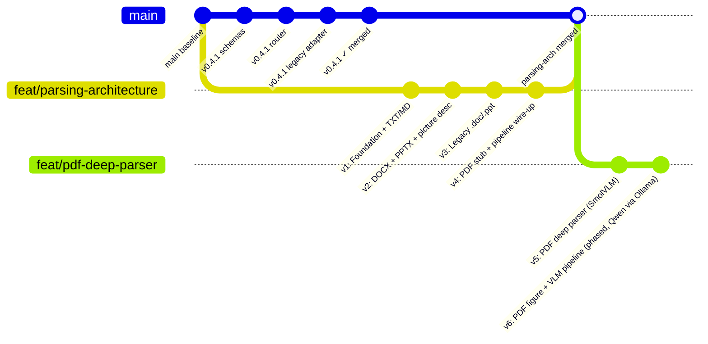

# Parsing Architecture — Branch Roadmap

**Branch:** `feat/parsing-architecture`
**Branches from:** `main` (runs in parallel with v0.4.1)
**Integration point:** Merges to `main` after **v4 completes** — that is when all formats are covered and the ingestion endpoint can be safely switched.

---

## Why a Separate Branch

The v0.4.1 plan changes the **API layer** (routing, schemas, status codes). This parsing architecture changes the **parsing + chunking layer** underneath it. They are independent — v0.4.1 can ship to main without waiting for parsing work, and parsing work does not depend on v0.4.1 being finished. Running them as separate branches lets both land in the right order without blocking each other.



---

## Version Sequence

| Version | Document | What it adds | Integration |
|---|---|---|---|
| **v1** | `v1.md` | `BaseParser` abstract, `TextParser` (TXT/MD via `convert_string`), `ParserRouter` scaffold, `HybridChunker` in `Chunker` | Internal only — ingestion endpoint unchanged |
| **v2** | `v2.md` | `DoclingParser` for `.docx` + `.pptx`, router updated; `HybridChunker.serialize()` critical fix; lightweight local picture description (SmolVLM-256M / Granite-Vision via Ollama) | Internal only |
| **v3** | `v3.md` | `LibreOfficeConverter` for `.doc`/`.ppt`, router updated | Internal only |
| **v4** | `v4.md` | `PdfStubParser` for `.pdf`, router covers all formats → **ingestion endpoint switched to `parser_router`** | **Branch merge to main** |
| **v5** | `v5.md` | `PdfPageRouter` (per-page triage, PyMuPDF4LLM, Docling, SmolVLM) | Separate branch off main post-merge |
| **v6** | `v6_plan.md` | PDF figure/diagram pipeline in phases P0-P6: Qwen VLM installed in Ollama (P0), `fitz` -> `pymupdf` (P1), deterministic Figure cards (P2), procedure chunks (P3), OCR + strictly validated VLM connections (P4), typed chunks with MinIO image links (P5), A/B harness (P6). Replaces the DeepSeek-OCR2 / vLLM plan, which is discarded (`parsing_arch_v6_vllm_migration.md` is kept only as a superseded record). | Continuation off v5.9. Each phase is opt-in via `PDF_FIGURE_PIPELINE=v6` until the A/B passes. |

---

## Rules Across All Versions

- **No regression.** Every version must pass `tests/v0.3/` and `tests/v0.4/` unchanged.
- **Public API contract never changes.** `POST /api/v1/documents` response schema, HTTP status codes, and legacy routes are frozen.
- **Comment preservation mandate.** No existing comment or docstring in any modified file is removed or reworded. New comments may be added.
- **Additive only.** Each version adds files or extends existing ones. Nothing is deleted until a later version explicitly retires it.
- **`core/parser.py` stays alive** until v4 integration. Legacy routes in `api/legacy.py` always call the old `Parser` — the new `ParserRouter` is only used from the new v1 ingestion path.

---

## Dependency Chain

```
v1 Foundation
    └── v2 DOCX/PPTX + picture desc (requires BaseParser + DoclingParser)
            └── v3 Legacy (requires LibreOfficeConverter + DoclingParser from v2)
                    └── v4 PDF stub + pipeline (requires all formats + HybridChunker from v1)
                            └── v5 PDF deep (requires PdfPageRouter + SmolVLM integration)
                                    └── v6 PDF figure + VLM pipeline (requires v5.9 router, Docling figure classification and an Ollama service)
```

---

## File Ownership Per Version

| File | Owner Version | Action |
|---|---|---|
| `core/parsers/__init__.py` | v1 | [NEW] |
| `core/parsers/base.py` | v1 | [NEW] |
| `core/parsers/text_parser.py` | v1 | [NEW] |
| `core/parser_router.py` | v1 | [NEW] scaffold |
| `core/chunker.py` | v1 | [MODIFY] add HybridChunker path |
| `config.py` | v1 | [MODIFY] chunker_tokenizer |
| `core/parsers/docling_parser.py` | v2 | [NEW] |
| `core/parser_router.py` | v2 | [MODIFY] add .docx/.pptx |
| `core/parsers/libreoffice_converter.py` | v3 | [NEW] |
| `core/parser_router.py` | v3 | [MODIFY] add .doc/.ppt |
| `core/parsers/pdf_stub.py` | v4 | [NEW] |
| `core/parser_router.py` | v4 | [MODIFY] add .pdf |
| `api/dependencies.py` | v4 | [MODIFY] add parser_router singleton |
| `api/v1/endpoints/documents.py` | v4 | [MODIFY] switch to parser_router |
| `config.py` | v2 | [NEW] picture-description model settings (SmolVLM-256M primary preset, Granite-Vision-3.3-2B via Ollama as escalation — see v2.md) |
| `core/parsers/pdf_router.py` | v5 | [NEW] |
| `core/parser_router.py` | v5 | [MODIFY] swap .pdf to PdfPageRouter |
| `config.py` | v5 | [MODIFY] Configure SmolVLM settings for PDF page routing |
| `config.py` | v6 | [MODIFY] additive v6 settings (`PDF_FIGURE_PIPELINE`, `PDF_VLM_*`, `PDF_FIGURE_*`); DeepSeek-OCR2 / vLLM settings are no longer planned |
| `parsers/pdf_v6/` | v6 | [NEW] figure pipeline package: `text`, `geometry`, `labels`, `gate`, `cards` (P2), `procedure` (P3), `ocr`, `vlm` (P4), `store` (P5) |
| `parsers/pdf_router.py` | v6 | [MODIFY] additive v6 branches only (`PDF_FIGURE_PIPELINE=v6`); the v5.9 code path is untouched; `fitz` -> `pymupdf` (P1) |
| `parsers/docling_parser.py` | v6 | [MODIFY] `_build_figure_converter` (classification, no picture description) |
| `core/chunker.py` | v6 | [MODIFY] `figure` / `procedure` content types; moves page / bbox / image link into chunk metadata |
| `scripts/qwen_setup.py` | v6 | [NEW] P0: background install + status + verify of the Qwen VLM in Ollama |
| `scripts/figure_eval.py` | v6 | [NEW] P6: A/B harness for VLM models on gold figures |

---

## Test Directory Structure

```
tests/
├── v0.3/          (locked — never touch)
├── v0.4/          (locked — never touch)
└── parsing_arch/
    ├── v1/        (Foundation + TXT/MD)
    ├── v2/        (DOCX + PPTX + picture description + serialize() fix)
    ├── v3/        (Legacy formats)
    ├── v4/        (PDF stub + pipeline)
    ├── v5/        (PDF deep parser with SmolVLM)
    └── v6/        (PDF figure + VLM pipeline: test_p0_qwen_setup ... test_p6_eval, one file per phase)
```

Each version's test directory is created alongside its plan document.

---

## v6 Phases (replaces the DeepSeek-OCR2 / vLLM plan)

Full plan: `v6_plan.md`.  Every phase ships as its own patch with its own tests and leaves the suite green.

| Phase | Delivers | Switch |
|---|---|---|
| P0 | `scripts/qwen_setup.py`: Qwen VLM pulled into the Ollama service in the background, status and verify commands | none (infrastructure) |
| P1 | `fitz` -> `import pymupdf` across the app, pinned `pymupdf>=1.24.3` | none (behaviour-preserving) |
| P2 | Deterministic Figure cards, no SmolVLM on PDF pages | `PDF_FIGURE_PIPELINE=v6` |
| P3 | Step-by-step illustration pages -> one ordered Procedure chunk | `PDF_FIGURE_PROCEDURES` |
| P4 | RapidOCR labels + Ollama VLM connections validated by exact match | `PDF_FIGURE_OCR`, `PDF_VLM_ENABLED` |
| P5 | Page / bbox / MinIO image link in chunk metadata | `PDF_FIGURE_STORE` |
| P6 | A/B harness and gold-figure template | none (tooling) |
