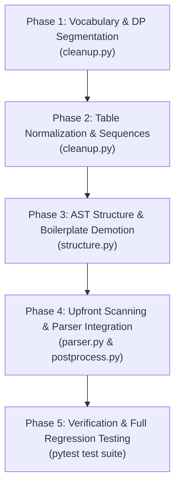

# Formal Implementation Plan: PDF v3.1 — Text & Structure Heuristics Restoration

## Executive Summary

**PDF v3.1** elevates the modular PDF parser (`core/parsers/pdf/`) to feature and heuristic parity with `parser_v1` (v5.2–v5.9.4) for all text-layer, table-splitting, vocabulary-based space repair, and AST-level structural heuristics.

In the initial refactoring (v3.0), `cleanup.py` and `structure.py` were established as modular interfaces but contained simplified logic. **PDF v3.1** replaces those stubs with the full, battle-tested algorithms from `parser_v1` while preserving the clean modular directory structure of `pdf_refactor`.

---

## 1. Architectural Scope & Invariants

```text
┌────────────────────────────────────────────────────────────────────────┐
│                        PDF v3.1 Scope Boundary                         │
├────────────────────────────────────────────────────────────────────────┤
│ 1. Active Working Branch                                               │
│    └── pdf_refactor (0 branch switching, purely on pdf_refactor)       │
│                                                                        │
│ 2. Modules Updated inside core/parsers/pdf/                            │
│    ├── transforms/                                                     │
│    │   ├── cleanup.py (DP word segmentation, tables, sequence repairs) │
│    │   └── structure.py (Boilerplate demote, relevel, caption bind)    │
│    ├── postprocess.py (Passes vocab & runs multi-pass pipeline)        │
│    └── parser.py (Upfront page text scan, build_vocab, OCR gating)     │
│                                                                        │
│ 3. Modules Strictly Untouched                                          │
│    └── core/chunker.py, retriever.py, uploader.py                      │
│                                                                        │
│ 4. Test Suites Expanded                                                │
│    ├── tests/parsers/test_pdf_cleanup.py                               │
│    └── tests/parsers/test_pdf_structure.py                             │
└────────────────────────────────────────────────────────────────────────┘
```

---

## 2. Implementation Deliverables by Distinct Phases



---

### 🔷 Phase 1: Vocabulary Engine & Dynamic Programming Word Segmentation

**Target File**: [`core/parsers/pdf/transforms/cleanup.py`](file:///c:/Users/ADMIN/OneDrive/Desktop/Honeywell%20Project/honeywell-project/core/parsers/pdf/transforms/cleanup.py)

#### 1. Implementation Scope:
- **`build_vocab(texts: Iterable[str]) -> Counter`**:
  Extracts lowercase words across the PDF's text layer to construct a document-specific frequency dictionary.
- **`segment_words(token: str, vocab: Counter) -> list[str] | None`**:
  Dynamic programming algorithm maximizing summed log-frequency minus a per-piece cost (`_PIECE_COST = 3.0`). Requires pieces $\ge 3$ letters, with a whitelist for common 2-letter function words (`_TWO_LETTER_OK`) and leading `"a"`.
- **`_recase(original: str, pieces: list[str]) -> str`**:
  Maintains casing fidelity (ALL CAPS, TitleCase, lowercase) when rejoining split words.
- **`fix_lost_spaces(text: str, vocab: Counter) -> str`**:
  Re-inserts spaces into glued words ($\ge 6$ characters). Handles CamelCase identifiers (`"RingDips"`) while leaving valid acronyms/names intact (`"hetCOI"`, `"iPhone"`).
- **`collapse_letter_spacing(text: str, vocab: Counter | None) -> str`**:
  Collapses spaced-out runs (`"R o u n d  1"` $\rightarrow$ `"Round 1"`); long runs ($\ge 10$ chars) re-segmented via `segment_words`.
- **`rejoin_urls(text: str) -> str`**:
  Fixes URLs split across lines or contaminated with rogue whitespace (`_URL_RE`).
- **`is_noise_paragraph(text: str) -> bool`**:
  Filters out non-content debris, photo noise, and orphan punctuation.

#### 2. Phase 1 Tests (`tests/parsers/test_pdf_cleanup.py`):
- `test_build_vocab_counts_frequencies`: Validates word frequency dictionary generation over multi-page texts.
- `test_segment_words_glued_tokens`: Validates dynamic programming split on glued words present in vocab (e.g. `"systemparameters"` $\rightarrow$ `["system", "parameters"]`).
- `test_fix_lost_spaces_camelcase_and_caps`: Tests CamelCase splitting (`"RingDips"`) while preserving unlisted technical identifiers.
- `test_collapse_letter_spacing`: Validates `"R o u n d 1"` $\rightarrow$ `"Round 1"`.
- `test_rejoin_urls_broken_by_lines`: Verifies `https:// honeywell. com/ test` $\rightarrow$ `https://honeywell.com/test`.
- `test_is_noise_paragraph_filtering`: Validates that photo debris and single punctuation marks are flagged as noise.

---

### 🔷 Phase 2: Advanced Markdown Table Normalization & Sequence Repairs

**Target File**: [`core/parsers/pdf/transforms/cleanup.py`](file:///c:/Users/ADMIN/OneDrive/Desktop/Honeywell%20Project/honeywell-project/core/parsers/pdf/transforms/cleanup.py)

#### 1. Implementation Scope:
- **`clean_markdown_tables(md: str, vocab: Counter | None) -> str`**:
  - `_split_side_by_side`: Detects and separates two independent tables placed side-by-side in parallel columns into two sequential tables.
  - `_split_subheaders`: Splits tables containing embedded category subheaders into clean distinct tables.
  - `_try_toc`: Detects two-column Table of Contents tables and normalizes columns to `["No.", "Section", "Page"]`.
  - `_compact_toc_chunk`: Detects dotted-leader ToC rows and formats as a compact, structured ToC block.
  - `_fix_toc_rows`: Aligns multi-column ToC rows that lack explicit headers.
- **`clean_page_markdown(md: str, vocab: Counter | None) -> str`**:
  Orchestrates table cleaning, photo text caption filtering (`_PICTURE_TEXT_RE`), bold hyphen fixes, and paragraph-level space repairs.
- **Heading Number & Sequence Repairs**:
  - `fix_heading_number(text: str) -> str`: Fixes broken decimal numbering (`"6.5. 1Chest Circuit"` $\rightarrow$ `"6.5.1 Chest Circuit"`).
  - `repair_heading_sequence(texts: list[str]) -> list[str]`: Detects and corrects typos where sub-headings backtrack (e.g., `6.2.2` appearing after `6.5.1` repaired to `6.5.2`).
  - `renumber_sequence(labels: list[str]) -> list[str]`: Re-numbers corrupted sequences (e.g., `['Day 7', 'Day 2']` $\rightarrow$ `['Day 1', 'Day 2']` when $\le 1/3$ of items are bad).

#### 2. Phase 2 Tests (`tests/parsers/test_pdf_cleanup.py`):
- `test_split_side_by_side_tables`: Verifies that a table with duplicate headers side-by-side splits into two consecutive tables.
- `test_split_subheaders_in_table`: Verifies that embedded category subheaders break a table into separate blocks.
- `test_normalize_two_column_toc`: Verifies `_try_toc` correctly converts a 2-column contents table into standard `No.`, `Section`, `Page` format.
- `test_fix_heading_number`: Tests `"6.5. 1Chest Circuit"` $\rightarrow$ `"6.5.1 Chest Circuit"`.
- `test_repair_heading_sequence_typo`: Tests `["6.5.1 Heading A", "6.2.2 Heading B"]` $\rightarrow$ `["6.5.1 Heading A", "6.5.2 Heading B"]`.
- `test_renumber_sequence`: Tests `["Day 7", "Day 2", "Day 3"]` $\rightarrow$ `["Day 1", "Day 2", "Day 3"]`.

---

### 🔷 Phase 3: AST Structural Repairs & Heading Integrity

**Target File**: [`core/parsers/pdf/transforms/structure.py`](file:///c:/Users/ADMIN/OneDrive/Desktop/Honeywell%20Project/honeywell-project/core/parsers/pdf/transforms/structure.py)

#### 1. Implementation Scope:
- **AST Sequence Navigation**:
  `_sequence(doc)` iterating all `TextItem`, `TableItem`, `PictureItem` in reading order; helpers `_as_text()`, `_as_heading()`, `_swap()`, `_is_heading()`, `_page()`, `_idx()`.
- **`repair_pdf_headings(doc: DoclingDocument, min_page_repeats: int = 3) -> None`**:
  - **Cross-Page Boilerplate Demotion**: Tracks `pages_seen_on` across all pages. Any text string appearing on $\ge 3$ distinct pages is demoted from `SECTION_HEADER`/`TITLE` to `PARAGRAPH`.
  - **Empty Heading Blanking**: Converts empty headings into inert `TextItem` with `text=""` so HierarchicalChunker drops them without resetting heading paths.
  - **Heading Level Normalization**: Relocates misplaced section numbers via `_extract_misplaced_number()` (`"Greasing 6.4 the Groove"` $\rightarrow$ `"6.4 Greasing the Groove"`, level 2).
  - **Numbered Paragraph Promotion**: Stricter promotion for short body paragraphs starting with section numbers (`_PROMOTABLE_HEADING_RE`).
  - **`_split_embedded_headings(doc)`**: Detects items where Docling's markdown parser merged a heading and a body paragraph into a single item (`### 5.7 Routine\nDo 3 sets...`) and splits them into distinct `SectionHeaderItem` and `TextItem` nodes.
- **`repair_pdf_structure(doc: DoclingDocument, vocab: Counter | None) -> None`**:
  - `clean_text_items(doc, vocab)`: Cleans all text items in the AST using document vocabulary.
  - `repair_heading_numbers(doc)`: Runs `fix_heading_number` and `repair_heading_sequence` on all headings in reading order.
  - `demote_pseudo_headings(doc)`: Demotes CTA buttons (`"Download now"`) and capitalized body text.
  - `bind_captions(doc)`: Binds floating labels (`"Day 2"`, `"Animal Protein"`) immediately preceding a table to become the official table caption.
  - `relevel_headings(doc)`: Re-nests unnumbered subheadings beneath the parent numbered section header.
  - `dedupe_echoes(doc)`: Blanks body paragraphs that duplicate adjacent section headers.
  - `blacklist_headings(doc)`: Blanks template headers (`Titelseite`, `GB Version`, `Fig.xy`, `Abb.xy`).

#### 2. Phase 3 Tests (`tests/parsers/test_pdf_structure.py`):
- `test_cross_page_boilerplate_demotion`: Verifies that a header appearing on pages 1, 2, and 3 is demoted to `DocItemLabel.PARAGRAPH`.
- `test_empty_heading_inerting`: Verifies that empty `SectionHeaderItem` is converted to plain `TextItem` so chunker heading state does not reset.
- `test_misplaced_number_relocation`: Tests that `"Greasing 6.4 the Groove"` becomes `"6.4 Greasing the Groove"` with `level=2`.
- `test_split_embedded_headings`: Verifies that `### 5.7 Routine\nDo 3 sets` splits into a `SectionHeaderItem` followed by a `TextItem`.
- `test_bind_captions_to_tables`: Verifies that `"Day 2"` immediately preceding a `TableItem` becomes the table's caption.
- `test_relevel_headings_under_numbered_parent`: Verifies unnumbered subsection nests under preceding numbered section.
- `test_dedupe_echoes_blanks_duplicate`: Verifies that a paragraph containing the exact text of the preceding heading is blanked.
- `test_blacklist_template_headings`: Verifies that `"Titelseite"` and `"GB Version"` are blanked.

---

### 🔷 Phase 4: Upfront Scanning, OCR Gating & Pipeline Wiring

**Target Files**:
- [`core/parsers/pdf/parser.py`](file:///c:/Users/ADMIN/OneDrive/Desktop/Honeywell%20Project/honeywell-project/core/parsers/pdf/parser.py)
- [`core/parsers/pdf/postprocess.py`](file:///c:/Users/ADMIN/OneDrive/Desktop/Honeywell%20Project/honeywell-project/core/parsers/pdf/postprocess.py)

#### 1. Implementation Scope:
- **`PdfParser.parse()` Upfront Pre-Scan**:
  ```python
  # 1. Extract raw page texts
  page_texts = [p.get_text() for p in pdf]

  # 2. Build document-wide vocabulary
  vocab = build_vocab(page_texts)

  # 3. Dynamic OCR gating (skip OCR if digital text layer >= 40 chars)
  ocr_pages = {
      i for i, t in enumerate(page_texts)
      if len(t.strip()) < 40
  }
  ```
- **Backend Dispatch**:
  Pass `use_ocr = page_idx in ocr_pages` into `extract_page_markdown()`.
- **`PdfPostProcessor` Multi-Pass Orchestration**:
  ```python
  def process_markdowns(self, markdowns, raw_texts=None, vocab=None):
      # 1. normalize_glyphs(md)
      # 2. strip_running_lines(processed)
      # 3. clean_page_markdown(md, vocab=vocab)
      # 4. check_page_coverage(...)
      return processed

  def process_document(self, doc, pdf=None, vocab=None):
      # 1. repair_pdf_headings(doc, min_page_repeats=3)
      # 2. repair_pdf_structure(doc, vocab=vocab)
      # 3. tag_toc_structures(doc)
      return doc
  ```

#### 2. Phase 4 Tests (`tests/parsers/test_pdf_parser_v1.py` & `test_pdf_structure.py`):
- `test_upfront_vocab_passed_to_postprocessor`: Confirms `vocab` is built and passed through to markdown and document transforms.
- `test_ocr_gating_flag`: Confirms text-rich pages bypass OCR while low-text pages trigger OCR.
- `test_postprocessor_pipeline_order`: Confirms `repair_pdf_headings` executes before `repair_pdf_structure` and captions bind cleanly.

---

### 🔷 Phase 5: Verification & Full Regression Testing

#### 1. Test Execution Plan:
```powershell
# 1. Run Phase 1 & 2 tests (Text and Table Cleanup)
pytest tests/parsers/test_pdf_cleanup.py -v

# 2. Run Phase 3 tests (Structure, Boilerplate, Headings)
pytest tests/parsers/test_pdf_structure.py -v

# 3. Run all existing parser test suites (Triage, Backends, Glyphs, Cellmarks, Coverage)
pytest tests/parsers/ -v

# 4. Verify core/ cleanliness (ensure no modifications to chunker/retriever/uploader)
git status
```

#### 2. Success Criteria:
- 100% of unit tests pass in `tests/parsers/`.
- All text-layer, table-splitting, and structural heuristics from `parser_v1` verified operational.
- Zero git diff in `core/chunker.py`, `core/retriever.py`, or `core/uploader.py`.

---

## 3. Definition of Done (PDF v3.1)
- [ ] `core/parsers/pdf/transforms/cleanup.py` expanded with complete vocabulary engine, DP word segmentation, and table normalizations.
- [ ] `core/parsers/pdf/transforms/structure.py` expanded with cross-page boilerplate demotion, heading normalization, caption binding, and embedded heading splitting.
- [ ] `core/parsers/pdf/parser.py` extracts upfront vocabulary and gates OCR per page.
- [ ] `core/parsers/pdf/postprocess.py` runs all markdown and document passes in dependency order.
- [ ] All unit tests in `test_pdf_cleanup.py` and `test_pdf_structure.py` pass cleanly.
- [ ] Commit ready as: `PDF v3.1: Full Text & Structure Heuristics Restoration`.
