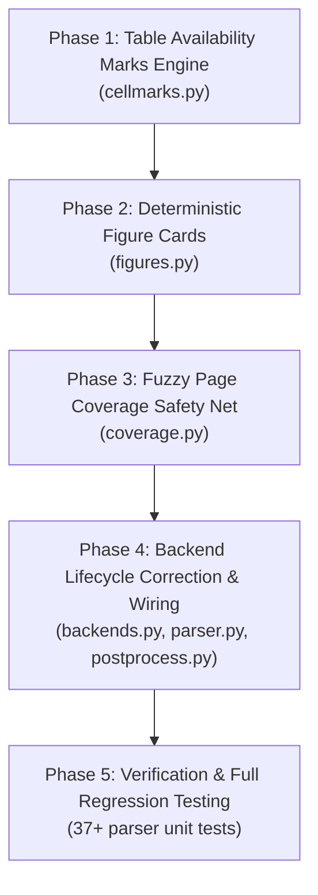

# Formal Implementation Plan: PDF v4.1 — Visual Domain & Coverage Transforms Restoration

## Executive Summary

**PDF v4.1** is the second major milestone in bringing the modular PDF parser (`core/parsers/pdf/`) up to **100% feature and heuristic parity** with `parser_v1` (v5.2–v5.9.4).

In the initial refactoring (v4.0), `cellmarks.py`, `figures.py`, and `coverage.py` were created as minimal stubs, and `cellmarks.inject_marks` was incorrectly attached after the document was merged from markdown (where PDF bounding boxes no longer exist). **PDF v4.1** fixes this critical lifecycle defect and ports the complete, battle-tested visual and text recovery algorithms from `parser_v1`, making availability ticks, figure diagram cards, and dropped text recovery fully operational.

---

## 1. Architectural Scope & Invariants

```text
┌────────────────────────────────────────────────────────────────────────┐
│                        PDF v4.1 Scope Boundary                         │
├────────────────────────────────────────────────────────────────────────┤
│ 1. Active Working Branch                                               │
│    └── pdf_refactor (0 branch switching, purely on pdf_refactor)       │
│                                                                        │
│ 2. Modules Updated inside core/parsers/pdf/                            │
│    ├── transforms/                                                     │
│    │   ├── cellmarks.py (Digest hashing, ink test, center-snap, ticks) │
│    │   ├── figures.py (Deterministic figure cards, OCR labels/numbers) │
│    │   └── coverage.py (Fuzzy line-by-line SequenceMatcher recovery)   │
│    ├── backends.py (LIFECYCLE FIX: cellmarks & figures BEFORE export)  │
│    ├── parser.py (Upfront legend scan, passes legend to backend)       │
│    └── postprocess.py (Fuzzy line-by-line coverage integration)        │
│                                                                        │
│ 3. Modules Strictly Untouched                                          │
│    └── core/chunker.py, retriever.py, uploader.py                      │
│                                                                        │
│ 4. Test Suites Expanded                                                │
│    ├── tests/parsers/test_pdf_cellmarks.py                             │
│    ├── tests/parsers/test_pdf_figures.py                               │
│    └── tests/parsers/test_pdf_coverage.py                              │
└────────────────────────────────────────────────────────────────────────┘
```

---

## 2. Implementation Deliverables by Distinct Phases



---

### 🔷 Phase 1: Table Cell Availability Marks Engine (`cellmarks.py`)

**Target File**: [`core/parsers/pdf/transforms/cellmarks.py`](file:///c:/Users/ADMIN/OneDrive/Desktop/Honeywell%20Project/honeywell-project/core/parsers/pdf/transforms/cellmarks.py)  
*Ported from `parser_v1:parsers/pdf_cellmarks.py` (426 lines)*

#### 1. Implementation Scope:
- **`scan_legend(page_texts: list[str]) -> dict | None`**:
  Scans full-document texts once for availability patterns (e.g. `"= available"`, `"= unavailable"`). Returns `{"tick": "Yes", "dots": "No"}` when detected.
- **Image Digest Hashing (`_cand_hash` / `_image_hash`)**:
  Computes MD5 hashes on PyMuPDF image digests (`get_image_info(hashes=True)`) to identify recurring checkmark graphics across table cells.
- **Color-Space Ink Heuristic (`_is_tick_colour`)**:
  Samples RGB pixels inside bounding boxes, ignoring white/background pixels ($\ge 215$), and verifies that green ink dominates ($\text{green} > \text{red} + 15$ and $\text{green} > \text{blue} + 15$, ratio $\ge 60\%$).
- **Center-Snap & Pitch Alignment (`_axes`, `_SNAP_TOL = 3.0`, `_SNAP_PITCH = 0.75`)**:
  Calculates median horizontal/vertical column and row axes so checkmark icons slightly misaligned with TableFormer bounding boxes snap into the correct cell.
- **Cell Mutation (`_write_position`, `_mark_text`)**:
  Writes `"Yes"` / `"No"` directly into `TableCell.text` fields in-place.
- **Fallback Cell OCR (`_ocr_cell`)**:
  Runs PyMuPDF word clip extraction when a table cell is completely blank.
- **Unicode Font Checkmark Normalization (`_normalize_text_ticks`)**:
  Converts text-encoded checkmarks (`_TEXT_TICK_CHARS`: `\u2713`, `\u2714`, `\u2611`, `\u2705`, `\u221a`, `\uf052`, `\uf0fc`, `\uf0fe`) to `"Yes"` and crosses (`\u2717`, `\u2718`, `\u274c`, `\u00d7`) to `"No"`.
- **Thumbnail Column Suppression**:
  Identifies columns where $\ge 80\%$ of cells contain product images and replaces them with `[{col_name}: product picture]`.
- **Dot Filler Conversion (`_apply_dots`)**:
  Converts `"..."`, `"…"`, `"⋯"` to `"No"` when the scanned legend indicates dots represent unavailability.

#### 2. Phase 1 Tests (`tests/parsers/test_pdf_cellmarks.py`):
- `test_scan_legend_detected_and_absent`: Verifies legend detection from text blocks.
- `test_is_tick_colour_green_vs_red_black`: Validates RGB pixel color tests on synthetic pixmaps.
- `test_snap_tolerance_center_pitch`: Verifies that a mark near a cell border snaps to the correct column/row.
- `test_normalize_unicode_text_ticks`: Tests `✓`, `✔`, `\uf0fc`, and `\u221a` $\rightarrow$ `"Yes"`; `✗`, `✘` $\rightarrow$ `"No"`.
- `test_apply_dots_converts_to_no_when_legend_present`: Tests `"..."` $\rightarrow$ `"No"` when legend specifies dots.
- `test_thumbnail_column_cleared`: Verifies thumbnail product picture columns are replaced with clean placeholders.

---

### 🔷 Phase 2: Deterministic Figure Cards & Label Extraction (`figures.py`)

**Target File**: [`core/parsers/pdf/transforms/figures.py`](file:///c:/Users/ADMIN/OneDrive/Desktop/Honeywell%20Project/honeywell-project/core/parsers/pdf/transforms/figures.py)  
*Ported from `parser_v1:parsers/pdf_figures.py` (180 lines)*

#### 1. Implementation Scope:
- **`process_pictures(doc, page_fitz, heading_path, page_no, mode="labels_only", hash_cache=None) -> list[dict]`**:
  Extracts deterministic figure cards from `PictureItem` elements without requiring slow, hallucination-prone VLM generation.
- **Diagram Label & Number Extraction**:
  - `page_fitz.get_text("words", clip=bbox)` extracts text labels inside diagram bounding boxes.
  - `_dedup()` normalizes and removes duplicate diagram labels.
  - `_extract_numbers()` pulls part numbers, model numbers, and technical specifications from diagram callouts.
- **Exclusion Filters**:
  - `_inside_table()`: Discards images embedded inside tables (e.g. checkmark icons or product thumbnails handled by cellmarks).
  - Small icon filter: Discards decorative graphics ($\text{area} < 1000\text{ pt}^2$).
  - Repeating logo filter: Discards images whose `xref` appears $\ge 3$ times across the document.
- **Card Builder**:
  Constructs rich structural card text: `Figure: <caption/id> | Section: <heading_path> | Labels: <labels> | Numbers: <spec_numbers>`.
- **Caption De-hallucination (`_has_repeated_ngram`, `_zlib_ratio`)**:
  Scrubs repetitive n-grams and degenerate compressed text from captions.

#### 2. Phase 2 Tests (`tests/parsers/test_pdf_figures.py`):
- `test_process_pictures_extracts_labels_and_numbers`: Validates extraction of diagram callout words and part numbers into a figure card.
- `test_filter_images_inside_tables`: Verifies that an image inside table bounding boxes is excluded from figure cards.
- `test_filter_small_icons_and_repeating_logos`: Verifies that icons $< 1000\text{ pt}^2$ and recurring logos ($\text{xref} \ge 3$) produce no cards.
- `test_filter_repetitive_ngrams`: Tests removal of degenerate repeating phrases from captions.

---

### 🔷 Phase 3: Fuzzy Page Coverage Safety Net (`coverage.py`)

**Target File**: [`core/parsers/pdf/transforms/coverage.py`](file:///c:/Users/ADMIN/OneDrive/Desktop/Honeywell%20Project/honeywell-project/core/parsers/pdf/transforms/coverage.py)  
*Ported from `parser_v1:parsers/pdf_coverage.py` (150 lines)*

#### 1. Implementation Scope:
- **`check_page(page_md, raw_text, running_lines, recall_min=0.9, near_match_ratio=0.75) -> str`**:
  Line-by-line comparison between raw PyMuPDF text and extracted markdown.
- **Line-by-Line Near-Match Scoring (`_best_line`)**:
  Uses `difflib.SequenceMatcher` to find the most similar non-table markdown line for each raw text line.
- **In-Place Word Restoration (`_with_prefix`)**:
  When a markdown line lost words compared to the raw text layer ($\text{ratio} \ge 0.75$), the missing words are restored in-place while strictly preserving markdown prefixes (`#`, `-`, `*`, `>`).
- **Exclusion Filters**:
  - ToC pages (`_is_toc_page`): Skips pages with $\ge 60\%$ dot-leader lines.
  - Figure labels (`_is_figure_label`): Skips short label markers (`"Fig. 1"`, `"Figure 3"`).
  - Boilerplate running lines (`norm_running`): Skips headers/footers removed by `strip_running_lines`.
  - Noise paragraphs (`is_noise_paragraph`): Skips debris.
- **Recovered Text Block**:
  Any genuine, substantial text line completely absent from markdown is appended in a `[Recovered text]` block at the bottom of the page.
- **Recall Calculation**:
  Computes recall percentage ($\text{covered} / \text{total}$) and logs warnings if recall falls below `recall_min` (default: 0.90).

#### 2. Phase 3 Tests (`tests/parsers/test_pdf_coverage.py`):
- `test_check_page_fuzzy_inplace_repair`: Verifies that a markdown line that lost words is restored in-place with its prefix intact (`# Section Overview` restored).
- `test_check_page_toc_and_figure_labels_skipped`: Verifies that ToC dot-leader lines and figure tags are not falsely appended as recovered text.
- `test_check_page_appends_uncovered_text`: Verifies that an omitted instruction line is appended under `[Recovered text]`.
- `test_check_page_recall_calculation`: Verifies recall threshold calculation and warning logging.

---

### 🔷 Phase 4: Backend Lifecycle Correction & Pipeline Wiring

**Target Files**:
- [`core/parsers/pdf/backends.py`](file:///c:/Users/ADMIN/OneDrive/Desktop/Honeywell%20Project/honeywell-project/core/parsers/pdf/backends.py)
- [`core/parsers/pdf/parser.py`](file:///c:/Users/ADMIN/OneDrive/Desktop/Honeywell%20Project/honeywell-project/core/parsers/pdf/parser.py)
- [`core/parsers/pdf/postprocess.py`](file:///c:/Users/ADMIN/OneDrive/Desktop/Honeywell%20Project/honeywell-project/core/parsers/pdf/postprocess.py)

#### 1. Implementation Scope:
- **`backends.py` Lifecycle Fix**:
  ```python
  class DoclingTableBackend:
      def extract_page_markdown(self, page_pdf_bytes: bytes, filename: str, legend: dict | None = None, use_ocr: bool = True) -> str:
          stream = DocumentStream(name=filename, stream=io.BytesIO(page_pdf_bytes))
          doc = self._get_converter().convert(stream).document

          # 1. Run cellmarks in-place on DoclingDocument BEFORE export
          try:
              page_fitz = fitz.open(stream=page_pdf_bytes, filetype="pdf")[0]
              inject_marks(doc, page_fitz, legend=legend, repeat_min=3)
          except Exception as exc:
              logger.warning("cellmarks failed on page: %s", exc)

          # 2. Run figure card extraction BEFORE export
          cards = []
          try:
              page_fitz = fitz.open(stream=page_pdf_bytes, filetype="pdf")[0]
              cards = process_pictures(doc, page_fitz, heading_path=[], page_no=1)
          except Exception as exc:
              logger.warning("figures failed on page: %s", exc)

          md = doc.export_to_markdown()
          if cards:
              card_md = "\n\n".join(c["text"] for c in cards if c.get("text"))
              if card_md:
                  md = f"{md}\n\n{card_md}"
          return md
  ```
- **`parser.py` Upfront Legend Scanning**:
  ```python
  # Scanned once upfront across all page texts
  tick_legend = scan_legend(page_texts)

  # Passed into table extraction backend
  table_md = self.docling_backend.extract_page_markdown(
      p_bytes, filename, legend=tick_legend, use_ocr=use_ocr
  )
  ```
- **`postprocess.py` Coverage Integration**:
  ```python
  # Replaces basic string contains check with fuzzy check_page
  processed = [
      check_page(md, raw, running_lines=boilerplate)
      for md, raw in zip(processed, raw_texts)
  ]
  ```

#### 2. Phase 4 Tests (`tests/parsers/test_pdf_parser_v1.py` & `test_pdf_backends.py`):
- `test_docling_backend_executes_cellmarks_before_export`: Confirms `DoclingTableBackend` converts table cells with checkmark images into `"Yes"` in exported markdown.
- `test_docling_backend_appends_figure_cards`: Confirms figure card text is appended to exported markdown.
- `test_parser_scans_legend_and_propagates`: Confirms `PdfParser.parse()` scans the availability legend and supplies it to backends.

---

### 🔷 Phase 5: Verification & Full Regression Testing

#### 1. Test Execution Plan:
```powershell
# 1. Run Phase 1 tests (Cellmarks)
docker exec honeywell_api python -m unittest tests/parsers/test_pdf_cellmarks.py

# 2. Run Phase 2 tests (Figures)
docker exec honeywell_api python -m unittest tests/parsers/test_pdf_figures.py

# 3. Run Phase 3 tests (Coverage)
docker exec honeywell_api python -m unittest tests/parsers/test_pdf_coverage.py

# 4. Run full PDF parser test suite
docker exec honeywell_api python -m unittest discover -s tests/parsers -p "test_pdf_*.py"

# 5. Verify core/ cleanliness (ensure no modifications to chunker/retriever/uploader)
git status
```

#### 2. Success Criteria:
- 100% of unit tests pass in `tests/parsers/`.
- All visual checkmark detection, figure card extraction, and fuzzy coverage heuristics from `parser_v1` verified operational.
- Zero git diff in `core/chunker.py`, `core/retriever.py`, or `core/uploader.py`.

---

## 3. Definition of Done (PDF v4.1)
- [ ] `core/parsers/pdf/transforms/cellmarks.py` expanded with image digest hashing, color ink tests, center-snapping, and font tick normalizer.
- [ ] `core/parsers/pdf/transforms/figures.py` expanded with deterministic figure cards, diagram labels/numbers, and table exclusion.
- [ ] `core/parsers/pdf/transforms/coverage.py` expanded with line-by-line `SequenceMatcher` in-place repair and ToC/boilerplate exclusion.
- [ ] `core/parsers/pdf/backends.py` executes cellmarks and figures on the single-page DoclingDocument *before* markdown export.
- [ ] `core/parsers/pdf/parser.py` scans availability legend upfront and passes it to backends.
- [ ] All unit tests in `test_pdf_cellmarks.py`, `test_pdf_figures.py`, and `test_pdf_coverage.py` pass cleanly.
- [ ] Commit ready as: `PDF v4.1: Visual Domain & Coverage Transforms Restoration`.

