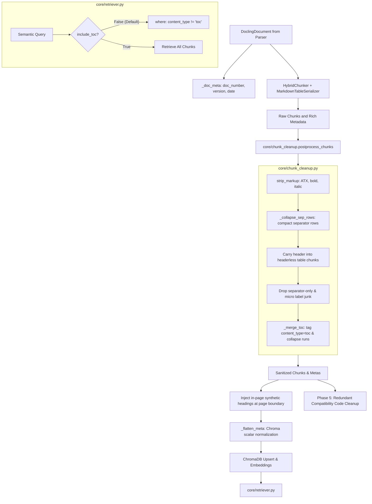

# Implementation Plan: PDF v5.0 — Chunking & Retrieval Decoupling

## Executive Summary
**PDF v5.0** bridges the gap between parsing extraction and downstream retrieval. In `parser_v1`, critical retrieval accuracy depended on four post-parsing capabilities:
1. **Markdown Table Chunk Serialization**: Serializing tables as intact Markdown tables (`| Col1 | Col2 |`) rather than key-value triplets (`row 1, col 2 = val`), allowing `HybridChunker` to repeat headers across chunk boundaries without token inflation.
2. **Chunk Sanitization & Cleanup (`core/chunk_cleanup.py`)**: Collapsing wide separator rows, carrying table headers into headerless chunk fragments, filtering separator-only junk chunks, tagging and merging Table of Contents (ToC) chunks, and extracting document metadata (`doc_number`, `doc_version`, `doc_date`).
3. **Chroma-Safe Scalar Metadata & In-Page Synthetic Headings (`core/chunker.py`)**: Flattening list and nullable metadata to Chroma-compatible scalar types (`page_numbers` as `"1,2"`, `heading_path` as `"A > B"`), and inserting orphaned section headers into their respective page positions rather than tail-appending.
4. **ToC Retrieval Suppression (`core/retriever.py`)**: Excluding ToC chunks by default via Chroma `$ne: "toc"` filtering, preventing dense dot-leader lists from polluting semantic query results.
5. **Redundant Compatibility Audit & Cleanup**: A dedicated final phase to audit, document, and cleanly remove obsolete shims, redundant fallbacks, and dead compatibility wrappers.

---

## Architectural Workflow & Decoupling



---

## Proposed Changes

### Phase 1: Pure-Python Chunk Sanitizer (`core/chunk_cleanup.py`)
Create `core/chunk_cleanup.py` as a lightweight, zero-dependency module (no Docling or fitz imports) ported from `parser_v1`:
- **`strip_markup(text: str) -> str`**: Strips leaked ATX header markers (`###`), bold markers (`**`), italic runs (`*text*`), and collapses whitespace runs.
- **`_collapse_sep_rows(text: str) -> str`**: Replaces inflated table separator rows with compact `|---|---|` to prevent token limits from exceeding chunk sizes.
- **`_strip_dot_runs(text: str) -> str`**: Replaces runs of 4+ dots (`....`) with `...`.
- **`_is_sep_fragment_chunk(ls: list[str]) -> bool`**: Identifies chunks consisting solely of breadcrumbs and table separator fragments.
- **`is_micro_label(text: str) -> bool`**: Identifies isolated running logo or header fragments ($\le 3$ words, $< 40$ chars, no digits).
- **`section_id(page: int | None, headings: Any) -> str`**: Computes human-readable anchor IDs (e.g., `p28:1.2`).
- **`extract_doc_meta(texts: list[str]) -> dict[str, str]`**: Extracts `doc_number`, `doc_version`, and `doc_date` from initial document text.
- **`_is_toc_chunk(text: str, meta: dict, prev_is_toc: bool = False) -> bool`**: Identifies ToC chunks via dot leaders, numbered patterns, or continuation cues.
- **`_merge_toc(chunks: list[str], metas: list[dict[str, Any]]) -> tuple[list[str], list[dict[str, Any]]]`**: Collapses consecutive ToC chunks into a single unified `content_type="toc"` chunk.
- **`postprocess_chunks(chunks: list[str], metas: list[dict[str, Any]], *, drop_micro: bool = False) -> tuple[list[str], list[dict[str, Any]]]`**: Coordinates the entire sanitization pipeline.

### Phase 2: HybridChunker Table Serialization & Metadata Normalization (`core/chunker.py`)
Update `core/chunker.py` while preserving backward compatibility for legacy text pages:
- **`_MarkdownTableChunkSerializer` & `_MarkdownTableSerializerProvider`**:
  Configures `HybridChunker` with `MarkdownTableSerializer()` so table chunks retain explicit Markdown row structure and repeated headers.
- **`_flatten_meta(meta: dict[str, Any]) -> dict[str, Any]`**:
  Converts list and nullable metadata to Chroma-compatible scalar values:
  - `page_numbers: list[int]` $\rightarrow$ comma-separated string `"1,2"`.
  - `heading_path: list[str]` $\rightarrow$ `" > "` delimited string.
  - `page: None` $\rightarrow$ omitted (Chroma rejects `None`).
- **`_doc_meta(doc: DoclingDocument) -> dict[str, str]`**:
  Collects text from the first three pages of the document and extracts document metadata.
- **Enriched Metadata Fields**:
  - `content_type`: `"table"`, `"figure"`, `"text"`, or `"toc"`.
  - `heading_path`: breadcrumb hierarchy.
  - `section_id`: hierarchical locator.
  - `doc_number`, `doc_version`, `doc_date`.
- **In-Page Synthetic Heading Placement**:
  When injecting orphaned `TITLE` or `SECTION_HEADER` items, inserts them at the end of their respective page index rather than appending at the tail of the entire document.
- **Chunk Postprocessing Execution**:
  Calls `postprocess_chunks()` when `settings.chunk_postprocess` is True.

### Phase 3: Query Retrieval & ToC Suppression (`core/retriever.py`)
Update `core/retriever.py`:
- Method signature:
  ```python
  def retrieve(self, query: str, k: int | None = None, *, include_toc: bool = False) -> dict[str, Any]:
  ```
- Filtering logic:
  ```python
  target_k = k if k is not None else pipeline_settings.retrieval_k
  where: dict | None = None
  if not include_toc:
      where = {"content_type": {"$ne": "toc"}}
  try:
      return self.collection.query(
          query_texts=[query],
          n_results=target_k,
          include=["documents", "metadatas", "distances"],
          where=where,
      )
  except Exception:
      # Graceful fallback for legacy collections without content_type metadata
      return self.collection.query(
          query_texts=[query],
          n_results=target_k,
          include=["documents", "metadatas", "distances"],
      )
  ```

### Phase 4: Unit Testing & Verification
Create dedicated test modules and run all checks inside Docker:
1. `tests/parsers/test_pdf_chunk_cleanup.py`:
   - Separator-only and separator-fragment chunk removal.
   - Table header carryover into headerless continuation chunks.
   - ToC chunk detection, tagging, and collapsing.
   - Section ID computation and document metadata extraction.
2. `tests/parsers/test_pdf_chunker_retriever.py`:
   - Verification of `_flatten_meta()` scalar conversions.
   - In-page synthetic heading placement order.
   - Table chunk Markdown serialization.
   - Retriever `where={"content_type": {"$ne": "toc"}}` execution.

### Phase 5: Redundant Backward Compatibility Code Audit & Removal
Perform a systematic audit and pruning of redundant legacy compatibility constructs:
1. **Audit & Pruning Scope**:
   - **Obsolete Shims in Transforms**: Scan `core/parsers/pdf/transforms/` for redundant stubs (such as old stub signatures or dead compatibility wrappers like `inject_figure_cards` docling-level no-ops that have been fully replaced by `DoclingTableBackend` single-page processing).
   - **Deprecated Aliases**: Clean up dead aliases and temporary fallback mocks in `core/chunker.py` and `core/parsers/pdf/postprocess.py`.
   - **Defensive Redundancies**: Eliminate unnecessary intermediate conversions that were only retained during transitional phases.
2. **Safety Invariants**:
   - Ensure `_split_legacy` in `chunker.py` remains active for genuine non-Docling inputs (`.txt` and legacy tests).
   - Ensure all public API signatures remain clean and unbloated by obsolete transitional parameters.
3. **Documentation Note**:
   - Maintain an explicit changelog note detailing every removed compatibility construct, verifying that test coverage remains 100% green with zero regressions across the codebase.

---

## Verification Plan

### Automated Tests
Run the entire PDF parser test suite inside the production Docker container:
```bash
docker exec honeywell_api python -m unittest discover -s tests/parsers -p "test_pdf_*.py"
```

### Manual Verification
1. Verify that `core/chunker.py`, `core/chunk_cleanup.py`, and `core/retriever.py` compile and pass type checks.
2. Verify that `core/uploader.py` remains unmodified and operational.
3. Verify that all Chroma scalar constraints are strictly satisfied (no lists, no `None` values in metadata dicts).
4. Verify that Phase 5 pruned redundant legacy code cleanly without breaking any dependent services.
