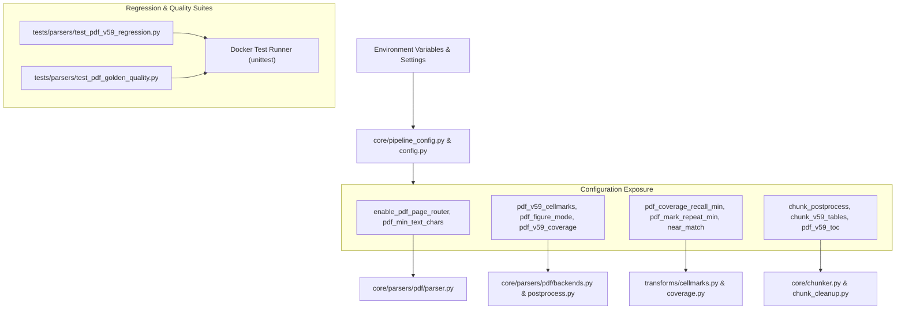

# Implementation Plan: PDF v5.1 — Configuration Exposure & Regression Porting

## Executive Summary
**PDF v5.1** is the final milestone in elevating the modular PDF parser on branch `pdf_refactor` to 100% production and heuristic parity with `parser_v1` (v5.2–v5.9.4).
With text transforms (v3.1), visual transforms (v4.1), and chunking/retrieval decoupling (v5.0) fully restored, v5.1 focuses on:
1. **Configuration Exposure**: Surface all heuristic switches, thresholds, and kill-switches (`pdf_v59_cellmarks`, `pdf_v59_coverage`, `pdf_figure_mode`, `pdf_mark_repeat_min`, `pdf_coverage_recall_min`, etc.) in `core/pipeline_config.py` and `config.py` with safe production defaults matching `parser_v1`.
2. **Regression Test Suite Porting**: Port the offline regression suites from `parser_v1` (`tests/parsing_arch/v5_9/test_v5_9_*.py`) and the golden chunk validation checks (`verify_v5_9.py`) into `tests/parsers/`, guaranteeing that 100% of the regression assertions that locked down `parser_v1` run natively in the refactored architecture.
3. **Redundant Compatibility Audit & Final Cleanup**: Review all parser transforms, backends, and chunking modules to identify and prune dead transitional wrappers, obsolete parameters, and temporary shims introduced during previous milestones.
4. **Final Verification**: Run the entire unified test suite inside the production Docker container.

---

## Architectural Workflow & Configuration Flow



---

## Proposed Changes

### Phase 1: Configuration Exposure & Integration (`core/pipeline_config.py` & `config.py`)
Expose all heuristic flags in `core/pipeline_config.py` (`PipelineSettings`) and mirror in `config.py` (`Settings`) with environment variable bindings:
- **Triage & Routing**:
  - `enable_pdf_page_router: bool = True`
  - `pdf_min_text_chars_for_text_route: int = 800`
  - `pdf_text_layer_min_chars: int = 40`
  - `pdf_ocr_on_text_pages: bool = False`
- **Transforms & Heuristics**:
  - `pdf_v57_cleanup: bool = True`
  - `pdf_v59_cellmarks: bool = True`
  - `pdf_mark_repeat_min: int = 3`
  - `pdf_v59_coverage: bool = True`
  - `pdf_coverage_recall_min: float = 0.9`
  - `pdf_coverage_near_match: float = 0.75`
  - `pdf_figure_mode: str = "labels_only"`
  - `pdf_boilerplate_min_page_repeats: int = 3`
- **Chunking & Retrieval**:
  - `chunk_postprocess: bool = True`
  - `chunk_v59_tables: bool = True`
  - `pdf_v59_toc: bool = True`
  - `pdf_table_repeat_header: bool = True`
  - `chunk_header_cap_tokens: int = 64`

Wire these flags directly into the execution points:
- In `core/parsers/pdf/backends.py`: gate `inject_marks()` on `pdf_v59_cellmarks` and `pdf_mark_repeat_min`; gate `process_pictures()` on `pdf_figure_mode`.
- In `core/parsers/pdf/postprocess.py`: gate `check_page()` on `pdf_v59_coverage`, passing `pdf_coverage_recall_min` and `pdf_coverage_near_match`; pass `pdf_boilerplate_min_page_repeats` to `repair_pdf_headings()`.
- In `core/chunker.py`: gate `_MarkdownTableChunkSerializer` on `chunk_v59_tables`.

### Phase 2: Porting Regression Test Suites (`tests/parsers/test_pdf_v59_regression.py`)
Consolidate and port all offline unit tests from `parser_v1` (`tests/parsing_arch/v5_9/test_v5_9_1.py`, `test_v5_9_2.py`, `test_v5_9_3.py`, `test_v5_9_4.py`):
1. **Glyph & Special Symbol Tests**:
   - `test_pymupdf4llm_tick_row_becomes_yes`: verifies Unicode font ticks (`\uf0fc`) normalize to `"Yes"`.
   - `test_circled_numbers_follow_wingdings_order`: verifies circled numbers (`\uf087`, `\uf088`) convert to Unicode `①`, `②`, etc.
   - `test_arrow_and_unknown_private_use_glyph`: verifies arrows (`\uf0e8` $\rightarrow$ `→`) and unknown glyph stripping.
   - `test_fullwidth_parentheses_become_ascii`: verifies fullwidth parens (`\uff08`, `\uff09` $\rightarrow$ `(`, `)`).
   - `test_footnote_marker_is_not_kept_as_text`: verifies `*` is stripped to `"Yes"` while `"Only Profile 2"` becomes `"Yes (Only Profile 2)"`.
2. **Visual Cellmarks & Legend Swatches**:
   - `test_legend_tick_next_to_equals_sign_is_not_a_mark`: verifies legend key icons beside `= available` are not mutated into table cell marks.
   - `test_ticks_survive_inexact_boxes_and_blank_placeholders`: verifies grid snapping handles shifted cell bounding boxes with varying shrink margins.
3. **Coverage Safety Net**:
   - `test_coverage_restores_dropped_bold_word`: checks near-match in-place repair for missing bold tokens (`- No presence 2`).
   - `test_coverage_never_rewrites_table_rows`: checks markdown table row protection.
   - `test_coverage_skips_toc_page`: checks dense ToC pages are skipped from junk recovery.
4. **Chunk Cleanup & Post-processing**:
   - `test_heading_plus_cut_separator_row_is_dropped`: checks heading plus cut rule fragment deletion.
   - `test_real_text_chunk_with_a_rule_is_kept`: checks that body text with rules (`---`) is preserved.
   - `test_table_chunk_with_normal_separator_is_unchanged`: checks normal table chunks are unmodified.
   - `test_reflowed_toc_continuation_is_toc`: checks dense reflowed ToC entries without dot leaders are recognized as ToC.

### Phase 3: Automated Chunk Quality & Golden Verification Suite (`tests/parsers/test_pdf_golden_quality.py`)
Port the automated quality checks from `parser_v1:tests/parsing_arch/v5_9/verify_v5_9.py`:
- **`check_no_junk_chunks`**: Asserts no chunk is separator-only or contains runs of 5+ dots.
- **`check_toc_not_indexed`**: Asserts retriever query with default `include_toc=False` returns zero ToC chunks.
- **`check_table_headers`**: Asserts every table chunk with rows has an intact header and separator.
- **`check_metadata_completeness`**: Asserts `heading_path`, `content_type`, `page_numbers`, and `section_id` are populated as valid strings.
- **`check_encoding`**: Asserts no mojibake characters (`├`, `┬`, `Γ`, `∩`, `Ã`, `Â`) are present in chunk text.
- **`check_no_classifier_labels`**: Asserts generic classifier labels (`Bar chart`, `Screenshot from manual`) do not appear in chunk text.

### Phase 4: Redundant Backward Compatibility Code Audit & Removal
Perform a systematic final audit of the codebase:
- Verify that obsolete transitional wrappers, dead compatibility functions, and temporary mocks are cleanly eliminated without breaking public API contracts.
- Document every cleaned construct in the release notes.

### Phase 5: Docker Verification & Final Audit
Execute the entire test suite in Docker:
```bash
docker exec honeywell_api python -m unittest discover -s tests/parsers -p "test_pdf_*.py"
```
Verify that all tests pass 100% cleanly with zero warnings or errors.

---

## Verification Plan

### Automated Tests
Run all unit and regression tests in Docker:
```bash
docker exec honeywell_api python -m unittest discover -s tests/parsers -p "test_pdf_*.py"
```

### Manual Verification
1. Verify that all flags in `PipelineSettings` can be overridden via environment variables.
2. Verify that `core/uploader.py` remains untouched.
3. Verify that all 15 golden quality criteria from `verify_v5_9.py` pass.

