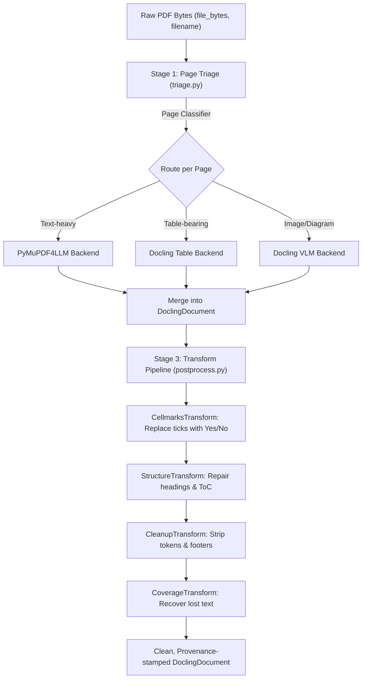

# PDF Parser Architecture & Refactoring Plan

## 🛠️ Execution Protocol: Zero Branch-Switching Workflow

> [!IMPORTANT]
> **Zero Branch-Switching Guarantee**:
> The entire restructuring and implementation will take place on the clean, conflict-free target branch (e.g. `dev` or a feature branch branched off `dev`).
> The assistant will reference, extract, and adapt all functional heuristics (cellmarks, triage, heading fixes, Wingdings, token cleanup) directly from `parser_v1` using Git object inspection (`git show parser_v1:parsers/...`).
> Neither the user nor the agent needs to repeatedly `git checkout` or `git switch` back and forth.

---

## 1. Executive Summary & Objective

In `dev` / `main`, document parsing follows a clean, object-oriented, single-responsibility architecture located in `core/parsers/`:
- `BaseParser`: Abstract base interface defining `can_handle(ext: str)` and `parse(file_bytes, filename) -> DoclingDocument`.
- `TextParser`: Handles `.txt` and `.md`.
- `DoclingParser`: Handles Office formats (`.docx`, `.pptx`) with lazy VLM loading.
- `LibreOfficeConverter`: Converts legacy `.doc` and `.ppt` to OpenXML formats.
- `ParserRouter`: Dispatches incoming files to the registered `BaseParser`.

In `parser_v1`, the PDF parser works and handles extreme edge cases (tables, ticks, SmolVLM descriptions, Wingdings, ToC, micro-labels), but suffers from architectural decay:
1. It is outside `core/` (spilled into a top-level `parsers/` directory).
2. It bleeds into `core/chunker.py`, `core/retriever.py`, and `config.py` with one-off PDF hacks.
3. It consists of 7 loosely coupled helper scripts with over 2,500 lines of procedural functions (`pdf_router.py`, `pdf_cleanup.py`, `pdf_cellmarks.py`, `pdf_structure.py`, `pdf_figures.py`, `pdf_coverage.py`, `pdf_glyphs.py`).

**The Goal**: Encapsulate the entire PDF extraction and normalization pipeline into a dedicated, modular **`PdfParser`** subclass of `BaseParser` inside `core/parsers/pdf/`, aligning perfectly with the pattern of `DoclingParser` and `TextParser`.

---

## 2. Target Directory & Class Structure

Instead of dumping loose `pdf_*.py` files directly into `parsers/` or `core/parsers/`, we create a clean package: `core/parsers/pdf/`.

```text
core/parsers/
├── __init__.py                  # Exports ParserRouter, BaseParser, DoclingParser, PdfParser...
├── base.py                      # Abstract BaseParser
├── docling_parser.py            # .docx, .pptx
├── libreoffice_converter.py     # .doc, .ppt
├── text.py                      # .txt, .md
├── router.py                    # ParserRouter (registers PdfParser)
└── pdf/                         # Dedicated PDF subsystem package
    ├── __init__.py              # Exports PdfParser
    ├── parser.py                # Main PdfParser(BaseParser) orchestrator
    ├── triage.py                # Page triage classifier (Text vs Table vs Image)
    ├── backends.py              # PyMuPDF4LLM, Docling, & VLM execution adapters
    ├── postprocess.py           # Pipeline runner applying cleanup & normalization
    └── transforms/              # Discrete, single-responsibility transformation steps
        ├── __init__.py
        ├── cellmarks.py         # Table tick/crossmark detection & text replacement
        ├── structure.py         # Section header normalization & heading freeze repair
        ├── glyphs.py            # Wingdings & symbol font to Unicode translation
        ├── cleanup.py           # SmolVLM token scrubbing & boilerplate line stripping
        ├── figures.py           # Standalone figure card extraction
        └── coverage.py          # Lost raw text recovery
```

---

## 3. Structural Comparison: Current vs Target

| Aspect | Current (`parser_v1`) | Target Clean Architecture (`dev` Style) |
| :--- | :--- | :--- |
| **Location** | Root `parsers/` + root patch docs | `core/parsers/pdf/` inside `core/` package |
| **Class Interface** | Procedural router `PdfPageRouter` in root | `class PdfParser(BaseParser)` with `SUPPORTED_EXTENSIONS = {".pdf"}` |
| **Registration** | Ad-hoc fallback or manual import | Registered automatically inside `core.parsers.ParserRouter` |
| **Configuration** | Loose dictionary reads / old `config.py` | Uses `core.pipeline_config.pipeline_settings` |
| **Pipeline Flow** | 800-line monolithic `pdf_router.py` | Modular 3-stage pipeline: **Triage $\rightarrow$ Extract $\rightarrow$ Transform** |
| **Core Bleed** | Hacky PDF branches in `chunker.py` and `retriever.py` | Clean metadata extraction adhering to standard Docling schema |

---

## 4. Pipeline Design: The 3-Stage Engine

The target `PdfParser` executes a clean, readable pipeline:



---

## 5. Detailed Component Responsibilities

### 1. `core/parsers/pdf/parser.py` (The Entry Point)
Subclasses `BaseParser`:
```python
class PdfParser(BaseParser):
    SUPPORTED_EXTENSIONS: frozenset[str] = frozenset({".pdf"})

    def can_handle(self, ext: str) -> bool:
        return ext.lower() in self.SUPPORTED_EXTENSIONS

    def parse(self, file_bytes: bytes, filename: str, **kwargs) -> DoclingDocument:
        # 1. Triage pages
        routes = self.triager.triage(file_bytes)
        # 2. Extract pages via backends
        doc = self.backends.extract_and_merge(file_bytes, routes, filename)
        # 3. Post-process transformations
        return self.pipeline.process(doc, file_bytes, filename)
```

### 2. `core/parsers/pdf/triage.py` (Classification Engine)
- Inspects PyMuPDF page descriptors (`page.find_tables()`, `page.get_images()`, text density).
- Returns routing enum list per page: `[PAGE_ROUTE.TEXT]`, `[PAGE_ROUTE.TABLE]`, `[PAGE_ROUTE.IMAGE]`, or `[TABLE, IMAGE]`.

### 3. `core/parsers/pdf/backends.py` (Extraction Adapters)
- **`PyMuPdfBackend`**: Converts text pages to markdown with page provenance stamping.
- **`DoclingBackend`**: Runs single-page Docling conversions for tables.
- **`VlmBackend`**: Handles SmolVLM image descriptions lazily, honoring `pipeline_settings.enable_picture_description`.

### 4. `core/parsers/pdf/transforms/` (Isolated Micro-Passes)
Each transform implements a simple protocol: `apply(doc: DoclingDocument, ctx: PdfContext) -> DoclingDocument`.
- **`cellmarks.py`**: Encapsulates bounding-box collision logic for tick/crossmark raster images.
- **`structure.py`**: Encapsulates font-size heading repair, numbered section regexes, and ToC detection.
- **`glyphs.py`**: Symbol translation dictionary.
- **`cleanup.py`**: Regex scrubbing for token artifacts and repeating running headers/footers.
- **`coverage.py`**: Diff engine recovering dropped text runs.

---

## 6. Migration & De-bloating Steps

### Step 1: Create `core/parsers/pdf/` Package
- Move logic from root `parsers/pdf_*.py` into the corresponding `core/parsers/pdf/transforms/` modules.
- Convert raw procedural logic into pure functions with typed arguments (`doc: DoclingDocument`).

### Step 2: Register in `core/parsers/router.py`
- Import `PdfParser` in `core/parsers/router.py`.
- Register `self.register(PdfParser())` alongside `TextParser`, `DoclingParser`, and `LibreOfficeConverter`.

### Step 3: Decouple `core/chunker.py` and `core/retriever.py`
- Ensure metadata generated by `PdfParser` uses standard Docling attributes (`prov`, `label`, `meta.description`).
- Eliminate file-extension special-casing (`if filename.lower().endswith(".pdf")`) inside `core/chunker.py` by relying on generalized DocItem metadata.
- Move `chunk_cleanup.py` into `core/parsers/pdf/transforms/` where document cleanup properly belongs before chunking.

### Step 4: Delete Root Artifacts
- Remove root `parsers/` directory.
- Remove loose `.patch` files from `docs/` (`v5_5.patch`, `v5_6.patch`, etc.).
- Consolidate tests into `tests/parsers/test_pdf.py` and `tests/parsers/test_pdf_transforms.py`.

---

## 7. Verification & Acceptance Criteria
1. **API Parity**: `ParserRouter.parse(file_bytes, "sample.pdf")` returns a valid, populated `DoclingDocument`.
2. **Feature Preservation**:
   - Table cell green ticks still resolve to `"Yes"` / `"No"`.
   - Subsection headings don't freeze the heading stack.
   - Page provenance (`page` and `page_numbers`) remains accurate across all pages.
   - VLM token leaks remain purged.
3. **Clean Test Suite**: All tests run through `pytest tests/parsers/` and `tests/unit/` with 0 import errors and 0 circular dependencies.

