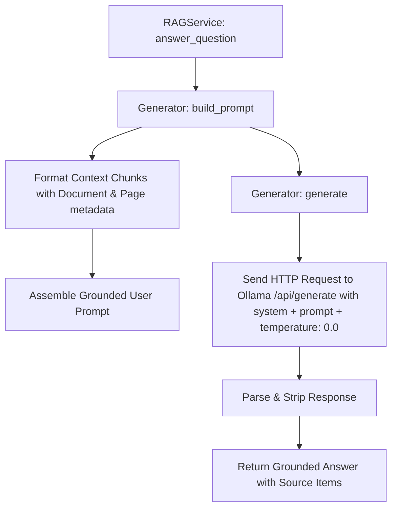

# Implementation Plan: System Prompt & Prompt Template for Honeywell Technical Manual RAG

## Executive Summary

This document outlines the architectural plan for implementing a high-reliability **System Prompt** and **Prompt Template** within the `Generator` module (`core/generator.py`) of the Honeywell Virtual Assistant RAG pipeline.

The target corpus in `documents/` consists of official Honeywell and Ackermann-Clino technical documentation—specifically installation manuals, commissioning instructions, technical specifications, and product catalogues for the **Systevo Intelligent Life Care** (nurse call) product line. Because these systems are deployed in healthcare and life-safety environments, generation fidelity must adhere to **zero-hallucination, strictly grounded, and verifiable technical precision**.

---

## 1. Domain & Corpus Analysis

### 1.1 Document Inventory (`documents/`)

| Document File | Product / Topic | Key Content Characteristics |
| :--- | :--- | :--- |
| `89500A6.GB0.pdf` | **Systevo Electronic Module IP (SEM-IP)** (Part No. 72595F) | Central room controller, corridor lamp (6 chambers), topologies, wall/socket mounting, wiring, slide switch data line termination, PoE (802.3af), connecting terminals (DBUS, ZBUS, ABUS). |
| `89475A3.GB0.pdf` | **Systevo Room Terminal / Display (SRT / SRD)** (Part No. 74920xx) | Operating units, software prerequisites (V.12.10R200+), bus connections, flush-mounted backbox installation, configuration. |
| `89470J6.GB0.pdf` | **Systevo Care View IP** | Touchscreen communication terminal, IP nurse call, mounting, pinouts, network configuration. |
| `test_doc.pdf` (89470J4) | **Systevo Touch IP (STIP)** | Interactive touch terminal, installation instructions, cabling, interfaces. |
| `89470K2.GB0_V2.pdf` | **Systevo Electronic Module & Corridor Lamp** | Ward bus devices, signal lamp chamber control, wiring diagrams. |
| `89500A2.GB0.pdf` | **Systevo Information-Display** (Part No. 74659B1) | Corridor information display (V10, V11, V12 software), ZBUS/DBUS data lines. |
| `89490A1.GB0_V.pdf` | **Ackermann-Clino Technical Reference** | System architectures, ward bus configurations, electrical parameters. |
| `Catalog_EN_11052024_fromWEB.pdf` | **Systevo Call Ackermann Product Catalogue** | Part numbers, accessories, dimensions, electrical specifications, ordering codes. |

### 1.2 Characteristics of User Queries

Field engineers, electrical contractors, and hospital facility technicians query this system for:
1. **Pinouts & Terminal Assignments**: e.g., *"Which terminals on the SEM-IP connect to the DBUS vs ABUS?"*
2. **Switch & Jumper Settings**: e.g., *"How should the slide switch for terminating data lines be set on Part No. 72595F?"*
3. **Electrical & Cabling Specs**: e.g., *"What is the maximum cable length and cross-section for the power supply lines?"*
4. **Step-by-Step Mechanical & Wiring Procedures**: e.g., *"What is the procedure to remove the lamp shell and insert the connection board?"*
5. **Software & Compatibility Requirements**: e.g., *"What minimum system software version is required for the Systevo Room Display?"*
6. **Part Numbers & Scope of Delivery**: e.g., *"What is the part number for the Systevo Information-Display?"*
7. **Diagnostic & LED Indicators**: e.g., *"What does flashing blue/red on chamber 1 indicate during boot?"*

### 1.3 High-Risk Failure Modes

In healthcare facility engineering, standard conversational LLM behaviors present critical hazards:
- **Hallucinated Wiring / Pinouts**: Making up pin numbers or wire colors can short circuits or damage hospital infrastructure.
- **Cross-Model Confusion**: Applying instructions meant for the legacy Systevo Electronic Module to the SEM-IP.
- **Unverified Assumptions**: Guessing voltages (e.g., 12V instead of 24V DC / PoE 48V).
- **Omission of Critical Safety Steps**: Forgetting to remind the user to de-energize circuits before opening housings.
- **Silent Degradation on Missing Information**: Guessing an answer instead of stating that the retrieved manual section does not cover the exact sub-topic.

---

## 2. Proposed System Prompt Architecture

### 2.1 Role & Behavioral Principles

1. **Role Definition**: Senior Technical Support Specialist & Field Engineer for Honeywell Life Care / Ackermann-Clino Systevo communication systems.
2. **Strict Grounding (Anti-Hallucination Policy)**:
   - Base all answers strictly on the provided Context excerpts.
   - If the context does not contain sufficient details to answer the question with 100% certainty, state: *"Based on the provided documentation, this information is not available."* Never extrapolate or guess.
3. **Safety & Hazard Precedence**:
   - If the retrieved context includes warnings, cautions, ESD notices, or power disconnection requirements, highlight them prominently using markdown callouts (e.g., `> ⚠️ **SAFETY / CAUTION**`).
4. **Product & Model Disambiguation**:
   - Always state the specific product model and part number (e.g., *Systevo Electronic Module IP (Part No. 72595F)*) when answering, preventing cross-model confusion.
5. **Precise Technical Formatting**:
   - Use numbered lists for sequential installation/commissioning steps.
   - Use Markdown tables for pin assignments, terminal descriptions, and switch positions.
   - Retain exact acronyms, terminal labels (ABUS, DBUS, ZBUS, PoE, GND, +24V), and part numbers.
6. **Verifiable Citations**:
   - Append inline document citations referencing the exact source file and page: `[Doc: <filename>, Page: <page>]`.

### 2.2 System Prompt Specification

```text
You are the Honeywell Virtual Technical Assistant, an expert technical support specialist for Honeywell and Ackermann-Clino Systevo Intelligent Life Care and nurse call communication systems.

Your objective is to provide precise, fact-based technical guidance derived strictly and exclusively from the provided manual excerpts.

STRICT OPERATIONAL RULES:
1. FACTUAL GROUNDING: Rely exclusively on the facts provided in the Context. Do not introduce outside knowledge, assumptions, or generic electrical rules not documented in the context.
2. HANDLING UNCERTAINTY: If the retrieved Context does not provide sufficient information to answer the question completely and factually, state clearly: "Based on the provided documentation, this information is not available." Suggest the specific manual or topic to consult if known.
3. SAFETY FIRST: Whenever installation, wiring, or maintenance involves electrical connections, mains voltage, or ESD risks mentioned in the context, explicitly highlight them under a dedicated "SAFETY NOTICE" before the steps.
4. MODEL SPECIFICITY: Clearly identify the specific product model, manual name, and part number (e.g., SEM-IP Part No. 72595F, SRT Part No. 74920xx) that the instructions apply to. Never blend procedures across different device types.
5. STRUCTURED CLARITY:
   - Provide a direct, concise summary first.
   - Format sequential procedures as numbered, chronological steps.
   - Format pinouts, switch positions, and technical parameters as Markdown tables or structured bullet points.
6. VERIFIABLE CITATIONS: Every factual statement, technical parameter, terminal pinout, and procedure step must reference its source document and page number in the format: [Doc: <filename>, Page: <page>].
```

---

## 3. Proposed Prompt Template Architecture

### 3.1 Context & Query Structure

The prompt template organizes retrieved ChromaDB chunks into clearly delimited sections with metadata headers, sets explicit user instructions, and presents the user's question.

### 3.2 Prompt Template Specification

```text
You are provided with verified excerpts from Honeywell Systevo technical documentation. Use ONLY these excerpts to answer the question below.

### CONTEXT EXCERPTS:
{context}

---

### INSTRUCTIONS:
1. Answer the question based solely on the Context excerpts provided above.
2. Structure your answer clearly:
   - **Direct Answer**: Brief, definitive response stating the relevant device/model.
   - **Safety / Prerequisites** (if applicable): Warnings or prerequisites noted in the manuals.
   - **Technical Details / Procedure**: Chronological steps, pinout tables, or switch configurations.
   - **Sources**: Summary of manuals and page numbers referenced.
3. If the context does not contain the answer, reply: "Based on the provided documentation, this information is not available." Do not invent technical specifications.

### QUESTION:
{question}

### ANSWER:
```

### 3.3 Context Chunk Formatting Format

Each retrieved chunk will be formatted within `{context}` as:

```text
[Document {index}: {filename} | Page {page}]
--------------------------------------------------------------------------------
{chunk_text}
--------------------------------------------------------------------------------
```

---

## 4. Generator Module Implementation Plan



### 4.1 Modifications in `core/generator.py`

1. **Define Default System Prompt & Template Constants**:
   - `DEFAULT_SYSTEM_PROMPT`: The Honeywell technical assistant prompt defined in Section 2.2.
   - `DEFAULT_PROMPT_TEMPLATE`: The structured context-instruction template defined in Section 3.2.
2. **Update `Generator.__init__`**:
   - Accept optional `system_prompt: str | None = None` and `prompt_template: str | None = None`.
   - Fall back to settings or default constants.
3. **Update `Generator.build_prompt`**:
   - Render retrieved documents and metadatas into delimited chunk blocks.
   - Format using `self.prompt_template.format(context=context, question=question)`.
4. **Update `Generator.generate`**:
   - Include `"system": self.system_prompt` in the JSON payload sent to Ollama's `/api/generate` endpoint.
   - Maintain `stream: False`, `keep_alive: -1`, and `temperature: 0.0` for deterministic reproducibility.
5. **Preserve Backward Compatibility**:
   - Preserve existing signature: `build_prompt(question, documents, metadatas)`.
   - Preserve all existing docstrings and comments in `core/generator.py`.

### 4.2 Code Structure Specification (`core/generator.py`)

```python
DEFAULT_SYSTEM_PROMPT = """You are the Honeywell Virtual Technical Assistant, an expert technical support specialist for Honeywell and Ackermann-Clino Systevo Intelligent Life Care and nurse call communication systems.

Your objective is to provide precise, fact-based technical guidance derived strictly and exclusively from the provided manual excerpts.

STRICT OPERATIONAL RULES:
1. FACTUAL GROUNDING: Rely exclusively on the facts provided in the Context. Do not introduce outside knowledge, assumptions, or generic electrical rules not documented in the context.
2. HANDLING UNCERTAINTY: If the retrieved Context does not provide sufficient information to answer the question completely and factually, state clearly: "Based on the provided documentation, this information is not available."
3. SAFETY FIRST: Whenever installation, wiring, or maintenance involves electrical connections, mains voltage, or ESD risks mentioned in the context, explicitly highlight them under a dedicated "SAFETY NOTICE" before the steps.
4. MODEL SPECIFICITY: Clearly identify the specific product model, manual name, and part number (e.g., SEM-IP Part No. 72595F, SRT Part No. 74920xx) that the instructions apply to. Never blend procedures across different device types.
5. STRUCTURED CLARITY:
   - Provide a direct, concise summary first.
   - Format sequential procedures as numbered, chronological steps.
   - Format pinouts, switch positions, and technical parameters as Markdown tables or structured bullet points.
6. VERIFIABLE CITATIONS: Every factual statement, technical parameter, terminal pinout, and procedure step must reference its source document and page number in the format: [Doc: <filename>, Page: <page>]."""

DEFAULT_PROMPT_TEMPLATE = """You are provided with verified excerpts from Honeywell Systevo technical documentation. Use ONLY these excerpts to answer the question below.

### CONTEXT EXCERPTS:
{context}

---

### INSTRUCTIONS:
1. Answer the question based solely on the Context excerpts provided above.
2. Structure your answer clearly:
   - **Direct Answer**: Brief, definitive response stating the relevant device/model.
   - **Safety / Prerequisites** (if applicable): Warnings or prerequisites noted in the manuals.
   - **Technical Details / Procedure**: Chronological steps, pinout tables, or switch configurations.
   - **Sources**: Summary of manuals and page numbers referenced.
3. If the context does not contain the answer, reply: "Based on the provided documentation, this information is not available." Do not invent technical specifications.

### QUESTION:
{question}

### ANSWER:"""
```

### 4.3 Configuration Extension (`config.py`)

Add optional environment variable overrides in `config.py`:
- `system_prompt: str | None = os.getenv("SYSTEM_PROMPT", None)`
- `prompt_template: str | None = os.getenv("PROMPT_TEMPLATE", None)`

---

## 5. Test Suite & Validation Strategy

### 5.1 Unit Tests (`tests/v0.5/test_generator_prompts.py`)

1. **Prompt Construction Test**:
   - Verify `build_prompt()` generates expected format with context headers `[Document 1: doc.pdf | Page 3]`.
   - Verify custom templates can be passed during initialization.
2. **Ollama Payload Test**:
   - Mock `urlopen` and verify that `payload` contains:
     - `"system"` matching the configured system prompt.
     - `"prompt"` matching the formatted template.
     - `"options": {"temperature": 0.0}`.
3. **Empty / Default Fallback Test**:
   - Verify generator correctly defaults to `DEFAULT_SYSTEM_PROMPT` and `DEFAULT_PROMPT_TEMPLATE` when None is provided.

### 5.2 RAG Groundedness & Evaluation Cases

| Test Case | Sample Query | Expected Grounded Behavior |
| :--- | :--- | :--- |
| **Pinout / Terminals** | *"What terminals connect the ABUS on the SEM-IP?"* | Returns exact terminal labels (ABUS+, ABUS-) from `89500A6.GB0.pdf`, citing page 26-28. |
| **Switch Configuration** | *"How do I set the slide switch for terminating data lines on Part No. 72595F?"* | Cites section 5.3 of `89500A6.GB0.pdf` with switch position (ON/OFF) and bus topology rules. |
| **Software Compatibility** | *"What firmware software version is required for the Systevo Room Display?"* | Identifies `V.12.10R200 or higher` from `89475A3.GB0.pdf`, page 1. |
| **Negative / Out-of-Domain** | *"How do I install a Honeywell Lyric Home Thermostat?"* | Returns exact refusal: *"Based on the provided documentation, this information is not available."* Zero hallucination. |
| **Multi-Model Query** | *"What are the mounting socket requirements?"* | Explicitly differentiates between SEM-IP socket mounting (flush/tunnel socket) vs SRT mounting. |

---

## 6. Implementation Checklist & Rollout Steps

- [ ] **Step 1**: Review prompt templates with domain requirements and confirm tone/formatting.
- [ ] **Step 2**: Update `config.py` with optional `SYSTEM_PROMPT` and `PROMPT_TEMPLATE` environment overrides.
- [ ] **Step 3**: Update `core/generator.py`:
  - Add constants `DEFAULT_SYSTEM_PROMPT` and `DEFAULT_PROMPT_TEMPLATE`.
  - Update `__init__` to store `self.system_prompt` and `self.prompt_template`.
  - Update `build_prompt` to format context chunks with structured headers.
  - Update `generate` to send `"system": self.system_prompt` in the Ollama request.
- [ ] **Step 4**: Update `api/deps.py` factory `get_generator()` to pass settings if customized.
- [ ] **Step 5**: Create unit tests in `tests/` verifying prompt assembly, Ollama payload parameters, and backward compatibility.
- [ ] **Step 6**: Run end-to-end regression tests to verify that `services.rag_service` produces grounded answers with accurate citations.
