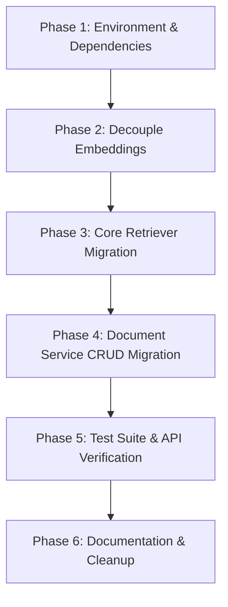

# Architectural Migration Plan: ChromaDB to Qdrant

## 1. Executive Summary & Objective

The **Honeywell Virtual Assistant** currently relies on **ChromaDB** for vector storage, chunk metadata tracking, and semantic search retrieval. While ChromaDB served well for the initial prototype, migrating to **Qdrant** provides critical architectural and operational benefits:

1. **High Performance & Scalability**: Qdrant is implemented in Rust, offering lower memory overhead, significantly higher queries-per-second (QPS), and robust concurrency under load.
2. **First-Class Payload & Filter Engine**: ChromaDB restricts metadata to scalar primitives (`str`, `int`, `float`, `bool`), requiring brittle workarounds like serializing page number lists into comma-separated strings. Qdrant supports arbitrary, rich JSON payloads with deeply nested fields, lists, and indexed filtering.
3. **Atomic Filter-Based Updates**: Updating metadata in Chroma requires reading all chunk IDs into application memory and writing them back. Qdrant can update payloads across all matching points in a single, atomic network call using filters.
4. **Native Hybrid Search Foundation**: Qdrant natively supports sparse vectors (BM25 / SPLADE) alongside dense vectors and performs server-side **Reciprocal Rank Fusion (RRF)** in a single query. This is particularly valuable for Honeywell technical manuals containing exact part numbers (e.g. `SEM-IP Part No. 72595F`), error codes, and terminal labels that pure dense semantic embeddings often miss.

### Migration Scope
This document outlines the end-to-end strategy for replacing ChromaDB with Qdrant. The migration is designed to be **non-disruptive** to existing FastAPI contracts, SQLite relational records, MinIO object storage, and Ollama generation logic.

---

## 2. Target Architecture: Before vs. After

```
BEFORE (ChromaDB Architecture):
┌──────────────┐     ┌────────────────────────────────────────────────────────┐
│ FastAPI App  │ ──> │ DocumentService / IngestionService / RAGService        │
└──────────────┘     └────────────────────────────────────────────────────────┘
                                    │                           │
                                    ▼                           ▼
                        ┌───────────────────────┐   ┌───────────────────────┐
                        │ Embeddings            │   │ Retriever             │
                        │ (Chroma wrapper:      │   │ (chromadb.HttpClient/ │
                        │  DefaultEmbeddingFn)  │   │  PersistentClient)    │
                        └───────────────────────┘   └───────────────────────┘
                                                                │
                                                                ▼
                                                    ┌───────────────────────┐
                                                    │ ChromaDB Container    │
                                                    │ (Port 8000/8001)      │
                                                    └───────────────────────┘

AFTER (Qdrant Architecture):
┌──────────────┐     ┌────────────────────────────────────────────────────────┐
│ FastAPI App  │ ──> │ DocumentService / IngestionService / RAGService        │
└──────────────┘     └────────────────────────────────────────────────────────┘
                                    │                           │
                                    ▼                           ▼
                        ┌───────────────────────┐   ┌───────────────────────┐
                        │ Embeddings            │   │ Retriever             │
                        │ (Decoupled:           │   │ (qdrant_client:       │
                        │  SentenceTransformer) │   │  QdrantClient)        │
                        └───────────────────────┘   └───────────────────────┘
                                                                │
                                                                ▼
                                                    ┌───────────────────────┐
                                                    │ Qdrant Container      │
                                                    │ (Port 6333 REST/6334) │
                                                    └───────────────────────┘
```

---

## 3. Core Architectural Differences & Design Decisions

### 3.1 Point ID Strategy (Deterministic UUIDv5)
* **ChromaDB**: Accepts arbitrary string IDs (e.g., `doc_123_chunk_0`).
* **Qdrant**: Strictly requires point IDs to be either an unsigned 64-bit integer (`uint64`) or a valid **UUID string** (RFC 4122).
* **Design Decision**: 
  Generate deterministic UUIDs using Python's `uuid.uuid5(uuid.NAMESPACE_DNS, chunk_id)`. Store the original human-readable `chunk_id` inside the Qdrant point's payload. This guarantees zero ID collisions, deterministic upserts, and backwards-compatible lookups.

### 3.2 Payload Standardization
* **ChromaDB**: Required stringifying non-scalar values (e.g., `page_numbers="1,2"`).
* **Qdrant**: Store full, structured payloads:
  ```json
  {
    "chunk_id": "doc_a1b2c3d4_chunk_0",
    "document_id": "doc_a1b2c3d4",
    "filename": "systevo_sem_ip_manual.pdf",
    "product_id": "SEM-IP",
    "chunk_index": 0,
    "page": 1,
    "page_numbers": [1, 2],
    "text": "The SEM-IP station requires 24V DC auxiliary power..."
  }
  ```

### 3.3 Embeddings Engine Decoupling
* **Current state**: `core/embeddings.py` directly imports `DefaultEmbeddingFunction` and `SentenceTransformerEmbeddingFunction` from `chromadb.utils.embedding_functions`.
* **Design Decision**: Remove the Chroma dependency completely. Use `sentence_transformers.SentenceTransformer` directly (or FastEmbed). This decouples embedding generation from the vector database.

### 3.4 In-Memory vs. Networked Client Modes
* **Production / Docker**: Connect via HTTP to `qdrant:6333`.
* **Local / Unit Tests**: Qdrant natively supports an in-memory client `QdrantClient(":memory:")` or local on-disk storage `QdrantClient(path="./qdrant_data")`. This allows all unit tests to execute rapidly in-process without requiring a running Docker daemon.

---

## 4. File-by-File Change Inventory

| Component / File | Current State | Required Change | Impact Level |
| :--- | :--- | :--- | :--- |
| **`docker-compose.yml`** | Uses `chromadb/chroma:0.5.15` on port `8001:8000` with volume `chroma_data`. | Replace service with `qdrant/qdrant:v1.12.0` (or `latest`), port `6333:6333`, volume `qdrant_data:/qdrant/storage`, and healthcheck `curl -f http://localhost:6333/readyz`. | Low |
| **`.env` / `.env.example`** | Contains `CHROMA_HOST`, `CHROMA_PORT`, `CHROMA_PATH`, `CHROMA_COLLECTION`. | Replace with `QDRANT_HOST=qdrant`, `QDRANT_PORT=6333`, `QDRANT_PATH=./qdrant_data`, `QDRANT_COLLECTION=honeywell_documents`. | Low |
| **`config.py`** | Holds Chroma attributes on `Settings`. | Replace with `qdrant_host`, `qdrant_port`, `qdrant_path`, `qdrant_collection`. | Low |
| **`requirements.txt`** | Pins `chromadb==0.5.15`. | Remove `chromadb`, add `qdrant-client>=1.12.0` and `sentence-transformers>=3.0.0`. | Low |
| **`core/embeddings.py`** | Uses `chromadb.utils.embedding_functions`. | Refactor to use `sentence_transformers.SentenceTransformer` directly. Keep identical `embed(texts)` signature. | Medium |
| **`core/retriever.py`** | Wraps `chromadb.HttpClient` / `PersistentClient`. | Refactor to wrap `QdrantClient`. Implement collection creation with vector parameters (`size=768`, `Distance.COSINE`), `upsert()`, and `retrieve()`. | High |
| **`services/document_service.py`** | Calls `collection.get()`, `update()`, and `delete()`. | Update: <br>1. `get_documents`: Use `client.count()` with filter instead of fetching IDs.<br>2. `get_document_chunks`: Use `client.scroll()` for pagination.<br>3. `update_document_metadata`: Use `client.set_payload()` with filter (single atomic call).<br>4. `delete_document`: Use `client.delete()` with filter. | High |
| **`services/ingestion_service.py`** | Calls `retriever.upsert()`. | No signature change needed if `Retriever.upsert` maintains `(ids, documents, metadatas, embeddings)`. | None |
| **`services/rag_service.py`** | Reads `retrieved.get("documents")`, etc. | No change if `Retriever.retrieve()` normalizes Qdrant's `QueryResponse` into the existing output dictionary shape. | None |
| **`tests/unit/test_document_service.py`** | Mocks Chroma collection calls. | Update mock fixtures to mock `QdrantClient` methods (`count`, `scroll`, `set_payload`, `delete`). | Medium |

---

## 5. Phased Implementation Roadmap



### Phase 1: Environment & Dependencies
1. Update `requirements.txt`: replace `chromadb` with `qdrant-client` and `sentence-transformers`.
2. Update `docker-compose.yml`: replace `chroma` service definition with `qdrant`.
3. Update `config.py`, `.env`, and `.env.example`: rename `CHROMA_*` configuration keys to `QDRANT_*`.

### Phase 2: Decouple Embeddings Engine
1. Refactor [`core/embeddings.py`](file:///home/prathamgbhat/Desktop/honeywell-virtual-assistant/core/embeddings.py):
   - Remove Chroma imports.
   - Use `SentenceTransformer(model_name, device=device)` directly for local vector generation.
   - Ensure fallback handling and CPU/GPU device selection remain intact.
2. Verify unit tests for embeddings pass in isolation.

### Phase 3: Core Retriever Migration
1. Rewrite [`core/retriever.py`](file:///home/prathamgbhat/Desktop/honeywell-virtual-assistant/core/retriever.py):
   - Initialize `QdrantClient(host=..., port=...)` or `QdrantClient(path=...)`.
   - Implement collection setup with `models.VectorParams(size=embedding_dim, distance=models.Distance.COSINE)`.
   - Implement `upsert()`:
     - Map string `chunk_id` to `uuid5`.
     - Construct `models.PointStruct(id=uuid, vector=vector, payload=payload)`.
     - Upload via `client.upsert(collection_name=..., points=...)`.
   - Implement `retrieve()`:
     - Embed incoming query string.
     - Call `client.query_points(collection_name=..., query=vector, limit=k)`.
     - Format results into `{"documents": [docs], "metadatas": [metas], "distances": [dists]}` to preserve backwards compatibility.

### Phase 4: Document Service CRUD Migration
1. Update [`services/document_service.py`](file:///home/prathamgbhat/Desktop/honeywell-virtual-assistant/services/document_service.py):
   - **Count chunks**: Replace `len(collection.get(where={"document_id": id})["ids"])` with:
     ```python
     self.retriever.client.count(
         collection_name=self.retriever.collection_name,
         count_filter=models.Filter(
             must=[models.FieldCondition(key="document_id", match=models.MatchValue(value=document_id))]
         )
     ).count
     ```
   - **Chunk Inspection / Pagination**: Use `client.scroll()`:
     ```python
     records, next_page_offset = self.retriever.client.scroll(
         collection_name=self.retriever.collection_name,
         scroll_filter=models.Filter(must=[...]),
         limit=limit,
         offset=offset,
         with_payload=True,
     )
     ```
   - **Metadata Updates**: Replace ID-fetching loop with direct payload update:
     ```python
     self.retriever.client.set_payload(
         collection_name=self.retriever.collection_name,
         payload={"product_id": product_id},
         points=models.Filter(
             must=[models.FieldCondition(key="document_id", match=models.MatchValue(value=document_id))]
         )
     )
     ```
   - **Document Deletion**: Delete by filter selector:
     ```python
     self.retriever.client.delete(
         collection_name=self.retriever.collection_name,
         points_selector=models.FilterSelector(
             filter=models.Filter(
                 must=[models.FieldCondition(key="document_id", match=models.MatchValue(value=document_id))]
             )
         )
     )
     ```

### Phase 5: Test Suite & API Verification
1. Update mocks in `tests/unit/test_document_service.py` to match Qdrant's client methods.
2. Add an integration test using `QdrantClient(":memory:")` verifying full ingestion -> query -> metadata update -> deletion lifecycle.
3. Start the Docker stack (`docker compose up -d`) and verify:
   - `/api/v1/documents` upload and indexing.
   - `/api/v1/documents/{id}/chunks` inspection.
   - `PATCH /api/v1/documents/{id}` metadata synchronization.
   - `DELETE /api/v1/documents/{id}` cascading purge.
   - `POST /api/v1/query` grounded RAG generation via Ollama.

### Phase 6: Documentation & Cleanup
1. Update `README.md` (architecture diagrams, badges, port mappings, environment tables).
2. Remove old `chroma_data/` references from `.gitignore` and replace with `qdrant_data/`.

---

## 6. Future-Proofing: Native Hybrid Search Roadmap (Post-Migration)

Once the base migration is complete, Qdrant allows enabling **hybrid search (Dense + Sparse BM25/SPLADE)** with minimal code additions:

### 1. Multi-Vector Collection Definition
Configure the collection with named dense and sparse vectors:
```python
client.create_collection(
    collection_name="honeywell_documents",
    vectors_config={
        "dense": models.VectorParams(size=768, distance=models.Distance.COSINE)
    },
    sparse_vectors_config={
        "sparse": models.SparseVectorParams()
    }
)
```

### 2. Dual Embeddings during Ingestion
Generate sparse embeddings locally using `fastembed`:
```python
from fastembed import SparseTextEmbedding

sparse_model = SparseTextEmbedding(model_name="Qdrant/bm25")
sparse_vectors = list(sparse_model.embed(chunks))
```

### 3. Server-Side Reciprocal Rank Fusion (RRF)
Execute semantic and keyword search simultaneously in a single call:
```python
results = client.query_points(
    collection_name="honeywell_documents",
    prefetch=[
        models.Prefetch(query=dense_vector, using="dense", limit=25),
        models.Prefetch(query=sparse_vector, using="sparse", limit=25),
    ],
    query=models.FusionQuery(fusion=models.Fusion.RRF),
    limit=5,
)
```
This guarantees that exact part numbers (e.g. `SEM-IP 72595F`) are retrieved with 100% precision without degrading natural language semantic understanding.

---

## 7. Risk Analysis & Mitigation

| Risk | Impact | Likelihood | Mitigation Strategy |
| :--- | :--- | :--- | :--- |
| **Point ID collisions or format rejections** | High | Low | Enforce deterministic UUIDv5 mapping (`uuid.uuid5(uuid.NAMESPACE_DNS, chunk_id)`). Preserve original `chunk_id` in payload. |
| **SQLite / Vector store desynchronization** | High | Low | `services/document_service.py` already treats SQLite as the source of truth for document identity; vector deletions and updates are wrapped in existing service transaction boundaries. |
| **Test environment dependency on external service** | Medium | Low | Use Qdrant's embedded in-memory mode (`QdrantClient(":memory:")`) in unit and contract tests so tests run offline without Docker. |
| **Vector dimension mismatch on collection creation** | Medium | Low | Infer vector dimension dynamically from the configured embedding model (`len(embeddings.embed(["test"])[0])`) or validate against pipeline configuration on startup. |

