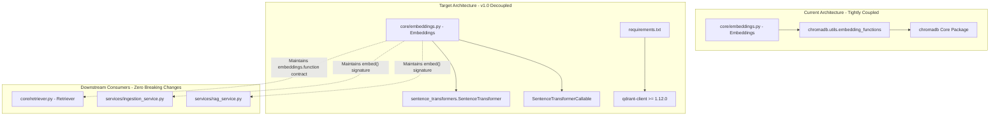
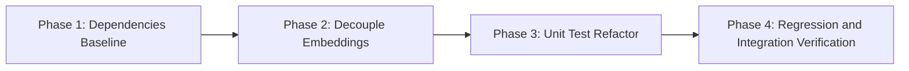

# Formal Implementation Plan: Qdrant Migration Version 1.0 - Embeddings Decoupling & Dependency Baseline

## 1. Executive Summary & Objective

The objective of **Qdrant Migration Version 1.0** is to establish the foundation for migrating from ChromaDB to Qdrant by **decoupling vector embeddings generation from ChromaDB vendor utilities** and provisioning the **`qdrant-client`** dependency.

Currently, [`core/embeddings.py`](file:///home/prathamgbhat/Desktop/honeywell-virtual-assistant/core/embeddings.py) imports directly from `chromadb.utils.embedding_functions` (`DefaultEmbeddingFunction` and `SentenceTransformerEmbeddingFunction`). This tightly binds embedding generation to ChromaDB.

### Key Objectives for Version 1.0:
1. **Decouple Embeddings from Chroma**:
   Refactor [`core/embeddings.py`](file:///home/prathamgbhat/Desktop/honeywell-virtual-assistant/core/embeddings.py) to use native `sentence-transformers.SentenceTransformer` directly without importing any symbols from `chromadb`.
2. **Add `qdrant-client` to Dependencies**:
   Add `qdrant-client>=1.12.0` to [`requirements.txt`](file:///home/prathamgbhat/Desktop/honeywell-virtual-assistant/requirements.txt) to prepare the environment for Qdrant client integration in Version 2.0.
3. **Preserve Complete Backward Compatibility**:
   Ensure `Embeddings.function` preserves the callable contract (`__call__(self, input: list[str]) -> list[list[float]]`) expected by Chroma's collection initialization in [`core/retriever.py`](file:///home/prathamgbhat/Desktop/honeywell-virtual-assistant/core/retriever.py#L44), ensuring that all existing Chroma-based ingestion, search, and CRUD endpoints continue operating without interruption.
4. **Isolate Unit Testing**:
   Refactor [`tests/unit/test_embeddings.py`](file:///home/prathamgbhat/Desktop/honeywell-virtual-assistant/tests/unit/test_embeddings.py) to remove Chroma imports and verify model loading, device selection, dimension validation, and caching.
5. **Workflow Invariants**:
   - Zero new git branches (all changes directly on the working branch).
   - Zero automated commits by the assistant (handover via commit message template for user execution).

---

## 2. Architectural Principles & Layer Boundaries



### Invariants Enforced in Version 1.0:
- **Zero Chroma Imports in `core/embeddings.py`**: The embeddings module must be 100% agnostic to vector databases.
- **Protocol Preservation**: Downstream callers (`Retriever`, `IngestionService`) access `embeddings.embed(texts)` and `embeddings.function(texts)`. Both must return `list[list[float]]` with uniform dimensionality.
- **Dual Dependency Stability**: `chromadb` remains installed alongside `qdrant-client` so existing services continue running seamlessly during the transitional versions (v1.0 through v4.0).

---

## 3. Phased Implementation Roadmap



---

### Phase 1: Dependencies Baseline (`requirements.txt`)

#### Objective:
Add `qdrant-client` and ensure `sentence-transformers` is explicitly pinned, while retaining `chromadb` for transitional compatibility.

#### Target `requirements.txt`:
```text
fastapi==0.115.0
uvicorn==0.30.6
boto3==1.35.24
python-multipart==0.0.20
chromadb==0.5.15
qdrant-client>=1.12.0
langchain-text-splitters==0.3.0
SQLAlchemy==2.0.36
alembic==1.14.0
pypdf==5.0.1
python-docx==1.1.2
python-pptx>=1.0.0
docling>=2.0.0
pymupdf>=1.24.0
pymupdf4llm>=0.0.17
sentence-transformers>=2.2.0
python-dotenv>=1.0.0
```

---

### Phase 2: Decouple `Embeddings` Engine (`core/embeddings.py`)

#### Objective:
Replace ChromaDB's `DefaultEmbeddingFunction` and `SentenceTransformerEmbeddingFunction` with a native `SentenceTransformer` implementation.

#### Design Specifications:
1. **Model Loader & Caching**:
   - Resolve `model_name` from parameter or [`core.pipeline_config.pipeline_settings.embedding_model`](file:///home/prathamgbhat/Desktop/honeywell-virtual-assistant/core/pipeline_config.py#L96).
   - Resolve `device` from parameter or [`core.pipeline_config.pipeline_settings.embedding_device`](file:///home/prathamgbhat/Desktop/honeywell-virtual-assistant/core/pipeline_config.py#L99).
2. **Callable Wrapper (`SentenceTransformerCallable`)**:
   Implement a lightweight callable class wrapping `SentenceTransformer`:
   ```python
   class SentenceTransformerCallable:
       """Callable wrapper implementing the embedding function protocol."""

       def __init__(self, model_name: str, device: str = "cpu") -> None:
           self.model_name = model_name
           self.device = device
           self._model = SentenceTransformer(model_name, device=device)

       def __call__(self, input: list[str]) -> list[list[float]]:
           """Generate vector embeddings for ChromaDB protocol and direct invocation."""
           if not input:
               return []
           embeddings = self._model.encode(
               input,
               convert_to_numpy=True,
               normalize_embeddings=True,
           )
           return embeddings.tolist()
   ```
3. **Public API of `Embeddings`**:
   - `self.model_name: str`: Configured model identifier.
   - `self.device: str`: Target compute device (`cpu`, `cuda`).
   - `self.function: Callable[[list[str]], list[list[float]]]`: The callable embedding function.
   - `embed(texts: list[str]) -> list[list[float]]`: Direct vector generation method.
4. **Resilience & Fallbacks**:
   - If a custom model fails to load, gracefully fall back to `"sentence-transformers/all-MiniLM-L6-v2"` with a warning log.
   - If an explicit `embedding_function` is passed in `__init__`, bypass resolution (enabling mock injection for tests).
5. **Lifecycle & Future Consolidation (v5.0)**:
   - `SentenceTransformerCallable` exists as a separate wrapper strictly to satisfy ChromaDB's required collection callback protocol (`embedding_function=self.embeddings.function`) during transitional versions v1.0 through v4.0.
   - In Version 5.0 (when Chroma is fully deleted), `SentenceTransformerCallable` will be collapsed directly into `Embeddings`, eliminating the wrapper layer and any redundant list conversions.

---

### Phase 3: Unit Test Suite Refactor (`tests/unit/test_embeddings.py`)

#### Objective:
Update `tests/unit/test_embeddings.py` to remove all imports from `chromadb` while thoroughly validating all functionality.

#### Target Test Cases in `TestEmbeddingsConfiguration`:
1. `test_default_model_resolution`: Verifies default model string (`BAAI/bge-base-en-v1.5`) is loaded.
2. `test_explicit_model_name_override`: Verifies constructor `model_name="all-MiniLM-L6-v2"` overrides defaults.
3. `test_device_selection_forwarding`: Verifies device parameter (`cpu` / `cuda`) is forwarded to the underlying loader.
4. `test_explicit_embedding_function_injection`: Verifies passing `embedding_function=mock_fn` bypasses internal loading.
5. `test_empty_input_handling`: Verifies `embed([])` returns `[]`.
6. `test_embedding_output_structure`: Verifies `embed(["test text"])` returns a list of float lists with correct dimensionality.
7. `test_callable_protocol`: Verifies `embeddings.function(["test text"])` can be invoked directly as a callable matching ChromaDB's required protocol.
8. `test_fallback_on_unresolvable_model`: Verifies graceful fallback to standard MiniLM if an invalid model name is supplied.

#### Target Test Cases in `TestEmbeddingsDependencyInjection`:
1. `test_get_embeddings_singleton`: Verifies `api.deps.get_embeddings()` returns a cached singleton instance via `@lru_cache`.

---

### Phase 4: Backward-Compatibility & Regression Verification

#### Objective:
Verify that all dependent modules continue operating without changes:
1. **`core/retriever.py`**:
   - Confirms `self.collection = self.chroma_client.get_or_create_collection(..., embedding_function=self.embeddings.function)` initializes without type or protocol errors.
2. **`services/ingestion_service.py`**:
   - Confirms `self.embeddings.embed(chunks)` continues returning vector arrays for ingestion.
3. **`services/rag_service.py`**:
   - Confirms query embedding and retrieval continues functioning as expected.

---

## 4. Comprehensive Testing Strategy

### Test Execution Matrix

| Test Suite | Environment | Scope | Expected Outcome |
| :--- | :--- | :--- | :--- |
| `tests/unit/test_embeddings.py` | Unit / Local | Isolated embedding resolution, dimensionality, fallbacks, and mocks. | 100% Passed (0 Chroma dependencies). |
| `tests/unit/test_document_service.py` | Unit / Local | Service layer CRUD using existing Chroma mocks. | 100% Passed (Unchanged). |
| `tests/test_generator_prompts.py` | Unit / Local | Prompt generation logic. | 100% Passed (Unchanged). |
| End-to-End API Healthcheck | Docker Stack | `GET /docs`, `POST /api/v1/query`. | HTTP 200 OK. |

### Mocking Guidelines for Embeddings Unit Tests
To prevent unnecessary multi-hundred-megabyte HuggingFace model downloads during CI/unit testing:
* Patch `SentenceTransformer` using `unittest.mock.patch("sentence_transformers.SentenceTransformer")`.
* Configure mock `encode()` return values with controlled float lists:
  ```python
  mock_model = MagicMock()
  mock_model.encode.return_value = np.array([[0.1] * 384])
  ```

---

## 5. Validation, Handover & Commit Checklist

### Pre-Commit Checklist (To be executed prior to handover):
- [ ] `requirements.txt` updated with `qdrant-client>=1.12.0`.
- [ ] `core/embeddings.py` contains zero imports from `chromadb`.
- [ ] `tests/unit/test_embeddings.py` contains zero imports from `chromadb`.
- [ ] Unit tests pass:
  ```bash
  python -m unittest tests/unit/test_embeddings.py
  ```
- [ ] Docker container build / reload passes cleanly without dependency conflicts.
- [ ] Git status confirms only `requirements.txt`, `core/embeddings.py`, and `tests/unit/test_embeddings.py` are modified.

### User Commit Instruction:
Once verification is complete, the changes will be handed over to the user to commit on the current branch using:

```bash
git add requirements.txt core/embeddings.py tests/unit/test_embeddings.py docs/qdrant_v1.md
git commit -m "feat(embeddings): decouple Embeddings from Chroma and add qdrant-client dependency"
```

