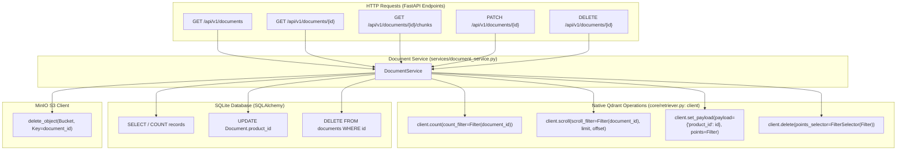
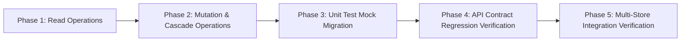

# Formal Implementation Plan: Qdrant Migration Version 4.0 - Document Service CRUD Migration

## 1. Executive Summary & Objective

The objective of **Qdrant Migration Version 4.0** is to migrate all document lifecycle management operations in [`services/document_service.py`](file:///home/prathamgbhat/Desktop/honeywell-virtual-assistant/services/document_service.py) from legacy ChromaDB collection methods to native **Qdrant client filter, count, scroll, payload, and deletion operations**.

In Version 2.0, [`core/retriever.py`](file:///home/prathamgbhat/Desktop/honeywell-virtual-assistant/core/retriever.py) was updated to wrap `QdrantClient` (`self.client`), removing the old Chroma `collection` object. Consequently, `DocumentService` currently retains stale references to `self.retriever.collection.get()`, `.update()`, and `.delete()`. Version 4.0 resolves this gap by re-architecting `DocumentService` to use Qdrant's high-performance native APIs, optimizing chunk counting, simplifying metadata updates into single atomic network calls, and updating mock test suites.

### Key Objectives for Version 4.0:
1. **High-Speed Chunk Counting**:
   Replace Chroma's inefficient `len(self.retriever.collection.get()["ids"])` with Qdrant's native indexed `self.retriever.client.count(collection_name, count_filter=Filter(...))` call.
2. **Chunk Discovery & Inspection via Scrolling**:
   Migrate `get_document_chunks` to use `self.retriever.client.scroll()` with `models.Filter` and `limit`/`offset` parameters.
3. **Atomic Filter-Based Metadata Updates**:
   Replace the multi-step fetch-modify-rewrite loop with a single atomic call:
   `self.retriever.client.set_payload(collection_name, payload={"product_id": product_id}, points=Filter(...))`.
4. **Cascade Deletion via Point Filter Selector**:
   Replace `collection.delete(where=...)` with Qdrant's `self.retriever.client.delete(points_selector=models.FilterSelector(...))`, preserving the strict cascade deletion order across Qdrant, SQLite, and MinIO.
5. **Mock Test Suite Migration**:
   Update mock objects and assertions in [`tests/unit/test_document_service.py`](file:///home/prathamgbhat/Desktop/honeywell-virtual-assistant/tests/unit/test_document_service.py) to validate Qdrant client interactions (`count`, `scroll`, `set_payload`, `delete`).
6. **Workflow Invariants**:
   - Zero new git branches (all changes directly on the working branch).
   - Zero automated commits by the assistant (handover via commit message template for user execution).

---

## 2. Architectural Principles & CRUD Operation Mapping



### CRUD API Mapping: ChromaDB vs. Qdrant

| Operation | ChromaDB (Legacy) | Qdrant (Version 4.0 Native) | Operational Benefit |
| :--- | :--- | :--- | :--- |
| **Chunk Count** (`list_documents`, `get_document`) | `len(collection.get(where={"document_id": id})["ids"])` | `client.count(collection_name, count_filter=Filter(...), exact=True).count` | Server-side indexed count; avoids transferring all chunk IDs over the network. |
| **Inspect Chunks** (`get_document_chunks`) | `collection.get(where=..., limit=..., offset=...)` | `client.scroll(collection_name, scroll_filter=Filter(...), limit=limit, offset=offset, with_payload=True)` | Native offset/cursor scrolling returning full point payloads. |
| **Metadata Update** (`update_document_metadata`) | 1. Query all IDs<br/>2. Merge in Python<br/>3. `collection.update(ids, metadatas)` | `client.set_payload(collection_name, payload={"product_id": id}, points=Filter(...))` | Single atomic network call; eliminates memory overhead and race conditions. |
| **Cascade Delete** (`delete_document`) | `collection.delete(where={"document_id": id})` | `client.delete(collection_name, points_selector=FilterSelector(filter=Filter(...)))` | Atomic deletion of all matching vectors matching the document filter. |

---

## 3. Key Technical Decisions

### 3.1 Standardizing Filter Construction
All document-scoped operations in Qdrant filter points using `document_id`. A helper method or standardized filter structure ensures consistent query execution:
```python
from qdrant_client import models

def _make_document_filter(document_id: str) -> models.Filter:
    return models.Filter(
        must=[
            models.FieldCondition(
                key="document_id",
                match=models.MatchValue(value=document_id),
            )
        ]
    )
```

### 3.2 Chunk Description Unpacking from Point Payload
In Qdrant, points are returned as `models.Record(id=uuid, payload={...})`.
When constructing `ChunkDescription`:
* `chunk_id` is extracted from `payload.get("chunk_id", str(record.id))`.
* `text` is extracted from `payload.get("text", "")`.
* Clean metadata dictionary excludes the large `"text"` attribute:
  ```python
  metadata = {k: v for k, v in payload.items() if k != "text"}
  ```

### 3.3 Preserving the Strict Cascade Deletion Sequence
The domain invariants established in the initial CRUD architecture must remain strictly intact:
1. **Step 1: Qdrant Vector Pre-Count & Purge**:
   - Count vectors to record `deleted_chunks` in the response:
     ```python
     deleted_chunks_count = self.retriever.client.count(
         collection_name=self.retriever.collection_name,
         count_filter=_make_document_filter(document_id),
         exact=True,
     ).count
     ```
   - Delete vectors immediately to halt RAG search discovery:
     ```python
     if deleted_chunks_count > 0:
         self.retriever.client.delete(
             collection_name=self.retriever.collection_name,
             points_selector=models.FilterSelector(filter=_make_document_filter(document_id)),
             wait=True,
         )
     ```
2. **Step 2: SQLite Row Purge**:
   - Delete database record and commit, releasing the SHA-256 fingerprint for future re-uploads.
3. **Step 3: MinIO Binary Purge**:
   - Delete the raw file from the S3 bucket to reclaim physical storage.

---

## 4. Phased Implementation Roadmap



---

### Phase 1: Read Operations Migration (`services/document_service.py`)

#### Objective:
Update `list_documents`, `get_document`, and `get_document_chunks` to use `self.retriever.client.count()` and `self.retriever.client.scroll()`.

#### Code Changes:
1. **`list_documents`**:
   Replace `self.retriever.collection.get()` with:
   ```python
   count_res = self.retriever.client.count(
       collection_name=self.retriever.collection_name,
       count_filter=models.Filter(
           must=[models.FieldCondition(key="document_id", match=models.MatchValue(value=doc.document_id))]
       ),
       exact=True,
   )
   total_chunks = count_res.count
   ```

2. **`get_document`**:
   Apply identical `count()` call for single document chunk resolution.

3. **`get_document_chunks`**:
   Use `client.scroll()` for paginated retrieval and `client.count()` for total chunks:
   ```python
   records, _ = self.retriever.client.scroll(
       collection_name=self.retriever.collection_name,
       scroll_filter=models.Filter(
           must=[models.FieldCondition(key="document_id", match=models.MatchValue(value=document_id))]
       ),
       limit=limit,
       offset=offset,
       with_payload=True,
       with_vectors=False,
   )

   total_chunks = self.retriever.client.count(
       collection_name=self.retriever.collection_name,
       count_filter=models.Filter(
           must=[models.FieldCondition(key="document_id", match=models.MatchValue(value=document_id))]
       ),
       exact=True,
   ).count
   ```

---

### Phase 2: Mutation & Cascade Operations Migration (`services/document_service.py`)

#### Objective:
Update `update_document_metadata` and `delete_document` to use `client.set_payload()` and `client.delete()`.

#### Code Changes:
1. **`update_document_metadata`**:
   ```python
   # Update product_id in Qdrant chunk payloads in a single atomic call
   self.retriever.client.set_payload(
       collection_name=self.retriever.collection_name,
       payload={"product_id": product_id},
       points=models.Filter(
           must=[models.FieldCondition(key="document_id", match=models.MatchValue(value=document_id))]
       ),
       wait=True,
   )

   # Fetch total chunks count for response
   total_chunks = self.retriever.client.count(
       collection_name=self.retriever.collection_name,
       count_filter=models.Filter(
           must=[models.FieldCondition(key="document_id", match=models.MatchValue(value=document_id))]
       ),
       exact=True,
   ).count
   ```

2. **`delete_document`**:
   ```python
   # Count vectors prior to deletion
   deleted_chunks_count = self.retriever.client.count(
       collection_name=self.retriever.collection_name,
       count_filter=models.Filter(
           must=[models.FieldCondition(key="document_id", match=models.MatchValue(value=document_id))]
       ),
       exact=True,
   ).count

   # Remove vectors from Qdrant
   if deleted_chunks_count > 0:
       self.retriever.client.delete(
           collection_name=self.retriever.collection_name,
           points_selector=models.FilterSelector(
               filter=models.Filter(
                   must=[models.FieldCondition(key="document_id", match=models.MatchValue(value=document_id))]
               )
           ),
           wait=True,
       )
       logger.info("Purged %d vectors from Qdrant for doc_id=%s", deleted_chunks_count, document_id)
   ```

---

### Phase 3: Unit Test Mock Migration (`tests/unit/test_document_service.py`)

#### Objective:
Update `tests/unit/test_document_service.py` to mock Qdrant client methods (`count`, `scroll`, `set_payload`, `delete`) instead of Chroma collection methods.

#### Mock Setup Specifications:
```python
# Setup mock Qdrant client
self.mock_retriever = MagicMock()
self.mock_client = MagicMock()
self.mock_retriever.client = self.mock_client
self.mock_retriever.collection_name = "test_collection"
```

#### Test Case Adaptations:
1. `test_list_documents_*`: Configure `self.mock_client.count.return_value = models.CountResult(count=5)`.
2. `test_get_document_chunks_transparency`: Configure `self.mock_client.scroll.return_value = (records, None)` and `self.mock_client.count.return_value = models.CountResult(count=2)`.
3. `test_update_document_metadata_syncs_sqlite_and_qdrant`:
   - Assert `self.mock_client.set_payload.assert_called_once()` with `payload={"product_id": "new-prod"}` and proper `models.Filter`.
4. `test_delete_document_strict_cascade_sequence`:
   - Assert `self.mock_client.delete.assert_called_once()`.
   - Assert SQLite row deleted and MinIO S3 object deleted in exact sequence.

---

### Phase 4: API Contract Regression Verification

#### Objective:
Run existing API contract test suites to verify that HTTP status codes, response schemas, and router behavior remain 100% compliant:
* `tests/unit/test_documents_read_api.py` (GET `/documents`, GET `/documents/{id}`, GET `/documents/{id}/chunks`)
* `tests/unit/test_documents_mutation_api.py` (PATCH `/documents/{id}`, DELETE `/documents/{id}`)

---

## 5. Comprehensive Testing Strategy

### Test Execution Matrix

| Test Suite | Environment | Scope | Expected Outcome |
| :--- | :--- | :--- | :--- |
| `tests/unit/test_document_service.py` | Local / In-Memory | DocumentService CRUD using mocked Qdrant client and in-memory SQLite. | 100% Passed. |
| `tests/unit/test_documents_read_api.py` | Local / TestClient | HTTP GET endpoints for discovery, pagination, chunk inspection. | 100% Passed. |
| `tests/unit/test_documents_mutation_api.py` | Local / TestClient | HTTP PATCH metadata and DELETE cascade endpoints. | 100% Passed. |
| `tests/unit/test_retriever.py` | Local / In-Memory | Core Qdrant Retriever tests. | 100% Passed. |
| Live API Multi-Store Verification | Docker Stack | End-to-end CRUD verification against live Qdrant, SQLite, and MinIO. | HTTP 200 / 201 / 204. |

---

## 6. Validation, Handover & Commit Checklist

### Implementation Notes & Verification Results

- Migrated all five `DocumentService` operations to Qdrant using a shared document filter and exact chunk-count helper. No `self.retriever.collection` references remain.
- **Pagination correction:** the public integer `offset` is a row count, not a Qdrant point-ID cursor. The implementation advances through bounded scroll batches (up to 256 skipped points per request), then fetches the requested page. Results follow Qdrant point-ID order, not `chunk_index` order. Offsets at or beyond the total return an empty page with the correct total.
- Point payloads supply the original chunk ID and text; returned metadata excludes `text`. Other payload fields are preserved when updating `product_id`.
- Payload updates and vector deletes use `wait=True`. Deletion retains the Qdrant -> SQLite -> MinIO sequence. SQLite and Qdrant are separate stores; these operations do not provide a distributed transaction.
- MinIO deletion errors now return `storage_removed=False` instead of claiming successful object removal. The existing best-effort deletion behavior and response schema are preserved.
- **39 targeted tests passed:** 14 document-service tests, 7 read-API tests, 5 mutation-API tests, 9 retriever tests, and 4 v3 pipeline integration tests. The existing API test files required no changes.
  ```bash
  HF_HUB_OFFLINE=1 TRANSFORMERS_OFFLINE=1 python -m pytest -p no:cacheprovider \
    tests/unit/test_document_service.py \
    tests/unit/test_documents_read_api.py \
    tests/unit/test_documents_mutation_api.py \
    tests/unit/test_retriever.py \
    tests/integration/test_qdrant_pipeline.py
  ```
- Real in-memory Qdrant coverage verifies 260-chunk pagination across multiple scroll batches, out-of-range offsets, payload preservation, document isolation, metadata updates, and cascading deletion. Mock tests additionally verify exact filters, cascade call order, missing documents, vector-deletion failure, and MinIO failure reporting.
- **Live multi-store verification passed:** a temporary Uvicorn HTTP server exercised list, details, chunk pagination, PATCH, and DELETE against the running Qdrant and MinIO services and an isolated SQLite database. All CRUD requests returned HTTP 200; fetching the deleted document returned HTTP 404. Qdrant points, SQL rows, and MinIO object removal were checked directly, including preservation of another document.
- The live check seeded vectors and objects directly and injected the isolated collection client, avoiding unrelated model downloads. It verifies document CRUD, not upload/model generation. Verification collections, objects, SQL storage, and the temporary server were cleaned up.
- Tests ran in a disposable API-image container with `qdrant-client==1.12.0` and pytest installed. No image rebuild or model download was needed.
- Existing `docs/qdrant_v3.md` edits were preserved. No branch or commit was created.

### Pre-Commit Checklist (To be verified prior to handover):
- [x] `services/document_service.py` completely purged of `self.retriever.collection` references.
- [x] `services/document_service.py` uses `self.retriever.client.count()`, `.scroll()`, `.set_payload()`, and `.delete()`.
- [x] `tests/unit/test_document_service.py` updated to mock `QdrantClient` and passing 100%.
- [x] `tests/unit/test_documents_read_api.py` passing 100%.
- [x] `tests/unit/test_documents_mutation_api.py` passing 100%.
- [x] V4 changes are confined to the target files; pre-existing v3 documentation edits are preserved.

### User Commit Instruction:
Once verification is complete, the changes will be handed over to the user to commit on the current branch using:

```bash
git add services/document_service.py tests/unit/test_document_service.py docs/qdrant_v4.md
git commit -m "refactor(service): migrate DocumentService CRUD operations to Qdrant native APIs"
```
