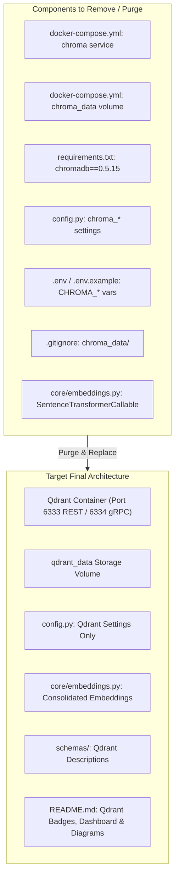
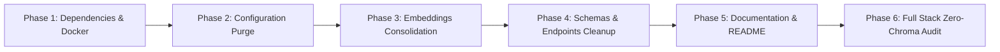

# Formal Implementation Plan: Qdrant Migration Version 5.0 - Chroma Deprecation, Cleanup & Final Polish

## 1. Executive Summary & Objective

The objective of **Qdrant Migration Version 5.0** is the **complete decommissioning of ChromaDB** across the repository, finalizing the transition to Qdrant.

With Version 2.0 establishing the core `Retriever`, Version 3.0 integrating Ingestion & RAG pipelines, and Version 4.0 migrating `DocumentService` CRUD operations, ChromaDB is now completely unused by active application logic. Version 5.0 eliminates technical debt by:
1. Deleting the `chroma` container service and persistent volume from [`docker-compose.yml`](file:///home/prathamgbhat/Desktop/honeywell-virtual-assistant/docker-compose.yml).
2. Removing `chromadb` from [`requirements.txt`](file:///home/prathamgbhat/Desktop/honeywell-virtual-assistant/requirements.txt).
3. Purging obsolete `chroma_*` attributes and environment variables from [`config.py`](file:///home/prathamgbhat/Desktop/honeywell-virtual-assistant/config.py), [`.env`](file:///home/prathamgbhat/Desktop/honeywell-virtual-assistant/.env), and [`.env.example`](file:///home/prathamgbhat/Desktop/honeywell-virtual-assistant/.env.example).
4. Collapsing the transitional `SentenceTransformerCallable` wrapper in [`core/embeddings.py`](file:///home/prathamgbhat/Desktop/honeywell-virtual-assistant/core/embeddings.py) directly into `Embeddings`, eliminating redundant list conversions.
5. Updating schema descriptions ([`schemas/ingestion.py`](file:///home/prathamgbhat/Desktop/honeywell-virtual-assistant/schemas/ingestion.py), [`schemas/document.py`](file:///home/prathamgbhat/Desktop/honeywell-virtual-assistant/schemas/document.py)) and route documentation ([`api/v1/endpoints/documents.py`](file:///home/prathamgbhat/Desktop/honeywell-virtual-assistant/api/v1/endpoints/documents.py)).
6. Updating [`README.md`](file:///home/prathamgbhat/Desktop/honeywell-virtual-assistant/README.md) with Qdrant badges, architectural diagrams, port mappings, and Qdrant Web Dashboard URL (`http://localhost:6333/dashboard`).
7. Updating [`.gitignore`](file:///home/prathamgbhat/Desktop/honeywell-virtual-assistant/.gitignore) by removing `chroma_data/` and adding `qdrant_data/`.

---

## 2. Decommissioning & Cleanup Architecture



---

## 3. Core Refactoring: Embeddings Consolidation

In Version 1.0, `SentenceTransformerCallable` was created as an auxiliary wrapper strictly to satisfy ChromaDB's required collection callback protocol (`embedding_function=self.embeddings.function`).

With ChromaDB decommissioned, Qdrant takes vectors directly via `Retriever.upsert()` and `Retriever.retrieve()`. The intermediary callable class is no longer necessary and can be consolidated directly into `Embeddings`.

### Consolidated Design (`core/embeddings.py`):
```python
from __future__ import annotations

import logging
from typing import Any, Callable
from sentence_transformers import SentenceTransformer

from core import pipeline_config

logger = logging.getLogger(__name__)

DEFAULT_FALLBACK_MODEL = "sentence-transformers/all-MiniLM-L6-v2"


class Embeddings:
    """
    Generate normalized vector embeddings for text chunks using SentenceTransformer.

    Attributes:
        model_name: Identifier of the embedding model.
        device: Target execution device ('cpu', 'cuda', etc.).
        function: Callable alias pointing to self.embed for backwards compatibility.
    """

    def __init__(
        self,
        model_name: str | None = None,
        device: str | None = None,
    ) -> None:
        self.model_name = model_name or pipeline_config.pipeline_settings.embedding_model
        self.device = device or pipeline_config.pipeline_settings.embedding_device
        self._model = self._load_model(self.model_name, self.device)
        self.function: Callable[[list[str]], list[list[float]]] = self.embed

    def _load_model(self, model_name: str, device: str) -> SentenceTransformer:
        """Load SentenceTransformer model with fallback handling."""
        try:
            logger.info("Loading SentenceTransformer model %r on device %r", model_name, device)
            return SentenceTransformer(model_name, device=device)
        except Exception as err:
            logger.warning(
                "Could not load SentenceTransformer for %r (%s). Falling back to %r.",
                model_name,
                err,
                DEFAULT_FALLBACK_MODEL,
            )
            return SentenceTransformer(DEFAULT_FALLBACK_MODEL, device=device)

    def embed(self, texts: list[str]) -> list[list[float]]:
        """Generate normalized vector embeddings for a list of text strings."""
        if not texts:
            return []
        embeddings = self._model.encode(
            texts,
            convert_to_numpy=True,
            normalize_embeddings=True,
        )
        return [
            item.tolist() if hasattr(item, "tolist") else list(item)
            for item in embeddings
        ]
```
**Benefits**:
* Eliminates the extra wrapper class and redundant list comprehension passes.
* Retains `self.function = self.embed` so any tests or callers expecting a callable attribute continue working without changes.

---

## 4. Phased Implementation Roadmap



---

### Phase 1: Dependencies & Docker Decommissioning

#### 1. [`requirements.txt`](file:///home/prathamgbhat/Desktop/honeywell-virtual-assistant/requirements.txt):
Remove `chromadb==0.5.15`.
Keep `qdrant-client>=1.12.0` and `sentence-transformers>=2.2.0`.

#### 2. [`docker-compose.yml`](file:///home/prathamgbhat/Desktop/honeywell-virtual-assistant/docker-compose.yml):
- Delete the entire `chroma:` service block.
- Remove `chroma: condition: service_healthy` from `api.depends_on`.
- Remove `CHROMA_HOST`, `CHROMA_PORT`, `CHROMA_COLLECTION` from `api.environment`.
- Remove `chroma_data:` from the top-level `volumes` list.

#### 3. [`.gitignore`](file:///home/prathamgbhat/Desktop/honeywell-virtual-assistant/.gitignore):
- Remove `chroma_data/`.
- Add `qdrant_data/`.

---

### Phase 2: Configuration & Environment Purge

#### 1. [`config.py`](file:///home/prathamgbhat/Desktop/honeywell-virtual-assistant/config.py):
Remove obsolete Chroma attributes from `Settings`:
```python
# DELETE THESE:
chroma_host: str | None = os.getenv("CHROMA_HOST")
chroma_port: int = int(os.getenv("CHROMA_PORT", "8000"))
chroma_path: str = os.getenv("CHROMA_PATH", "./chroma_data")
chroma_collection: str = os.getenv("CHROMA_COLLECTION", "my_documents")
```

#### 2. [`.env`](file:///home/prathamgbhat/Desktop/honeywell-virtual-assistant/.env) & [`.env.example`](file:///home/prathamgbhat/Desktop/honeywell-virtual-assistant/.env.example):
- Remove all `CHROMA_*` lines.
- Ensure `QDRANT_*` variables are the sole vector store configuration:
  ```bash
  # Qdrant Vector Store
  QDRANT_HOST=qdrant
  QDRANT_PORT=6333
  QDRANT_PATH=./qdrant_data
  QDRANT_COLLECTION=honeywell_documents
  ```

---

### Phase 3: Embeddings Technical Debt Consolidation

#### 1. [`core/embeddings.py`](file:///home/prathamgbhat/Desktop/honeywell-virtual-assistant/core/embeddings.py):
- Remove `SentenceTransformerCallable`.
- Consolidate model loading and encoding directly inside `Embeddings`.
- Set `self.function = self.embed`.

#### 2. [`tests/unit/test_embeddings.py`](file:///home/prathamgbhat/Desktop/honeywell-virtual-assistant/tests/unit/test_embeddings.py):
- Clean up tests asserting `SentenceTransformerCallable` instances; assert `isinstance(emb._model, SentenceTransformer)` or mock calls.
- Remove any legacy Chroma docstrings or comments.

---

### Phase 4: Schema & Endpoint Documentation Cleanup

#### 1. [`schemas/ingestion.py`](file:///home/prathamgbhat/Desktop/honeywell-virtual-assistant/schemas/ingestion.py):
Update field description:
```python
collection: str = Field(..., description="Qdrant collection name")
```

#### 2. [`schemas/document.py`](file:///home/prathamgbhat/Desktop/honeywell-virtual-assistant/schemas/document.py):
Update field descriptions:
```python
total_chunks: int = Field(..., description="Number of text chunks indexed in Qdrant")
chunk_id: str = Field(..., description="Unique chunk vector ID in Qdrant")
deleted_chunks: int = Field(..., description="Number of vectors removed from Qdrant")
```

#### 3. [`api/v1/endpoints/documents.py`](file:///home/prathamgbhat/Desktop/honeywell-virtual-assistant/api/v1/endpoints/documents.py):
Update remaining route descriptions:
- `GET /documents/{id}/chunks`: `"Inspect extracted text chunks and chunk-level metadata stored in Qdrant."`
- `PATCH /documents/{id}`: `"Update metadata attributes (such as product_id) across SQLite and all associated chunks in Qdrant."`
- `DELETE /documents/{id}`: `"Irreversibly delete a document and cascade deletion across Qdrant vectors, SQLite metadata, and MinIO storage."`

---

### Phase 5: Developer Documentation & README Overhaul

#### [`README.md`](file:///home/prathamgbhat/Desktop/honeywell-virtual-assistant/README.md):
1. **Badges**: Replace ChromaDB badge with Qdrant:
   ```markdown
   
   ```
2. **Architecture Diagrams**: Replace Chroma with Qdrant (port 6333).
3. **Services Table**:
   | Component | Technology | Default URL | Purpose |
   | :--- | :--- | :--- | :--- |
   | **Vector Search** | Qdrant | `http://localhost:6333` | Vector indexing & semantic search |
   | **Qdrant Dashboard** | Qdrant Web UI | `http://localhost:6333/dashboard` | Visual cluster & collection explorer |
4. **Environment Variables Table**: Remove `CHROMA_*` rows; document `QDRANT_*`.
5. **Volume Reset Instructions**: Update docker volume reset commands:
   ```bash
   docker volume rm honeywell-virtual-assistant_qdrant_data
   ```

---

### Phase 6: Full Stack Zero-Chroma Audit

#### 1. Codebase Audit:
Run grep to verify zero active references to Chroma outside archived history:
```bash
git grep -i "chroma" -- ':!docs/archive/' ':!docs/qdrant*' ':!documents/'
```
The command should return zero matches in all `.py`, `.yml`, `.env`, `.txt`, and active markdown files.

#### 2. Docker Stack Verification:
Restart the entire docker stack with fresh volumes:
```bash
docker compose down -v
docker compose up -d
```
Verify that all 4 services start cleanly and report healthy:
* `honeywell_api`
* `honeywell_qdrant`
* `honeywell_minio`
* `honeywell_ollama`

---

## 5. Comprehensive Testing Strategy

### Test Execution Matrix

| Test Suite | Environment | Scope | Expected Outcome |
| :--- | :--- | :--- | :--- |
| `tests/unit/test_embeddings.py` | Local / Container | Consolidated `Embeddings` model loading and generation. | 100% Passed. |
| `tests/unit/test_retriever.py` | Local / In-Memory | Qdrant retriever mechanics with in-memory client. | 100% Passed. |
| `tests/unit/test_document_service.py` | Local / In-Memory | DocumentService CRUD using mocked Qdrant client. | 100% Passed. |
| `tests/integration/test_qdrant_pipeline.py` | Local / In-Memory | End-to-end ingestion and RAG querying. | 100% Passed. |
| `tests/v0.4/v0.4.1/test_api_v1.py` | Local / TestClient | OpenAPI schema and route validation. | 100% Passed. |
| Zero-Chroma Codebase Grep | Local Shell | Verify no active Chroma references remain. | 0 matches. |
| Live Docker Healthcheck | Docker Stack | `GET http://localhost:8000/health` & `GET http://localhost:6333/readyz`. | HTTP 200 OK. |

---

## 6. Validation, Handover & Commit Checklist

### Implementation Notes & Verification Results

- Removed the Chroma dependency, Compose service/dependency/volume declaration, configuration attributes, and environment keys. Updated both `.env.example` and the ignored local `.env` without changing unrelated settings.
- Retained `qdrant-client==1.12.0` to match the pinned v1.12.0 server, rather than restoring the unbounded dependency shown earlier in this plan.
- Consolidated model loading and normalized encoding into `Embeddings`. `function` remains a callable alias for `embed`; tests now patch the model's `encode()` rather than replacing the obsolete callback implementation.
- Updated schema and endpoint descriptions, README architecture/configuration/dashboard documentation, parser architecture references, and the parser test fixture text. The README now accurately identifies supported parser formats and explains vector-reset/deduplication behavior.
- Added an API healthcheck so all four Compose services report health status.
- **Fresh API image build succeeded.** The running image has no importable `chromadb` package, contains Qdrant client v1.12.0, and passes `pip check`.
- **50 targeted tests passed in the freshly built image**, with model-hub networking disabled:
  ```bash
  HF_HUB_OFFLINE=1 TRANSFORMERS_OFFLINE=1 python -m pytest -p no:cacheprovider \
    tests/unit/test_embeddings.py tests/unit/test_retriever.py \
    tests/unit/test_document_service.py tests/unit/test_documents_read_api.py \
    tests/unit/test_documents_mutation_api.py tests/integration/test_qdrant_pipeline.py
  ```
- The full offline suite was also attempted in the previous API-image test container after uninstalling Chroma: **148 passed, 38 failed, 5 collection errors, 3 deselected**. Failures include unavailable cached models/tokenizers, historical removed routes/schema imports, and the existing page-versus-chunk citation expectation. Full-suite success is not claimed; historical test contracts were preserved.
  ```bash
  HF_HUB_OFFLINE=1 TRANSFORMERS_OFFLINE=1 python -m pytest \
    -p no:cacheprovider --continue-on-collection-errors tests
  ```
- **Four-service stack verification passed:** `docker compose up -d --wait --wait-timeout 180` reports API, Qdrant, MinIO, and Ollama healthy. API `/health` and Qdrant `/readyz` both returned HTTP 200. OpenAPI contains no Chroma descriptions.
- Removed the obsolete Chroma container. Existing named data volumes and the SQLite database were preserved; the destructive `down -v` example was not used. Removing the Compose volume declaration does not delete the old physical volume or migrate its contents.
- Runtime/source audit returned zero matches:
  ```bash
  git grep -in chroma -- core services api schemas config.py requirements.txt \
    docker-compose.yml .env.example .gitignore README.md
  ```
- The broader historical audit still finds Chroma in `docs/archive/`, `docs/qdrant*`, `docs/v0/`, and a preserved comment in `tests/v0.3/test_api_contracts.py`. These are historical references, not runtime dependencies. Local `.env` vector settings were checked separately because the file is ignored.
- `git diff --check` passed. Disposable test containers were removed; the four application services remain running. No branch or commit was created.

### Pre-Commit Checklist (To be verified prior to handover):
- [x] `chromadb` removed from `requirements.txt`.
- [x] `chroma` service and `chroma_data` volume deleted from `docker-compose.yml`.
- [x] `chroma_*` attributes deleted from `config.py`.
- [x] `CHROMA_*` keys purged from `.env` and `.env.example`.
- [x] `SentenceTransformerCallable` collapsed into `core/embeddings.py`.
- [x] Schema descriptions updated in `schemas/ingestion.py` and `schemas/document.py`.
- [x] Endpoint descriptions updated in `api/v1/endpoints/documents.py`.
- [x] `.gitignore` updated (`qdrant_data/`).
- [x] `README.md` updated with Qdrant badges, service table, and dashboard URL.
- [ ] Full test suite passes 100%.
- [x] Grep audit confirms zero active Chroma code references.

### User Commit Instruction:
Once verification is complete, the changes will be handed over to the user to commit on the current branch using:

```bash
git add requirements.txt docker-compose.yml config.py .env.example .gitignore core/embeddings.py schemas/ingestion.py schemas/document.py api/v1/endpoints/documents.py README.md tests/unit/test_embeddings.py tests/parsers/test_serialize_fix.py docs/parser/RAG_PARSING_ARCHITECTURE_FINAL.md docs/parser/overall_parser_plan.md docs/parser/v2.md docs/prompt/plan.md docs/qdrant_v5.md
git commit -m "chore: remove ChromaDB dependencies, clean configuration, and update documentation"
```
