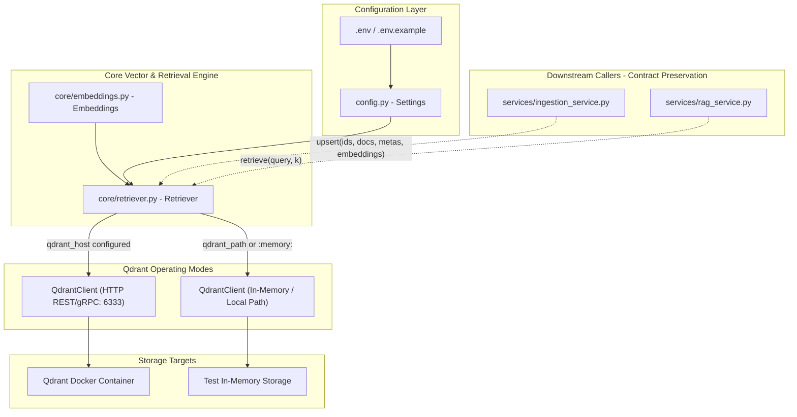
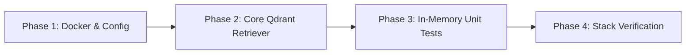

# Formal Implementation Plan: Qdrant Migration Version 2.0 - Infrastructure, Configuration & Core Retriever

## 1. Executive Summary & Objective

The objective of **Qdrant Migration Version 2.0** is to provision the Qdrant service within the application infrastructure, establish unified configuration parameters, and implement the core **Qdrant-backed `Retriever`** inside [`core/retriever.py`](file:///home/prathamgbhat/Desktop/honeywell-virtual-assistant/core/retriever.py).

In Version 1.0, [`core/embeddings.py`](file:///home/prathamgbhat/Desktop/honeywell-virtual-assistant/core/embeddings.py) was completely decoupled from ChromaDB and `qdrant-client` was installed. Version 2.0 builds upon this by introducing Qdrant as an active vector database driver with dual operating modes (HTTP networked client for Docker production and `:memory:` / local path for fast, offline unit testing).

### Key Objectives for Version 2.0:
1. **Infrastructure Provisioning**:
   Add the `qdrant` service (`qdrant/qdrant:v1.12.0`) to [`docker-compose.yml`](file:///home/prathamgbhat/Desktop/honeywell-virtual-assistant/docker-compose.yml) alongside existing services, exposing REST port `6333` and gRPC port `6334` with persistent volume `qdrant_data`.
2. **Unified Configuration**:
   Add `qdrant_host`, `qdrant_port`, `qdrant_path`, and `qdrant_collection` to [`config.py`](file:///home/prathamgbhat/Desktop/honeywell-virtual-assistant/config.py) and [`.env.example`](file:///home/prathamgbhat/Desktop/honeywell-virtual-assistant/.env.example).
3. **Core Qdrant `Retriever` Implementation**:
   Rewrite [`core/retriever.py`](file:///home/prathamgbhat/Desktop/honeywell-virtual-assistant/core/retriever.py) to wrap `qdrant_client.QdrantClient`, implementing:
   - Dynamic collection initialization with Cosine distance and auto-detected vector dimensions.
   - Deterministic UUIDv5 point ID generation from string chunk IDs (`uuid.uuid5(uuid.NAMESPACE_DNS, chunk_id)`).
   - `upsert()` storing chunk text, document metadata, and embeddings.
   - `retrieve()` querying top-k nearest vectors and normalizing responses into the standard dictionary contract (`{"documents": [docs], "metadatas": [metas], "distances": [dists]}`).
4. **Dedicated In-Memory Unit Test Suite**:
   Implement a comprehensive test suite in [`tests/unit/test_retriever.py`](file:///home/prathamgbhat/Desktop/honeywell-virtual-assistant/tests/unit/test_retriever.py) utilizing Qdrant's embedded `:memory:` mode for zero-dependency test execution.
5. **Workflow Invariants**:
   - Zero new git branches (all changes directly on the working branch).
   - Zero automated commits by the assistant (handover via commit message template for user execution).

---

## 2. Architectural Principles & Layer Boundaries



### Invariants Enforced in Version 2.0:
- **Contract Preservation**: The public signature of `Retriever.upsert(...)` and `Retriever.retrieve(...)` remains 100% identical. Downstream consumers receive the same data shapes without needing modification until Version 3.0.
- **Deterministic ID Invariant**: Point IDs are deterministically hashed via UUIDv5. Re-upserting the same chunk ID overwrites the point rather than duplicating it.
- **Dynamic Dimension Discovery**: Vector dimensions are dynamically discovered from the configured embedding model (`len(embeddings.embed(["probe"])[0])`), eliminating hardcoded assumptions.
- **Offline Testability**: Unit tests never require an external Qdrant daemon or open network socket.

---

## 3. Key Technical Decisions

### 3.1 Point ID Generation (Deterministic UUIDv5)
Qdrant strictly requires point IDs to be 64-bit unsigned integers or valid RFC 4122 UUID strings. The codebase generates chunk IDs like `doc_123_chunk_0`.
* **Strategy**:
  ```python
  import uuid

  def generate_point_id(chunk_id: str) -> str:
      return str(uuid.uuid5(uuid.NAMESPACE_DNS, chunk_id))
  ```
  The original human-readable `chunk_id` is preserved within the point payload (`payload["chunk_id"] = chunk_id`).

### 3.2 Dynamic Vector Dimension Discovery
Different embedding models produce different vector dimensions (e.g., `BAAI/bge-base-en-v1.5` produces 768, while `all-MiniLM-L6-v2` produces 384).
* **Strategy**:
  Upon initialization, `Retriever` probes the embedding model with a dummy string if dimension is not explicitly passed:
  ```python
  sample_vector = self.embeddings.embed(["probe"])[0]
  self.vector_size = len(sample_vector)
  ```
  This guarantees that Qdrant collection creation always matches the loaded model's tensor shape.

### 3.3 Score to Distance Normalization
* In Qdrant, Cosine search returns similarity scores where `1.0` is identical.
* ChromaDB returned Cosine distance where `0.0` is identical (`distance = 1.0 - similarity`).
* **Strategy**:
  In `Retriever.retrieve()`, normalized distances are calculated as:
  ```python
  distance = max(0.0, 1.0 - point.score)
  ```
  This preserves expected ranking and scoring thresholds in downstream RAG prompt builders.

---

## 4. Phased Implementation Roadmap



---

### Phase 1: Docker Infrastructure & Configuration

#### Objective:
Add Qdrant service to Docker Compose and add environment settings to `config.py` and `.env.example`.

#### 1. `docker-compose.yml` Updates
Add the `qdrant` service alongside existing services:
```yaml
  qdrant:
    image: docker.io/qdrant/qdrant:v1.12.0
    container_name: honeywell_qdrant
    ports:
      - "6333:6333"
      - "6334:6334"
    volumes:
      - qdrant_data:/qdrant/storage
    healthcheck:
      test: ["CMD", "curl", "-f", "http://localhost:6333/readyz"]
      interval: 10s
      timeout: 5s
      retries: 5
    restart: unless-stopped
```
Add volume definition:
```yaml
volumes:
  minio_data:
  chroma_data:
  qdrant_data:
  ollama_data:
```
Update `api` service environment:
```yaml
      QDRANT_HOST: qdrant
      QDRANT_PORT: "6333"
      QDRANT_COLLECTION: ${QDRANT_COLLECTION:-honeywell_documents}
```
Add `qdrant: condition: service_healthy` under `api.depends_on`.

#### 2. `config.py` Updates
Add Qdrant infrastructure settings to `Settings`:
```python
    # Qdrant Vector Store
    qdrant_host: str | None = os.getenv("QDRANT_HOST")
    qdrant_port: int = int(os.getenv("QDRANT_PORT", "6333"))
    qdrant_path: str | None = os.getenv("QDRANT_PATH")
    qdrant_collection: str = os.getenv("QDRANT_COLLECTION", "honeywell_documents")
```

#### 3. `.env.example` Updates
Document Qdrant environment variables:
```bash
# Qdrant Vector Store
# Set to 'qdrant' for container mode or leave empty to use local on-disk / in-memory storage
QDRANT_HOST=qdrant
QDRANT_PORT=6333
QDRANT_PATH=./qdrant_data
QDRANT_COLLECTION=honeywell_documents
```

---

### Phase 2: Core Qdrant `Retriever` Engine (`core/retriever.py`)

#### Objective:
Replace ChromaDB client wrapping in [`core/retriever.py`](file:///home/prathamgbhat/Desktop/honeywell-virtual-assistant/core/retriever.py) with `qdrant_client.QdrantClient`.

#### Detailed Design:
```python
from __future__ import annotations

import logging
import uuid
from typing import Any

from qdrant_client import QdrantClient, models

from config import settings
from core.embeddings import Embeddings
from core.pipeline_config import pipeline_settings

logger = logging.getLogger(__name__)


class Retriever:
    """
    Manage Qdrant vector persistence and semantic query retrieval.

    Attributes:
        embeddings: Embeddings instance for vector generation.
        client: QdrantClient instance.
        collection_name: Target collection name.
        vector_size: Dimensionality of vector embeddings.
    """

    def __init__(
        self,
        embeddings: Embeddings | None = None,
        client: QdrantClient | None = None,
        collection_name: str | None = None,
    ) -> None:
        self.embeddings = embeddings or Embeddings()
        self.collection_name = collection_name or settings.qdrant_collection

        # Initialize client (Explicit -> Networked -> Path/Memory)
        if client is not None:
            self.client = client
        elif settings.qdrant_host:
            self.client = QdrantClient(host=settings.qdrant_host, port=settings.qdrant_port)
        elif settings.qdrant_path:
            self.client = QdrantClient(path=settings.qdrant_path)
        else:
            self.client = QdrantClient(":memory:")

        # Probe dimension and ensure collection exists
        sample_vector = self.embeddings.embed(["probe"])[0]
        self.vector_size = len(sample_vector)
        self._ensure_collection()

    def _ensure_collection(self) -> None:
        """Create Qdrant collection with Cosine distance if it does not already exist."""
        if not self.client.collection_exists(self.collection_name):
            logger.info(
                "Creating Qdrant collection %r with vector size %d and Cosine distance",
                self.collection_name,
                self.vector_size,
            )
            self.client.create_collection(
                collection_name=self.collection_name,
                vectors_config=models.VectorParams(
                    size=self.vector_size,
                    distance=models.Distance.COSINE,
                ),
            )

    @staticmethod
    def chunk_id_to_uuid(chunk_id: str) -> str:
        """Deterministically map string chunk_id to UUIDv5 string."""
        return str(uuid.uuid5(uuid.NAMESPACE_DNS, chunk_id))

    def upsert(
        self,
        ids: list[str],
        documents: list[str],
        metadatas: list[dict[str, Any]],
        embeddings: list[list[float]],
    ) -> None:
        """Persist chunk IDs, text, metadata, and embeddings to Qdrant."""
        if not ids:
            return

        points = []
        for chunk_id, doc_text, meta, vector in zip(ids, documents, metadatas, embeddings):
            point_id = self.chunk_id_to_uuid(chunk_id)
            payload = dict(meta or {})
            payload["text"] = doc_text
            payload["chunk_id"] = chunk_id

            points.append(
                models.PointStruct(
                    id=point_id,
                    vector=vector,
                    payload=payload,
                )
            )

        self.client.upsert(
            collection_name=self.collection_name,
            points=points,
        )

    def retrieve(self, query: str, k: int | None = None) -> dict[str, Any]:
        """Query Qdrant for the top-k most semantically similar chunks."""
        target_k = k if k is not None else pipeline_settings.retrieval_k
        query_vector = self.embeddings.embed([query])[0]

        search_result = self.client.query_points(
            collection_name=self.collection_name,
            query=query_vector,
            limit=target_k,
            with_payload=True,
        )

        docs: list[str] = []
        metas: list[dict[str, Any]] = []
        distances: list[float] = []

        for point in search_result.points:
            payload = point.payload or {}
            docs.append(payload.get("text", ""))
            
            # Reconstruct metadata without embedded text
            meta = {k: v for k, v in payload.items() if k != "text"}
            metas.append(meta)

            # Cosine distance = 1.0 - similarity_score
            distances.append(max(0.0, 1.0 - (point.score or 0.0)))

        return {
            "documents": [docs],
            "metadatas": [metas],
            "distances": [distances],
        }
```

---

### Phase 3: Dedicated In-Memory Unit Test Suite (`tests/unit/test_retriever.py`)

#### Objective:
Create a dedicated test file validating all methods of `Retriever` using `QdrantClient(":memory:")`.

#### Target Test Cases:
1. `test_retriever_initialization_creates_collection`: Verifies collection creation with correct vector size and Cosine distance in memory.
2. `test_chunk_id_to_uuid_is_deterministic`: Verifies same `chunk_id` always generates the exact same UUIDv5 string.
3. `test_upsert_stores_points_correctly`: Verifies upserting points, payloads, and embeddings into Qdrant.
4. `test_upsert_idempotence`: Verifies re-upserting identical `chunk_id` updates existing points rather than duplicating them.
5. `test_retrieve_returns_normalized_structure`: Verifies query vector search returns `{"documents": [...], "metadatas": [...], "distances": [...]}`.
6. `test_retrieve_empty_collection`: Verifies querying an empty collection returns empty sub-lists without throwing errors.
7. `test_retrieve_top_k_limit`: Verifies passing `k=2` returns at most 2 results.
8. `test_client_injection_override`: Verifies passing an explicit mock/in-memory client overrides environment connection logic.

---

### Phase 4: Stack & Integration Verification

#### Objective:
Verify end-to-end stack startup with Qdrant container running:
1. Start Qdrant in Docker:
   ```bash
   docker compose up -d qdrant
   ```
2. Verify Qdrant readyz check:
   ```bash
   curl -I http://localhost:6333/readyz
   ```
3. Run retriever unit tests inside container:
   ```bash
   docker exec honeywell_api python -m unittest tests/unit/test_retriever.py
   ```

---

## 5. Comprehensive Testing Strategy

### Test Execution Matrix

| Test Suite | Environment | Scope | Expected Outcome |
| :--- | :--- | :--- | :--- |
| `tests/unit/test_retriever.py` | Local / In-Memory | Collection creation, UUIDv5 mapping, upsert, query, normalized output format. | 100% Passed. |
| `tests/unit/test_embeddings.py` | Local / Container | Embeddings generation, model loading, device selection. | 100% Passed. |
| `tests/unit/test_document_service.py` | Local / Container | Document service isolation. | 100% Passed. |
| Container Health Check | Docker Stack | Qdrant HTTP health endpoint `/readyz`. | HTTP 200 OK. |

---

## 6. Validation, Handover & Commit Checklist

### Pre-Commit Checklist (To be verified prior to handover):
- [ ] `docker-compose.yml` updated with `qdrant` service, healthcheck, and volume.
- [ ] `config.py` and `.env.example` updated with `QDRANT_*` settings.
- [ ] `core/retriever.py` rewritten with `QdrantClient`, UUIDv5 mapping, `upsert()`, and `retrieve()`.
- [ ] `tests/unit/test_retriever.py` implemented with 100% passing tests using in-memory mode.
- [ ] Git status confirms only the target files for Version 2.0 are modified.

### User Commit Instruction:
Once verification is complete, the changes will be handed over to the user to commit on the current branch using:

```bash
git add docker-compose.yml config.py .env.example core/retriever.py tests/unit/test_retriever.py docs/qdrant_v2.md
git commit -m "feat(retriever): implement Qdrant-backed Retriever and add docker infrastructure"
```

