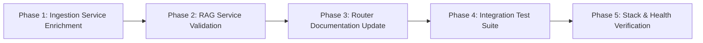

# Formal Implementation Plan: Qdrant Migration Version 3.0 - Ingestion & RAG Pipeline Integration

## 1. Executive Summary & Objective

The objective of **Qdrant Migration Version 3.0** is to seamlessly integrate the **Ingestion Pipeline** ([`services/ingestion_service.py`](file:///home/prathamgbhat/Desktop/honeywell-virtual-assistant/services/ingestion_service.py)) and **RAG Query Pipeline** ([`services/rag_service.py`](file:///home/prathamgbhat/Desktop/honeywell-virtual-assistant/services/rag_service.py)) with the new Qdrant vector engine established in Version 2.0.

In Version 2.0, [`core/retriever.py`](file:///home/prathamgbhat/Desktop/honeywell-virtual-assistant/core/retriever.py) was rewritten to wrap `qdrant_client.QdrantClient` with dynamic collection initialization, UUIDv5 deterministic point IDs, and Cosine distance normalization. Version 3.0 completes the integration of this core retriever into the live application services, ensuring rich metadata payload population, updating OpenAPI endpoint documentation, and establishing an automated end-to-end integration test suite.

### Key Objectives for Version 3.0:
1. **Enrich Ingestion Metadata Payloads**:
   Update [`services/ingestion_service.py`](file:///home/prathamgbhat/Desktop/honeywell-virtual-assistant/services/ingestion_service.py) to guarantee that `product_id` is explicitly injected into every chunk's metadata dictionary prior to calling `self.retriever.upsert()`. This ensures Qdrant point payloads immediately contain complete attributes (`document_id`, `product_id`, `filename`, `chunk_id`, `page`) required for downstream filtering and metadata synchronization.
2. **Validate RAG Retrieval & Prompt Assembly**:
   Verify that [`services/rag_service.py`](file:///home/prathamgbhat/Desktop/honeywell-virtual-assistant/services/rag_service.py) correctly queries Qdrant vectors, properly formats source citations with Cosine distances, and constructs context prompts for Ollama generation without regressions.
3. **Update OpenAPI & Endpoint Documentation**:
   Update router descriptions in [`api/v1/endpoints/query.py`](file:///home/prathamgbhat/Desktop/honeywell-virtual-assistant/api/v1/endpoints/query.py) and [`api/v1/endpoints/documents.py`](file:///home/prathamgbhat/Desktop/honeywell-virtual-assistant/api/v1/endpoints/documents.py) to accurately reflect Qdrant vector storage instead of legacy ChromaDB references.
4. **Automated Integration Test Suite**:
   Create a dedicated integration test in [`tests/integration/test_qdrant_pipeline.py`](file:///home/prathamgbhat/Desktop/honeywell-virtual-assistant/tests/integration/test_qdrant_pipeline.py) testing the full ingestion-to-query lifecycle using `QdrantClient(":memory:")` and in-memory SQLite without requiring live Docker containers.
5. **Workflow Invariants**:
   - Zero new git branches (all changes directly on the working branch).
   - Zero automated commits by the assistant (handover via commit message template for user execution).

---

## 2. Architectural Principles & Data Flow

```mermaid
flowchart TD
    subgraph IngestionFlow["Ingestion Pipeline (services/ingestion_service.py)"]
        File["Uploaded Multipart File"] --> Uploader["Uploader (MinIO Storage)"]
        Uploader --> Parser["ParserRouter (Text / Docling Extraction)"]
        Parser --> Chunker["Chunker (Text Segmentation)"]
        Chunker --> Embedder["Embeddings (Vector Generation)"]
        Embedder --> EnrichMeta["Enrich Payload (document_id, product_id, filename, chunk_id)"]
        EnrichMeta --> QdrantUpsert["Retriever.upsert() -> Qdrant Collection"]
        EnrichMeta --> SQLiteRecord["SQLite Database (Document Model)"]
    end

    subgraph QueryFlow["Query & RAG Pipeline (services/rag_service.py)"]
        Question["User Question (POST /api/v1/query)"] --> QdrantRetrieve["Retriever.retrieve() -> Qdrant Nearest Neighbors"]
        QdrantRetrieve --> PromptBuilder["Generator.build_prompt(context, question)"]
        PromptBuilder --> OllamaGen["Generator.generate() -> Local Ollama LLM"]
        OllamaGen --> QueryResp["QueryResponse (answer, sources, distance)"]
    end
```



### Invariants Enforced in Version 3.0:
- **Payload Completeness**: Every point in Qdrant must contain the following standard JSON payload attributes:
  ```json
  {
    "document_id": "doc-uuid-string",
    "product_id": "product-identifier",
    "filename": "manual.pdf",
    "chunk_id": "doc-uuid-string_chunk_0",
    "chunk_index": 0,
    "page": 1,
    "text": "Extracted excerpt text..."
  }
  ```
- **Dual Store Synchronization**: A document is only marked `status="indexed"` after both vector persistence in Qdrant and relational metadata persistence in SQLite succeed.
- **Contract Parity**: `POST /api/v1/documents` and `POST /api/v1/query` response schemas (`DocumentIngestResponse`, `QueryResponse`) remain byte-for-byte compatible with existing client consumers.

---

## 3. Key Technical Decisions

### 3.1 Metadata Enrichment During Ingestion
In the previous prototype, `Chunker.split()` generated chunk-level metadata (`page`, `filename`, `document_id`), but `product_id` was only attached to the SQLite record.
* **Problem**: In Version 4.0, Qdrant will filter and update points by `product_id`. If `product_id` is missing from the point payload at ingestion time, payload-based filtering cannot match the points.
* **Solution**: In `IngestionService.process_document()`, explicitly iterate through `metadatas` and attach `meta["product_id"] = product_id` prior to invoking `self.retriever.upsert()`.

### 3.2 Pure In-Memory Integration Testing
To ensure the pipeline is completely testable in automated CI and offline developer environments:
* Use `QdrantClient(":memory:")` passed to `Retriever(client=in_memory_client)`.
* Use SQLite in-memory (`sqlite:///:memory:`).
* Mock only external network boundaries (MinIO S3 byte storage and Ollama HTTP generation).
* This provides a true end-to-end test verifying that document bytes are parsed, chunked, embedded, indexed into Qdrant, and subsequently queried via semantic vector similarity.

---

## 4. Phased Implementation Roadmap



---

### Phase 1: Ingestion Service Metadata Enrichment (`services/ingestion_service.py`)

#### Objective:
Attach `product_id` to chunk metadatas and update code comments from Chroma to Qdrant.

#### File Changes in `services/ingestion_service.py`:
```python
# Chunk text and attach metadata
chunks, metadatas, chunk_ids = self.chunker.split(pages, doc_id, filename)

# Ensure product_id is attached to every chunk payload for Qdrant filtering
for meta in metadatas:
    meta["product_id"] = product_id

# Generate vector embeddings
vectors = self.embeddings.embed(chunks)

# Persist to Qdrant vector database
self.retriever.upsert(
    ids=chunk_ids,
    documents=chunks,
    metadatas=metadatas,
    embeddings=vectors,
)
```

---

### Phase 2: RAG Service Validation (`services/rag_service.py`)

#### Objective:
Verify query retrieval from Qdrant, score distance mapping, and prompt construction.

#### File Inspection & Verification in `services/rag_service.py`:
- `self.retriever.retrieve(q, k=self.retrieval_k)` invokes Qdrant vector search.
- Unpacks normalized response:
  ```python
  documents = retrieved.get("documents", [[]])[0]
  metadatas = retrieved.get("metadatas", [[]])[0]
  distances = retrieved.get("distances", [[]])[0]
  ```
- Ensures empty query validation (`ValueError("Question must not be empty")`) and empty collection handling (`ValueError("No indexed document chunks were found for this query")`).
- Passes documents and metadatas to `self.generator.build_prompt()` and constructs `QueryResponse`.

---

### Phase 3: OpenAPI Documentation & Endpoint Descriptions

#### Objective:
Update API route metadata to reference Qdrant.

#### 1. [`api/v1/endpoints/query.py`](file:///home/prathamgbhat/Desktop/honeywell-virtual-assistant/api/v1/endpoints/query.py):
Update description:
```python
@router.post(
    "/query",
    response_model=QueryResponse,
    summary="Query RAG pipeline",
    description="Retrieve relevant document chunks from Qdrant and generate an answer using Ollama.",
)
```

#### 2. [`api/v1/endpoints/documents.py`](file:///home/prathamgbhat/Desktop/honeywell-virtual-assistant/api/v1/endpoints/documents.py):
Update description:
```python
@router.post(
    "",
    status_code=status.HTTP_201_CREATED,
    response_model=DocumentIngestResponse,
    summary="Upload and ingest documents",
    description=(
        "Upload one or more documents, parse text, chunk, generate embeddings, "
        "and index them in Qdrant synchronously."
    ),
)
```

---

### Phase 4: Integration Test Suite (`tests/integration/test_qdrant_pipeline.py`)

#### Objective:
Build a complete integration test executing real ingestion and retrieval through in-memory Qdrant.

#### Target Test Cases in `test_qdrant_pipeline.py`:
1. `test_end_to_end_ingestion_and_retrieval`:
   - Ingests a multi-page document into in-memory Qdrant.
   - Asserts Qdrant collection point count matches chunk count.
   - Directly inspects Qdrant point payloads to verify `document_id`, `product_id`, `filename`, `chunk_id`, and `text` are stored correctly.
   - Executes `RAGService.answer_question()` and verifies prompt assembly, source citations, and distances.
2. `test_ingestion_duplicate_prevention_with_qdrant`:
   - Attempts uploading the same file twice; verifies SHA-256 deduplication correctly returns cached document metadata without duplicate vector inserts.
3. `test_rag_query_with_no_matching_vectors`:
   - Verifies appropriate error handling when querying an empty Qdrant collection.

---

### Phase 5: Stack & Health Verification

#### Objective:
Verify that the full stack with live Qdrant and API container runs without errors.
1. Run test suite:
   ```bash
   python -m unittest discover -s tests
   ```
2. Verify live endpoints:
   - `POST /api/v1/documents` indexes points in Qdrant container (`http://localhost:6333`).
   - `POST /api/v1/query` returns grounded response from Ollama.

---

## 5. Comprehensive Testing Strategy

### Test Execution Matrix

| Test Suite | Environment | Scope | Expected Outcome |
| :--- | :--- | :--- | :--- |
| `tests/integration/test_qdrant_pipeline.py` | Local / In-Memory | End-to-end document ingestion -> Qdrant indexing -> RAG query. | 100% Passed. |
| `tests/unit/test_retriever.py` | Local / In-Memory | Core Qdrant Retriever mechanics. | 100% Passed. |
| `tests/unit/test_embeddings.py` | Local / Container | Decoupled embeddings generation. | 100% Passed. |
| `tests/v0.5/v0.5.1/test_services.py` | Local / Container | Service contract mocking. | 100% Passed. |
| Live Endpoint Verification | Docker Stack | `POST /api/v1/documents` and `POST /api/v1/query`. | HTTP 201 / HTTP 200. |

---

## 6. Validation, Handover & Commit Checklist

### Pre-Commit Checklist (To be verified prior to handover):
- [x] `services/ingestion_service.py` updated with `product_id` metadata enrichment and comment cleanup.
- [x] `api/v1/endpoints/query.py` updated with Qdrant router description.
- [x] `api/v1/endpoints/documents.py` updated with Qdrant router description.
- [x] `tests/integration/test_qdrant_pipeline.py` created and passing 100%.
- [ ] Existing service unit tests (`tests/v0.5/v0.5.1/test_services.py`) pass without regressions.
- [x] Git status confirms only the target files for Version 3.0 are modified.

### Implementation & Verification Results

- Enrichment uses the existing `IngestionService.ingest_files()` method; there is no `process_document()` method in the current service.
- `RAGService` already consumes the v2 normalized retrieval contract and required no production changes.
- Four integration tests cover a two-slide PPTX, payload inspection, SQL persistence, real Qdrant ranking, prompt assembly, source distances, product-scoped deduplication, empty queries/collections, and both POST endpoints.
- Offline tests use a locally constructed SentenceTransformer bag-of-words model and tokenizer. Parsing, chunking, embedding execution, Qdrant, and SQLite are real; MinIO and Ollama HTTP boundaries are mocked. These tests verify pipeline integration, not the production embedding model's semantic quality or generated citation accuracy.
- Actual chunk IDs retain the existing `{document_id}_c{index}` format. Page metadata follows the parser's available provenance; this milestone does not invent page numbers for formats without it.
- Targeted verification passed **24 tests** with model-hub networking disabled:
  ```bash
  HF_HUB_OFFLINE=1 TRANSFORMERS_OFFLINE=1 python -m pytest -p no:cacheprovider \
    tests/integration/test_qdrant_pipeline.py \
    tests/unit/test_retriever.py tests/unit/test_embeddings.py
  ```
- The historical service suite fails during collection because it imports `DocumentIngestResponse` from `schemas.document`, while the class now lives in `schemas.ingestion`. Historical tests were preserved.
- The planned `python -m unittest discover -s tests` command was run: it reports three `v0` import errors from dotted version directories and the existing generator test failure expecting page citations rather than chunk citations. It does not discover the new pytest function tests.
- Live MinIO, Chroma, and Qdrant healthchecks passed. A temporary API process returned HTTP 200 from `/health`. The live upload exceeded the 300-second client timeout; its SQLite record was subsequently found during cleanup, but HTTP 201 and live Ollama query completion were not verified.
- A full API image rebuild exceeded the command timeout during system-package installation. Tests and the temporary API process used the existing API image with the pinned Qdrant client installed in a disposable container.
- Temporary verification SQL storage, uploaded object, Qdrant collection, and container were removed. The existing repository database was not used for the live check.
- `git diff --check` passed. No branch or commit was created.

### Remaining Verification & Migration Boundaries

- [ ] Complete live upload HTTP 201 and query HTTP 200 verification after API image/model preparation.
- Document GET/PATCH/DELETE operations remain dependent on the v4 CRUD migration.
- The existing generator exposes filename/page in context headers, while the system prompt requests chunk citations. This v3 scope validates the existing prompt assembly and source metadata; citation-format alignment remains outstanding.
- Existing Chroma content is not backfilled. SQLite deduplication can still identify a previously indexed document whose vectors have not been moved into Qdrant.

### User Commit Instruction:
Once verification is complete, the changes will be handed over to the user to commit on the current branch using:

```bash
git add services/ingestion_service.py api/v1/endpoints/query.py api/v1/endpoints/documents.py tests/integration/test_qdrant_pipeline.py docs/qdrant_v3.md
git commit -m "feat(pipeline): integrate IngestionService and RAGService with Qdrant"
```
