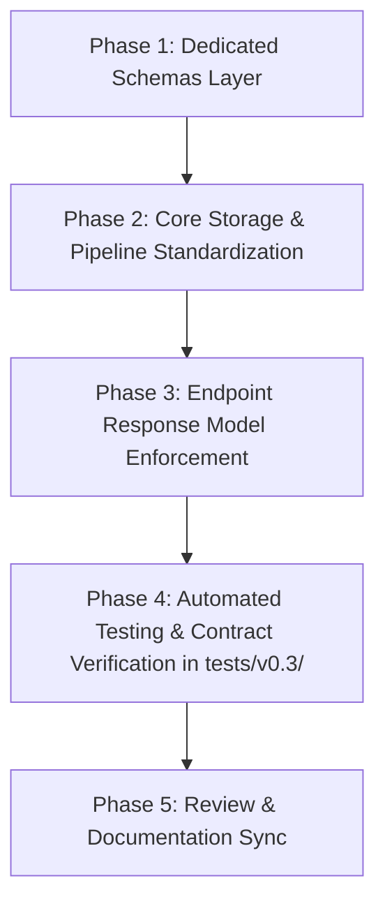

# Implementation Plan: Version 0.3 Data Contracts & Typing

## Objective
Establish strict, self-documenting Pydantic request and response schemas, bind `response_model` across all FastAPI endpoints, standardize object storage identifiers to `file_id` (preventing naming collisions with LangChain/ChromaDB `Document` chunks), remove prototype debug artifacts, and integrate automated test suites located in `tests/v0.3/`.

---

## Architectural Principles & Strict Guidelines

- **MinIO Storage (`File` / `file_id`)**: Anything uploaded to or downloaded from object storage is a raw **File**. Its unique handle across storage, chunking, and API boundaries is **`file_id`**.
- **LangChain & ChromaDB (`Document` / `Chunk`)**: Text extracted, segmented, embedded, and queried in the RAG pipeline represents textual **Chunks** (and LangChain/ChromaDB `Document` objects).
- **Explicit Contracts**: Eliminate raw Python `dict` returns. Every endpoint explicitly declares its request body and `response_model`.
- **Comment Preservation Guarantee**: **DO NOT modify, alter, or delete any existing comments or docstrings** in the codebase. All existing inline comments (e.g., `# 1. Download raw file`, `# Try reading the raw bytes of the file`, `# Attach relevant metadata and upload`, etc.) must remain strictly intact verbatim. New comments may be added, but existing ones must never be removed or rewritten.

---

## Phased Implementation Roadmap



---

### Phase 1: Dedicated Schemas Layer (`schemas/`)

**Goal**: Introduce strongly typed Pydantic models for every request and response in the system.

#### 1.1 `schemas/file.py`
Define models for MinIO storage and indexing:
```python
from pydantic import BaseModel, Field


class FileUploadItem(BaseModel):
    file_id: str = Field(..., description="Unique file identifier in object storage")
    filename: str = Field(..., description="Original filename")
    size_bytes: int = Field(..., description="File size in bytes")


class FileUploadResponse(BaseModel):
    message: str
    count: int
    files: list[FileUploadItem]


class ChunkItem(BaseModel):
    chunk_id: str
    text: str
    metadata: dict


class FileIndexResponse(BaseModel):
    file_id: str
    filename: str
    collection: str
    total_chunks: int
    indexed_chunks: int
```

#### 1.2 `schemas/query.py`
Define models for the generation endpoint:
```python
from typing import Any
from pydantic import BaseModel, Field


class QueryRequest(BaseModel):
    question: str = Field(..., min_length=1, description="Question for the RAG assistant")


class SourceItem(BaseModel):
    metadata: dict[str, Any]
    distance: float


class QueryResponse(BaseModel):
    question: str
    answer: str
    model: str
    sources: list[SourceItem]
```

#### 1.3 `schemas/health.py`
Define models for system liveness:
```python
from pydantic import BaseModel


class HealthResponse(BaseModel):
    status: str = "ok"
    version: str = "1.0.0"
```

#### 1.4 `schemas/__init__.py`
Expose all schemas cleanly:
```python
from .file import (
    ChunkItem,
    FileIndexResponse,
    FileUploadItem,
    FileUploadResponse,
)
from .health import HealthResponse
from .query import QueryRequest, QueryResponse, SourceItem

__all__ = [
    "ChunkItem",
    "FileIndexResponse",
    "FileUploadItem",
    "FileUploadResponse",
    "HealthResponse",
    "QueryRequest",
    "QueryResponse",
    "SourceItem",
]
```

---

### Phase 2: Core Storage & Pipeline Standardization

**Goal**: Align core data structures with schema contracts while preserving all existing comments verbatim.

#### 2.1 `core/uploader.py`
- Preserve all existing docstrings and step comments (`# Validate existence of filename`, `# Try reading the raw bytes of the file`, `# Attach relevant metadata and upload`, `# Append file details to list`).
- In `upload_files(self, files: list[UploadFile])`:
  - Change dictionary keys:
    - `"uuid"` $\rightarrow$ `"file_id"`
    - `"size": str(size)` $\rightarrow$ `"size_bytes": size` (integer)
- Signature of `download_file(self, file_id: str)` remains standard with `file_id`.

#### 2.2 `core/chunker.py`
- Preserve existing docstrings and step comments (`# Skip micro chunks`, `# Metadata`).
- Ensure `split(self, pages: list[tuple[int, str]], file_id: str, filename: str)` maintains `file_id`.
- Fix metadata chunk index: assign `chunk_index` 0-indexed accurately.
- Preserve chunk ID format: `f"{file_id}_c{index}"`.

---

### Phase 3: Endpoint Response Model Enforcement (`main.py`)

**Goal**: Bind `response_model` across all FastAPI route decorators, update function type signatures, and eliminate prototype debug artifacts while preserving all existing step comments verbatim.

#### 3.1 Cleanup
- Remove inline `GenerateRequest` class.
- Import `FileUploadItem`, `FileUploadResponse`, `FileIndexResponse`, `QueryRequest`, `QueryResponse`, `SourceItem`, and `HealthResponse` from `schemas`.

#### 3.2 Endpoint Implementations
- **`GET /health`**:
  ```python
  @app.get("/health", response_model=HealthResponse, summary="Health Check")
  async def health_check() -> HealthResponse:
      return HealthResponse(status="ok", version="1.0.0")
  ```
- **`POST /upload`**:
  - Add `response_model=FileUploadResponse`.
  - Update return type: `-> FileUploadResponse`.
  - Return `FileUploadResponse(message="Files uploaded successfully", count=len(uploaded_files), files=[FileUploadItem(**item) for item in uploaded_files])`.
- **`POST /chunk-and-embed/{file_id}`**:
  - Preserve all step comments:
    - `# 1. Download raw file`
    - `# 2. Parse text pages`
    - `# 3. Chunk text and attach metadata`
    - `# 4. Generate vector embeddings`
    - `# 5. Persist to ChromaDB`
  - Add `response_model=FileIndexResponse`.
  - Update return type: `-> FileIndexResponse`.
  - **Eliminate debug artifacts**: Remove `response_chunks` modulo slice (`range(0, len(chunks), 10)`) and remove internal `chroma_location`.
  - Return `FileIndexResponse(file_id=file_id, filename=filename, collection=retriever.collection_name, total_chunks=len(chunks), indexed_chunks=len(chunks))`.
- **`POST /generate`**:
  - Preserve all step comments:
    - `# 1. Retrieve relevant chunks`
    - `# 2. Build prompt and generate response with local Ollama`
  - Replace request parameter with `request: QueryRequest`.
  - Add `response_model=QueryResponse`.
  - Update return type: `-> QueryResponse`.
  - Return typed `QueryResponse(...)`.

---

### Phase 4: Automated Testing & Contract Verification (`tests/v0.3/`)

**Goal**: Introduce a dedicated test suite under `tests/v0.3/` verifying schemas, endpoint serialization, validation rules, and OpenAPI specification for this version.

#### 4.1 Test Directory Structure
```text
tests/
├── __init__.py
└── v0.3/
    ├── __init__.py
    ├── test_schemas.py           # Unit tests for Pydantic schema validation
    └── test_api_contracts.py      # Contract and endpoint tests with FastAPI TestClient
```

#### 4.2 Unit Tests (`tests/v0.3/test_schemas.py`)
- **`test_file_upload_item_valid()`**: Ensure `FileUploadItem` validates valid inputs and coerces integer `size_bytes`.
- **`test_file_upload_response()`**: Validate nested structure of `FileUploadResponse`.
- **`test_file_index_response()`**: Validate required fields for `FileIndexResponse`.
- **`test_query_request_validation()`**:
  - Assert valid question succeeds.
  - Assert empty string question `""` raises `ValidationError` due to `min_length=1`.
- **`test_query_response_serialization()`**: Validate `SourceItem` list and full response model.
- **`test_health_response_defaults()`**: Verify default values (`status="ok"`, `version="1.0.0"`).

#### 4.3 Endpoint Contract Tests (`tests/v0.3/test_api_contracts.py`)
- **`test_health_endpoint()`**:
  - `GET /health` returns HTTP 200.
  - Payload matches `HealthResponse` (`{"status": "ok", "version": "1.0.0"}`).
- **`test_generate_endpoint_validation_error()`**:
  - `POST /generate` with `{"question": ""}` returns HTTP 422 Unprocessable Entity.
  - `POST /generate` with `{}` returns HTTP 422.
- **`test_upload_endpoint_empty_files()`**:
  - `POST /upload` with empty file list returns HTTP 400.
- **`test_openapi_contracts()`**:
  - Fetch `app.openapi()`.
  - Assert all endpoints (`/upload`, `/chunk-and-embed/{file_id}`, `/generate`, `/health`) define valid `$ref` schemas in OpenAPI paths instead of empty/generic dict responses.

---

### Phase 5: Verification & Review

1. Execute test suite:
   ```powershell
   python -m unittest discover -s tests/v0.3
   ```
2. Verify Docker and application imports:
   ```powershell
   python -c "import main; print('Application imported successfully')"
   ```
3. Update API documentation in `README.md` if necessary to reflect the updated payload contracts (`file_id`, `size_bytes`).

---

## Concrete Test Plan Specification

| Test File | Test Case | Target | Verification Criteria |
| :--- | :--- | :--- | :--- |
| `tests/v0.3/test_schemas.py` | `test_file_schemas` | `FileUploadItem`, `FileUploadResponse`, `FileIndexResponse` | Correct serialization, integer `size_bytes`, field validation |
| `tests/v0.3/test_schemas.py` | `test_query_schemas` | `QueryRequest`, `QueryResponse` | Rejects empty question (`min_length=1`), formats sources |
| `tests/v0.3/test_schemas.py` | `test_health_schema` | `HealthResponse` | Default values `status="ok"`, `version="1.0.0"` |
| `tests/v0.3/test_api_contracts.py` | `test_health_route` | `GET /health` | HTTP 200, matches `HealthResponse` schema |
| `tests/v0.3/test_api_contracts.py` | `test_generate_validation` | `POST /generate` | HTTP 422 on invalid/empty body |
| `tests/v0.3/test_api_contracts.py` | `test_openapi_schema` | `app.openapi()` | Valid OpenAPI documentation for all request/response models |
