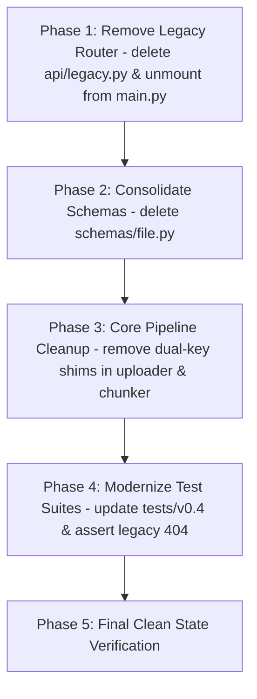

# Implementation Plan: Version 0.4.2 - Legacy Deprecation & Code Cleanup (Contract)

## Objective
Execute the **Contract** phase following the stabilization of v0.4.1:
1. Permanently remove deprecated prototype routes (`/upload`, `/chunk-and-embed/{file_id}`, `/generate`) and delete the adapter module `api/legacy.py`.
2. Streamline `main.py` so it exclusively mounts the modern versioned `api_router`.
3. Consolidate the schemas layer by deleting redundant `schemas/file.py` and retaining only `schemas/document.py`.
4. Prune backward-compatibility fallback keys (`"file_id"`) from `core/uploader.py` and `core/chunker.py`, standardizing strictly on `"document_id"`.
5. Modernize automated tests so `tests/v0.4/` is the authoritative API test suite, confirming legacy routes return `404 Not Found`.
6. Leave a lean, production-grade codebase prepared for Version 0.5 (FastAPI `Depends` & Service Layer).

---

## Architectural Principles & Strict Guidelines

- **Zero Dead Code**: Eliminate all prototype artifacts, legacy aliases, and temporary shims introduced for backward compatibility during v0.4.1.
- **Strict RESTful API Surface**: Exclusively expose versioned resources under `/api/v1`:
  - `POST /api/v1/documents` (Unified Ingestion: Upload $\rightarrow$ Parse $\rightarrow$ Chunk $\rightarrow$ Embed $\rightarrow$ Upsert)
  - `POST /api/v1/query` (RAG Retrieval & Generation)
  - `GET /health` (Health Check Probe)
- **Single Source of Truth**:
  - Domain models exist solely in `schemas/document.py` (`DocumentIngestItem`, `DocumentIngestResponse`), `schemas/query.py`, and `schemas/health.py`.
  - Object identification is strictly `document_id` throughout storage metadata, chunking, and HTTP contracts.
- **Strict Comment Preservation Mandate (MANDATORY)**:
  - **DO NOT modify, alter, overwrite, or delete any existing comments or docstrings** anywhere in the codebase.
  - All existing inline comments (e.g., `# 1. Upload files to MinIO`, `# 2. Download and parse text pages`, etc.) and class/function docstrings must remain strictly intact verbatim.
  - **New comments may be added, but old/existing ones must NEVER be replaced, reworded, or removed.**

---

## Phased Implementation Roadmap



---

### Phase 1: Legacy Route Removal (`api/legacy.py` & `main.py`)

**Goal**: Eradicate all legacy HTTP endpoints.

#### 1.1 `api/legacy.py` [DELETE]
Delete `api/legacy.py` entirely.

#### 1.2 `main.py` [MODIFY]
Remove the `legacy_router` import and mount. `main.py` becomes an ultra-lean application entrypoint:
```python
from contextlib import asynccontextmanager
import logging
from fastapi import FastAPI, Request
from fastapi.responses import JSONResponse

from api.dependencies import uploader
from api.v1.router import api_router
from core import GenerationError, StorageError

logging.basicConfig(
    level=logging.INFO,
    format="%(asctime)s [%(levelname)s] %(name)s: %(message)s",
)
logger = logging.getLogger(__name__)


@asynccontextmanager
async def lifespan(app: FastAPI):
    """Manage application startup and shutdown lifecycle."""
    logger.info("Initializing application resources...")
    uploader.ensure_bucket()
    yield
    logger.info("Shutting down application resources...")


app = FastAPI(title="Honeywell RAG", version="1.0.0", lifespan=lifespan)


# Global Exception Handlers
@app.exception_handler(ValueError)
async def value_error_handler(request: Request, exc: ValueError) -> JSONResponse:
    return JSONResponse(status_code=400, content={"detail": str(exc)})


@app.exception_handler(StorageError)
async def storage_error_handler(request: Request, exc: StorageError) -> JSONResponse:
    return JSONResponse(status_code=502, content={"detail": str(exc)})


@app.exception_handler(GenerationError)
async def generation_error_handler(request: Request, exc: GenerationError) -> JSONResponse:
    return JSONResponse(status_code=503, content={"detail": str(exc)})


# Mount Versioned Modern RESTful API & Health Probe
app.include_router(api_router)
```

---

### Phase 2: Consolidate Schemas Layer (`schemas/`)

**Goal**: Remove redundant `schemas/file.py` and establish `schemas/document.py` as the sole contract for document handling.

#### 2.1 `schemas/file.py` [DELETE]
Delete `schemas/file.py`.

#### 2.2 `schemas/__init__.py` [MODIFY]
Clean up all references to `file.py`:
```python
from .document import (
    DocumentIngestItem,
    DocumentIngestResponse,
)
from .health import HealthResponse
from .query import QueryRequest, QueryResponse, SourceItem

__all__ = [
    "DocumentIngestItem",
    "DocumentIngestResponse",
    "HealthResponse",
    "QueryRequest",
    "QueryResponse",
    "SourceItem",
]
```

---

### Phase 3: Core Pipeline Cleanup (`core/`)

**Goal**: Remove temporary fallback keys and ensure strictly `document_id` is passed through the pipeline.

#### 3.1 `core/uploader.py` [MODIFY]
- Preserve all existing step comments verbatim (`# Validate existence of filename`, `# Try reading the raw bytes of the file`, `# Attach relevant metadata and upload`, `# Append file details to list`).
- In `upload_files`:
  - Remove dual-key `"file_id"` fallback, returning purely:
    ```python
    uploaded_files.append(
        {
            "document_id": file_id,
            "filename": filename,
            "size_bytes": size,
        }
    )
    ```
- In `download_file(self, document_id: str) -> tuple[bytes, str]`:
  - Target key parameter is strictly `document_id`.

#### 3.2 `core/chunker.py` [MODIFY]
- Preserve all existing step comments verbatim (`# Skip micro chunks`, `# Metadata`).
- In `split(self, pages: list[tuple[int, str]], document_id: str, filename: str)`:
  - Remove dual-key `"file_id"` fallback from metadata:
    ```python
    metadatas.append(
        {
            "document_id": document_id,
            "filename": filename,
            "page": page_number,
            "chunk_index": len(chunks),
        }
    )
    ```
  - Chunk IDs remain `f"{document_id}_c{index}"`.

---

### Phase 4: Test Suite Modernization (`tests/v0.4/v0.4.2/`)

**Goal**: Establish a dedicated test suite under `tests/v0.4/v0.4.2/` confirming that legacy endpoints are removed and that pure `/api/v1` routes and schemas are operational.

#### 4.1 Directory Layout
```text
tests/
├── v0.3/                         # Archived / legacy markers
└── v0.4/
    ├── __init__.py
    ├── v0.4.1/                   # Preserved v0.4.1 tests
    │   ├── __init__.py
    │   ├── test_schemas.py
    │   └── test_api_v1.py
    └── v0.4.2/                   # v0.4.2 clean-contract tests
        ├── __init__.py
        ├── test_schemas.py       # Validates pure Document schemas (no file schemas)
        └── test_api_v1_pure.py   # Verifies pure /api/v1 and asserts legacy routes return 404
```

#### 4.2 `tests/v0.4/v0.4.2/test_api_v1_pure.py` [NEW]
```python
def test_legacy_endpoints_are_removed(self):
    """Verify legacy v0.1/v0.3 endpoints return 404 Not Found."""
    self.assertEqual(self.client.post("/upload").status_code, 404)
    self.assertEqual(self.client.post("/chunk-and-embed/test-uuid").status_code, 404)
    self.assertEqual(self.client.post("/generate").status_code, 404)
```

---

### Phase 5: Verification & Architectural Review

1. Execute the v0.4.2 clean test suite:
   ```powershell
   python -m unittest discover -s tests/v0.4/v0.4.2 -v
   ```
2. Execute full test suite:
   ```powershell
   python -m unittest discover -s tests -v
   ```
3. Verify OpenAPI specification:
   - Ensure the OpenAPI schema only contains `/api/v1/documents`, `/api/v1/query`, and `/health`.
   - Ensure no `/upload`, `/chunk-and-embed/...`, or `/generate` legacy paths appear.
4. Verify clean project structure:
   ```text
   honeywell-project/
   ├── api/
   │   ├── dependencies.py
   │   └── v1/
   │       ├── router.py
   │       └── endpoints/
   │           ├── documents.py
   │           ├── health.py
   │           └── query.py
   ├── core/
   │   ├── chunker.py
   │   ├── embeddings.py
   │   ├── generator.py
   │   ├── parser.py
   │   ├── retriever.py
   │   └── uploader.py
   ├── schemas/
   │   ├── document.py
   │   ├── health.py
   │   └── query.py
   ├── config.py
   ├── main.py
   ```
   This structure is now perfectly primed for v0.5's Service Layer and Dependency Injection.
