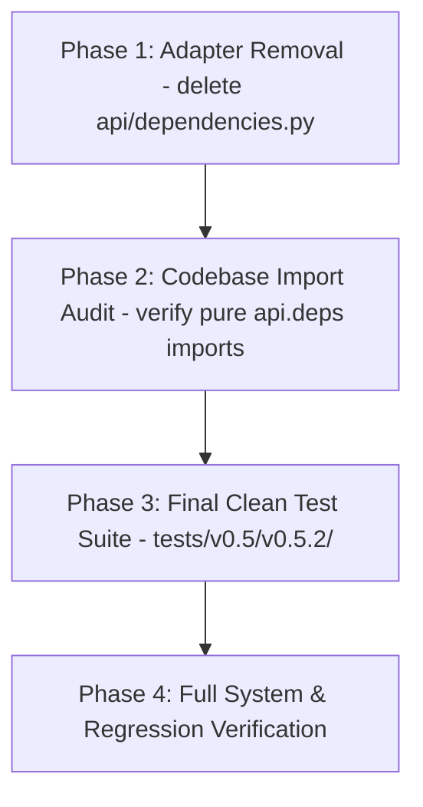

# Implementation Plan: Version 0.5.2 - Legacy Dependency Removal & Cleanup (Contract)

## Objective
Execute the **Contract** phase following the stabilization of Version 0.5.1:
1. Permanently remove the deprecated adapter `api/dependencies.py`.
2. Consolidate and standardize all imports across `api/`, `main.py`, and test suites strictly onto `api.deps`.
3. Eliminate all dead code and obsolete module globals.
4. Establish the authoritative clean-architecture test suite under `tests/v0.5/v0.5.2/` verifying that `api.dependencies` is eliminated and pure dependency injection functions flawlessly.

---

## Architectural Principles & Strict Guidelines

- **Zero Dead Code**: Eliminate all prototype shims and deprecated adapter files.
- **Strict Dependency Inversion**: `api/deps.py` is the single source of truth for all component singletons and service providers.
- **Strict Comment Preservation Mandate (MANDATORY)**:
  - **DO NOT modify, alter, overwrite, or delete any existing comments or docstrings** anywhere in the codebase.
  - All existing inline comments (e.g. `# 1. Upload files to MinIO`, `# 2. Download and parse text pages`, etc.) and class/function docstrings must remain intact verbatim.

---

## Phased Implementation Roadmap



---

### Phase 1: Adapter Removal (`api/dependencies.py`)

**Goal**: Permanently delete the deprecated compatibility module.

#### 1.1 `api/dependencies.py` [DELETE]
Delete `api/dependencies.py` entirely from the project.

---

### Phase 2: Codebase Import Consolidation

**Goal**: Verify all consumers import strictly from `api.deps`.

#### 2.1 File Import Map Verification

| File | Target Import | Verified Status |
| :--- | :--- | :--- |
| `main.py` | `from api.deps import get_uploader` | Clean |
| `api/v1/endpoints/documents.py` | `from api.deps import get_ingestion_service` | Clean |
| `api/v1/endpoints/query.py` | `from api.deps import get_rag_service` | Clean |

---

### Phase 3: Final Clean Test Suite (`tests/v0.5/v0.5.2/`)

**Goal**: Establish dedicated automated contract tests proving `api.dependencies` is eradicated and pure DI is operational.

#### 3.1 Directory Layout
```text
tests/
├── v0.5/
│   ├── __init__.py
│   ├── v0.5.1/                     # Preserved v0.5.1 test suite
│   └── v0.5.2/                     # Clean contract test suite
│       ├── __init__.py
│       ├── test_pure_deps.py       # Validates absence of api.dependencies & verifies api.deps
│       └── test_api_v1_pure_services.py # Comprehensive end-to-end tests on pure architecture
```

#### 3.2 Test Matrix Specification

| Test File | Test Method | Target Component | Verification Objective |
| :--- | :--- | :--- | :--- |
| `test_pure_deps.py` | `test_legacy_dependencies_module_deleted` | `import api.dependencies` | Asserts `ModuleNotFoundError` when attempting to import legacy adapter |
| `test_pure_deps.py` | `test_pure_deps_caching` | `api.deps.get_*` | Verifies `@lru_cache` behavior on `get_uploader`, `get_retriever`, etc. |
| `test_pure_deps.py` | `test_service_wiring` | `api.deps.get_ingestion_service` | Verifies full constructor injection into `IngestionService` and `RAGService` |
| `test_api_v1_pure_services.py` | `test_health_check` | `GET /health` | HTTP 200 `{"status": "ok", "version": "1.0.0"}` |
| `test_api_v1_pure_services.py` | `test_documents_ingest_pipeline` | `POST /api/v1/documents` | Ingests mock documents with `app.dependency_overrides`, verifies `201 Created` |
| `test_api_v1_pure_services.py` | `test_query_pipeline` | `POST /api/v1/query` | Queries RAG pipeline with `app.dependency_overrides`, verifies `200 OK` |
| `test_api_v1_pure_services.py` | `test_openapi_contracts` | `app.openapi()` | Validates OpenAPI schema reflects pure modern endpoints |

---

### Phase 4: Full System & Regression Verification

Execute the test suites:
1. Verify legacy module deletion and clean DI:
   ```powershell
   $env:PYTHONPATH="."; python tests/v0.5/v0.5.2/test_pure_deps.py
   ```
2. Verify pure services API endpoint execution:
   ```powershell
   $env:PYTHONPATH="."; python tests/v0.5/v0.5.2/test_api_v1_pure_services.py
   ```
3. Run backward compatibility verification against v0.4.2 tests:
   ```powershell
   $env:PYTHONPATH="."; python tests/v0.4/v0.4.2/test_api_v1_pure.py
   ```
4. Verify final workspace directory structure:
   ```text
   honeywell-project/
   ├── api/
   │   ├── deps.py
   │   └── v1/
   │       ├── router.py
   │       └── endpoints/
   │           ├── documents.py
   │           ├── health.py
   │           └── query.py
   ├── core/
   │   ├── chunker.py
   │   ├── embeddings.py
   │   ├── generator.py
   │   ├── parser.py
   │   ├── retriever.py
   │   └── uploader.py
   ├── schemas/
   │   ├── document.py
   │   ├── health.py
   │   └── query.py
   ├── services/
   │   ├── __init__.py
   │   ├── ingestion_service.py
   │   └── rag_service.py
   ├── config.py
   ├── main.py
   ```

