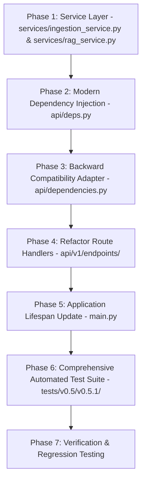

# Implementation Plan: Version 0.5.1 - Service Layer & Dependency Injection (Expand)

## Objective
Execute the **Expand** phase of Version 0.5:
1. Introduce a dedicated Service Layer (`services/`) encapsulating workflow orchestration into `IngestionService` and `RAGService`.
2. Implement modern FastAPI Dependency Injection in `api/deps.py` using `@lru_cache` for core singletons and `fastapi.Depends` for service resolution.
3. Refactor route handlers in `api/v1/endpoints/documents.py` and `api/v1/endpoints/query.py` to be clean, 3-line delegates injected with their respective services.
4. Maintain full backward-compatibility in `api/dependencies.py` by converting it into an adapter that exposes legacy global instances backed by `api.deps`.
5. Update `main.py` lifespan to initialize storage using `get_uploader()`.
6. Implement a comprehensive test suite under `tests/v0.5/v0.5.1/` covering service business logic isolation, dependency provider caching, compatibility shims, and FastAPI `app.dependency_overrides`.

---

## Architectural Principles & Strict Guidelines

- **Expand Phase (Coexistence)**: The modern dependency injection architecture is introduced without breaking any existing consumer expecting `api.dependencies`.
- **Clean Inversion of Control**: Service classes (`IngestionService`, `RAGService`) receive their dependencies via `__init__`, allowing complete unit testing with mocks without touching global state.
- **FastAPI Idiomatic DI**: Core component factories are cached with `@lru_cache`, and service factories resolve their dependencies via `Depends(...)`.
- **Strict Comment Preservation Mandate (MANDATORY)**:
  - **DO NOT modify, alter, overwrite, or delete any existing comments or docstrings** anywhere in the codebase.
  - All existing inline comments (e.g. `# 1. Upload files to MinIO`, `# 2. Download and parse text pages`, etc.) and class/function docstrings must remain strictly intact verbatim.
  - New comments may be added, but existing ones must never be removed or reworded.

---

## Phased Implementation Roadmap



---

### Phase 1: Service Layer Creation (`services/`)

**Goal**: Extract raw business logic workflows out of HTTP controllers into dedicated service classes.

#### 1.1 `services/__init__.py` [NEW]
```python
from .ingestion_service import IngestionService
from .rag_service import RAGService

__all__ = ["IngestionService", "RAGService"]
```

#### 1.2 `services/ingestion_service.py` [NEW]
Encapsulate the complete 5-step document ingestion pipeline:
```python
from fastapi import UploadFile

from core import Chunker, Embeddings, Parser, Retriever, Uploader
from schemas.document import DocumentIngestItem, DocumentIngestResponse


class IngestionService:
    def __init__(
        self,
        uploader: Uploader,
        parser: Parser,
        chunker: Chunker,
        embeddings: Embeddings,
        retriever: Retriever,
    ):
        self.uploader = uploader
        self.parser = parser
        self.chunker = chunker
        self.embeddings = embeddings
        self.retriever = retriever

    def ingest_files(self, files: list[UploadFile]) -> DocumentIngestResponse:
        if not files:
            raise ValueError("At least one file is required")

        # 1. Upload files to MinIO
        uploaded_documents = self.uploader.upload_files(files)

        ingested_items = []
        for item in uploaded_documents:
            doc_id = item["document_id"]
            filename = item["filename"]
            size_bytes = item["size_bytes"]

            # 2. Download and parse text pages
            content, _ = self.uploader.download_file(doc_id)
            pages = self.parser.parse(content, filename)

            # 3. Chunk text and attach metadata
            chunks, metadatas, chunk_ids = self.chunker.split(pages, doc_id, filename)

            # 4. Generate vector embeddings
            vectors = self.embeddings.embed(chunks)

            # 5. Persist to ChromaDB
            self.retriever.upsert(
                ids=chunk_ids,
                documents=chunks,
                metadatas=metadatas,
                embeddings=vectors,
            )

            # Append to list of ingested items
            ingested_items.append(
                DocumentIngestItem(
                    document_id=doc_id,
                    filename=filename,
                    size_bytes=size_bytes,
                    collection=self.retriever.collection_name,
                    total_chunks=len(chunks),
                    status="indexed",
                )
            )

        return DocumentIngestResponse(
            message="Documents uploaded and indexed successfully",
            count=len(ingested_items),
            documents=ingested_items,
        )
```

#### 1.3 `services/rag_service.py` [NEW]
Encapsulate the 2-step retrieval and generation pipeline:
```python
from core import Generator, Retriever
from schemas.query import QueryResponse, SourceItem


class RAGService:
    def __init__(
        self,
        retriever: Retriever,
        generator: Generator,
        retrieval_k: int = 5,
    ):
        self.retriever = retriever
        self.generator = generator
        self.retrieval_k = retrieval_k

    def answer_question(self, question: str) -> QueryResponse:
        q = question.strip() if question else ""
        if not q:
            raise ValueError("Question must not be empty")

        # 1. Retrieve relevant chunks
        retrieved = self.retriever.retrieve(q, k=self.retrieval_k)
        documents = retrieved.get("documents", [[]])[0]
        metadatas = retrieved.get("metadatas", [[]])[0]
        distances = retrieved.get("distances", [[]])[0]

        if not documents:
            raise ValueError("No indexed document chunks were found for this query")

        # 2. Build prompt and generate response with local Ollama
        prompt = self.generator.build_prompt(q, documents, metadatas)
        answer = self.generator.generate(prompt)

        # Return response
        return QueryResponse(
            question=q,
            answer=answer,
            model=self.generator.model,
            sources=[
                SourceItem(metadata=metadata, distance=distance)
                for metadata, distance in zip(metadatas, distances)
            ],
        )
```

---

### Phase 2: Modern Dependency Injection Layer (`api/deps.py`)

**Goal**: Implement cached factories for core components and injected service providers.

#### 2.1 `api/deps.py` [NEW]
```python
from functools import lru_cache
from fastapi import Depends

from config import settings
from core import (
    Chunker,
    Embeddings,
    Generator,
    Parser,
    Retriever,
    Uploader,
)
from services.ingestion_service import IngestionService
from services.rag_service import RAGService


# Core Component Providers (Lazy Singletons via @lru_cache)
@lru_cache
def get_uploader() -> Uploader:
    return Uploader()


@lru_cache
def get_parser() -> Parser:
    return Parser()


@lru_cache
def get_chunker() -> Chunker:
    return Chunker(chunk_size=settings.chunk_size, chunk_overlap=settings.chunk_overlap)


@lru_cache
def get_embeddings() -> Embeddings:
    return Embeddings()


@lru_cache
def get_retriever(embeddings: Embeddings = Depends(get_embeddings)) -> Retriever:
    return Retriever(embeddings=embeddings)


@lru_cache
def get_generator() -> Generator:
    return Generator(
        ollama_host=settings.ollama_host,
        ollama_port=settings.ollama_port,
        model=settings.ollama_model,
    )


# Service Providers
def get_ingestion_service(
    uploader: Uploader = Depends(get_uploader),
    parser: Parser = Depends(get_parser),
    chunker: Chunker = Depends(get_chunker),
    embeddings: Embeddings = Depends(get_embeddings),
    retriever: Retriever = Depends(get_retriever),
) -> IngestionService:
    return IngestionService(
        uploader=uploader,
        parser=parser,
        chunker=chunker,
        embeddings=embeddings,
        retriever=retriever,
    )


def get_rag_service(
    retriever: Retriever = Depends(get_retriever),
    generator: Generator = Depends(get_generator),
) -> RAGService:
    return RAGService(
        retriever=retriever,
        generator=generator,
        retrieval_k=settings.retrieval_k,
    )
```

---

### Phase 3: Backward Compatibility Adapter (`api/dependencies.py`)

**Goal**: Keep legacy module imports working by referencing instances provided by `api.deps`.

#### 3.1 `api/dependencies.py` [MODIFY]
```python
from api.deps import (
    get_chunker,
    get_embeddings,
    get_generator,
    get_ingestion_service,
    get_parser,
    get_rag_service,
    get_retriever,
    get_uploader,
)

# Global shared singletons (backward-compatibility shims for legacy callers)
uploader = get_uploader()
parser = get_parser()
chunker = get_chunker()
embeddings = get_embeddings()
retriever = get_retriever()
generator = get_generator()

__all__ = [
    "uploader",
    "parser",
    "chunker",
    "embeddings",
    "retriever",
    "generator",
    "get_uploader",
    "get_parser",
    "get_chunker",
    "get_embeddings",
    "get_retriever",
    "get_generator",
    "get_ingestion_service",
    "get_rag_service",
]
```

---

### Phase 4: Route Handlers Refactoring (`api/v1/endpoints/`)

**Goal**: Transform route handlers into concise HTTP controllers injecting services.

#### 4.1 `api/v1/endpoints/documents.py` [MODIFY]
```python
from fastapi import APIRouter, Depends, File, HTTPException, UploadFile, status

from api.deps import get_ingestion_service
from schemas.document import DocumentIngestResponse
from services.ingestion_service import IngestionService

router = APIRouter(prefix="/documents", tags=["Documents"])


# POST /api/v1/documents/
@router.post(
    "",
    status_code=status.HTTP_201_CREATED,
    response_model=DocumentIngestResponse,
    summary="Upload and ingest documents",
    description=(
        "Upload one or more documents, parse text, chunk, generate embeddings, "
        "and index them in ChromaDB synchronously."
    ),
)
async def ingest_documents(
    files: list[UploadFile] = File(...),
    service: IngestionService = Depends(get_ingestion_service),
) -> DocumentIngestResponse:
    if not files:
        raise HTTPException(status_code=400, detail="At least one file is required")

    return service.ingest_files(files)
```

#### 4.2 `api/v1/endpoints/query.py` [MODIFY]
```python
from fastapi import APIRouter, Depends, HTTPException

from api.deps import get_rag_service
from schemas.query import QueryRequest, QueryResponse
from services.rag_service import RAGService

router = APIRouter(tags=["Query"])


# POST /api/v1/query
@router.post(
    "/query",
    response_model=QueryResponse,
    summary="Query RAG pipeline",
    description="Retrieve relevant ChromaDB chunks and generate an answer using Ollama.",
)
async def query_pipeline(
    request: QueryRequest,
    service: RAGService = Depends(get_rag_service),
) -> QueryResponse:
    question = request.question.strip()
    if not question:
        raise HTTPException(status_code=400, detail="Question must not be empty")

    return service.answer_question(question)
```

---

### Phase 5: Application Lifespan (`main.py`)

**Goal**: Retrieve the uploader instance via `get_uploader()` in the lifespan context.

#### 5.1 `main.py` [MODIFY]
```python
from contextlib import asynccontextmanager
import logging
from fastapi import FastAPI, Request
from fastapi.responses import JSONResponse

from api.deps import get_uploader
from api.v1.router import api_router
from core import GenerationError, StorageError

logging.basicConfig(
    level=logging.INFO,
    format="%(asctime)s [%(levelname)s] %(name)s: %(message)s",
)
logger = logging.getLogger(__name__)


@asynccontextmanager
async def lifespan(app: FastAPI):
    """Manage application startup and shutdown lifecycle."""
    logger.info("Initializing application resources...")
    get_uploader().ensure_bucket()
    yield
    logger.info("Shutting down application resources...")


app = FastAPI(title="Honeywell RAG", version="1.0.0", lifespan=lifespan)


# Global Exception Handlers
@app.exception_handler(ValueError)
async def value_error_handler(request: Request, exc: ValueError) -> JSONResponse:
    return JSONResponse(status_code=400, content={"detail": str(exc)})


@app.exception_handler(StorageError)
async def storage_error_handler(request: Request, exc: StorageError) -> JSONResponse:
    return JSONResponse(status_code=502, content={"detail": str(exc)})


@app.exception_handler(GenerationError)
async def generation_error_handler(request: Request, exc: GenerationError) -> JSONResponse:
    return JSONResponse(status_code=503, content={"detail": str(exc)})


# Mount Versioned Modern RESTful API & Health Probe
app.include_router(api_router)
```

---

### Phase 6: Automated Testing Suite (`tests/v0.5/v0.5.1/`)

**Goal**: Deliver high-coverage unit and integration tests across services, DI caching, backward compatibility, and endpoint dependency overrides.

#### 6.1 Test Directory Structure
```text
tests/
├── v0.4/
│   └── v0.4.2/
│       ├── test_api_v1_pure.py
│       └── test_schemas.py
└── v0.5/
    ├── __init__.py
    └── v0.5.1/
        ├── __init__.py
        ├── test_services.py             # Unit tests for IngestionService & RAGService
        ├── test_deps_and_compat.py      # Tests for api/deps.py and api/dependencies.py
        └── test_api_v1_services.py      # Endpoint tests with app.dependency_overrides
```

#### 6.2 Test Matrix Specification

| Test File | Test Method | Target Component | Verification Objective |
| :--- | :--- | :--- | :--- |
| `test_services.py` | `test_ingestion_service_success` | `IngestionService` | Verifies full 5-step orchestration and returns `DocumentIngestResponse` with `DocumentIngestItem` |
| `test_services.py` | `test_ingestion_service_empty_files` | `IngestionService` | Asserts `ValueError("At least one file is required")` |
| `test_services.py` | `test_rag_service_success` | `RAGService` | Verifies retrieve $\rightarrow$ build_prompt $\rightarrow$ generate returning `QueryResponse` with sources |
| `test_services.py` | `test_rag_service_empty_query` | `RAGService` | Asserts `ValueError("Question must not be empty")` |
| `test_services.py` | `test_rag_service_no_chunks_found` | `RAGService` | Asserts `ValueError("No indexed document chunks were found...")` |
| `test_deps_and_compat.py` | `test_lru_cache_singleton_behavior` | `api.deps` | Asserts `get_uploader() is get_uploader()` (identical pointer) |
| `test_deps_and_compat.py` | `test_backward_compat_dependencies` | `api.dependencies` | Asserts `legacy.uploader is get_uploader()` and legacy imports resolve |
| `test_deps_and_compat.py` | `test_service_factory_creation` | `api.deps` | Asserts `get_ingestion_service()` and `get_rag_service()` create properly initialized instances |
| `test_api_v1_services.py` | `test_documents_endpoint_with_mock_service` | `POST /api/v1/documents` | Verifies route delegates to `IngestionService` using `app.dependency_overrides` |
| `test_api_v1_services.py` | `test_query_endpoint_with_mock_service` | `POST /api/v1/query` | Verifies route delegates to `RAGService` using `app.dependency_overrides` |
| `test_api_v1_services.py` | `test_health_endpoint` | `GET /health` | Asserts HTTP 200 `{"status": "ok", "version": "1.0.0"}` |

---

### Phase 7: Verification & Regression Plan

1. Execute service unit tests:
   ```powershell
   $env:PYTHONPATH="."; python tests/v0.5/v0.5.1/test_services.py
   ```
2. Execute dependency injection and compatibility tests:
   ```powershell
   $env:PYTHONPATH="."; python tests/v0.5/v0.5.1/test_deps_and_compat.py
   ```
3. Execute endpoint dependency override tests:
   ```powershell
   $env:PYTHONPATH="."; python tests/v0.5/v0.5.1/test_api_v1_services.py
   ```
4. Run full v0.4.2 regression suite to ensure zero breaking changes:
   ```powershell
   $env:PYTHONPATH="."; python tests/v0.4/v0.4.2/test_api_v1_pure.py
   ```
