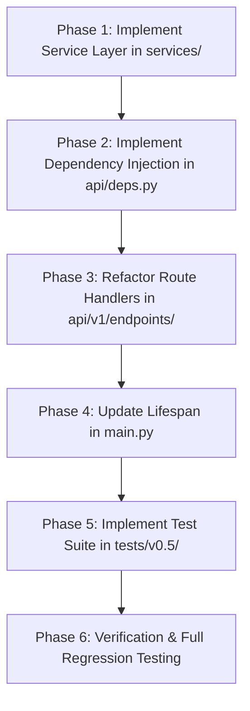

# Implementation Plan: Version 0.5 - Service Layer & FastAPI Dependency Injection Decoupling

## Objective
Decouple HTTP controllers from business logic and eliminate module-level global singletons by:
1. Creating a dedicated Service layer (`services/`) with `IngestionService` and `RAGService`.
2. Implementing FastAPI Dependency Injection (`api/deps.py`) using `@lru_cache` and `fastapi.Depends`.
3. Refactoring route controllers in `api/v1/endpoints/` into concise, single-responsibility handlers.
4. Updating `main.py` lifespan and exception handling to integrate with the new dependency architecture.
5. Implementing a comprehensive test suite in `tests/v0.5/` validating service isolation, dependency injection, and endpoint execution with `dependency_overrides`.

---

## Architectural Principles & Guidelines

- **Separation of Concerns**: HTTP routing, status codes, and request validation remain in `api/v1/endpoints/`; end-to-end workflow orchestration resides strictly in `services/`.
- **Inversion of Control**: Components and services declare their dependencies explicitly in `__init__`, enabling testability and mock injection.
- **FastAPI Idiomatic DI**: Core component factories are cached with `@lru_cache`, and service factories resolve their dependencies via `Depends(...)`.
- **Strict Comment Preservation Mandate (MANDATORY)**:
  - DO NOT modify, alter, overwrite, or delete any existing comments or docstrings anywhere in the codebase.
  - All existing inline comments (e.g. `# 1. Upload files to MinIO`, `# 2. Download and parse text pages`, etc.) and class/function docstrings must remain intact verbatim.
- **Backward Compatibility**: `api/dependencies.py` re-exports provider functions from `api/deps.py` to prevent import breaks.

---

## Phased Implementation Roadmap



---

### Phase 1: Service Layer (`services/`)

**Goal**: Extract raw business logic workflows from route handlers into dedicated service classes.

#### 1.1 `services/__init__.py` [NEW]
Expose `IngestionService` and `RAGService`.

#### 1.2 `services/ingestion_service.py` [NEW]
Class `IngestionService`:
- Dependencies: `uploader: Uploader`, `parser: Parser`, `chunker: Chunker`, `embeddings: Embeddings`, `retriever: Retriever`.
- Method `ingest_files(files: list[UploadFile]) -> DocumentIngestResponse`:
  - Validates `files` is non-empty (raises `ValueError` if empty).
  - `# 1. Upload files to MinIO`: `uploaded_documents = self.uploader.upload_files(files)`.
  - For each document:
    - `# 2. Download and parse text pages`: `content, _ = self.uploader.download_file(doc_id)`, `pages = self.parser.parse(content, filename)`.
    - `# 3. Chunk text and attach metadata`: `chunks, metadatas, chunk_ids = self.chunker.split(pages, doc_id, filename)`.
    - `# 4. Generate vector embeddings`: `vectors = self.embeddings.embed(chunks)`.
    - `# 5. Persist to ChromaDB`: `self.retriever.upsert(ids=chunk_ids, documents=chunks, metadatas=metadatas, embeddings=vectors)`.
    - Append `DocumentIngestItem` to `ingested_items`.
  - Return `DocumentIngestResponse(message=..., count=..., documents=ingested_items)`.

#### 1.3 `services/rag_service.py` [NEW]
Class `RAGService`:
- Dependencies: `retriever: Retriever`, `generator: Generator`, `retrieval_k: int = 5`.
- Method `answer_question(question: str) -> QueryResponse`:
  - Validates `question.strip()` (raises `ValueError` if empty).
  - `# 1. Retrieve top-k context chunks`: `retrieved = self.retriever.retrieve(question, k=self.retrieval_k)`.
  - Extracts `documents`, `metadatas`, `distances`. Raises `ValueError("No indexed document chunks were found for this query")` if `documents` is empty.
  - `# 2. Build prompt and generate response`: `prompt = self.generator.build_prompt(question, documents, metadatas)`, `answer = self.generator.generate(prompt)`.
  - Return `QueryResponse(question=question, answer=answer, model=self.generator.model, sources=[SourceItem(...)])`.

---

### Phase 2: Dependency Injection Layer (`api/deps.py`)

**Goal**: Provide factory functions for all components and services.

#### 2.1 `api/deps.py` [NEW]
```python
from functools import lru_cache
from fastapi import Depends
from config import settings
from core import Uploader, Parser, Chunker, Embeddings, Retriever, Generator
from services.ingestion_service import IngestionService
from services.rag_service import RAGService

@lru_cache
def get_uploader() -> Uploader:
    return Uploader()

@lru_cache
def get_parser() -> Parser:
    return Parser()

@lru_cache
def get_chunker() -> Chunker:
    return Chunker(chunk_size=settings.chunk_size, chunk_overlap=settings.chunk_overlap)

@lru_cache
def get_embeddings() -> Embeddings:
    return Embeddings()

@lru_cache
def get_retriever(embeddings: Embeddings = Depends(get_embeddings)) -> Retriever:
    return Retriever(embeddings=embeddings)

@lru_cache
def get_generator() -> Generator:
    return Generator(
        ollama_host=settings.ollama_host,
        ollama_port=settings.ollama_port,
        model=settings.ollama_model,
    )

def get_ingestion_service(
    uploader: Uploader = Depends(get_uploader),
    parser: Parser = Depends(get_parser),
    chunker: Chunker = Depends(get_chunker),
    embeddings: Embeddings = Depends(get_embeddings),
    retriever: Retriever = Depends(get_retriever),
) -> IngestionService:
    return IngestionService(uploader, parser, chunker, embeddings, retriever)

def get_rag_service(
    retriever: Retriever = Depends(get_retriever),
    generator: Generator = Depends(get_generator),
) -> RAGService:
    return RAGService(retriever, generator, retrieval_k=settings.retrieval_k)
```

#### 2.2 `api/dependencies.py` [MODIFY]
Refactor to re-export dependency providers from `api.deps` for backward compatibility.

---

### Phase 3: Route Handlers Refactoring (`api/v1/endpoints/`)

**Goal**: Convert controllers into concise delegates using `Depends`.

#### 3.1 `api/v1/endpoints/documents.py` [MODIFY]
```python
from fastapi import APIRouter, Depends, File, UploadFile, status
from api.deps import get_ingestion_service
from schemas.document import DocumentIngestResponse
from services.ingestion_service import IngestionService

router = APIRouter(prefix="/documents", tags=["Documents"])

# POST /api/v1/documents/
@router.post(
    "",
    status_code=status.HTTP_201_CREATED,
    response_model=DocumentIngestResponse,
    summary="Upload and ingest documents",
    description=(
        "Upload one or more documents, parse text, chunk, generate embeddings, "
        "and index them in ChromaDB synchronously."
    ),
)
async def ingest_documents(
    files: list[UploadFile] = File(...),
    service: IngestionService = Depends(get_ingestion_service),
) -> DocumentIngestResponse:
    return service.ingest_files(files)
```

#### 3.2 `api/v1/endpoints/query.py` [MODIFY]
```python
from fastapi import APIRouter, Depends
from api.deps import get_rag_service
from schemas.query import QueryRequest, QueryResponse
from services.rag_service import RAGService

router = APIRouter(tags=["Query"])

# POST /api/v1/query
@router.post(
    "/query",
    response_model=QueryResponse,
    summary="Query RAG pipeline",
    description="Retrieve relevant ChromaDB chunks and generate an answer using Ollama.",
)
async def query_pipeline(
    request: QueryRequest,
    service: RAGService = Depends(get_rag_service),
) -> QueryResponse:
    return service.answer_question(request.question)
```

---

### Phase 4: Application Lifespan (`main.py`)

**Goal**: Use `get_uploader()` in lifespan.

#### 4.1 `main.py` [MODIFY]
- Replace `from api.dependencies import uploader` with `from api.deps import get_uploader`.
- In `lifespan(app: FastAPI)`: call `get_uploader().ensure_bucket()`.

---

### Phase 5: Automated Testing (`tests/v0.5/`)

**Goal**: Add comprehensive test coverage for services and dependency injection.

#### 5.1 `tests/v0.5/__init__.py` [NEW]
#### 5.2 `tests/v0.5/test_services.py` [NEW]
- `TestIngestionService`: Test `ingest_files` with mocked core components, empty file list handling, and output schema structure.
- `TestRAGService`: Test `answer_question` with mocked retriever and generator, handling no chunks found, and output structure.

#### 5.3 `tests/v0.5/test_deps.py` [NEW]
- Test LRU cache behavior of core providers.
- Test service factory instantiation.

#### 5.4 `tests/v0.5/test_api_v1_services.py` [NEW]
- Test `/api/v1/documents` and `/api/v1/query` with `app.dependency_overrides`.

---

### Phase 6: Verification Plan

Execute all test suites:
1. `$env:PYTHONPATH="."; python tests/v0.5/test_services.py`
2. `$env:PYTHONPATH="."; python tests/v0.5/test_deps.py`
3. `$env:PYTHONPATH="."; python tests/v0.5/test_api_v1_services.py`
4. `$env:PYTHONPATH="."; python tests/v0.4/v0.4.2/test_api_v1_pure.py`

