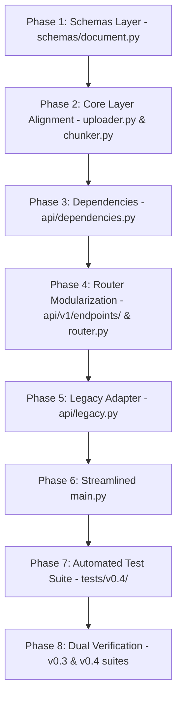

# Implementation Plan: Version 0.4.1 - RESTful Routing, Document Standardization & Dual-Run (Expand)

## Objective
Implement industry-standard RESTful routing and domain terminology for the Honeywell RAG Assistant under the **Expand** phase:
1. Standardize domain naming across the public API, schemas, and core pipeline on **`document`** and **`document_id`**.
2. Introduce versioned RESTful routes under `/api/v1` (`/api/v1/documents`, `/api/v1/documents/{document_id}/index`, `/api/v1/query`, and `/health`).
3. Modularize route handlers using FastAPI's `APIRouter` across a dedicated `api/v1/` package.
4. Enforce semantic HTTP status codes, specifically **`201 Created`** on document uploads.
5. Decouple component singletons into `api/dependencies.py` to prevent circular dependencies.
6. Provide an isolated backward-compatibility adapter in `api/legacy.py` and schema aliases in `schemas/file.py` so existing clients and the `tests/v0.3/` suite remain 100% functional.
7. Construct a comprehensive test suite under `tests/v0.4/`.

---

## Architectural Principles & Guidelines

- **Domain Entity: `Document` (`document_id`)**:
  - In a RAG knowledge assistant, the primary domain entity is a **Document** (manuals, specifications, procedures).
  - Public REST endpoints use standard resource nouns:
    - `/upload` $\rightarrow$ **`POST /api/v1/documents`** (`201 Created`)
    - `/chunk-and-embed/{file_id}` $\rightarrow$ **`POST /api/v1/documents/{document_id}/index`** (`200 OK`)
    - `/generate` $\rightarrow$ **`POST /api/v1/query`** (`200 OK`)
    - `/health` $\rightarrow$ **`GET /health`** (`200 OK`)
- **Semantic HTTP Status Codes**:
  - Document upload returns **`201 Created`**.
  - Document indexing, pipeline query, and health check return **`200 OK`**.
  - Input validation errors return **`422 Unprocessable Entity`** (FastAPI schema validation) or **`400 Bad Request`** (empty payload/missing files).
  - Storage and model upstream failures map to **`502 Bad Gateway`** (`StorageError`) and **`503 Service Unavailable`** (`GenerationError`).
- **Singleton Decoupling**:
  - Centralize shared component instances (`uploader`, `parser`, `chunker`, `embeddings`, `retriever`, `generator`) in `api/dependencies.py` to eliminate circular imports between `main.py` and the router modules (paving the way for FastAPI `Depends` in v0.5).
- **Dual-Run / Backward Compatibility**:
  - Maintain legacy route aliases in `api/legacy.py` (`/upload`, `/chunk-and-embed/{file_id}`, `/generate`) marked with `deprecated=True`.
  - Maintain backward-compatible aliases in `schemas/file.py` so both `tests/v0.3/` and `tests/v0.4/` pass simultaneously.
- **Strict Comment Preservation Mandate (MANDATORY)**:
  - **DO NOT modify, alter, overwrite, or delete any existing comments or docstrings** anywhere in the codebase.
  - All existing inline comments (e.g., `# Validate existence of filename`, `# Try reading the raw bytes of the file`, `# Attach relevant metadata and upload`, `# Append file details to list`, `# 1. Download raw file`, `# 2. Parse text pages`, etc.) and class/function docstrings must remain strictly intact verbatim.
  - **New comments may be added, but old/existing ones must NEVER be replaced, reworded, or removed.**

---

## Phased Implementation Roadmap



---

### Phase 1: Schemas Layer (`schemas/`)

#### 1.1 `schemas/document.py` [NEW]
Define strict Pydantic models for the RESTful document resource:
```python
from pydantic import BaseModel, Field


class DocumentUploadItem(BaseModel):
    document_id: str = Field(..., description="Unique document identifier in object storage")
    filename: str = Field(..., description="Original filename")
    size_bytes: int = Field(..., description="File size in bytes")


class DocumentUploadResponse(BaseModel):
    message: str
    count: int
    documents: list[DocumentUploadItem]


class ChunkItem(BaseModel):
    chunk_id: str
    text: str
    metadata: dict


class DocumentIndexResponse(BaseModel):
    document_id: str
    filename: str
    collection: str
    total_chunks: int
    indexed_chunks: int
```

#### 1.2 `schemas/file.py` [MODIFY]
Retain existing file schemas and provide seamless aliases for legacy compatibility:
```python
from pydantic import BaseModel, Field


class FileUploadItem(BaseModel):
    file_id: str = Field(..., description="Unique file identifier in object storage")
    filename: str = Field(..., description="Original filename")
    size_bytes: int = Field(..., description="File size in bytes")


class FileUploadResponse(BaseModel):
    message: str
    count: int
    files: list[FileUploadItem]


class ChunkItem(BaseModel):
    chunk_id: str
    text: str
    metadata: dict


class FileIndexResponse(BaseModel):
    file_id: str
    filename: str
    collection: str
    total_chunks: int
    indexed_chunks: int
```

#### 1.3 `schemas/__init__.py` [MODIFY]
Expose all schemas:
```python
from .document import (
    DocumentIndexResponse,
    DocumentUploadItem,
    DocumentUploadResponse,
)
from .file import (
    ChunkItem,
    FileIndexResponse,
    FileUploadItem,
    FileUploadResponse,
)
from .health import HealthResponse
from .query import QueryRequest, QueryResponse, SourceItem

__all__ = [
    "ChunkItem",
    "DocumentIndexResponse",
    "DocumentUploadItem",
    "DocumentUploadResponse",
    "FileIndexResponse",
    "FileUploadItem",
    "FileUploadResponse",
    "HealthResponse",
    "QueryRequest",
    "QueryResponse",
    "SourceItem",
]
```

---

### Phase 2: Core Layer Alignment (`core/`)

#### 2.1 `core/uploader.py` [MODIFY]
- Preserve all existing step comments verbatim (`# Validate existence of filename`, `# Try reading the raw bytes of the file`, `# Attach relevant metadata and upload`, `# Append file details to list`).
- In `upload_files`:
  - Provide both `"document_id"` and `"file_id"` in the returned dictionary for dual-compatibility:
    ```python
    uploaded_files.append(
        {
            "document_id": file_id,
            "file_id": file_id,
            "filename": filename,
            "size_bytes": size,
        }
    )
    ```
- In `download_file(self, document_id: str)`: accept `document_id` (or `file_id`) as the object key.

#### 2.2 `core/chunker.py` [MODIFY]
- Preserve all existing docstrings and step comments verbatim (`# Skip micro chunks`, `# Metadata`).
- In `split(self, pages: list[tuple[int, str]], document_id: str, filename: str)`:
  - Attach both `"document_id"` and `"file_id"` in chunk metadata:
    ```python
    metadatas.append(
        {
            "document_id": document_id,
            "file_id": document_id,
            "filename": filename,
            "page": page_number,
            "chunk_index": len(chunks),
        }
    )
    ```
  - Chunk ID format: `f"{document_id}_c{index}"`.

---

### Phase 3: Component Dependencies (`api/dependencies.py`)

#### 3.1 `api/__init__.py` [NEW]
Empty package initialization file.

#### 3.2 `api/dependencies.py` [NEW]
```python
from config import settings
from core import (
    Chunker,
    Embeddings,
    Generator,
    Parser,
    Retriever,
    Uploader,
)

# Global shared singletons (refactored to Depends in v0.5)
uploader = Uploader()
parser = Parser()
chunker = Chunker(chunk_size=settings.chunk_size, chunk_overlap=settings.chunk_overlap)
embeddings = Embeddings()
retriever = Retriever(embeddings=embeddings)
generator = Generator(
    ollama_host=settings.ollama_host,
    ollama_port=settings.ollama_port,
    model=settings.ollama_model,
)
```

---

### Phase 4: Router Modularization (`api/v1/`)

#### 4.1 `api/v1/__init__.py` [NEW]
Empty package initialization file.

#### 4.2 `api/v1/endpoints/__init__.py` [NEW]
Empty package initialization file.

#### 4.3 `api/v1/endpoints/health.py` [NEW]
```python
from fastapi import APIRouter
from schemas.health import HealthResponse

router = APIRouter(tags=["Health"])


@router.get(
    "/health",
    response_model=HealthResponse,
    summary="Health Check",
    description="Liveness probe indicating the service is running.",
)
async def health_check() -> HealthResponse:
    return HealthResponse(status="ok", version="1.0.0")
```

#### 4.4 `api/v1/endpoints/documents.py` [NEW]
Preserves all step comments verbatim:
```python
from fastapi import APIRouter, File, HTTPException, UploadFile, status
from api.dependencies import chunker, embeddings, parser, retriever, uploader
from schemas.document import (
    DocumentIndexResponse,
    DocumentUploadItem,
    DocumentUploadResponse,
)

router = APIRouter(prefix="/documents", tags=["Documents"])


@router.post(
    "",
    status_code=status.HTTP_201_CREATED,
    response_model=DocumentUploadResponse,
    summary="Upload multiple documents",
    description="Upload one or more documents to object storage.",
)
async def upload_documents(
    files: list[UploadFile] = File(...),
) -> DocumentUploadResponse:
    if not files:
        raise HTTPException(status_code=400, detail="At least one file is required")

    uploaded_documents = uploader.upload_files(files)

    return DocumentUploadResponse(
        message="Documents uploaded successfully",
        count=len(uploaded_documents),
        documents=[
            DocumentUploadItem(
                document_id=item["document_id"],
                filename=item["filename"],
                size_bytes=item["size_bytes"],
            )
            for item in uploaded_documents
        ],
    )


@router.post(
    "/{document_id}/index",
    response_model=DocumentIndexResponse,
    summary="Parse, chunk, embed and index a document",
    description="Download raw document from MinIO, split into chunks, generate embeddings, and persist in ChromaDB.",
)
async def index_document(document_id: str) -> DocumentIndexResponse:
    # 1. Download raw file
    content, filename = uploader.download_file(document_id)

    # 2. Parse text pages
    pages = parser.parse(content, filename)

    # 3. Chunk text and attach metadata
    chunks, metadatas, chunk_ids = chunker.split(pages, document_id, filename)

    # 4. Generate vector embeddings
    vectors = embeddings.embed(chunks)

    # 5. Persist to ChromaDB
    retriever.upsert(
        ids=chunk_ids,
        documents=chunks,
        metadatas=metadatas,
        embeddings=vectors,
    )

    return DocumentIndexResponse(
        document_id=document_id,
        filename=filename,
        collection=retriever.collection_name,
        total_chunks=len(chunks),
        indexed_chunks=len(chunks),
    )
```

#### 4.5 `api/v1/endpoints/query.py` [NEW]
Preserves all step comments verbatim:
```python
from fastapi import APIRouter, HTTPException
from config import settings
from api.dependencies import generator, retriever
from schemas.query import QueryRequest, QueryResponse, SourceItem

router = APIRouter(tags=["Query"])


@router.post(
    "/query",
    response_model=QueryResponse,
    summary="Query RAG pipeline",
    description="Retrieve relevant ChromaDB chunks and generate an answer using Ollama.",
)
async def query_pipeline(request: QueryRequest) -> QueryResponse:
    question = request.question.strip()
    if not question:
        raise HTTPException(status_code=400, detail="Question must not be empty")

    # 1. Retrieve relevant chunks
    retrieved = retriever.retrieve(question, k=settings.retrieval_k)
    documents = retrieved.get("documents", [[]])[0]
    metadatas = retrieved.get("metadatas", [[]])[0]
    distances = retrieved.get("distances", [[]])[0]
    if not documents:
        raise HTTPException(status_code=400, detail="No indexed document chunks were found")

    # 2. Build prompt and generate response with local Ollama
    prompt = generator.build_prompt(question, documents, metadatas)
    answer = generator.generate(prompt)

    return QueryResponse(
        question=question,
        answer=answer,
        model=generator.model,
        sources=[
            SourceItem(metadata=metadata, distance=distance)
            for metadata, distance in zip(metadatas, distances)
        ],
    )
```

#### 4.6 `api/v1/router.py` [NEW]
```python
from fastapi import APIRouter
from api.v1.endpoints import documents, health, query

api_router = APIRouter()

# Root health check mounted at /health
api_router.include_router(health.router)

# Versioned API routes mounted under /api/v1
api_router.include_router(documents.router, prefix="/api/v1")
api_router.include_router(query.router, prefix="/api/v1")
```

---

### Phase 5: Legacy Compatibility Adapter (`api/legacy.py`)

#### 5.1 `api/legacy.py` [NEW]
Preserves v0.1/v0.3 endpoints with `deprecated=True` for seamless dual-run:
```python
from fastapi import APIRouter, File, UploadFile
from api.dependencies import uploader
from api.v1.endpoints.documents import index_document
from api.v1.endpoints.query import query_pipeline
from schemas import (
    FileIndexResponse,
    FileUploadItem,
    FileUploadResponse,
    QueryRequest,
    QueryResponse,
)

legacy_router = APIRouter(tags=["Legacy (v0.1/v0.3)"])


@legacy_router.post(
    "/upload",
    response_model=FileUploadResponse,
    deprecated=True,
    summary="[Legacy] Upload multiple files",
)
async def legacy_upload(files: list[UploadFile] = File(...)) -> FileUploadResponse:
    uploaded = uploader.upload_files(files)
    return FileUploadResponse(
        message="Files uploaded successfully",
        count=len(uploaded),
        files=[
            FileUploadItem(
                file_id=item["file_id"],
                filename=item["filename"],
                size_bytes=item["size_bytes"],
            )
            for item in uploaded
        ],
    )


@legacy_router.post(
    "/chunk-and-embed/{file_id}",
    response_model=FileIndexResponse,
    deprecated=True,
    summary="[Legacy] Chunk and embed one uploaded file",
)
async def legacy_chunk_and_embed(file_id: str) -> FileIndexResponse:
    res = await index_document(document_id=file_id)
    return FileIndexResponse(
        file_id=res.document_id,
        filename=res.filename,
        collection=res.collection,
        total_chunks=res.total_chunks,
        indexed_chunks=res.indexed_chunks,
    )


@legacy_router.post(
    "/generate",
    response_model=QueryResponse,
    deprecated=True,
    summary="[Legacy] Answer question using indexed documents",
)
async def legacy_generate(request: QueryRequest) -> QueryResponse:
    return await query_pipeline(request=request)
```

---

### Phase 6: Streamlined `main.py`

#### 6.1 `main.py` [MODIFY]
```python
from contextlib import asynccontextmanager
import logging
from fastapi import FastAPI, Request
from fastapi.responses import JSONResponse

from api.dependencies import uploader
from api.legacy import legacy_router
from api.v1.router import api_router
from core import GenerationError, StorageError

logging.basicConfig(
    level=logging.INFO,
    format="%(asctime)s [%(levelname)s] %(name)s: %(message)s",
)
logger = logging.getLogger(__name__)


@asynccontextmanager
async def lifespan(app: FastAPI):
    """Manage application startup and shutdown lifecycle."""
    logger.info("Initializing application resources...")
    uploader.ensure_bucket()
    yield
    logger.info("Shutting down application resources...")


app = FastAPI(title="Honeywell RAG", version="1.0.0", lifespan=lifespan)


# Global Exception Handlers
@app.exception_handler(ValueError)
async def value_error_handler(request: Request, exc: ValueError) -> JSONResponse:
    return JSONResponse(status_code=400, content={"detail": str(exc)})


@app.exception_handler(StorageError)
async def storage_error_handler(request: Request, exc: StorageError) -> JSONResponse:
    return JSONResponse(status_code=502, content={"detail": str(exc)})


@app.exception_handler(GenerationError)
async def generation_error_handler(request: Request, exc: GenerationError) -> JSONResponse:
    return JSONResponse(status_code=503, content={"detail": str(exc)})


# Mount Modern Versioned API & Health Check
app.include_router(api_router)

# Mount Legacy Compatibility Routes (Dual-Run)
app.include_router(legacy_router)
```

---

### Phase 7: Automated Testing Suite (`tests/v0.4/v0.4.1/`)

#### 7.1 Directory Layout
```text
tests/
├── v0.3/
│   ├── test_api_contracts.py     # Continues passing against legacy routes
│   └── test_schemas.py
└── v0.4/
    ├── __init__.py
    └── v0.4.1/
        ├── __init__.py
        ├── test_schemas.py       # Unit tests for Document schemas
        └── test_api_v1.py        # Route contract tests for /api/v1 endpoints
```

#### 7.2 Test Cases Specification

| Test File | Method | Target | Verification Criteria |
| :--- | :--- | :--- | :--- |
| `tests/v0.4/v0.4.1/test_schemas.py` | `test_document_upload_item` | `DocumentUploadItem` | Validates `document_id`, `filename`, integer `size_bytes` |
| `tests/v0.4/v0.4.1/test_schemas.py` | `test_document_upload_response` | `DocumentUploadResponse` | Verifies `message`, `count`, and list of `DocumentUploadItem` |
| `tests/v0.4/v0.4.1/test_schemas.py` | `test_document_index_response` | `DocumentIndexResponse` | Validates `document_id`, `collection`, chunk counts |
| `tests/v0.4/v0.4.1/test_api_v1.py` | `test_health_endpoint` | `GET /health` | HTTP 200, returns `{"status": "ok", "version": "1.0.0"}` |
| `tests/v0.4/v0.4.1/test_api_v1.py` | `test_upload_documents_empty` | `POST /api/v1/documents` | HTTP 400 when no files are sent |
| `tests/v0.4/v0.4.1/test_api_v1.py` | `test_upload_status_code_contract` | `POST /api/v1/documents` | OpenAPI declares `201 Created` with `DocumentUploadResponse` |
| `tests/v0.4/v0.4.1/test_api_v1.py` | `test_index_document_openapi_contract` | `POST /api/v1/documents/{document_id}/index` | OpenAPI declares `200 OK` with `DocumentIndexResponse` |
| `tests/v0.4/v0.4.1/test_api_v1.py` | `test_query_validation_error_empty` | `POST /api/v1/query` | HTTP 422 on `{"question": ""}` |
| `tests/v0.4/v0.4.1/test_api_v1.py` | `test_query_validation_error_missing` | `POST /api/v1/query` | HTTP 422 on `{}` missing body |
| `tests/v0.4/v0.4.1/test_api_v1.py` | `test_openapi_v1_routes` | `app.openapi()` | Verify `/api/v1/documents`, `/api/v1/documents/{document_id}/index`, `/api/v1/query`, and `/health` exist with tags `["Documents"]`, `["Query"]`, `["Health"]` |

---

### Phase 8: Dual Verification

1. Run v0.4.1 test suite:
   ```powershell
   python -m unittest discover -s tests/v0.4/v0.4.1 -v
   ```
2. Run v0.3 test suite (regression):
   ```powershell
   python -m unittest discover -s tests/v0.3 -v
   ```
3. Verify application imports and total routes:
   ```powershell
   python -c "import main; print('Application imported successfully'); print(len(main.app.routes), 'routes registered')"
   ```

