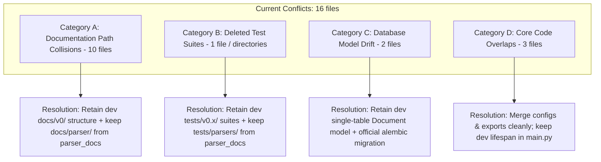

# Merge Plan: Integrating `parser_docs` into `dev` (Zero-Conflict Roadmap)

## Executive Summary

- **Source Branch:** `parser_docs` (contains modular parser pipeline: `core/parsers/`, `docs/parser/`, `tests/parsers/`).
- **Target Branch:** `dev` (canonical development branch containing v0.5.2 service layer, database schema deduplication, system prompt/template, and regression test suites).
- **Goal:** Merge the new document parsing capabilities from `parser_docs` into `dev` cleanly, resolving all 16 current merge conflicts without losing any parser features or breaking existing services.

---

## 1. Conflict Root-Cause Analysis

Running a three-way merge check between `dev` and `parser_docs` reveals **16 conflicts**. Although the primary intent of `parser_docs` was scoped to the parsing subsystem (`core/parsers/`), earlier cleanup commits and parallel work on documentation and tests caused branch divergence.

The conflicts fall into **four distinct categories**:



### Category A: Documentation Path Collisions (10 Conflicts)
- **Files:** `plan.md`, `docs/RAG_PARSING_ARCHITECTURE_FINAL.md`, and 8 files in `docs/`:
  - `docs/plan.md`, `docs/v0.2.md`, `docs/v0.3.md`, `docs/v0.3_plan.md`, `docs/v0.4.1_plan.md`, `docs/v0.4.2_plan.md`, `docs/v0.4.md`, `docs/v0.5.md`
- **Cause:** `dev` moved these architecture documents into `docs/v0/`, while `parser_docs` moved them into `docs/v0 refactor/` and `docs/archive/`.
- **Resolution Strategy:** Retain `dev`'s canonical `docs/v0/` directory. Add `docs/parser/` from `parser_docs`. Remove the redundant `docs/v0 refactor/` path.

### Category B: Accidental Test Suite Deletion (1 Conflict)
- **Files:** `tests/v0.4/v0.4.3/test_duplicate_uploads.py` (and missing `tests/v0.3/`, `tests/v0.4/`, `tests/v0.5/` trees).
- **Cause:** Commit `bbb6763` on `parser_docs` deleted the older test directories, while `dev` updated and maintained them.
- **Resolution Strategy:** Retain all `dev` test suites (`tests/v0.x/` and `tests/test_generator_prompts.py`) AND include the new `tests/parsers/` suite from `parser_docs`.

### Category C: Database Model & Migration Drift (2 Conflicts)
- **Files:** `db/models/__init__.py`, `db/models/document_version.py` (and Alembic migration files).
- **Cause:** `parser_docs` retained remnants of an experimental multi-table versioning schema (`DocumentVersion` + `b3801174c558_initial.py`), whereas `dev` settled on the production deduplication schema (`Document` + `20260925_0001_initial.py`).
- **Resolution Strategy:** Discard the legacy `document_version.py` and `b3801174c558` migration. Use `dev`'s canonical schema and Alembic revision.

### Category D: Core Application Code Overlaps (3 Conflicts)
- **Files:** `config.py`, `core/__init__.py`, `main.py`
- **Causes & Resolution:**
  1. **`config.py`**:
     - `dev` added `system_prompt` and `prompt_template`.
     - `parser_docs` added parser settings (`chunker_tokenizer`, `picture_description_*`, `libreoffice_*`, `enable_pdf_page_router`, etc.).
     - *Resolution:* Combine both sets of fields into `Settings`.
  2. **`core/__init__.py`**:
     - `dev` exported legacy `Parser`.
     - `parser_docs` exported `ParserRouter`, `DoclingParser`, `LibreOfficeConverter`, etc.
     - *Resolution:* Export all new parser components and alias `Parser = ParserRouter` to preserve complete backward compatibility.
  3. **`main.py`**:
     - `dev` added `Base.metadata.create_all(bind=engine)` inside the `lifespan` handler.
     - `parser_docs` omitted this call.
     - *Resolution:* Retain `dev`'s version with the database initialization hook.

---

## 2. File-by-File Resolution Specification

| File | Source of Truth | Action / Content Merge |
| :--- | :--- | :--- |
| `config.py` | **Merge Both** | Keep `dev` prompt settings + append `parser_docs` tokenizer/LibreOffice/Docling settings. |
| `core/__init__.py` | **Merge Both** | Export `ParserRouter`, `DoclingParser`, `TextParser`, `PdfPageRouter`, `LibreOfficeConverter`, etc., plus backward-compatible `Parser = ParserRouter`. |
| `main.py` | **`dev`** | Retain `dev` version (includes `Base.metadata.create_all(bind=engine)` in lifespan). |
| `db/models/__init__.py` | **`dev`** | Export only `Document`. Discard `DocumentVersion`. |
| `db/models/document.py` | **`dev`** | Remove relationship to dead `DocumentVersion`. |
| `db/models/document_version.py` | **Delete** | Delete file (`git rm db/models/document_version.py`). |
| `alembic/versions/` | **`dev`** | Keep `20260925_0001_initial.py`. Delete `b3801174c558_initial.py`. |
| `core/parsers/` (whole dir) | **`parser_docs`** | Keep intact (new parsing pipeline). |
| `docs/parser/` (whole dir) | **`parser_docs`** | Keep intact (new parser documentation). |
| `tests/parsers/` (whole dir) | **`parser_docs`** | Keep intact (unit and integration tests for parsers). |
| `docs/v0/` | **`dev`** | Retain `dev`'s `docs/v0/` directory. |
| `docs/v0 refactor/` | **Delete** | Remove duplicate folder (`git rm -rf "docs/v0 refactor"`). |
| `docs/archive/plan.md` | **`dev`** | Discard conflict; keep `dev`'s docs layout. |
| `cleanup_plan.md` | **Delete / Archive** | Delete temporary cleanup script artifact. |
| `tests/v0.3/`, `v0.4/`, `v0.5/` | **`dev`** | Retain all existing API and service tests from `dev`. |
| `tests/v0.4/v0.4.3/test_duplicate_uploads.py` | **`dev`** | Retain `dev` version (`git checkout dev -- tests/v0.4/v0.4.3/test_duplicate_uploads.py`). |
| `core/chunker.py` | **`parser_docs`** | Retain (supports both `DoclingDocument` and legacy page tuples). |
| `api/deps.py` | **Merge Both** | Use `get_parser() -> ParserRouter`, while preserving `get_generator()` with `system_prompt` and `prompt_template`. |
| `services/ingestion_service.py` | **`parser_docs`** | Accepts `ParserRouter`. |
| `Dockerfile` | **`parser_docs`** | Retain headless LibreOffice and JRE dependencies. |
| `requirements.txt` | **`parser_docs`** | Retain `python-pptx`, `docling`, `pymupdf`, `pymupdf4llm`. |

---

## 3. Step-by-Step Execution Plan

### Step 1: Ensure Clean Working Tree on `parser_docs`
```powershell
Set-Location "c:\Users\ADMIN\OneDrive\Desktop\Honeywell Project\honeywell-project"
git checkout parser_docs
git status
```

### Step 2: Fetch and Initiate Merge from `dev`
```powershell
git fetch origin dev
git merge origin/dev
```
*(Git will report 16 conflict files. Do not panic; proceed with the automated resolution steps below).*

### Step 3: Fast Resolution of File Deletions & Renames

#### 3.1 Accept `dev`'s documentation structure
```powershell
# Remove the colliding refactor/archive folders
git rm -rf "docs/v0 refactor" 2>$null
git rm -f "docs/archive/plan.md" "cleanup_plan.md" 2>$null
git checkout origin/dev -- docs/v0/
```

#### 3.2 Accept `dev`'s test suites and database models
```powershell
# Restore dev tests
git checkout origin/dev -- tests/v0.3 tests/v0.4 tests/v0.5 tests/test_generator_prompts.py

# Remove dead document_version model & old alembic migration
git rm -f db/models/document_version.py 2>$null
git checkout origin/dev -- db/models/__init__.py db/models/document.py alembic/versions/
```

#### 3.3 Accept `dev`'s `main.py`
```powershell
git checkout origin/dev -- main.py
```

### Step 4: Resolve Combined Code Files

#### 4.1 `config.py`
Ensure `Settings` contains both prompt configurations and parser configurations:
```python
    # Prompt Settings
    system_prompt: str | None = os.getenv("SYSTEM_PROMPT")
    prompt_template: str | None = os.getenv("PROMPT_TEMPLATE")

    # Tokenizer
    chunker_tokenizer: str = os.getenv(
        "CHUNKER_TOKENIZER", "sentence-transformers/all-MiniLM-L6-v2"
    )

    # Picture description config for docling 
    picture_description_preset: str = os.getenv("PICTURE_DESCRIPTION_PRESET", "smolvlm")
    picture_description_prompt: str = os.getenv(
        "PICTURE_DESCRIPTION_PROMPT",
        "Describe this image in 2-3 sentences. Be concise and accurate.",
    )
    enable_picture_description: bool = (
        os.getenv("ENABLE_PICTURE_DESCRIPTION", "false").lower() == "true"
    )

    # Configuration for libreoffice binaries
    libreoffice_binary: str = os.getenv("LIBREOFFICE_BINARY", "")
    libreoffice_timeout_seconds: int = int(os.getenv("LIBREOFFICE_TIMEOUT_SECONDS", "60"))

    enable_pdf_page_router: bool = (
        os.getenv("ENABLE_PDF_PAGE_ROUTER", "true").lower() == "true"
    )
    pdf_min_text_chars_for_text_route: int = int(os.getenv("PDF_MIN_TEXT_CHARS_FOR_TEXT_ROUTE", "800"))
    pdf_text_layer_min_chars: int = int(os.getenv("PDF_TEXT_LAYER_MIN_CHARS", "40"))
    pdf_ocr_on_text_pages: bool = os.getenv("PDF_ALLOW_OCR_ON_TEXT_PAGES", "false").lower() == "true"
    chunk_postprocess: bool = os.getenv("CHUNK_POSTPROCESS", "true").lower() == "true"
    pdf_smolvlm_max_new_tokens: int = int(os.getenv("PDF_SMOLVLM_MAX_NEW_TOKENS", "200"))
    pdf_boilerplate_min_page_repeats: int = int(os.getenv("PDF_BOILERPLATE_MIN_PAGE_REPEATS", "3"))
    pdf_debug_heading_dump: bool = bool(int(os.getenv("PDF_DEBUG_HEADING_DUMP", "0")))
```
Add changes to index:
```powershell
git add config.py
```

#### 4.2 `core/__init__.py`
Export new parser modules while keeping `Parser = ParserRouter` for backward compatibility:
```python
"""Core package exports."""
from .chunker import Chunker
from .embeddings import Embeddings
from .generator import GenerationError, Generator
from .parsers import (
    BaseParser,
    DoclingParser,
    LibreOfficeConversionError,
    LibreOfficeConverter,
    LibreOfficeNotFoundError,
    ParserRouter,
    PdfPageRouter,
    TextParser,
    UnsupportedFileError,
)
from .retriever import Retriever
from .uploader import StorageError, Uploader

# Backward-compatibility alias
Parser = ParserRouter

__all__ = [
    "BaseParser",
    "Chunker",
    "DoclingParser",
    "Embeddings",
    "GenerationError",
    "Generator",
    "LibreOfficeConversionError",
    "LibreOfficeConverter",
    "LibreOfficeNotFoundError",
    "Parser",
    "ParserRouter",
    "PdfPageRouter",
    "Retriever",
    "StorageError",
    "TextParser",
    "Uploader",
    "UnsupportedFileError",
]
```
Add to index:
```powershell
git add core/__init__.py
```

#### 4.3 `api/deps.py`
Verify that `get_generator()` retains `system_prompt` and `prompt_template` while `get_parser()` returns `ParserRouter`:
```powershell
git add api/deps.py
```

### Step 5: Finalize Merge Commit
Check status to ensure all conflicts are resolved:
```powershell
git status
```
Commit the merge:
```powershell
git commit -m "Merge branch 'dev' into parser_docs: resolve parser integration and doc paths"
```

---

## 4. Test Verification Gate

Before pushing into `dev`, run both the service regression test suite and the new parser tests:

```powershell
# 1. Run service & API tests
python -m pytest tests/v0.5/v0.5.2 tests/test_generator_prompts.py

# 2. Run new parser unit tests
python -m pytest tests/parsers/test_base.py tests/parsers/test_text.py tests/parsers/test_router.py
```

All test suites must pass with **0 errors**.

---

## 5. Pushing into `dev` and `main`

Once `parser_docs` has merged `dev` with all conflicts resolved locally:

```powershell
# Push the updated parser_docs branch
git push origin parser_docs

# Switch to dev and merge parser_docs (Fast-Forward / Clean Merge)
git checkout dev
git pull origin dev
git merge parser_docs
git push origin dev

# Merge dev into main
git checkout main
git pull origin main
git merge dev
git push origin main
```
Because `dev` was already merged into `parser_docs` and all 16 conflicts resolved, merging `parser_docs` into `dev` will be **100% conflict-free**.
