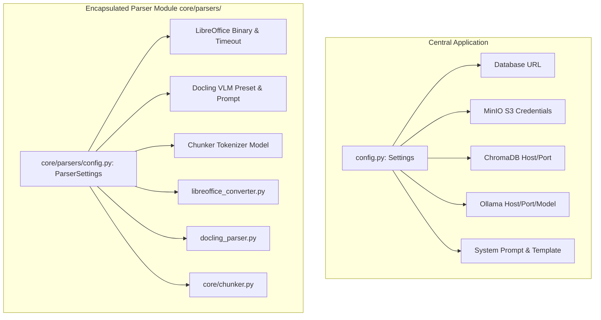

# Parser Cleanup Plan: Isolating Completed Features on `parser_docs`

## Executive Summary

- **Canonical Checkpoint Commit:** `acc5c91853f2511d1bcbd829aab82facef1d85e3` ("Binary executable").
- **Current Problem:** 
  1. Commits after `acc5c91` introduced an **incomplete, experimental `pdf_router.py`** and polluted the central `config.py` with 8+ PDF-specific configuration flags.
  2. Central `config.py` contains LibreOffice and Docling settings that violate modular isolation principles and create merge conflicts with `dev`.
  3. Commit `bbb6763` caused severe collateral damage by deleting existing `dev` test suites (`tests/v0.3/`, `tests/v0.4/`, `tests/v0.5/`), renaming documentation paths to `docs/v0 refactor/`, and keeping dead database models (`document_version.py`).
- **Goal:** Strip incomplete experiments, decouple parser configuration into an encapsulated `core/parsers/config.py`, restore deleted tests and documentation, and bring `parser_docs` into a clean, modular, and conflict-free state ready for merging.

---

## 1. Commit Baseline Analysis (`acc5c91853f2511d1bcbd829aab82facef1d85e3`)

Commit `acc5c91` is the last verified state where features were complete, stable, and tested:

### 1.1 Verified Stable Components at `acc5c91`
- **`core/parsers/base.py`**: `BaseParser` interface and `UnsupportedFileError`.
- **`core/parsers/text.py`**: `TextParser` handling `.txt` and `.md` with multi-encoding fallback.
- **`core/parsers/docling_parser.py`**: `DoclingParser` handling modern `.docx` and `.pptx` with lazy initialization and optional VLM picture descriptions.
- **`core/parsers/libreoffice_converter.py`**: Headless LibreOffice bridge converting legacy `.doc` and `.ppt` to modern formats and routing to Docling.
- **`core/parsers/router.py`**: `ParserRouter` dispatching `.txt`, `.md`, `.docx`, `.pptx`, `.doc`, `.ppt`.

### 1.2 Incomplete / Collateral Items Introduced After `acc5c91`
- ❌ **`core/parsers/pdf_router.py`**: Incomplete per-page PDF triage router using PyMuPDF and Docling markdown stitching.
- ❌ **`tests/parsers/test_pdf_router.py`**: Tests for incomplete PDF router.
- ❌ **8+ PDF Settings in `config.py`**:
  - `enable_pdf_page_router`
  - `pdf_min_text_chars_for_text_route`
  - `pdf_text_layer_min_chars`
  - `pdf_ocr_on_text_pages`
  - `chunk_postprocess`
  - `pdf_smolvlm_max_new_tokens`
  - `pdf_boilerplate_min_page_repeats`
  - `pdf_debug_heading_dump`
- ❌ **Central Config Pollution**: LibreOffice binary path, LibreOffice timeout, Docling VLM presets in root `config.py`.
- ❌ **Collateral File Damage**:
  - `cleanup_plan.md`
  - `docs/archive/` and `docs/v0 refactor/`
  - Deletion of `tests/v0.3/`, `tests/v0.4/`, `tests/v0.5/`
  - Deletion of `core/parser.py`
  - Presence of dead `db/models/document_version.py`

---

## 2. Target Architecture: Encapsulated Parser Configuration

To ensure clean isolation and avoid merge conflicts with `dev`, parser-specific configuration must not reside in the application's central `config.py`.



### Proposed `core/parsers/config.py` [NEW]
```python
import os
from dataclasses import dataclass


@dataclass(frozen=True)
class ParserSettings:
    """Specialized configuration for document parsing and format conversion."""

    # LibreOffice Headless Bridge (.doc / .ppt)
    libreoffice_binary: str = os.getenv("LIBREOFFICE_BINARY", "")
    libreoffice_timeout_seconds: int = int(os.getenv("LIBREOFFICE_TIMEOUT_SECONDS", "60"))

    # Docling & Picture Description (VLM) Options
    picture_description_preset: str = os.getenv("PICTURE_DESCRIPTION_PRESET", "smolvlm")
    picture_description_prompt: str = os.getenv(
        "PICTURE_DESCRIPTION_PROMPT",
        "Describe this image in 2-3 sentences. Be concise and accurate.",
    )
    enable_picture_description: bool = (
        os.getenv("ENABLE_PICTURE_DESCRIPTION", "false").lower() == "true"
    )

    # Tokenizer for HybridChunker
    chunker_tokenizer: str = os.getenv(
        "CHUNKER_TOKENIZER", "sentence-transformers/all-MiniLM-L6-v2"
    )


parser_settings = ParserSettings()
```

---

## 3. Phased Cleanup Plan

```
┌────────────────────────────────────────────────────────┐
│ Phase 1: Purge Incomplete PDF Router Features          │
│ (Delete pdf_router.py, test_pdf_router.py, router fix) │
└──────────────────────────┬─────────────────────────────┘
                           │
┌──────────────────────────▼─────────────────────────────┐
│ Phase 2: Decouple Parser Configuration into Submodule  │
│ (core/parsers/config.py & clean central config.py)     │
└──────────────────────────┬─────────────────────────────┘
                           │
┌──────────────────────────▼─────────────────────────────┐
│ Phase 3: Restore Repo Hygiene & Undo Collateral Damage │
│ (Restore docs/v0/, restore dev tests, drop dead models)│
└──────────────────────────┬─────────────────────────────┘
                           │
┌──────────────────────────▼─────────────────────────────┐
│ Phase 4: Full Test Suite Verification                  │
│ (Run parser tests + dev API/service regression tests)  │
└──────────────────────────┬─────────────────────────────┘
                           │
┌──────────────────────────▼─────────────────────────────┐
│ Phase 5: Commit Clean State & Ready for Upstream Merge │
│ (Commit on parser_docs, fast-forward merge to dev)     │
└────────────────────────────────────────────────────────┘
```

---

### Phase 1: Purge Incomplete PDF Router Features

#### 1.1 Remove Files
- Delete `core/parsers/pdf_router.py`
- Delete `tests/parsers/test_pdf_router.py`

#### 1.2 Update `core/parsers/router.py`
Remove `PdfPageRouter` import and registration from `__init__`:
```python
    def __init__(self) -> None:
        """Create a router and auto-register the built-in parsers."""

        self._parsers: list[BaseParser] = []
        self.register(TextParser())             # .txt / .md
        self.register(DoclingParser())          # .docx / .pptx
        self.register(LibreOfficeConverter())   # .doc / .ppt
```

#### 1.3 Update `core/parsers/__init__.py`
Remove `PdfPageRouter` from exports:
```python
from .base import BaseParser, UnsupportedFileError
from .docling_parser import DoclingParser
from .libreoffice_converter import (
    LibreOfficeConversionError,
    LibreOfficeConverter,
    LibreOfficeNotFoundError,
)
from .router import ParserRouter
from .text import TextParser

__all__ = [
    "BaseParser",
    "DoclingParser",
    "LibreOfficeConversionError",
    "LibreOfficeConverter",
    "LibreOfficeNotFoundError",
    "ParserRouter",
    "TextParser",
    "UnsupportedFileError",
]
```

---

### Phase 2: Decouple Parser Configuration (`core/parsers/config.py`)

#### 2.1 Create `core/parsers/config.py`
Create the dedicated `ParserSettings` dataclass shown in Section 2.

#### 2.2 Update Consumers to use `parser_settings`
- **`core/parsers/libreoffice_converter.py`**:
  ```python
  from core.parsers.config import parser_settings
  # Replace settings.libreoffice_* with parser_settings.libreoffice_*
  ```
- **`core/parsers/docling_parser.py`**:
  ```python
  from core.parsers.config import parser_settings
  # Replace settings.picture_description_* with parser_settings.picture_description_*
  ```
- **`core/chunker.py`**:
  ```python
  from core.parsers.config import parser_settings
  # Replace settings.chunker_tokenizer with parser_settings.chunker_tokenizer
  ```

#### 2.3 Revert Central `config.py` to Match `dev`
Remove all parser settings from the root `config.py`. Central `config.py` retains only:
- Database, MinIO, ChromaDB, Ollama, RAG retrieval parameters, and Prompt settings (`system_prompt`, `prompt_template`).
- Result: **0 diff and 0 conflicts in `config.py` when merging into `dev`**.

---

### Phase 3: Restore Repository Hygiene & Revert Collateral Damage

#### 3.1 Restore Canonical Documentation Structure
- Remove `docs/v0 refactor/` and `cleanup_plan.md`
- Remove `docs/archive/plan.md`
- Ensure `docs/v0/` matches `dev`
- Retain all genuine parser documentation in `docs/parser/`

#### 3.2 Restore Deleted Tests from `dev`
Restore all regression test suites that were deleted by commit `bbb6763`:
```powershell
git checkout origin/dev -- tests/v0.3 tests/v0.4 tests/v0.5 tests/test_generator_prompts.py
```

#### 3.3 Discard Dead Database Models
- Remove `db/models/document_version.py`
- Revert `db/models/__init__.py` and `db/models/document.py` to match `dev` (exporting only `Document`)
- Discard `alembic/versions/b3801174c558_initial.py` and retain `20260925_0001_initial.py`

#### 3.4 Retain `core/parser.py`
Keep the existing `core/parser.py` from `dev` (which handles `.pdf` via `pypdf`) so the system continues to support PDF documents seamlessly until a production PDF engine is finalized.

---

### Phase 4: Test Suite Validation at Cleaned State

Run all unit tests to verify parser components and ensure zero regression:

```powershell
# 1. Test Text Parser
python -m pytest tests/parsers/test_base.py tests/parsers/test_text.py

# 2. Test Router & LibreOffice Converter
python -m pytest tests/parsers/test_router.py tests/parsers/test_libreoffice_converter.py

# 3. Test Docling Parser
python -m pytest tests/parsers/test_docling.py tests/parsers/test_serialize_fix.py

# 4. Test Chunker
python -m pytest tests/unit/test_chunker.py

# 5. Test dev Regressions & Prompt Templates
python -m pytest tests/v0.5/v0.5.2 tests/test_generator_prompts.py
```

**Pass Criteria:** All tests pass with **0 errors**.

---

### Phase 5: Commit Clean State & Ready for Upstream Merge

Once verified, stage and commit the isolated, cleaned changes on `parser_docs`:

```powershell
# Stage clean parser module and config
git add core/parsers/ core/chunker.py requirements.txt Dockerfile docs/parser/ tests/parsers/

# Stage restored dev files
git add config.py db/ alembic/ tests/v0* docs/v0/

# Remove deleted/dead files
git rm -rf "docs/v0 refactor" cleanup_plan.md db/models/document_version.py 2>$null

git commit -m "refactor(parsers): isolate completed parser features at acc5c91, encapsulate config, and purge incomplete pdf router"
```

Result: `parser_docs` (or `parser_upd`) is now in a pristine state containing only completed parser features, ready for a **100% conflict-free merge into `dev`**.

