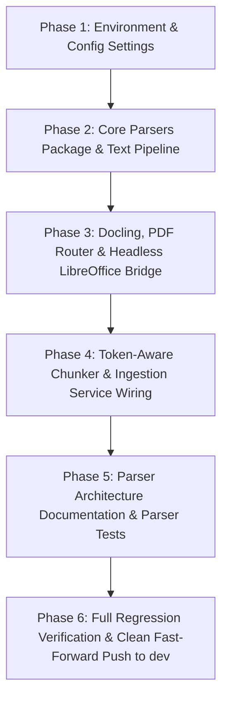

# Implementation & Integration Plan: Modular Parsing Subsystem on `parser_upd`

## Executive Summary

- **Working Branch:** `parser_upd` (currently aligned with `dev` at commit `d5276d7`).
- **Feature Source:** `parser_docs` (contains modular parser pipeline: `core/parsers/`, `docs/parser/`, `tests/parsers/`).
- **Target Upstream:** `dev` (canonical branch containing FastAPI v0.5.2, single-table document deduplication, grounded RAG prompts, and complete regression tests).
- **Core Directive:** Port only the modular parsing capabilities from `parser_docs` onto `parser_upd` in structured, verified phases. Because `parser_upd` branches directly off `dev`, merging `parser_upd` into `dev` upon completion will be a **100% clean, conflict-free fast-forward merge**.

---

## 1. Architectural Strategy & Isolation Guardrails

### 1.1 The Clean-Room Strategy

Rather than attempting a complex 3-way conflict resolution on the historically polluted `parser_docs` branch, `parser_upd` serves as the clean integration vehicle:
1. `parser_upd` starts in complete sync with `origin/dev`.
2. Parser features from `parser_docs` are introduced in **6 self-contained phases**.
3. Each phase includes a formal **Verification Gate** (automated unit tests).
4. Zero collateral modifications:
   - Existing documentation in `docs/v0/` and `docs/prompt/` is strictly preserved.
   - Existing database models (`db/models/document.py`), migrations (`alembic/versions/20260925_0001_initial.py`), and lifespan DB initialization remain untouched.
   - Existing test suites (`tests/v0.3/`, `tests/v0.4/`, `tests/v0.5/`, `tests/test_generator_prompts.py`) must pass at every step.



---

## 2. Phased Implementation Roadmap

### Phase 1: Environment, Runtime & Configuration

#### Objective
Equip the repository and runtime environment with the dependencies and configuration flags required by the advanced parser engine, while strictly preserving existing prompt settings.

#### 1.1 `requirements.txt`
Append new parser libraries to the existing dependency list:
```text
python-pptx>=1.0.0
docling>=2.0.0
pymupdf>=1.24.0
pymupdf4llm>=0.0.17
```

#### 1.2 `Dockerfile`
Add system packages for headless document conversion:
```dockerfile
RUN apt-get update \
	&& apt-get install -y --no-install-recommends \
	   antiword \
	   libreoffice-core \
	   libreoffice-writer \
	   libreoffice-impress \
	   default-jre-headless \
	&& rm -rf /var/lib/apt/lists/*
```

#### 1.3 `config.py`
Add parser settings to `Settings` dataclass without touching existing database, MinIO, Chroma, Ollama, or Prompt settings:
```python
    # Tokenizer
    chunker_tokenizer: str = os.getenv(
        "CHUNKER_TOKENIZER", "sentence-transformers/all-MiniLM-L6-v2"
    )

    # Picture description config for docling 
    picture_description_preset: str = os.getenv("PICTURE_DESCRIPTION_PRESET", "smolvlm")
    picture_description_prompt: str = os.getenv(
        "PICTURE_DESCRIPTION_PROMPT",
        "Describe this image in 2-3 sentences. Be concise and accurate.",
    )
    enable_picture_description: bool = (
        os.getenv("ENABLE_PICTURE_DESCRIPTION", "false").lower() == "true"
    )

    # Configuration for libreoffice binaries
    libreoffice_binary: str = os.getenv("LIBREOFFICE_BINARY", "")
    libreoffice_timeout_seconds: int = int(os.getenv("LIBREOFFICE_TIMEOUT_SECONDS", "60"))

    # PDF routing configuration
    enable_pdf_page_router: bool = (
        os.getenv("ENABLE_PDF_PAGE_ROUTER", "true").lower() == "true"
    )
    pdf_min_text_chars_for_text_route: int = int(os.getenv("PDF_MIN_TEXT_CHARS_FOR_TEXT_ROUTE", "800"))
    pdf_text_layer_min_chars: int = int(os.getenv("PDF_TEXT_LAYER_MIN_CHARS", "40"))
    pdf_ocr_on_text_pages: bool = os.getenv("PDF_ALLOW_OCR_ON_TEXT_PAGES", "false").lower() == "true"
    chunk_postprocess: bool = os.getenv("CHUNK_POSTPROCESS", "true").lower() == "true"
    pdf_smolvlm_max_new_tokens: int = int(os.getenv("PDF_SMOLVLM_MAX_NEW_TOKENS", "200"))
    pdf_boilerplate_min_page_repeats: int = int(os.getenv("PDF_BOILERPLATE_MIN_PAGE_REPEATS", "3"))
    pdf_debug_heading_dump: bool = bool(int(os.getenv("PDF_DEBUG_HEADING_DUMP", "0")))
```

#### Verification Gate 1
- Verify existing settings instantiate correctly:
  ```powershell
  python -c "from config import settings; print('Config OK:', settings.chunker_tokenizer, settings.ollama_model)"
  ```

---

### Phase 2: Core Parsers Package & Text Pipeline

#### Objective
Establish the `core/parsers/` package structure with base abstractions and lightweight text parsers.

#### File Additions
1. **`core/parsers/base.py`**:
   - `BaseParser` abstract base class defining `parse(content: bytes, filename: str) -> list[tuple[int, str]] | DoclingDocument`.
   - `UnsupportedFileError` exception.
2. **`core/parsers/text.py`**:
   - `TextParser` for `.txt` and `.md` formats.
   - Robust multi-encoding decoding (`utf-8`, `utf-8-sig`, `latin-1`, `cp1252`).
   - Normalization of whitespace.
3. **`core/parsers/router.py` (Initial Version)**:
   - `ParserRouter` dispatching based on file extension.
   - Routes `.txt` and `.md` to `TextParser`.
4. **`core/parsers/__init__.py`**:
   - Package exports for `BaseParser`, `TextParser`, `ParserRouter`, `UnsupportedFileError`.

#### Verification Gate 2
- Run text parser unit tests:
  ```powershell
  python -m pytest tests/parsers/test_base.py tests/parsers/test_text.py
  ```

---

### Phase 3: Docling, PDF Router & Headless LibreOffice Bridge

#### Objective
Introduce heavy-duty format parsers for PDFs, Word documents (`.docx`, `.doc`), and presentations (`.pptx`, `.ppt`).

#### File Additions
1. **`core/parsers/libreoffice_converter.py`**:
   - Headless LibreOffice process execution with configurable timeout.
   - Converts `.doc` -> `.docx`, `.ppt` -> `.pptx`.
   - Graceful fallback and clear exceptions (`LibreOfficeNotFoundError`, `LibreOfficeConversionError`).
2. **`core/parsers/pdf_router.py`**:
   - `PdfPageRouter` analyzing PDF page characteristics (text length, scanned images).
   - Fast PyMuPDF route vs Docling OCR route.
3. **`core/parsers/docling_parser.py`**:
   - `DoclingParser` integrating IBM Docling with lazy-initialization.
   - Structured document extraction returning `DoclingDocument`.
   - Picture description options and VLM integration hooks.
4. **`core/parsers/router.py` (Full Registry)**:
   - Register `.pdf`, `.docx`, `.pptx`, `.doc`, `.ppt` routes into `ParserRouter`.
5. **Update `core/parsers/__init__.py`**:
   - Export all parsers and converters.

#### Verification Gate 3
- Run parser integration & converter tests:
  ```powershell
  python -m pytest tests/parsers/test_router.py tests/parsers/test_libreoffice_converter.py tests/parsers/test_pdf_router.py
  ```

---

### Phase 4: Token-Aware Chunker & Ingestion Service Wiring

#### Objective
Wire the output of `ParserRouter` into `Chunker` and `IngestionService`.

#### 4.1 `core/chunker.py`
Update `Chunker` to support polymorphic inputs:
- Legacy text list: `list[tuple[int, str]]` -> handled via `_split_legacy()`.
- Docling document: `DoclingDocument` -> handled via `_split_docling()` using `HybridChunker(tokenizer=settings.chunker_tokenizer)`.
- Extract page numbers, heading contextualization, and picture descriptions.
- Preserve backward-compatible method signature: `split(pages_or_doc, file_id, filename)`.

#### 4.2 `core/__init__.py`
Export new parser symbols and provide backward-compatible alias:
```python
"""Core package exports."""
from .chunker import Chunker
from .embeddings import Embeddings
from .generator import GenerationError, Generator
from .parsers import (
    BaseParser,
    DoclingParser,
    LibreOfficeConversionError,
    LibreOfficeConverter,
    LibreOfficeNotFoundError,
    ParserRouter,
    PdfPageRouter,
    TextParser,
    UnsupportedFileError,
)
from .retriever import Retriever
from .uploader import StorageError, Uploader

# Backward-compatibility alias
Parser = ParserRouter

__all__ = [
    "BaseParser",
    "Chunker",
    "DoclingParser",
    "Embeddings",
    "GenerationError",
    "Generator",
    "LibreOfficeConversionError",
    "LibreOfficeConverter",
    "LibreOfficeNotFoundError",
    "Parser",
    "ParserRouter",
    "PdfPageRouter",
    "Retriever",
    "StorageError",
    "TextParser",
    "Uploader",
    "UnsupportedFileError",
]
```

#### 4.3 `api/deps.py`
Update parser provider:
```python
@lru_cache
def get_parser() -> ParserRouter:
    return ParserRouter()
```
And update `get_ingestion_service` parameter typing: `parser: ParserRouter = Depends(get_parser)`.

#### 4.4 `services/ingestion_service.py`
Update `IngestionService.__init__` to type-hint `parser: ParserRouter`.

#### Verification Gate 4
- Run regression tests on services and chunker:
  ```powershell
  python -m pytest tests/v0.5/v0.5.2 tests/unit/test_chunker.py
  ```

---

### Phase 5: Documentation & Test Suite Porting

#### Objective
Transfer all architectural documents and comprehensive parser test suites without disturbing existing documentation.

#### 5.1 Documentation Porting
Copy from `parser_docs`:
- `docs/parser/RAG_PARSING_ARCHITECTURE_FINAL.md`
- `docs/parser/orgv2.md`
- `docs/parser/overall_parser_plan.md`
- `docs/parser/parsing_arch_v6_vllm_migration.md`
- `docs/parser/parsing_architecture_plan.md`
- `docs/parser/v1.md`
- `docs/parser/v2.1.md`
- `docs/parser/v2.md`

*(Note: Do not create `docs/v0 refactor/` or touch `docs/v0/` or `docs/prompt/`).*

#### 5.2 Test Suite Porting
Ensure all tests under `tests/parsers/` are present:
- `tests/parsers/test_base.py`
- `tests/parsers/test_text.py`
- `tests/parsers/test_router.py`
- `tests/parsers/test_libreoffice_converter.py`
- `tests/parsers/test_pdf_router.py`
- `tests/parsers/test_docling.py`
- `tests/parsers/test_integration.py`
- `tests/parsers/test_picture_description.py`
- `tests/parsers/test_serialize_fix.py`

#### Verification Gate 5
- Run complete parser test suite:
  ```powershell
  python -m pytest tests/parsers/
  ```

---

### Phase 6: Full Regression Verification & Clean Fast-Forward Push to `dev`

#### Objective
Validate the entire repository across all test suites, ensure zero regressions, and cleanly push `parser_upd` to `origin/dev`.

#### 6.1 Full Test Suite Execution
```powershell
# 1. Core API & Service Isolation Tests (v0.5.2)
python -m pytest tests/v0.5/v0.5.2

# 2. System Prompt & Prompt Template Tests
python -m pytest tests/test_generator_prompts.py

# 3. Chunker Tests
python -m pytest tests/unit/test_chunker.py

# 4. Parser Unit & Integration Tests
python -m pytest tests/parsers/
```

**Pass Criteria:** 100% of test suites pass with 0 errors and 0 warnings.

#### 6.2 Fast-Forward Push to `dev`
Because `parser_upd` was branched off `dev` and applies only additive, non-colliding changes:
```powershell
# 1. Commit changes on parser_upd
git add .
git commit -m "feat(parsers): implement modular parser pipeline with docling and libreoffice bridge"
git push origin parser_upd

# 2. Switch to dev and merge parser_upd (pure fast-forward)
git checkout dev
git pull origin dev
git merge parser_upd --ff-only
git push origin dev
```
Result: **Zero merge conflicts, zero manual conflict resolutions.**

---

## 3. Git Operations Guide for Step-by-Step Checkout & Porting

To pull files directly from `parser_docs` into `parser_upd` during implementation without dealing with commit history pollution, use git checkout from the tree:

```powershell
# Step A: Checkout parser_upd
git checkout parser_upd

# Step B: Selectively pull parser source trees from parser_docs
git checkout parser_docs -- core/parsers/
git checkout parser_docs -- docs/parser/
git checkout parser_docs -- tests/parsers/
git checkout parser_docs -- tests/unit/test_chunker.py

# Step C: Review and stage
git status
```

This ensures only the genuine parser files are brought into `parser_upd`, leaving all other files in their clean `dev` state.
