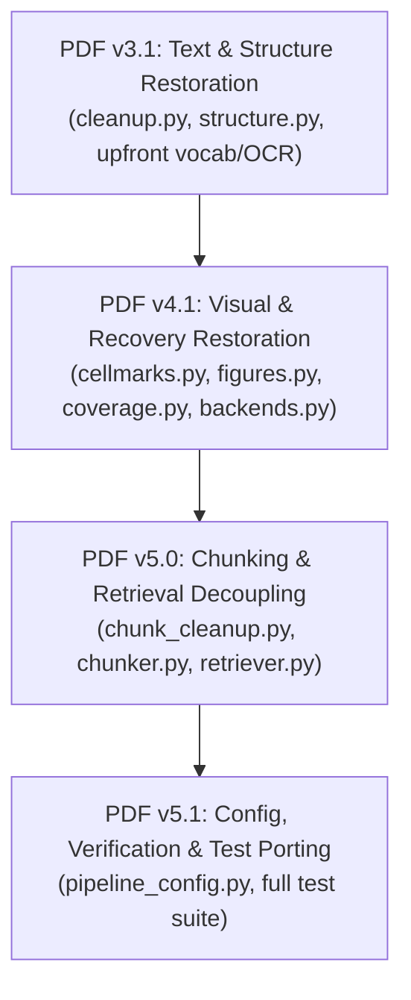

# PDF Parser Production Parity: Version Roadmap (`pdf_imp_versions.md`)

This document outlines the version-by-version delivery plan to bring the modular PDF parser (`core/parsers/pdf/`) up to **100% feature and heuristic parity** with `parser_v1` (v5.2 through v5.9.4) while strictly preserving the clean, decoupled package architecture in `pdf_refactor`.

---

## 🗺️ Version Summary

| Version | Focus | Primary Deliverables | Key Milestones |
| :--- | :--- | :--- | :--- |
| **PDF v3.1** | **Text & Structure Heuristics** | `transforms/cleanup.py` `transforms/structure.py` `parser.py` (scan phase) | • Upfront document vocabulary & OCR gating • Dynamic programming word segmenter (`segment_words`) • Table splitting (side-by-side, subheaders, 2-col ToC) • Heading number & sequence repairs • Cross-page boilerplate demotion & caption binding • Embedded heading splitting |
| **PDF v4.1** | **Visual & Recovery Transforms** | `transforms/cellmarks.py` `transforms/figures.py` `transforms/coverage.py` `backends.py` (lifecycle fix) | • **Lifecycle Fix**: Cellmarks executed on Docling doc *before* markdown export • Image MD5 digest hashing & color ink test (`_is_tick_colour`) • Center-snap tolerance & column/row pitch snapping • Deterministic figure cards with OCR diagram labels/numbers • Line-by-line `SequenceMatcher` in-place text recovery |
| **PDF v5.0** | **Chunking & Retrieval Integrity** | `core/chunk_cleanup.py` `core/chunker.py` `core/retriever.py` | • Restored `core/chunk_cleanup.py` (separator repair, ToC merge, junk drop) • `_MarkdownTableChunkSerializer` (preserves table row integrity & headers) • In-page synthetic heading insertion (eliminates tail orphans) • ChromaDB scalar metadata flattening (`_flatten_meta`) • Semantic search ToC filtering (`content_type != 'toc'`) |
| **PDF v5.1** | **Configuration & Verification** | `core/pipeline_config.py` `tests/parsers/` | • Complete PDF feature flags in `pipeline_config.py` • Porting test suites from `tests/parsing_arch/` (v5.2 through v5.9.4) • End-to-end integration verification across all document formats |

---

## 🔷 PDF v3.1: Text & Structure Heuristic Restoration

**Objective**: Port all advanced text-layer, table-splitting, vocabulary-based space repair, and AST-level structural heuristics from `parser_v1` into the modular transforms.

### 1. Components Touched
- [`core/parsers/pdf/transforms/cleanup.py`](file:///c:/Users/ADMIN/OneDrive/Desktop/Honeywell%20Project/honeywell-project/core/parsers/pdf/transforms/cleanup.py)
- [`core/parsers/pdf/transforms/structure.py`](file:///c:/Users/ADMIN/OneDrive/Desktop/Honeywell%20Project/honeywell-project/core/parsers/pdf/transforms/structure.py)
- [`core/parsers/pdf/parser.py`](file:///c:/Users/ADMIN/OneDrive/Desktop/Honeywell%20Project/honeywell-project/core/parsers/pdf/parser.py)
- [`tests/parsers/test_pdf_structure.py`](file:///c:/Users/ADMIN/OneDrive/Desktop/Honeywell%20Project/honeywell-project/tests/parsers/test_pdf_structure.py)
- [`tests/parsers/test_pdf_cleanup.py`](file:///c:/Users/ADMIN/OneDrive/Desktop/Honeywell%20Project/honeywell-project/tests/parsers/test_pdf_cleanup.py)

### 2. Deliverables
1. **Upfront Document Analysis in `parser.py`**:
   - `build_vocab(page_texts)`: Build document-specific lowercase word frequency counter.
   - Per-page OCR gating: Check text layer length against threshold (`pdf_text_layer_min_chars`) so pages with clean digital text bypass heavy OCR.
2. **Text Normalization in `cleanup.py`**:
   - `segment_words()`: Dynamic programming word segmenter using frequency scoring and length penalties to split glued words.
   - `fix_lost_spaces()`: Vocab-guided space insertion respecting CamelCase identifiers.
   - `collapse_letter_spacing()`: Reassemble spaced-out text (`"R o u n d  1"` -> `"Round 1"`).
   - `rejoin_urls()`: Rejoin URLs broken across whitespace/lines.
   - `clean_markdown_tables()`: Split side-by-side table blocks (`_split_side_by_side`), separate embedded subheaders, and normalize 2-column contents tables.
   - Sequence fixes: `fix_heading_number` (`"6.5. 1"` -> `"6.5.1"`), `repair_heading_sequence`, `renumber_sequence`.
3. **AST Structure Restoration in `structure.py`**:
   - Cross-page boilerplate demotion: Count occurrences per text across distinct pages (`pages_seen_on`), demoting repeating headers/footers to `PARAGRAPH`.
   - `bind_captions()`: Bind floating labels (`"Day 2"`, `"Animal Protein"`) to adjacent tables.
   - `relevel_headings()`: Re-nest unnumbered subheadings beneath parent numbered sections.
   - `dedupe_echoes()`: Blank body paragraphs that duplicate adjacent section headers.
   - `blacklist_headings()`: Blank template headings (`Titelseite`, `GB Version`, `Fig.xy`, `Abb.xy`).
   - `_split_embedded_headings()`: Detect fused heading + paragraph items and split into distinct AST nodes.
   - `_extract_misplaced_number()`: Relocate misplaced section numbers (`"Greasing 6.4"` -> `"6.4 Greasing"`).

### 3. Verification Criteria
- Unit tests pass verifying heading freeze prevention, embedded heading splitting, side-by-side table separation, and vocabulary-guided word segmentation.

---

## 🔷 PDF v4.1: Visual Domain & Coverage Transforms Restoration

**Objective**: Fix the critical cellmarks execution lifecycle, restore visual checkmark detection, generate deterministic figure cards, and restore line-by-line fuzzy coverage recovery.

### 1. Components Touched
- [`core/parsers/pdf/backends.py`](file:///c:/Users/ADMIN/OneDrive/Desktop/Honeywell%20Project/honeywell-project/core/parsers/pdf/backends.py)
- [`core/parsers/pdf/transforms/cellmarks.py`](file:///c:/Users/ADMIN/OneDrive/Desktop/Honeywell%20Project/honeywell-project/core/parsers/pdf/transforms/cellmarks.py)
- [`core/parsers/pdf/transforms/figures.py`](file:///c:/Users/ADMIN/OneDrive/Desktop/Honeywell%20Project/honeywell-project/core/parsers/pdf/transforms/figures.py)
- [`core/parsers/pdf/transforms/coverage.py`](file:///c:/Users/ADMIN/OneDrive/Desktop/Honeywell%20Project/honeywell-project/core/parsers/pdf/transforms/coverage.py)
- [`core/parsers/pdf/parser.py`](file:///c:/Users/ADMIN/OneDrive/Desktop/Honeywell%20Project/honeywell-project/core/parsers/pdf/parser.py)
- [`tests/parsers/test_pdf_cellmarks.py`](file:///c:/Users/ADMIN/OneDrive/Desktop/Honeywell%20Project/honeywell-project/tests/parsers/test_pdf_cellmarks.py)
- [`tests/parsers/test_pdf_coverage.py`](file:///c:/Users/ADMIN/OneDrive/Desktop/Honeywell%20Project/honeywell-project/tests/parsers/test_pdf_coverage.py)

### 2. Deliverables
1. **Lifecycle Correction in `backends.py` & `parser.py`**:
   - `scan_legend(page_texts)` executed upfront in `PdfParser.parse()`.
   - `DoclingTableBackend` invokes `inject_marks(doc, page_fitz, legend)` on the single-page `DoclingDocument` **before** calling `export_to_markdown()`, while cell bounding boxes still exist.
2. **Advanced Cellmarks in `cellmarks.py`**:
   - `_cand_hash()` / `_image_hash()`: Inline image MD5 digest hashing to group repeated icons.
   - `_is_tick_colour()`: Color inspection on non-white ink samples verifying green checkmarks.
   - `_SNAP_TOL` & `_SNAP_PITCH`: Snapping icons to row/col cell centers using median grid axes.
   - `_TEXT_TICK_CHARS` & `_TEXT_CROSS_CHARS`: Normalizing font-based Unicode ticks/crosses to `"Yes"` / `"No"`.
   - Thumbnail column clearing: Detecting image-heavy columns (>80%) and replacing with `[{col_name}: product picture]`.
   - `_apply_dots`: Converting `...` to `"No"` when legend specifies dots = unavailable.
3. **Deterministic Figure Cards in `figures.py`**:
   - `process_pictures()`: PyMuPDF bounding box word clipping to capture diagram labels and part/spec numbers.
   - Card builder: `Figure: ... | Section: ... | Labels: ... | Numbers: ...`.
   - Filters: Exclude images inside tables, small icons (<1000 pt²), and repeated logos (xref count >= 3).
4. **Fuzzy Coverage Safety Net in `coverage.py`**:
   - Line-by-line `SequenceMatcher` scoring (`_best_line`) to repair markdown lines that lost words from the PDF text layer in-place.
   - Prefix preservation (`#`, `-`, `*`) during in-place line repair.
   - Exclusion filters: Never re-add ToC lines, figure labels, or repeating running headers/footers.

### 3. Verification Criteria
- Table test documents with green tick graphics and dot fillers produce clean `"Yes"` / `"No"` markdown cells.
- Dropped text lines from complex diagrams/callouts are restored via in-place repair or `[Recovered text]` blocks.

---

## 🔷 PDF v5.0: Chunking, Chunk Cleanup & Retrieval Decoupling

**Objective**: Restore downstream chunk-level integrity, table chunk serialization, metadata flattening, and semantic search filtering.

### 1. Components Touched
- [`core/chunk_cleanup.py`](file:///c:/Users/ADMIN/OneDrive/Desktop/Honeywell%20Project/honeywell-project/core/chunk_cleanup.py) [RESTORE]
- [`core/chunker.py`](file:///c:/Users/ADMIN/OneDrive/Desktop/Honeywell%20Project/honeywell-project/core/chunker.py)
- [`core/retriever.py`](file:///c:/Users/ADMIN/OneDrive/Desktop/Honeywell%20Project/honeywell-project/core/retriever.py)
- [`tests/unit/test_chunker.py`](file:///c:/Users/ADMIN/OneDrive/Desktop/Honeywell%20Project/honeywell-project/tests/unit/test_chunker.py)

### 2. Deliverables
1. **Restore `core/chunk_cleanup.py`**:
   - Table separator repair: `_collapse_sep_rows`, `_SEP_FRAG_RE` (stripping half-cut separator rows).
   - Dot run suppression: `_strip_dot_runs` (`....`).
   - Junk chunk drop: `_JUNK_CHUNK_RE` and micro-label filtering.
   - ToC chunk consolidation: Tagging `content_type='toc'` and merging scattered ToC chunks into a single compact block.
   - Metadata helpers: `section_id(page, heading_path)` (e.g. `p28:1.2`) and `extract_doc_meta()` (doc number, version, date).
2. **Chunker Enhancements in `core/chunker.py`**:
   - `_MarkdownTableChunkSerializer` with `_MarkdownTableSerializerProvider`: Preserves markdown table row structure during chunking and repeats table header rows across chunk boundaries.
   - `_flatten_meta()`: Flattens list/None metadata (`heading_path`, `page_numbers`) into Chroma-safe scalar strings.
   - In-page synthetic heading placement: Inserts synthetic heading chunks on their own page (`insert_at`) rather than accumulating at the tail of the document.
3. **Retrieval Protection in `core/retriever.py`**:
   - Add `where={"content_type": {"$ne": "toc"}}` filter to exclude ToC summary chunks from semantic query retrieval by default.

### 3. Verification Criteria
- Chunker outputs valid Chroma-compatible metadata with zero list or None values.
- Multi-page tables repeat header rows in consecutive chunks.
- Queries for technical terms return actual document sections rather than Table of Contents chunks.

---

## 🔷 PDF v5.1: Pipeline Configuration, Verification & Final Polish

**Objective**: Add configuration controls to `core/pipeline_config.py`, port regression suites from `tests/parsing_arch/`, and verify end-to-end performance.

### 1. Components Touched
- [`core/pipeline_config.py`](file:///c:/Users/ADMIN/OneDrive/Desktop/Honeywell%20Project/honeywell-project/core/pipeline_config.py)
- [`tests/parsers/`](file:///c:/Users/ADMIN/OneDrive/Desktop/Honeywell%20Project/honeywell-project/tests/parsers)
- [`tests/unit/`](file:///c:/Users/ADMIN/OneDrive/Desktop/Honeywell%20Project/honeywell-project/tests/unit)

### 2. Deliverables
1. **Configuration Exposure**:
   - Expose control parameters in `pipeline_config.py`:
     - `pdf_boilerplate_min_page_repeats` (default: 3)
     - `pdf_text_layer_min_chars` (default: 40)
     - `pdf_ocr_on_text_pages` (default: False)
     - `pdf_v59_cellmarks` (default: True)
     - `pdf_v59_coverage` (default: True)
     - `pdf_v59_toc` (default: True)
     - `pdf_figure_mode` (default: "labels_only")
     - `pdf_coverage_recall_min` (default: 0.90)
     - `pdf_coverage_near_match` (default: 0.75)
2. **Test Suite Migration**:
   - Port key regression tests from `tests/parsing_arch/` (heading freeze, tick graphics, chunk ordering, table splitting) into standard pytest suites in `tests/parsers/`.
3. **End-to-End Verification**:
   - Run complete ingestion and retrieval cycles on sample Honeywell manuals.

---

## 🚀 Execution Summary

Each version is independent, testable, and commit-ready with zero regressions against the existing codebase.
