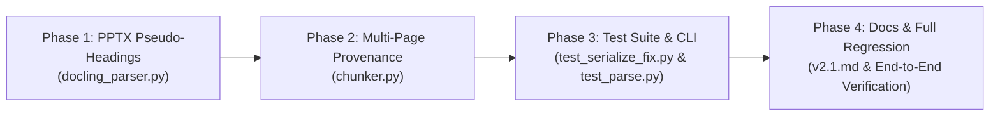

# Phased Implementation & Verification Plan: Porting v2.1 Fixes to `parser_docs` (`v2fix_plan.md`)

This document outlines the phased implementation plan for porting the v2.1 code fixes from `parser_v1` into `parser_docs`.
**Crucial Constraint**: **Zero modification to existing comments and docstrings**. All existing docstrings, section headers, and inline explanations in `parser_docs` remain 100% intact.

---

## Overview of Phases



---

## Phase 1: PPTX Slide Title Boundary Classification

### 1.1 Objective
Fix **Bug A** where Docling misclassifies PPTX text box titles as `DocItemLabel.PARAGRAPH`. Upcast them to `SectionHeaderItem` with label `DocItemLabel.SECTION_HEADER` so `HybridChunker` respects slide titles as hard boundaries.

### 1.2 Target File
- [`core/parsers/docling_parser.py`](file:///c:/Users/ADMIN/OneDrive/Desktop/Honeywell%20Project/honeywell-project/core/parsers/docling_parser.py)

### 1.3 Exact Code Changes
*(Preserving all module docstrings, class docstrings, and existing comments)*

1. **Import `SectionHeaderItem`** (Line 9):
   ```python
   # Before
   from docling_core.types.doc import DocItemLabel, DoclingDocument
   
   # After
   from docling_core.types.doc import DocItemLabel, DoclingDocument, SectionHeaderItem
   ```

2. **Add `_promote_pptx_pseudo_headings()` helper** (Insert after `_inject_picture_descriptions()` around Line 114):
   ```python
   def _promote_pptx_pseudo_headings(doc: DoclingDocument) -> None:
       """Identify and promote plain text pseudo-headings on PPTX slides.
       
       Docling's MsPowerpointDocumentBackend often misclassifies text box titles as
       PARAGRAPH. If a PARAGRAPH is short (<100 chars), does not end in a period,
       and is the first textual item on its page, we safely replace the TextItem
       node with a SectionHeaderItem so HybridChunker respects it as a hard boundary.
       """
       page_first_items = {}
       for item in doc.texts:
           if getattr(item, "prov", None):
               p_no = item.prov[0].page_no
               if p_no not in page_first_items:
                   page_first_items[p_no] = item
                   
       for i, item in enumerate(doc.texts):
           p_no = item.prov[0].page_no if getattr(item, "prov", None) else None
           if p_no and page_first_items.get(p_no) is item:
               if item.label == DocItemLabel.PARAGRAPH:
                   text = getattr(item, "text", "").strip()
                   if text and len(text) < 100 and not text.endswith("."):
                       dump = item.model_dump()
                       dump["label"] = DocItemLabel.SECTION_HEADER
                       new_item = SectionHeaderItem(**dump)
                       doc.texts[i] = new_item
   ```

3. **Call helper in `DoclingParser.parse()`** (Right before `return doc` around Line 157):
   ```python
           if filename.lower().endswith(".pptx"):
               _promote_pptx_pseudo_headings(doc)
   ```

### 1.4 Phase 1 Dedicated Tests
- **Test Class**: `TestBugAFix_PseudoHeadingBoundary` in `tests/parsers/test_serialize_fix.py`
- **Assertions**:
  - Creates a 2-slide PPTX with a 300-word body on Slide 1 (pushing tokenizer to limit) and a short text title "Proposed Outcomes" on Slide 2.
  - Verifies that `HybridChunker` does **not** orphan "Proposed Outcomes" into the preceding chunk and that the slide title appears prepended to Slide 2's bullet content chunk.
- **Execution Command**:
  ```powershell
  pytest tests/parsers/test_serialize_fix.py -k "TestBugAFix" -v
  ```

### 1.5 Phase 1 Acceptance Gate
- `python -m py_compile core/parsers/docling_parser.py` succeeds with zero syntax errors.
- `TestBugAFix_PseudoHeadingBoundary` passes.
- All existing parser tests in `tests/parsers/test_docling.py` pass.

---

## Phase 2: Multi-Page Provenance & Span Tracking

### 2.1 Objective
Fix **Bug B** where `HybridChunker` merging multiple short consecutive slides into a single chunk resulted in metadata recording only the first page number (`page: 13`), losing trailing slides (`page: 14`).

### 2.2 Target File
- [`core/chunker.py`](file:///c:/Users/ADMIN/OneDrive/Desktop/Honeywell%20Project/honeywell-project/core/chunker.py)

### 2.3 Exact Code Changes
*(Preserving all comments such as `# Append relevant metadata`, `# Attempt to extract page number`, `# Identify whether its a picture`, `# Second pass over the raw chunks...`)*

1. **Extract all page numbers in `_split_docling()`** (Lines 133–140):
   ```python
   # Before
               # Attempt to extract page number
               page: int | None = None
               try:
                   prov = chunk.meta.doc_items[0].prov
                   if prov:
                       page = prov[0].page_no
               except (AttributeError, IndexError, TypeError):
                   pass
   
   # After
               # Attempt to extract page number
               pages = sorted(
                   list(
                       set(
                           item.prov[0].page_no
                           for item in getattr(chunk.meta, "doc_items", [])
                           if getattr(item, "prov", None)
                       )
                   )
               )
               page: int | None = pages[0] if pages else None
   ```

2. **Add `page_numbers` field to main chunk metadata** (Line 150):
   ```python
               meta: dict[str, Any] = {
                   "document_id": file_id,
                   "file_id": file_id,
                   "filename": filename,
                   "page": page,
                   "page_numbers": pages,
                   "chunk_index": len(metadatas),
               }
   ```

3. **Add `page_numbers` field to heading fallback metadata** (Line 185):
   ```python
                   metadatas.append(
                       {
                           "document_id": file_id,
                           "file_id": file_id,
                           "filename": filename,
                           "page": page,
                           "page_numbers": [page] if page is not None else [],
                           "chunk_index": len(metadatas),
                       }
                   )
   ```

### 2.4 Phase 2 Dedicated Tests
- **Test Class**: `TestBugBFix_MultiPageMetadata` in `tests/parsers/test_serialize_fix.py`
- **Assertions**:
  - Creates a PPTX with 2 small consecutive slides ("Small Slide A" and "Small Slide B").
  - Verifies that every produced chunk has `page_numbers` as a `list[int]`.
  - Verifies `meta["page"] == meta["page_numbers"][0]` for backward compatibility.
  - Verifies that merged chunks spanning multiple slides contain both `[1, 2]` in `meta["page_numbers"]`.
- **Execution Command**:
  ```powershell
  pytest tests/parsers/test_serialize_fix.py -k "TestBugBFix" -v
  ```

### 2.5 Phase 2 Acceptance Gate
- `python -m py_compile core/chunker.py` succeeds.
- `TestBugBFix_MultiPageMetadata` passes.
- All unit chunker tests in `tests/unit/test_chunker.py` pass.

---

## Phase 3: Test Suite Integration & CLI Utilities

### 3.1 Objective
Incorporate the regression test cases into the test suite and enhance the CLI testing utility with expanded file format support and better chunk inspection formatting.

### 3.2 Target Files
- [`tests/parsers/test_serialize_fix.py`](file:///c:/Users/ADMIN/OneDrive/Desktop/Honeywell%20Project/honeywell-project/tests/parsers/test_serialize_fix.py)
- [`tests/unit/test_parse.py`](file:///c:/Users/ADMIN/OneDrive/Desktop/Honeywell%20Project/honeywell-project/tests/unit/test_parse.py)

### 3.3 Exact Code Changes

1. **Append Test Classes to `tests/parsers/test_serialize_fix.py`**:
   ```python
   # ---------------------------------------------------------------------------
   # Bug A & B Fixes — Pseudo-heading Boundary & Multi-page metadata
   # ---------------------------------------------------------------------------
   
   class TestBugAFix_PseudoHeadingBoundary:
       """Pseudo-headings in PPTX must act as hard boundaries for HybridChunker."""
       
       def test_pseudo_heading_hard_boundary(self):
           """High token load before a slide title should not cause the title to be orphaned."""
           prs = Presentation()
           layouts = prs.slide_layouts
           
           slide1 = prs.slides.add_slide(layouts[0])
           slide1.shapes.title.text = "Slide 1 Title"
           large_text = "word " * 300
           slide1.placeholders[1].text = large_text
           
           slide2 = prs.slides.add_slide(layouts[0])
           slide2.shapes.title.text = "Proposed Outcomes"
           slide2.placeholders[1].text = "Bullet 1\nBullet 2\nBullet 3"
           
           buf = io.BytesIO()
           prs.save(buf)
           file_bytes = buf.getvalue()
           
           from core.parsers.docling_parser import DoclingParser
           from core.chunker import Chunker
           
           doc = DoclingParser().parse(file_bytes, "high_token.pptx")
           chunks, _, _ = Chunker().split(doc, "file-buga", "high_token.pptx")
           
           slide2_chunks = [c for c in chunks if "Bullet 1" in c]
           assert slide2_chunks, "Expected to find slide 2 body in chunks"
           assert "Proposed Outcomes" in slide2_chunks[0], (
               "Slide title 'Proposed Outcomes' was orphaned from its body bullets!"
           )
   
   
   class TestBugBFix_MultiPageMetadata:
       """Chunk metadata must accurately reflect multi-page spans."""
       
       def test_multi_page_metadata(self):
           """Consecutive small slides merged into a single chunk must expose all page numbers."""
           prs = Presentation()
           layouts = prs.slide_layouts
           
           s1 = prs.slides.add_slide(layouts[0])
           s1.shapes.title.text = "Small Slide A"
           
           s2 = prs.slides.add_slide(layouts[0])
           s2.shapes.title.text = "Small Slide B"
           s2.placeholders[1].text = "Some body text here"
           
           buf = io.BytesIO()
           prs.save(buf)
           file_bytes = buf.getvalue()
           
           from core.parsers.docling_parser import DoclingParser
           from core.chunker import Chunker
           
           doc = DoclingParser().parse(file_bytes, "merged.pptx")
           chunks, metadatas, _ = Chunker().split(doc, "file-bugb", "merged.pptx")
           
           for meta in metadatas:
               assert "page" in meta
               assert "page_numbers" in meta
               assert isinstance(meta["page_numbers"], list)
               assert meta["page"] == meta["page_numbers"][0] if meta["page_numbers"] else None
   ```

2. **Update CLI Utility `tests/unit/test_parse.py`**:
   - Update usage string to display `.txt`, `.md`, `.docx`, `.pptx`.
   - Update chunk index banner to `Chunk #{i + 1}/{total}`.
   - Expand preview cutoff from 300 to 800 characters.

### 3.4 Phase 3 Dedicated Tests
- **Test Suite**: Run entire serialize & regression suite.
- **Execution Command**:
  ```powershell
  pytest tests/parsers/test_serialize_fix.py -v
  ```
- **CLI Smoke Test**:
  ```powershell
  python tests/unit/test_parse.py README.md
  ```

### 3.5 Phase 3 Acceptance Gate
- All 15 tests in `test_serialize_fix.py` pass without errors or warnings.

---

## Phase 4: Architecture Documentation & End-to-End Regression Gate

### 4.1 Objective
Record the v2.1 architectural document in `docs/parser/v2.1.md` and execute the entire project test suite to guarantee zero regressions.

### 4.2 Target File
- [`docs/parser/v2.1.md`](file:///c:/Users/ADMIN/OneDrive/Desktop/Honeywell%20Project/honeywell-project/docs/parser/v2.1.md)

### 4.3 Content to Write
Write root cause analysis, architecture design decisions, and testing notes into `docs/parser/v2.1.md`.

### 4.4 Phase 4 Full Regression Test Suite
Execute all test suites across the repository:

| Test Target | Purpose | Command |
|---|---|---|
| **Parser Suite** | Verifies base, text, docling, router, picture description, serialize fixes | `pytest tests/parsers/ -v` |
| **Unit Suite** | Verifies chunker splitting and legacy/hybrid fallback paths | `pytest tests/unit/ -v` |
| **Integration Suite** | Verifies multi-format parsing through `ParserRouter` | `pytest tests/parsers/test_integration.py -v` |
| **All Tests** | Complete regression safety check | `pytest tests/ -v` |

### 4.5 Phase 4 Acceptance Gate
- `docs/parser/v2.1.md` created and properly linked.
- 100% of test suites pass cleanly.
- `git diff` confirms zero comments or docstrings from `parser_docs` were modified or removed.
